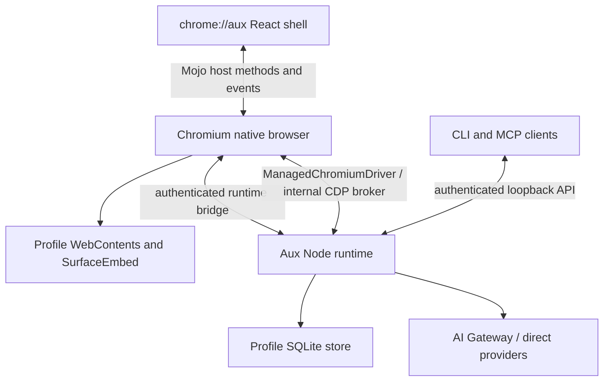

# Aux architecture

The pinned Node runtime requires complete matching ICU data for memory tokenization with `Intl.Segmenter`. Small-ICU's trimmed break-iterator data causes the observed native crash during automatic recall. The integrated packaging correction uses the official pinned ICU78 data, checks its digest before staging, and supplies a fixed app-bundle data path before Node initializes across runtime and packaged helper entrypoints. The isolated segmentation witness, required integrated source check and actual native runtime startup pass. Live first-task acceptance remains unverified and is deferred to the next roadmap round; the configured Gateway credential was rejected.

Aux is a Chromium browser with a trusted `chrome://aux/` React shell and a per-Profile Node runtime. Chromium owns windows, WebContents, tabs, navigation, browser sessions, extensions, history, bookmarks, permissions and the native glass underlay. The shell places page surfaces through SurfaceEmbed and invokes the native host through its packaged Mojo bootstrap.

The native method registry advertises implemented capabilities. Feature entry points depend on those capabilities and user Labs preferences. Runtime-owned chat, task and AI data stream to the shell; browser-owned interactions must remain available independently of runtime readiness.

The runtime’s services coordinate agent execution, snapshots, policy decisions, durable effect receipts, artifacts, memory, routines and external tools. Observed element references are scoped to page and document epochs. Navigation or takeover invalidates earlier authority; Stop and Take over must fence in-flight work. Model and page content remain untrusted.

The loopback API uses a bearer token stored in the Profile runtime directory. CLI and MCP are clients of the same runtime policy rather than alternate authorities. Secrets are held by native secret storage; stored sensitive values currently use protected SQLite adapters.

Aux owns the agent loop; provider SDKs supply model transport rather than an embedded foreign agent runtime. Execution chooses the saved local or cloud target for the original turn; cloud SDK loading is deferred until that target is used. Resource admission uses the original run family, usage limits and reviewed account quote before a money decision. Provider stop acknowledgements settle retained resource receipts; ambiguous creation or cleanup stays unresolved. A typed resource handoff can switch the original family to local execution only after original-window proof and cleanup of every family resource. A provably unsent review retains its exact creation promise but cannot dispatch after the handoff. Shutdown synchronously retires active run proofs, controls and Set schedulers, then joins their original execution tasks and pending review continuations before closing cloud resources and the repository. Accepted leased Space-memory updates join their actual native key writes, durable watermark and lease release before repository closure; closing admission cannot abort an accepted write halfway through publication. Secrets remain in native credential storage.

Projects combine read-only Files/Changes with a reviewed terminal and native Preview. The runtime checks the original window and granted directory identity. Native listeners and isolated guest surfaces require real process/socket ownership and cleanup acknowledgements. Preview admission is internal to the authenticated native bridge, with a synchronous retirement fence at runtime shutdown. The native adapters are compiled and packaged in the current AuxFast app through area 0080. Remaining native walkthroughs are deferred to the next roadmap round.

The legacy JSON planner, Electron migration and standalone drivers have been removed. Backup exports minimize observation artifacts to their retained evidence format; that privacy transformation is separate from database compatibility. Implementation for this roadmap round is consolidated in the current AuxFast app. [ROADMAP.md](ROADMAP.md) preserves the next-round validation targets; [STATUS.md](STATUS.md) records completed delivery and deferred acceptance.

## Browser chrome and chat surfaces

The native window supplies the glass underlay; the renderer keeps the primary page surface painted while transient menus, previews and the left hover sidebar are visible. Vertical address entry is owned by Sidebar/CommandBar; horizontal entry remains in Toolbar. Focus uses the existing command-bar routing and can reveal the vertical sidebar. Pinned tabs and bookmark folders are separate native browser state.

Conversation shares its compact composer between Home Ask and full chat. ChatPreferences exposes the remembered confirmation policy and a Popover containing RunOptions; model, reasoning, execution target and private-task controls retain their existing authority checks. Ask first is the fresh-profile default, Skip confirmation selects Full auto, and Auto remains a Settings choice. Anchored popovers use Dialog focus containment and viewport-clamped placement with a dark theme surface; they deliberately omit the decorative GlassMaterial stack. Only the left sidebar has edge-hover reveal. Interactive controls are excluded from native window-drag regions.

Current build/validation evidence and deferred acceptance live in [STATUS](STATUS.md); the roadmap describes targets rather than proof that every target has passed.

## Governed coding and approval fluidity

Aux’s tool loop owns coding execution. Trusted run configuration captures the
effective mode, project, declarative profile and pinned Aux Packages. Profile
tools and limits narrow parent authority. Durable run grants and current policy
are rechecked at dispatch; exact reviewed batches retain content/action digests
and observed versions. Browser dispatch revalidates and holds the reviewed element after asynchronous preparation. Broader grants remain separate choices; interrupted runs cannot accept new grants.

The filesystem worker implements bounded read/search and versioned file batches
under granted roots and credential exclusions. Protected file receipts retain
before/after content, binary/mode state and individual outcomes. Reconciliation
observes current state without replay; undo checks recorded results before
reversing effects. Temporary writes recheck the original version before replacement. Search inherits permitted project ignore rules when narrowed to a subdirectory. The change UI fetches metadata and lazily opens file diffs, with a final refresh independent of older in-flight requests.

CodingProcesses shares Bash Seatbelt and network admission. It owns detached
process groups, bounded logs/artifacts, policy-revocation monitoring and cleanup
barriers. A launch handshake persists process birth/group identity before command execution; restart cleanup checks that stable identity even when shell exec changes its command text. Recovery never launches a duplicate command. Process reconciliation
can establish an interrupted lifetime while retaining unknown command effects.
Arbitrary commands have no universal file or external-effect undo guarantee.

QuickJS filesystem/process APIs call these governed services without ambient
Node, credential or raw-eval authority. Protected host-call results and cell
sources support deterministic restart replay; transcript compaction does not
redispatch completed effects. Unknown mutation outcomes halt the cell instead of entering its successful replay cache. Bounded coding_state / fs.state pages expose unresolved receipts beyond recent context; failure diagnostics include stopped commands. Local coding is supported first; cloud coding
returns an explicit unsupported capability until its equivalent boundary exists.

Ordinary durable tool suspensions survive crash recovery and normal shutdown.
Shutdown aborts controls and retires executable approval proofs while retaining
the parked call. A trusted answer restores the original Aux loop and rechecks
current native source authority; an earlier action approval is refreshed before
dispatch. Stop still cancels the parked work. Budget, model and cloud-resource
reviews also survive restart through their dedicated Continue/retry actions.
Explicit resume binds the reopened native window to the unchanged run and
rechecks its workspace and source pages; expired native tokens are not reused.
Accepted non-execution answers remain encrypted with the parked call if a budget
pause occurs before consumption. Original cloud resources require exact provider
session identity and stop acknowledgement before local continuation releases
funding. Unknown creation outcomes remain unresolved and never trigger duplicate
creation. Model retry rechecks the same reviewed model's admission bounds.
Only trusted Aux UI can answer human questions or resume these reviews.

Coder cells use isolated Git worktrees with permitted dirty/untracked snapshots,
binary assets and modes. Parent integration uses governed writes and captured
parent versions, with stable review batches of at most 100 file changes. Continuing a partial integration verifies previously confirmed results in bounded worker batches and reviews only the remainder. Incomplete snapshots and conflicts remain inspectable rather
than being force-cleared. Aux Packages contain versioned declarative profiles,
skills, templates and registered-tool workflows; shipped directories are agent
write-protected, and package contents are pinned per run. Native terminals launch
an ordinary shell independently of the Aux agent loop.
