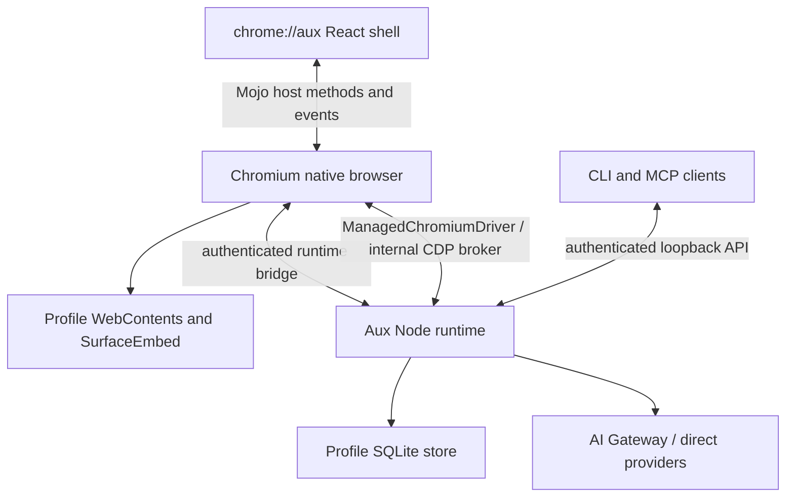

# Aux architecture

The pinned Node runtime requires complete matching ICU data for memory tokenization with `Intl.Segmenter`. Packaging supplies official pinned ICU78 data through a fixed app-bundle path before Node initializes. The earlier small-ICU crash is resolved. Current delivery and acceptance evidence belongs in [STATUS](STATUS.md). The owner resumed full UI parity work on October 16; the current reference ledger records implementation and native acceptance gaps.

Aux is a Chromium browser with a trusted `chrome://aux/` React shell and a per-Profile Node runtime. Chromium owns windows, WebContents, tabs, navigation, browser sessions, extensions, history, bookmarks, permissions and the native glass underlay. The shell places page surfaces through SurfaceEmbed and invokes the native host through its packaged Mojo bootstrap.

Named custom model providers keep their own endpoint, protocol, models, role
defaults and enabled state. Their keys live in separate OS credential entries
bound to the normalized destination and protocol. Settings writes use the current
connection revision; old transports cannot dispatch after a connection change.
Private windows inherit the declared protocol through the credential-only broker.
Custom endpoints use inline tool schemas and refuse HTTP redirects.

Quick Ask mounts the ordinary conversation and draft owner. Its empty form uses a
compact context/send footer; native sizing follows text, context and connection
notices, then expands for the transcript. The recent-downloads popover and full
history share one download projection and action implementation. Native snapshots
and file/transfer controls work without the runtime; the popup does not create
another download history or separate file-action authority.

Bookmarks, History and Clear History route to Chromium's native WebUI pages.
The native bookmark model owns folder navigation, selection, editing, clipboard,
Undo and import/export. Aux branding and appearance apply within those pages.
The normal Profile caches the folders, split-view and Private-window feature
preferences so native bookmark actions honor Labs opt-outs without the runtime.
Invisible empty permanent roots are omitted. Private windows reject persistent
Library destinations without redirecting to a normal window.

SavedPages retains Reading list, Archived tabs and Recently closed as a full-stage
Aux surface. Reading items use native bookmark data and keep row focus when their
read state moves them between groups. Browser chrome remains usable around this
surface, and the replaced combined Library implementation has been removed.

Memory extraction selects exact quotes from a bounded completed report using the
selected connection's fast route. The model has no tools; verified source quotes
enter the existing review inbox before recall. Per-Space queues preserve simultaneous
completions. Original source, policy, model generation and lease are checked before
dispatch and again inside encrypted generation publication. Pause and shutdown
cancel uncommitted extraction while joining accepted native key writes.
Forget all retires and joins active/queued sources before publishing its own
generation, retaining their watermarks so delayed work cannot restore them.

The extraction has its own financial reservation and model invoices. Activity stores
actual extraction tokens/cache/cost, duration and safe failure codes independently
of the source run's usage. Failed attempts remain retryable; completed sources keep
deduplication watermarks. The encrypted generation commits notes and activity
together, with200operations. Recovery and Forget include the records; proposed
quotes are resolved only from remaining notes while their source remains eligible.
Activity and recovery revisions remain separate History views.

Memory Settings uses four routed views under the same retained Space editor:
Overview, History, Context awareness and Configure. Subpage selection changes the
visible controls without discarding the editor draft or changing the selected
Space. History defaults to extraction activity; Recovery revisions retains Restore
through the existing scoped command and original revision ID. Context controls
continue to use separate browsing-title and page-content policies. Model-based
extraction now has source telemetry and safe retries. Episodic retention and the
approved-note index are implemented. Explicit owner-written USER.md/TAXONOMY.md
live in the encrypted workspace record beside the independent root. Normal-window
proof and the workspace revision own every mutation; removal reviews an exact
body/revision and retires derived context and older managed recovery generations.
Search/recall include these bodies within the existing bounded Space budget; they
grant no execution authority. Site and routine documents now share the encrypted
authoritative document model. Dream records its own admitted model operation and
usage, consolidates generated material, and proposes changes to owner-authored
documents. Eligible nonempty sessions are selected within the original Space before
keyset paging. Original source reports are fenced at admission and final publication.
Owner proposal/revert text and encrypted operation receipts publish atomically after
key preparation. Exact generated-document publication identity survives failed key
acknowledgement and failed SQLite restoration; persisted generations determine
confirmed rollback or inspect-only uncertainty, without overwriting later results
or replaying inference. File-change records bind before/after revisions; Revert
refuses later edits. History uses50-entry pages. Unified retrieval preserves heading-aware
chunks, original revision/line ranges and source eligibility through publication;
local semantic ranking has an explicit lexical fallback. Native populated
Dream/diff acceptance remains open in STATUS.

The native method registry advertises implemented capabilities. Feature entry points depend on those capabilities and user Labs preferences. Runtime-owned chat, task and AI data stream to the shell; browser-owned interactions must remain available independently of runtime readiness.

The runtime’s services coordinate agent execution, snapshots, policy decisions, durable effect receipts, artifacts, memory, routines and external tools. Observed element references are scoped to page and document epochs. Navigation or takeover invalidates earlier authority; Stop and Take over must fence in-flight work. Model and page content remain untrusted.

The loopback API uses a bearer token stored in the Profile runtime directory. CLI and MCP are clients of the same runtime policy rather than alternate authorities. Secrets are held by native secret storage; stored sensitive values use protected SQLite adapters. Task evidence JSON is sealed against its actual SQLite sequence and its record identity is checked on read. New writes allocate that sequence with an empty field and seal the body in the same transaction, without writing plaintext. Existing evidence converts once through authenticated resumable keyset progress before AI service admission; completed startup checks only its protected completion marker. Backup and cross-Profile recovery authenticate and translate the marker and row protection together.

The existing agent loop now compacts bounded context without deleting the complete
encrypted transcript. Summary publication binds an exact transcript boundary and
revision; independently retained constraints, task state, sources, approvals and
unresolved effects survive compaction. Steering, cancellation, model/Space changes
and Forget retire the original publication. Queue edits atomically move text,
attachments and source references against the original queued-message revision;
delivery fences further edits. Provider transport and context accounting prepare
the same tool-schema representation, retaining the original runtime validation.

Google Docs rich editing extends the existing revision-bound operation and account
grant. A single reviewed batch may insert text, apply complete-paragraph named
styles/alignment and create flat lists. Empty tables use bounded dimensions and a
sole insertion; filling requires a fresh independent read of actual unmerged cell
indices. No guessed cell offsets or browser-to-API index equivalence is accepted.
Readback verifies complete text, direct styles, unrelated document/tab/section
metadata, lists and table topology; actual targeted formatting is bounded in the
result. Unsupported nested/merged transforms fail before dispatch. A mismatched
sent result remains an uncertain durable intent without a second write.

Selected-original connector uploads use the existing governed tool dispatcher and
durable effect ledger. Notion's supported multipart instructions and Slack's
allocation/upload/completion phases retain original source bytes, account and OAuth
generation, original run/task/Space, and separate reviewable phase intents. Encrypted
schema12 jobs retain private instructions; publication rechecks source eligibility,
and uncertain sends never replay. Forget joins dependent original transfers before
source/key removal. Startup retires actionable jobs through a state index in bounded
batches; protected bodies are authenticated on actual store reads and explicit
backup/recovery, rather than decrypted for every historical job at boot. Restored
write authority stays retired. Cached structural MCP tool proof determines local
availability; it neither grants OAuth authority nor probes credentials/network during
model preparation. Dispatch retains fresh authenticated provider checks.

Native address acceptance retires its original foreground overlay through the
ordinary shell path. Window, route, view and subsequent editor-interaction ownership
prevent a late reply from dismissing newer work. Background navigation does not
close Settings. Final desktop-context shutdown synchronously closes admission, joins
original attachment/start and serialized operations, then stops capture and closes
recall. A permanently closed original RpcChannel proves the native disconnect path
owns producer retirement; this exception applies only to final shutdown. Live pause
and Forget still require the actual stop acknowledgement and retain failures.

Selected-app desktop context is a separate encrypted local source service, off by
default. Ordinary Memory enablement grants no desktop access. Native accessibility
text and separately permitted local OCR retain explicit app selection, original
consent/generation and window provenance, with14-day retention. Pause, app removal,
permission changes, lock and Forget retire affected captures and derived model
work; no raw-keystroke path exists. This does not grant Quick Ask cross-window
page authority: unsupported live browser choices use Open in Aux with the same
ordinary draft and admitted attachment ownership.

Aux owns the agent loop; provider SDKs supply model transport rather than an embedded foreign agent runtime. Execution chooses the saved local or cloud target for the original turn; cloud SDK loading is deferred until that target is used. Resource admission uses the original run family, usage limits and reviewed account quote before a money decision. Provider stop acknowledgements settle retained resource receipts; ambiguous creation or cleanup stays unresolved. A typed resource handoff can switch the original family to local execution only after original-window proof and cleanup of every family resource. A provably unsent review retains its exact creation promise but cannot dispatch after the handoff. Shutdown synchronously retires active run proofs, controls and Set schedulers, then joins their original execution tasks and pending review continuations before closing cloud resources and the repository. Accepted leased Space-memory updates join their actual native key writes, durable watermark and lease release before repository closure; closing admission cannot abort an accepted write halfway through publication. Secrets remain in native credential storage.

Projects combine read-only Files/Changes with a reviewed terminal and native Preview. The runtime checks the original window and granted directory identity. Native listeners and isolated guest surfaces require real process/socket ownership and cleanup acknowledgements. Preview admission is internal to the authenticated native bridge, with a synchronous retirement fence at runtime shutdown. Native area 0096 adds cloud Preview with original VM/process/listener proof. Human Preview and Undo use the retained original Session and actual native window independently of agent dispatch; they never create or resume a VM. Successful completion transfers a background server's monitor and cancellation ownership before dispatch retires. Retention commits only with durable completion and keeps the original funding expiry; Stop, window retirement, policy/account changes and unknown process outcomes close the original Session. Native capability publication must register the concrete asynchronous handler, and Preview must receive the original native window context. The frozen pre-consolidation area 0034 repaired omissions in those registrations and routes. The runtime-only launcher checks the compiled ABI before staging runtime changes. Actual cloud acceptance remains separate from source checks and compilation.

The legacy JSON planner, Electron migration and standalone drivers have been removed. Backup exports minimize observation artifacts to retained evidence. [ROADMAP](ROADMAP.md) and [the execution graph](ROADMAP-EXECUTION-GRAPH.md) preserve the remaining work; [STATUS](STATUS.md) distinguishes integrated source from built and observed native behavior.

Native socket events replace periodic bridge polling. Chromium owns background tab discarding and native bookmark identities, so human browser controls do not require Node. Model context is a bounded projection of the complete durable transcript. Exact capture references bind selected saved articles; relevant excerpts use the remaining provider input budget after required plans, receipts and images. Automatic recall warms cooperatively and enters only ephemeral provider messages. It does not append plaintext recall into the durable transcript.

Conversation documents preserve complete metadata collections with separately encrypted immutable bodies and previews. Accepted turns store exact chat/attachment/content-hash references. Provider requests resolve relevant excerpts one body at a time under the remaining input budget and original cancellation/source fences; raw document context is not copied into new durable run configurations. Used sources survive removal for exact retries and branches; source-chat deletion and Forget retire the corresponding bodies and references. Historical inline collections convert atomically on first access rather than blocking startup with a full scan.

Skills, occurrence history and inbox results use keyset pages. Scheduling traverses every eligible definition in cooperative batches, re-reading current definitions before dispatch. Shutdown synchronously closes scheduler admission and joins the original sweep, including any accepted launch receipt, before repository closure. Automatic command-bar routing selects the visible Ask/Search intent synchronously; Enter executes that choice without a provider round trip.

Embedded tabs own their native input acknowledgement through their actual child document, widget and connector lifetime. Physical input follows Chromium's actual queued pointer target or focused keyboard target before Take over; navigation, connector retirement and native root retirement clear the original proof. The frozen pre-consolidation areas 0035–0036 moved human Find/Zoom to browser-owned services. These source boundaries require the current native compile and changed-flow observations recorded in STATUS.

Private AI belongs to the actual Chromium off-the-record Profile. Authenticated native capability proof admits its UUID, in-memory SQLite and owner-only temporary files. The native Profile owns worker retirement and temporary cleanup; its existing private tabs retain signed-in sessions and exact document authority. Normal Temporary tasks remain isolated signed-out tabs. The authenticated native broker forwards only strict credential, budget and cloud realms to the original normal runtime. The selected provider descriptor and short-lived access lease inherit saved/environment/OAuth connections; refresh tokens and private content stay with their original owners. Original provider revocation aborts inherited private transports. Private daily/monthly costs use opaque aggregate leases without prompts, URLs, run IDs or provider identifiers. Basic private source-backed answer delivery, Stop and last-window retirement have passed a native walkthrough. Provider revocation, explicit export and shared-account/cloud acceptance remain separate pending flows.

Cloud coding captures the original VM, Session and command identities. Local and cloud file/process receipts share the encrypted ledger; remote receipts never become local PIDs or filesystem paths. Uncertain dispatch cannot replay, and background commands retain network policy until confirmed retirement. Cloud Preview and human Changes/Logs/Stop/Undo routing are integrated. Process metadata contains bounded summaries; encrypted UTF-8 chunks supply cursor-based history without SDK access. Schema-4 startup conversion removes the replaced embedded log field atomically after original key admission. Cloud code-mode parity and actual cloud workflow acceptance remain pending.

Memory restoration reads a bounded before/after approved-note preview, then binds
the explicit write to that generation. Concurrent edits and Forget invalidate the
write; pause and lease ownership are checked again at publication after original
native key writes. Window/Space retirement and Memory events clear preview content
and invalidate pending reads. Restoring preserves the prior current notes as a
restorable encrypted revision. The root owner document is independent.

Channel transport implementations own Slack envelope ACKs, Telegram offsets and
Discord heartbeat/resume state. They admit authenticated provider identities and
await durable receipt before acknowledgement. Schema 6 separately protects channel
connections, peers, thread mappings, inputs, outbox receipts and transport cursors.
Per-connection keyed indexes live outside ciphertext; their random keys remain
inside the encrypted connection envelope and survive reviewed Profile recovery.
Interrupted sends remain unknown, and a delivery ID cannot change its recipient.
Original normal-window proof owns channel configuration and native secret writes;
credentials never enter connection rows or renderer status. Authenticated provider
user IDs map to local pairing records and revocable external workspace authority.
Each provider thread owns an ordinary task/chat. Remote turns retain that authority
through initial runs and queued/steered follow-ups, using normal approvals and
session retirement. Blocking, disablement, changed configuration and shutdown
retire original work and join admitted producers. Network reconnects preserve
pairing; identity/authentication faults require local attention. Replies remain
bound to their original task, run, authority and provider destination. Unknown
acceptance requires concrete local review before retrying. Cross-Profile recovery
disables connections, rotates configuration revisions, clears resume cursors and
retires pairing authority while preserving protected history and opaque indexes.
Settings uses shared fields, dialogs, native selects, switches and command dispatch.
Live messenger and native visual acceptance remain open in STATUS.

## Immutable documents and native receipt exports

Native file intake captures the original selected file once and hashes its bytes.
A dedicated utility extracts PDF with PDFium and DOCX with bounded ZIP/XML parsing;
UTF-8 text stays explicit. The utility receives captured bytes, rather than a path,
and admits neither network loading nor document scripts. Extraction, read and
release retain the original window, runtime generation and cancellation identity.
A release joins the corresponding pending read before ownership is retired.
Formats come from bytes and package structure; filenames are display labels.
The isolated utility also performs bounded PDF render/text/fields/fill/merge/split/
rotate jobs over immutable admitted originals. Operation receipts retain source
hashes, page mappings and saved outputs. Forms require supported AcroForm types
and verification of both saved values and rendered appearances; encrypted, XFA,
signature and script-dependent mutation paths are refused. Original files remain
unchanged. Reference-image generation similarly uses admitted MIME-verified image
artifacts and current provider capabilities, with existing reservations, receipts
and cancellation ownership.

One DocumentSnapshots service owns encrypted schema-5 manifests and bounded text
segments. Conversation attachments and historical task evidence share its strict
import/read interfaces. Cursors bind the original snapshot and hash. Publication
is atomic after original chat/task ownership checks; preview and model retrieval
read relevant bounded segments. Backup/recovery authenticates the inventory, and
Forget removes these derivatives. Old valid inline text converts on access.

Receipt Save streams the exact selected revision and complete captured evidence
to a temporary file, without creating a public or durable artifact row. Native
save claims bind the original window token and claim ID. A retained file descriptor
supports the accepted Save if Node later retires; streaming copy checks byte count
and hash before destination replacement. Cancellation, original document/window
retirement and runtime shutdown join writers and remove unclaimed files. Claimed
files stay owned until native release. Startup scrubs only the runtime-owned export
subdirectory. Explicitly saved destinations remain user files.

Saved-document citations use a distinct typed source/locator/quote contract.
Only excerpts admitted by successful model steps acquire protected source-relative
recipes in encrypted run config; raw snippets are not copied there. Restart
verification decrypts only the cited segment and validates its captured identity,
span and digest. Public Run responses and activity events exclude these internal
recipes before journaling. Verified transcript citations carry a server-created,
owner/manifest-bound cursor that opens the exact saved section. Document citations
cannot reconcile browser effects.

Native stored-image Copy reuses the original artifact export claim without sending
encoded bodies through the renderer. Original document/window proof, a retained
file read, isolated decode and a clipboard sequence witness govern publication.
It preserves a newer human clipboard, retains private-Profile provenance, and
retires its exact decoder/claim on cancellation. Copy has its own precise native
method capability and does not disable existing Save. The clean ea9a82ec application compiles this implementation and advertises278
host methods. Native stored-image Copy itself still requires its specific current
interaction observation; capability count is not behavior acceptance.

## Browser chrome and chat surfaces

The native window supplies the glass underlay, with a clear native tint in both appearances. Docked sidebars and horizontal browser chrome share the renderer's optional sidebar tint; Home and chats use their independent content opacity. The renderer keeps the primary page surface painted while transient menus, previews and the left hover sidebar are visible. Vertical address entry is owned by Sidebar/CommandBar; horizontal entry remains in Toolbar. Fresh Profiles start with the sidebar expanded and the 42 px toolbar visible; saved collapse and auto-hide choices are preserved. Auto-hide requires both the saved preference and its Labs feature, while Minimal UI can still hide the toolbar independently. Focus uses the existing command-bar routing and can reveal the vertical sidebar. Pinned tabs and bookmark folders are separate native browser state.

Conversation shares its compact composer between Home Ask and full chat. ChatPreferences exposes the remembered confirmation policy and one More menu containing RunOptions and feature actions; model, reasoning, execution target and private-task controls retain their existing authority checks. Ask first is the fresh-profile default, Skip confirmation selects Full auto, and Auto remains a Settings choice. Anchored popovers use Dialog focus containment and viewport-clamped placement with the shared popup material: an 80% themed backing, 8px blur, inner/outer rings and compact shadow, plus solid accessibility fallbacks. Floating popups do not mount the window-glass decorative layer stack. Only the left sidebar has edge-hover reveal. Interactive controls are excluded from native window-drag regions.

The searchable composer model menu is presentation over RunOptions' existing
catalog; it does not create a second provider or admission path. Browser-object
search also reuses the command bar's providers, with a compact presentation that
accepts only a selected browser object or chat. Its empty Enter never starts a
navigation or agent request.

An unsaved normal-window rail draft retains its displayed active-page context
when expanded. Quick Ask and explicit no-context choices remain separate. Reader
admission rejects failed/blank website documents before native preparation;
implicit unavailable tabs are omitted, while explicit and recovered selections
retain strict failure semantics.

Held Ctrl-Tab uses an ephemeral renderer selection over the current Space's
native tabs. Native chord forwarding distinguishes a physical Control-Tab from
menu commands and alternate shortcuts. The ordinary preview API supplies visible
cards; no history or thumbnails are persisted by the switcher. Control release
activates the retained selection only while its window, Space and original
selection remain current. Dialog composition keeps the underlying page painted.
Sidebar visibility/count and tab layout preferences use the existing settings
service, while native tab indices and saved organization preserve manual order.

Current build/validation evidence and deferred acceptance live in [STATUS](STATUS.md); the roadmap describes targets rather than proof that every target has passed.

## Governed coding and approval fluidity

Aux’s tool loop owns coding execution. Trusted run configuration captures the
effective mode, project, declarative profile and pinned Aux Packages. Profile
tools and limits narrow parent authority. Durable run grants and current policy
are rechecked at dispatch; exact reviewed batches retain content/action digests
and observed versions. Browser dispatch revalidates and holds the reviewed element after asynchronous preparation. Broader grants remain separate choices; interrupted runs cannot accept new grants.

The filesystem worker implements bounded read/search and versioned file batches
under granted roots and credential exclusions. Protected file receipts retain
before/after content, binary/mode state and individual outcomes. Reconciliation
observes current state without replay; undo checks recorded results before
reversing effects. Temporary writes recheck the original version before replacement. Search inherits permitted project ignore rules when narrowed to a subdirectory. The change UI fetches metadata and lazily opens file diffs, with a final refresh independent of older in-flight requests.

CodingProcesses shares Bash Seatbelt and network admission. It owns detached
process groups, bounded logs/artifacts, policy-revocation monitoring and cleanup
barriers. A launch handshake persists process birth/group identity before command execution; restart cleanup checks that stable identity even when shell exec changes its command text. Recovery never launches a duplicate command. Process reconciliation
can establish an interrupted lifetime while retaining unknown command effects.
Arbitrary commands have no universal file or external-effect undo guarantee.

QuickJS filesystem/process APIs call these governed services without ambient
Node, credential or raw-eval authority. Protected host-call results and cell
sources support deterministic restart replay; transcript compaction does not
redispatch completed effects. Unknown mutation outcomes halt the cell instead of entering its successful replay cache. Bounded coding_state / fs.state pages expose unresolved receipts beyond recent context; failure diagnostics include stopped commands. Local coding is supported first; cloud coding
returns an explicit unsupported capability until its equivalent boundary exists.

Ordinary durable tool suspensions survive crash recovery and normal shutdown.
Shutdown aborts controls and retires executable approval proofs while retaining
the parked call. A trusted answer restores the original Aux loop and rechecks
current native source authority; an earlier action approval is refreshed before
dispatch. Stop still cancels the parked work. Budget, model and cloud-resource
reviews also survive restart through their dedicated Continue/retry actions.
Explicit resume binds the reopened native window to the unchanged run and
rechecks its workspace and source pages; expired native tokens are not reused.
Accepted non-execution answers remain encrypted with the parked call if a budget
pause occurs before consumption. Original cloud resources require exact provider
session identity and stop acknowledgement before local continuation releases
funding. Unknown creation outcomes remain unresolved and never trigger duplicate
creation. Model retry rechecks the same reviewed model's admission bounds.
Only trusted Aux UI can answer human questions or resume these reviews.

Coder cells use isolated Git worktrees with permitted dirty/untracked snapshots,
binary assets and modes. Parent integration uses governed writes and captured
parent versions, with stable review batches of at most 100 file changes. Continuing a partial integration verifies previously confirmed results in bounded worker batches and reviews only the remainder. Incomplete snapshots and conflicts remain inspectable rather
than being force-cleared. Aux Packages contain versioned declarative profiles,
skills, templates and registered-tool workflows; shipped directories are agent
write-protected, and package contents are pinned per run. Native terminals launch
an ordinary shell independently of the Aux agent loop.

An ordinary question answer retains an unchanged source selection and revalidates its native window, Space and document identity; it does not reopen a person reader beneath the run's existing page guard. On terminal borrowed-page cleanup, native admission records the exact returned document for the fixed person reader. New task registration clears that proof. The document's network tombstone remains, so completed-run readability does not restore late agent network authority. Parked tool results enter the transcript before newly refreshed context, preserving valid model tool-call pairing across continuation.

Ordinary restored tabs load from Chromium’s cached navigation state on initial observation and explicit activation. An interrupted first restore is rearmed only when its document is still empty, its saved entry remains restored, and native egress does not protect the document; runtime-owned pages are excluded. Isolation retirement owns its page identity across observer destruction. An unavailable restored source produces a typed stale-source result and keeps the reply draft; explicit mentions and persisted run sources remain strict.

Trusted header filtering receives the actual network endpoint, or for a pure cache hit the valid endpoint persisted with that exact cached response. Chromium’s cache transaction has no current socket in the latter case. Missing or malformed cached metadata still fails the existing semantic admission; no address is invented and no filter is bypassed.

Native History and download dismissal use the original browser Profile directly. Download dismissal retains file bytes and live transfer ownership; ordered updates prevent stale snapshots from restoring dismissed completed rows. Space presentation is native browser state, while workspace identity comes only from authenticated runtime mappings. Tracker exceptions share the existing durable native blocking snapshot. Downloaded source updates carry the original policy generation and controls; they cannot overwrite a later human change. Browser exception controls remain available without Node.

Configured model destinations retain the original account, connection revision, run and cancellation checks. Managed restrictions, explicit policy and handoffs apply before the default model-admission decision. A genuinely unsent model request can park through its own continuation; it is not represented by an invented tool call. Stop retires that continuation with the original run.

## Settings design ownership

Settings uses the shared spacing, radius, typography and control-size tokens in
`apps/shell/src/tokens.css`. `settings/controls.css` owns Settings buttons and form
layout. Startup-loaded `styles/select.css` styles single-choice native Chromium
controls throughout the shell using `appearance: base-select`; Settings loading
does not change picker behavior. `styles/glass.css` applies the same popup material
and accessibility fallbacks to native pickers and anchored menus. Native selects
retain labels, keyboard/typeahead, forms, values and change events. Listboxes are
excluded from the dropdown treatment. Parent menus leave open native pickers in
charge of keyboard input and the first Escape; select typeahead does not move
focus into the parent menu. Composer triggers share chevron sizing and label gaps.
Status badges and timeline chips share pill geometry in styles/primitives.css; their
individual selectors own only tone or content-specific behavior. Page/dialog title
tokens scale with Interface text. Keep native
select keyboard behavior and use the shared focus/dismissal handling.

Use `SettingsField` for searchable labeled rows, `SettingsGroup` or `settings-card`
for grouped surfaces, and `SettingsDialogControl` for editors. `SettingsField`
provides `surface="plain"` for unboxed sections and `layout="feature"` for the shared
illustrated feature card used by CLI, Quick Ask and Selection & Capture. Do not duplicate card
fills, borders or select geometry in page styles: translucent nested fills compound
and drift between themes. Page CSS should describe layout unique to that page.
Add semantic tokens only for a distinct reusable role; reuse existing scale tokens
for ordinary spacing and sizes. Reference-specific geometry may remain explicit
when it is genuinely unique.

Settings chrome, canvas and cards have separate opaque semantic colors. Home/chat
uses `--content-canvas` under the existing content-opacity setting; do not stack
another opaque conversation fill over it. Native page slots remain transparent.
The Settings toolbar reads the section title from the Settings route owner.

Shared `Dialog` portals retain native focus containment and dismissal. Their
position and backdrop bounds follow `.main-col > .main`, observed for resizing,
so the browser sidebar and toolbar remain visually outside the modal content
area. Anchored Menu and Popover surfaces retain their own placement. New dialogs
should use this shared shell rather than calculating sidebar offsets independently.

Composer controls share one trigger recipe and chevron across menus and native
selects. Full-width context controls and model/actions wrap as groups. The rail uses compact confirmation/project triggers, flexible model labels and one More menu beneath a persistent writing area. Unsaved rail drafts show the current website by default; explicit context selections remain authoritative. The full
conversation portals its title and actions into the shared window toolbar; overlay
ownership keeps Settings and the active chat from competing for that slot.
Extension import reuses the existing reviewed importer with an extension-only
category filter and loads its editor only on demand.

Settings editors with asynchronously loaded fields transfer initial focus when the
first visible editable field becomes available, excluding closed disclosures. Keyboard/pointer interaction cancels this
handoff. External-agent connection drafts stay in one active Settings/window
lifetime; pending mutations lock client/scope selection and retired results cannot
install credentials into a replacement editor. Cloud account status has an explicit
retry without dispatching configuration before its revision is known.

Native tab catalog history flags own ordinary browser Back/Forward availability;
late runtime full-page and partial events cannot replace those flags. Runtime-only
pages retain their own navigation state until a catalog is available.

Quick Ask's trusted `quickAskLayout` host method resizes only the controller's
current compact window. The renderer measures draft height outside the flex layout,
deduplicates requests and retires observers with the window. Native code clamps the
draft range and keeps both draft/conversation bounds within the current display.
Editors mount only while open; their section supplies active state to retire them
when navigating away. Selection action drafts and save ownership stay in the
section, so closing an action editor does not discard the unsaved draft. Skills
and MCP keep visited tab content mounted, while search waits for its destination
panel to become visible before focusing it. Feature Settings mounts receive active
state for the same lifecycle contract.

Settings editors share regular/wide width tokens and `settings-editor-fields` /
`settings-editor-actions` layout primitives. New Selection actions use the dialog's
initial-open state; the parent retains unsaved action drafts. Cloud account setup
owns its credential draft inside the mounted editor, clearing it on dismissal.
Selection and Night shift save owners recognize an exact pending broadcast before
the request ACK without treating it as another window's edit. This does not admit
unrelated saved revisions or revive retired window/Private owners; success still
requires the original command acknowledgement.

Primary buttons use neutral semantic foreground/background tokens in both themes,
matching the reference's primary control role. Brand/link/selection accents remain
separate. Regular dialogs are384px and wide setup dialogs512px; fields can use the
shared inline-label layout, which stacks within narrow editor containers.
