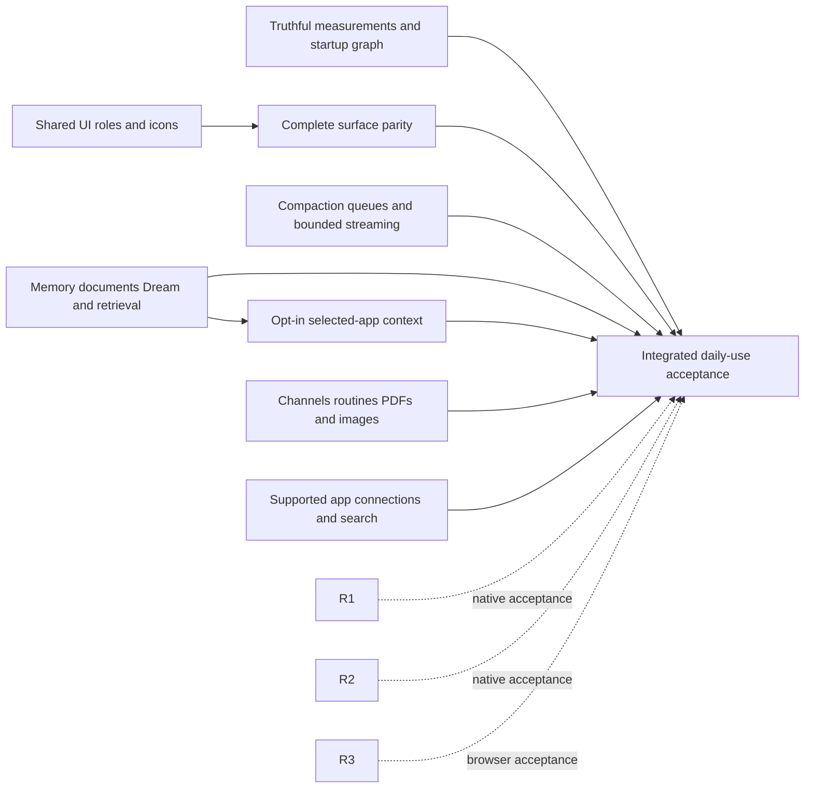
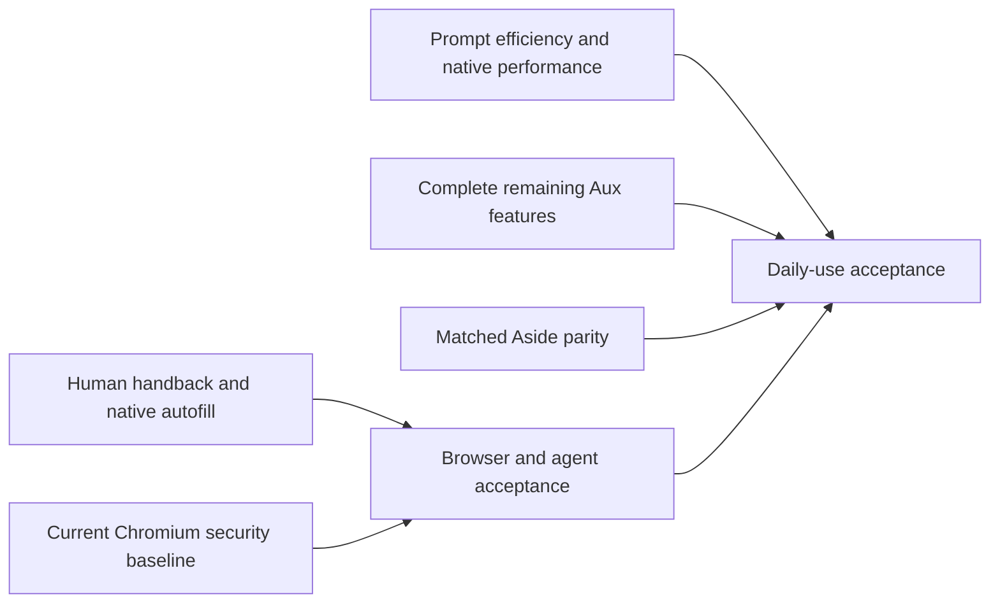
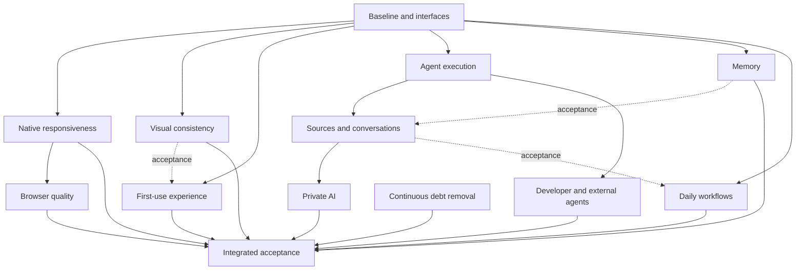

# Aux competitive execution graph

## October 17 complete Aside adoption — executing

The owner approved and requested execution of [the adoption specification](design/aside-adoption.md).
Starting source is clean local main `ce4b6a69c`. Existing R1–R6/RF acceptance
requirements below remain open; this program adds outcomes rather than retiring
their unfinished gates. Initial native owner 19445/app 19611 and disposable Profile `aux-dev-BWXBny`
retired normally. The next native candidate must use the matching 155 checkout
and the existing launcher; never clear an active lock.

Solid edges are implementation/integration prerequisites. Dashed edges preserve
the earlier acceptance gates. A3 uses A2's shared UI vocabulary. A6 uses A5's
source identity, encrypted retention and retrieval. A4/A7/A8 can be implemented
independently against coordinated contracts; their native acceptance uses the
single build/launch owner. No completion percentage or unmeasured timing is implied.

| Outcome | State                          | Implementation and acceptance                                                                                                                                                                                                |
| ------- | ------------------------------ | ---------------------------------------------------------------------------------------------------------------------------------------------------------------------------------------------------------------------------- |
| A1      | active                         | Correct boot-root/preload bytes and positive/zero/unknown cache usage; remove broad startup schemas; bounded idle prefetch. Verify fixtures and actual production bytes before claiming improvement.                         |
| A2      | active                         | Reference semantic tokens, 8px popup glass, distinct solid dialog/tooltip/search roles, exact controls, drag switches and utility glyphs. Focused interaction checks plus native appearance remain separate.                 |
| A3      | active                         | Home, single-scroll Settings, narrow model submenus, shared chat cards, Memory tree, chrome, libraries and every captured surface/state. Current native comparison is required.                                              |
| A4      | active                         | Durable revision-bound compaction/context UI, queue reorder and bounded streams/native asynchronous dispatch. Preserve unresolved effects, cancellation and exact owners.                                                    |
| A5      | active                         | Authoritative site/routine documents, heading-aware multi-query retrieval, Dream/diffs/revert, retention/Forget/recovery. Owner documents receive proposals rather than automatic rewrites.                                  |
| A6      | active                         | Separate off-by-default macOS selected-app visible-text/selection capture; local OCR separately enabled; no raw-key recording; explicit permissions, pause, 14-day retention and Forget.                                     |
| A7      | active                         | Channel commands/attachments/voice, semantic routine suggestions, seven isolated PDF jobs, reference-image generation and masked capture fallback. Real artifacts/receipts and partial failures required.                    |
| A8      | active                         | Shared account primitives, Google REST, Notion/eligible Slack MCP, X REST, governed LinkedIn/browser paths and structured Gateway/image search. Registrations and actual granted capabilities remain explicit prerequisites. |
| A9      | waiting on integrated outcomes | Current 155 crash/browser acceptance, all reference surfaces in matched themes/widths/states, matching-stock perf and default-route 20-task smoke at least18/20. No source-only completion.                                  |

### Owner-requested stopping checkpoint — October 18

Batch6 is integrated through `c54330aab`; [evidence](evidence/aside-parallel-integration-batch6-2026-10-18.json)
records its check (6,188 pass/one failure; targeted9/9 rerun passes), exact
native/source distinction and resume gates. The full check is not green; the
intermittent title assertion has no established cause. No new build or
campaign starts before handback. The tables below retain earlier batch history;
this checkpoint and STATUS supersede their old active/pending build descriptions.

| Remaining gate | Owner | Evidence / next step |
| --- | --- | --- |
| Batch6 Forget and Project glyph | AI/UI + root | Integrated187c/843; focused79/13 cases. Native staging and changed-flow observation pending. |
| Stock command-input timing | Tools + root | Stock3D build0; ten fixture documents and tab pair pass, then command presentation absent. Bounded source investigation preserved separately. |
| Paired performance | Root | 0 qualified pairs. c543 shared1280×800 control needs native observation, then complete original target campaign with quiet resources. |
| UI and real-user behavior | UI + root | Full192-reference/theme/narrow/accessibility coverage and current final-candidate20-task smoke remain open. |
| AI lifecycle | AI + root | Long successful compaction, populated Dream/diff/revert, active Forget/recovery and queue races need native proof. |
| Tools and connected apps | Tools + root | Earlier native PDF/audio evidence and current fixtures; fresh image/channel/account tests and explicit OAuth setup remain. |
| Crash and browser readiness | Root | Original exact crash UUID unavailable; unresolved. Broad current-source browser acceptance remains open. |

### Current implementation owners — October 18

The owner authorized three implementation agents and one integrator. Each lane
starts at `0a5c27653` in its own detached worktree; older dirty worktrees remain
untouched. Native performance has priority: lanes review source only until the
integrator sends `PERF_RESOURCE_RELEASED`. No competing installs/builds/heavy tests
run during timed samples. Each lane delivers fixes, focused checks and a small
requirement/evidence matrix; the integrator runs one full check per coherent batch.

| Owner                                    | Worktree                           | Concrete deliverable and acceptance                                                                                                                                                                                                                                                                                                                                                                                                                                                     |
| ---------------------------------------- | ---------------------------------- | --------------------------------------------------------------------------------------------------------------------------------------------------------------------------------------------------------------------------------------------------------------------------------------------------------------------------------------------------------------------------------------------------------------------------------------------------------------------------------------- |
| `/root/ui_audit` — UI                    | `/tmp/aux-ui-final-0a5c27653`      | Reference-backed theme/select placement, narrow menus/layouts and keyboard/state fixes in renderer settings/shared controls. Preserve native input/Aux identity; focused regressions plus exact references. Native parity remains integrator-owned.                                                                                                                                                                                                                                     |
| `/root/ai_data_final` — AI/data          | `/tmp/aux-ai-data-final-0a5c27653` | Complete compaction/queue/Memory/Dream/Forget/recovery gaps in runtime services/API/loop and focused tests, with exact boundaries, cancellation and owner/revision proofs. Rebuild isolated runtime dist first.                                                                                                                                                                                                                                                                         |
| `/root/aside_logic` — tools/integrations | `/tmp/aux-tools-final-0a5c27653`   | Complete PDF/image/channel/account/adapter gaps with artifact/authority/partial-failure fixtures; distinguish native/live output proof from mocks. OAuth registrations remain explicit prerequisites.                                                                                                                                                                                                                                                                                   |
| `/root` — integrator                     | local `main`                       | Native builder/launcher ownership, current GUI/reference comparisons, crash investigation, paired performance and batch integration/full checks. Currentcd76 manual smoke20/20 is bounded deterministic fixture evidence; earlier334 result remains historical. Currentcd76 native Routines geometry, narrow model-menu states and runtime normal retirement forced0/exit0 are observed; prior3868 failures are retained. Performance and transient navigation/new-tab focus stay open. |

Latest acceptance ledger (implementation is separate from native/live proof):

| Remaining requirement                                            | Owner          | Latest evidence / next gate                                                                                                                                                                                          |
| ---------------------------------------------------------------- | -------------- | -------------------------------------------------------------------------------------------------------------------------------------------------------------------------------------------------------------------- |
| Complete reference, themes, narrow and keyboard states           | UI + root      | Currentcd76 native Routines/model-menu observations; Home Cmd-L native24a case passes. Native Control-release sequence observed on24a; remaining192-reference/accessibility coverage pending.                             |
| Long compaction, queue races, Dream/diff/revert, Forget/recovery | AI/data + root | Integrated source/fixtures and batch5 full check6187; earliercd76 native smoke20/20. Populated/long-running native lifecycle acceptance remains open.                                                                    |
| PDFs/images/channels/connected applications                      | Tools + root   | Actual earlier native PDF output evidence and current focused fixtures; latest Google/MCP/admission regressions integrated. Registered-account/live-output checks remain explicit, with no simulated registrations.  |
| Correct paired performance                                       | Root + tools   | Ten actual fixture documents prepare;0qualified paired samples. Actual Aux AppKit feed compiled/diagnostic signals pass. Matching stock88 diagnostic misses tab pair after10fixtures; bounded stock ingress investigation.0qualified paired samples.                       |
| Native Control-release ownership                                 | UI + root      | Chromium handled-key suppression proven by source/existing fixture; renderer literal-release focused tests pass. Consolidated/build24a; complete modifier sequence dismisses preview and activates expected tab. Wider ownership/keyboard acceptance remains open.                                   |
| Original155crash                                                 | Root           | Exact olddump decoded; matching framework UUID unavailable. Currentcd76 two native quits join runtime0; does not resolve originalSIGTRAP.                                                                            |
| Browser daily-use workflows                                      | Root           | Current deterministic20/20 and earlier navigation/runtime-outage observations; current Stop/Take over, restore, sleep/wake, imports/extensions/media/permissions and synthetic autofill/payment coverage incomplete. |
| Batch integration                                                | Root           | Five batches passed6121/6150/6174/6183/6187 tests. Aux873/22 and stock88 builds pass sequentially with preserved symbols. Aux signals pass; stock tab pair missing. Tools stock ingress follow-up isolated; root advances native acceptance.                                                         |

Common contracts, generated bindings, runtime main/store/run dispatch and global
status documents require coordination before edits. No lane runs a native build,
changes the owner's Profile, sends real messages, pushes or releases. Inconclusive
investigations preserve their reproductions and limits while independent fixes advance.

### Remaining requirements, owners and evidence

| Requirement                                                  | Owner                | Current evidence / next acceptance                                                                                                                                                                                                         |
| ------------------------------------------------------------ | -------------------- | ------------------------------------------------------------------------------------------------------------------------------------------------------------------------------------------------------------------------------------------ |
| Theme placement, narrow menus, keyboard and reference states | UI + integrator      | Two Theme commits integrated; exact reference width roles and21 focused cases. Current native comparison pending. First batch Tidy/Routines/selection controls passed combined check.                                                      |
| Compaction, queue and retirement/recovery                    | AI/data + integrator | Queue source identities and bounded Memory reads integrated; exact Dream cancel/join and24h failure retry integrated.32 affected Dream cases; long-conversation/Forget native acceptance open.                                             |
| PDF/image/channel/connector authority                        | tools + integrator   | Google refresh98 cases, PDF admission28 and MCP refresh23 cases. MCP shutdown joins in progress. Native artifacts and actual scoped connections remain separate gates.                                                                     |
| Native readiness, crash and performance                      | integrator           | Built334 manual smoke20/20 and bounded GUI observations. Original155 crash unsymbolicated; new-tab focus independently open. New fixture counter replay69areas/975paths exact; actual native build/observation and paired timings pending. |
| Whole reference set and real-user daily use                  | integrator           | Every unavailable theme/width/state observation remains open; no phase/readiness/parity completion claim.                                                                                                                                  |

[Batch1](evidence/aside-parallel-integration-batch1-2026-10-18.json) passes6,121tests/866files.
[Batch2](evidence/aside-parallel-integration-batch2-2026-10-18.json) preserves per-fix
source and focused evidence separately from its combined check and native observations.

### Current reservations and integration

The current built product334b882ac passes25native steps and has preserved matching
framework/dSYM UUID `4C4C4490-5555-3144-A14B-64A5A937C72D`.
[Native evidence](evidence/aside-native-334-observations-2026-10-18.json) includes
corrected fullscreen geometry/Cmd-L focus, browser-fullscreen retention, bounded
Settings-close and completed-context corrections, selected dark glyphs and actual
populated Home/All Chats. The preview retired normally with unforced runtime exit0.
Whole reference rows, light/narrow states and remaining browser workflows stay open.

The fresh default-route manual smoke completes20/20. Its51 observed provider calls
retain actual token/cache/cost/duration evidence, including8 explicit zero-cache
values. Three uncertain L10/L15 receipts remain without replay; task score does not
establish effect certainty or daily-use readiness. Prior partial9/12 remains historical.

The first paired334 run has0complete samples. Two diagnosed instrumentation issues
are corrected in source: initialize standard original-process accessibility and
prepare each final encrypted Profile at its own native credential path. The
[correction](evidence/aside-perf-profile-accessibility-2026-10-18.json) passes16focused
benchmark tests and6,100integrated tests/866files in113.89s, with no concurrent native
compiler. Updated helper OS registration and valid paired measurements remain open.
The original155 SIGTRAP still lacks matching symbols; owner reports no known archive.
Current zero-report observations do not diagnose it. All remaining A9 gates stay active.

The earlier October 18 `8b87f491` native campaign adds concrete prerequisites to A9.
Four of eight submitted tasks pass; the remaining 20-task acceptance is open.
Captured selection and fresh same-tab admission now work. Input-triggered
navigation still needs an exact continuation from its original action to the
replacement document. Pending protocol commands need finite settlement so
cancellation can join the original worker before releasing its page claim. The
fresh teardown-watchdog dump has matching symbols: synchronous child termination
can wait 60 seconds against a 10-second watchdog, with a second unbounded
destructor wait. These are implementation prerequisites, not reasons to relax
session, source, cancellation or uncertain-effect checks. The [current campaign](evidence/aside-native-navigation-campaign-2026-10-18.json)
retains the failed observations. A new complete 20-task campaign follows repairs.
Stock 155 also needs the current microsecond/frame-interval and warm-window
histograms before the existing paired runner can produce valid measurements.
The original browser-main SIGTRAP remains a separate unresolved gate.

One integrator owns main/contracts/migrations, the single native source/patch/
builder/launcher, evidence and local commits. X public-PKCE/scoped REST, original
source desktop model admission/retirement, DOM-only LinkedIn research, startup
schema narrowing, Memory/archive and connected-service UI are integrated in the
current follow-on source. Exact prepared schema bytes and actual optional-tool
publication now cover saved/idle compaction and captured operation grants.
Canonical Select ownership and remaining compact Settings roles are integrated;
utility glyph modules and generated synchronous command routing narrow startup.
The actual `99d6203af` closure below measures618,769 JS/206,792 CSS bytes and
3,174,909 total JS bytes; all byte targets remain open. Isolated work completes typed LinkedIn native recipient/editor proof
and remaining matched UI observations.
Skills/MCP/activity geometry and the Quick Ask context admission/scroll fixes are
integrated. Google adds revision-bound Docs ranges/readback, separately granted
Sheet grid reads, verified underline/link insertion and inspected Gmail originals; genuine Docs DOM caret/ranges
remain distinct from API indices and unsupported canvas editors. Working Sheets
navigation adds original-target input, one-time approval continuation and
independent grid readback, with42 integrated cases passing. Actual Google editor
compatibility remains open. Bounded rich Docs paragraph/list/table edits now have
revision-bound dispatch and independent unrelated-metadata preservation fixtures;
arbitrary HTML and nested/merged structural mutations remain unsupported. Account setup remains explicit per
the owner's decision; adapters use fixtures until registrations exist.

Foundation7806e41fc, capability07199225f and owned-services34117c740 have limited
155 native observations. Area0065 is compiled; follow-on native Tab Search,
Cmd-L/navigation/Back/Find and isolated Reload during original-runtime pause work.
Quick Ask92px empty/long-draft expansion and unified empty Memory tree render;
the corrected Quick Ask context opener, focus return and draft/image handback
now have clean ea9a82ec native observations in both themes.
Main-window live context has no original Quick caller admission: source now offers
Open in Aux, preserves drafts and fences new/queued/steered browser choices.
The current Aside Mini review demonstrates Profile/mode binding, not an initial
cross-window page selector. A new native grant is optional and outside that
demonstrated parity target; current supported context/focus/handback acceptance
remains open. The earlier34117+dirty preview retired normally; the current clean
compiled candidate is99d6203af below, without the subsequent runtime corrections.
Area0066 now has a complete source replay proof plus49 passing actual Blink
input cases and nine passing Mac retirement/acknowledgement cases, without
retries or skips. Its full application rebuild passed761steps in16m48.16s at clean ea9a82ec;
live third-party workflow observation remains open. One AppKit sharing-indicator negative-geometry path is diagnosed;
the older155 SIGTRAP remains unresolved. The owner authorized crash-report-only
inspection; the exact original155 dump is identified, and its mismatched framework
UUID prevents direct symbolization with the current rebuilt symbols.
The clean current native preview also reproduced a Settings/omnibox overlay
transition failure and a default-route tool-schema rejection. Their source fixes
and current native verification remain active. Matching155 stock requires its full compile; no paired
timing result exists. Source, compiled objects, observed current behavior and
accepted outcomes stay separate. See STATUS for exact evidence.

The integrated runtime slice adds original-source Notion/Slack file-byte protocols,
encrypted schema12 transfers and recovery, exact run/OAuth/source retirement and
pre-removal article Forget joins. Tool-schema publication/accounting share actual
SDK conversion and preserve object-union validation. Codecs no longer decrypt
completed transfer history at boot; strict ownership-index checks remain. Fixtures
and independent reviews do not establish live account compatibility. Next current
native acceptance must verify the default-route schema correction and Settings
navigation fix before the manual20-task smoke.

The full-corpus renderer corrections are integrated for Home/menu/Memory/selection/
CLI and Settings controls, MCP form ownership, custom JSON and Task notifications.
All182 original reference images have been manually reviewed. Their `.png` filenames
contain JPEG bytes; complete read-only decoding verifies manifest dimensions and
unchanged hashes. Current native comparisons remain open.
The earlier debug runtime-only preview stalled before task submission, then retired
after SIGINT; its cause remains unproven. A saved non-debugger preview connected and
submitted L01, exposing actual Gateway/Anthropic rejection of root schema
composition. That single attempted task failed; noL02 or complete smoke is claimed.
Current source now uses strict SDK-generated envelopes for those original object
schemas and refuses SDK-invalid calls before preparation/execution. Actual provider
retry remains open. Memory publication/rollback corrections and exact eligibility
have integrated fault regressions; native populated Dream acceptance remains open.
Native area0067 adds guarded File New Chat and oriented Tab split chooser commands.
All67 areas replay exactly across940 source paths; the four affected objects compile
in94.58s/10steps. The clean `99d6203af` full app now compiles 1,589 steps in 22m51.38s;
native menu behavior remains open.
Measured optional Dialog extraction, Filter split Update controls and durable
work-trace/turn navigation are integrated with reviewed source and fixtures.
Trace loads only on disclosure and retires held/cached data on canonical Space
changes; exact source Forget joins original reads before removal. Its generated
native producer row is included in that full build; current UI observations remain open. The optional
widget CSS boundary preserves shared controls and all122 rules while saving
10,653 startup CSS bytes in matched private renderer builds. Final cumulative
source passes all5,707tests/851files; packaged performance remains separate. No unbuilt result
is treated as native acceptance.

The actual `99d6203af` renderer closure is 618,769 JS / 206,792 CSS bytes and
3,174,909 total JS bytes, above targets. Its original disposable runtime reports
ready with the configured Gateway / Claude Sonnet 5.5 / Ask first route. A separate older Aux instance
made CUA selection ambiguous and was left untouched pending permission. Root
cancelled only the original disposable launcher, which joined its process group
and removed its own Profile/lock; no GUI Quit, provider retry or UI acceptance is
claimed. Genuine AuxFast smoke guards now have exact binary/configuration evidence
separation, the inherited original lock and eight synthetic fixtures. Live smoke,
matching-stock performance and the original crash resolution remain open. See
[current build](evidence/aside-native-99d6203-2026-10-18.json) and
[guard](evidence/aside-smoke-candidate-2026-10-18.json) evidence.
The integrated guard slice passes typecheck/lint and all 5,707 tests across
851 files in 130.02s; its eight standalone guard fixtures remain separate proof.

Current source corrects tool-only article provenance before publication, shares
authenticated Set/subagent retirement and historical-read dependencies, refuses
held-read family growth, and retires generated child task/follow-up bodies. Active
desktop-source export/stage now uses the same live transcript projection when
original captures are omitted. Independent reviews and actual encrypted-store/
export/stage/apply fixtures pass; the integrated source check passes5,724tests/
852files in138.56s with dist rebuilt first. These
changes are not in the compiled candidate. The follow-on legacy slice adds bounded
authenticated call/result/park discovery, model-context refusal, exact removal
proofs and live derived-note retirement with inspectable owner edits. Its corrected
closure alternates typed Memory dependencies and authenticated run families for
live Forget and portable transcript cleanup. Original patch/review failures remain
recorded. The integrated check passes5,754tests/852files in137.02s with dist
rebuilt first and unchanged570 advisory warnings; current native acceptance stays
open. The corrected physical restore slice now owns detached changed-Space
factors, durable metadata/apply boundaries, original stage cancellation/join and
authenticated pre-API finalization. Independent review clears the source;163
private affected cases pass. The root integrated check passes5,777tests/853files
in125.68s after rebuilding dist, with unchanged570 advisory warnings. The
[restore record](evidence/aside-memory-restore-ownership-2026-10-18.json) preserves
initial failures and the unobserved hardware/native limits. The
[expired-source admission correction](evidence/aside-memory-source-admission-2026-10-18.json)
is now integrated with that restore work. Bounded candidate/family proof gates
extraction, recall/index use and Dream without a global scan or backfilled access.
Modern no-content outcomes require exact ledger/message/park evidence. Two
independent merge reviews preserve both lifecycles; the private185-case check and
combined5,798tests/853files in123.78s pass after rebuilding dist, with570 unchanged
advisories. Old records still cannot prove historical fork mode after complete
prefix removal; current original source/family checks remain mandatory. Current
native staging and A5/A6/work-details acceptance stay open; see
[retirement evidence](evidence/aside-protected-recall-retirement-2026-10-18.json) and
[the legacy correction](evidence/aside-legacy-memory-retirement-2026-10-18.json).

The subsequent reviewed A3/A4/A8 audit batch closes the reproduced queued
task-PDF scope expansion, bounds native-socket output and RPC failure handling,
and gives compaction controls committed run ownership. Selection now uses actual
action-only Cancel/Save/Update/Remove with read-only outage draft retention and
explicit fresh-owner resume; Chats sort shares the measured menu role. Google/X
service fixtures cover the remaining bounded draft/grid/write/paging proofs with
synthetic accounts, while setup/live compatibility stay explicit. See
[the integration record](evidence/aside-audit-reliability-2026-10-18.json).
The rebuilt integrated retry passes 5,867 tests across 855 files in138.58s; its six original
parent-fixture failures and exact test-only correction remain recorded. Root lint
passes with 570 unchanged advisories and two new Selection advisories. Current
native appearance, browser/performance and default-route manual acceptance remain
separate; no outcome node is marked complete by source tests.

Live project-key SDK probes now accept all 67 canonical tool schemas on the
Sonnet5.5 model using a project key, with exact synthetic output and no tool
execution. Native account/provider filters were not loaded. Actual cache counts
0 and 49,776 remain distinct, and the warm actual cost is
$0.0051356. This independently verifies schema acceptance/cache fields, not
native publication/approvals or the required manual20-task smoke; see
[the live record](evidence/aside-live-tool-schema-2026-10-18.json).

The next A1 source optimization deletes 54 unused legacy project CSS rules
without changing live producers or lazy boundaries. Matched production renderer
builds measure startup CSS 206,719→201,471 bytes (-5,248), with unchanged startup
and total JS bytes. CSS still exceeds 180KiB by 17,151 bytes; emitted filename
changes account for 144 raw JS hash changes. Native timing and complete byte
targets remain open. [The source/build record](evidence/aside-dead-project-css-2026-10-18.json)
retains the distinct original-dist baseline and unchanged live CSS proofs.
The rebuilt integrated check passes5,867tests/855files in129.30s with the same
572 advisory warnings; native acceptance remains open.

The A4/A8 Gateway effort correction is integrated: supported OpenAI/Anthropic/Google
requests retain selected shared effort, including OpenAI xhigh, with original
direct/native-caller and lifecycle behavior preserved. Rebuilt checks pass
5,895tests/856files in130.31s and572 unchanged advisories. A single bounded live
Exa probe confirms medium on the wire, exact query/domain/two-result arguments
and two genuine IANA source identities. Cost components remain separate and
internal provider thinking/native manual20 remain unproven; see
[the exact source/live record](evidence/aside-gateway-effort-search-2026-10-18.json).
No outcome node is marked complete by this client probe.

A further A1 slice removes 22 proven obsolete task/takeover/library CSS rules and
one selector branch, preserving live controls and all remaining rules. Matched
startup CSS is 199,011 bytes (-2,460), still 14,691 bytes over 180KiB; JavaScript
byte totals remain unchanged, with emitted filename hash propagation recorded.
The rebuilt cumulative check passes 5,895 tests across 856 files in 128.49s with
572 unchanged advisories. [The deletion evidence](evidence/aside-dead-surface-css-2026-10-18.json)
keeps private renderer bytes separate from current native acceptance.

The A1/A3 lazy-CSS failure discovery produced an actual compiled Find bar
regression: Retry mounted after stylesheet failure without retrying CSS. The
pinned Vite7.3.6 producer now shares pending ownership and removes only failed
owned links/cache entries. Canonical pnpm patch installation is verified; source
components/Retry/styles are unchanged. Rebuilt cumulative checks pass 5,905 tests
across 857 files in 128.84s with 572 unchanged advisories. Actual emitted Retry
waits for a fresh controlled load and preserves drafts in VM/JSDOM; matched JS
grows 236 bytes, with all CSS unchanged. [The recovery record](evidence/aside-lazy-css-retry-2026-10-18.json)
separates this evidence from native painting. SetPanel relocation remains an
optional source proposal; all A9 native acceptance gates remain open.

Workers must not edit another reserved surface or start native builds. Focused
checks precede handoff; one integrated `npm run check` runs per coherent slice.
Runtime edits rebuild dist before tests. After integration, dispatch the next
ready outcome with exact ownership. Commit only reviewed slice files on local
main. Run phase perf and the required manual smoke without repeating unchanged
successful checks. Account setup and unavailable native control do not justify
invented evidence or lowering the acceptance targets.

## October 17 readiness execution — active

The owner authorized completing the readiness audit's six substantial batches,
with focused verification and no repeated unchanged checks. This supersedes the
historical pause below. Baseline is clean local main `6f1016d8b`; the accepted
native/renderer/runtime source is `769ba5f86`. The 4,675-test integrated check and
native dropdown/rail observations remain valid for unchanged behavior. Full
browser readiness, the manual 20-task smoke and performance acceptance remain open.
Current source adds isolated named providers, compact Quick Ask/downloads,
model-based Memory extraction and Channels transport/storage/pairing/run/reply/
Settings integration, shared visual tokens and reviewed generation-bound Memory
restoration, explicit owner USER.md/TAXONOMY.md documents and common popup glass/
sidebar motion. Latest integrated verification passes all4,784tests/762files in91.75s; STATUS
records source and native acceptance separately. Live messenger
and native channel acceptance remain open. Native address save/edit/cancel/update and refill are accepted
on c366c7dc8. Redirect area0058 and compact-window area0059 await native acceptance;
the isolated155candidate compiled with59areas and booted, then exited withSIGTRAP.
An LLDB observation did not reproduce that trap but exposed debugger detachment
on launcher retirement; the original target was explicitly retired and LLDB's
ownership setting corrected. The latest owner-document/popup source compiled at a22cc01b2; fresh startup and
original debugger-target/runtime/Profile/lock retirement were observed. Current
preview belongs to19445 with disposableProfileaux-dev-BWXBny. Native visual and
changed-flow acceptance, and the earlier crash diagnosis, remain open. STATUS is the current build-ownership
record; older preview entries below are historical.

| Batch | State                         | Outcome and acceptance                                                                                                                                                                                                                                                                                                                                                                                                                                                                                                 |
| ----- | ----------------------------- | ---------------------------------------------------------------------------------------------------------------------------------------------------------------------------------------------------------------------------------------------------------------------------------------------------------------------------------------------------------------------------------------------------------------------------------------------------------------------------------------------------------------------- |
| R1    | active                        | Preserve protected document tombstones while admitting actual human navigation after agent retirement; complete native address/payment save UI. Verify navigation/back/forward/reload, Stop/Take over and synthetic form save/update/cancel without authorizing late agent traffic. Investigate the earlier unexplained native exit through changed-flow lifecycle observations.                                                                                                                                       |
| R2    | active                        | Official155.0.8059.85 with59areas compiled and launched, then trapped. Latest main is compiled at a22cc01b2; fresh startup and debugger-target retirement pass. The owner-requested consolidation places the 155 pin and native fixes on local main. Diagnose the earlier SIGTRAP and accept native changed flows before claiming migration readiness. Preserve stable product/stock checkouts.                                                                                                                        |
| R3    | waiting on R1/R2              | Complete native restore/sleep/wake/runtime-outage/import/extension/file/media/permission workflows and default-route manual smoke (at least 18/20), plus real research/site/file/coding journeys and durable controls. Reuse earlier valid observations.                                                                                                                                                                                                                                                               |
| R4    | active                        | Shared tool schemas halve the known SDK payload bytes; actual provider token/cache/latency and valid paired native startup/interaction/memory measurements against matching stock remain.                                                                                                                                                                                                                                                                                                                              |
| R5    | active                        | Named custom providers have integrated source and protocol/private/UI checks; real inference and combined picker remain. Accept live channel transport/pairing/reply/native flows; implement personal-assistant capabilities; supported subscription setup; Memory root/automatic document authority, real-note extraction and file-diff/Dream flows (approved-note restore review is integrated); routine lifecycle; cloud provisioning/preview/Stop/recovery/cleanup; device/file-grant and notification acceptance. |
| R6    | active                        | Compact Quick Ask/download popup source is integrated. Complete native compilation, matched light/dark, normal/narrow and populated/error/focus comparisons across browser chrome, Settings, chat and libraries using the current corpus.                                                                                                                                                                                                                                                                              |
| RF    | waiting on integrated batches | All scoped implementation and native acceptance complete, current evidence recorded, no unresolved daily-use blocker. Distribution, signing/notarization, sync and other platforms remain separate scope.                                                                                                                                                                                                                                                                                                              |

One executor owns source integration, the native tree, builder and launcher/plain
lock. Retire the current preview through its original launcher before replacing
it. Consolidate native changes as area patches; commit coherent slices to local
main. Runtime source changes rebuild dist before tests. Run one integrated check
per slice and changed-flow native observations; repeat only for a changed
dependency, invalid result or failure. External account registration, signed
password-manager identity and DRM licensing stay explicit prerequisites rather
than compatibility claims.

## Execution checkpoint — October 8 wrap-up

The owner requested wrapping up, landing completed work on local main and stopping
further testing. Execution is paused, with the full scope and unfinished acceptance
preserved. All returned worker slices are integrated. No further test run, build,
launch or benchmark is scheduled by this wrap-up.

The latest 272-method app built in 44 steps / 26m07.40s with 200 renderer assets,
Node 26.9, document citations, early Enter, full-size image Save and area 0037.
Native DOCX/text/PDF batch intake was observed. The owner used the preview;
automation stopped, then normal retirement exited 0 and removed its Profile/lock.
Source now has 273 methods / 30 events (`cce8203bcbd0`): areas 0038–0039 add
lossless icon compression and native image Copy. Both are registered and applied
to product source, but uncompiled. Their TypeScript/focused UI/replay evidence
is recorded in STATUS; no native clipboard or complete workflow pass is claimed.

## Outcome and baseline

Implement the approved Mac daily-driver plan completely: frictionless human and
agent browsing, intentional Aside-derived visuals with Aux branding, fast native
interaction, reliable research/writing/site/file/coding workflows, and removal of
the implementations replaced by this work. Ask first remains the initial default;
Skip confirmation is the remembered Full mode, with a temporary per-run override.
No new permission system is introduced. Stop, Take over, site policy, native
ownership, secret protection, durable effects and conflict-safe undo remain.

Execution was authorized on October 7, 2026. The source baseline is clean local
main at `62f3626c8d0b50880452e928c3e24ba0277f4d2e`. The integrated native candidate is
Chromium 154.0.8037.98 in `~/aux-chromium-product/chromium/src/out/AuxFast/Aux.app`,
with the native tree through the frozen 42-area source checkpoint consolidated into 32 equivalent areas. The preceding combined areas 0033–0036 compiled in 33 steps / 30m40.20s with 272 methods / 30 events, `97d6daa5466e`; the same owned pipeline staged checksum-pinned slim Node 26.9 and completed a disposable launch. DOCX import, Next/Previous preview and preserved attachment/draft were observed; normal Quit exited 0 and removed the Profile and plain lock. Earlier 270-method observations established History, Space creation/adoption, download Reveal/dismissal, tracker exceptions and Save as PDF with the runtime paused. The retained-page fix for full-chat connector retirement is staged in the new candidate and awaits native observation. A source-backed first answer, runtime-unavailable Find/Zoom, private answer/Stop and last-private-window retirement have earlier observations. Broader provider, takeover and workflow acceptance remain. Existing delivery observations live in STATUS.
There is no complete current performance comparison. Source presence and previous
unit checks do not establish native performance or competitor parity.

Windows/mobile, cross-device sync, enterprise administration and public release
work remain later. Do not push, run hosted Actions, enable Dependabot, sign,
notarize or release. Use only disposable development Profiles. External vendor
registration, signed password-manager integration and DRM licensing remain
explicit external prerequisites, not compatibility claims.

## Dependency graph

Solid edges are implementation prerequisites; dotted edges are integrated
acceptance prerequisites. Shared native resources are scheduled separately.

## Outcome registry and requirement coverage

Every node includes deletion of replaced code and focused verification. States
distinguish working source, integration, native build, observation and acceptance.
No node is complete merely because a worker returns a commit.

| Node | State      | Requirements and completion evidence                                                                                                                                                                                                                                                                                                                                                                                                                                                                                                                | Owner / dependencies                          |
| ---- | ---------- | --------------------------------------------------------------------------------------------------------------------------------------------------------------------------------------------------------------------------------------------------------------------------------------------------------------------------------------------------------------------------------------------------------------------------------------------------------------------------------------------------------------------------------------------------- | --------------------------------------------- |
| N0   | active     | Preserve current baseline; reconcile historical roadmap against source/evidence; establish cancellation, scheduling, sources, retrieval, providers and private-retention interfaces; maintain this graph and current docs.                                                                                                                                                                                                                                                                                                                          | Integrator; ready baseline inspected          |
| N1   | active     | Event-driven native socket bridge with bounded draining and original ownership; remove artificial startup sleep; selected-route credentials first; browser-owned memory saving; task provenance distinct from active-work discard exemption; consistent native checkout/flavor resolution. Validate changed native behavior and actual startup/interaction measurements.                                                                                                                                                                            | Native worker + integrator runtime wiring; N0 |
| N2   | active     | Readable toast/tooltip/omnibox/command/approval material; shared Quick Ask toast actions/Undo/dismiss/timing; consistent control spacing/icons/focus/loading/errors; polish sidebar reveal, narrow layouts, pins, folders and bottom Profile/Space controls; compact result-first task status; consolidated Settings metadata; keyboard/VoiceOver/reduced motion/transparency. Required selected native look comparison.                                                                                                                            | Shell worker; N0                              |
| N3   | active     | Four skippable setup stages; optional recovery/import receipts out of first-task path; normal composer and signed-in context; durable start identity; Ask/remembered Skip/temporary mode consistent; no redundant completion confirmations; truthful available providers, local discovery and OpenRouter PKCE; actionable unavailable registration paths; correct image copy. Fresh Profile completes first task within two minutes.                                                                                                                | Shell + provider owner; N0, N2 acceptance     |
| N4   | active     | Up to four independent safe reads overlap; dependent effects, suspension and terminal completion ordered; deterministic pairing/receipts; cancellation through DNS/redirects/body/extraction and absolute deadline; native search preference authority; public page-free research children; stable capability-derived manifests and cached schemas; model-aware working context separate from durable history, preserving constraints/decisions/sources/effects; compact browser observation/action batching/strategy changes.                      | Runtime worker + integrator wiring; N0        |
| N5   | active     | Cancellable idle incremental encrypted indexes/embeddings; batch identity validation; lexical results immediately, semantic refinement; active-Space recall prewarm with 150 ms initial allowance and late safe-boundary recall; no plaintext sensitive FTS; version/reuse indexes; pause/forget/revocation removes all derivatives; visible editable provenance.                                                                                                                                                                                   | Retrieval owner; N0                           |
| N6   | active     | One live/captured source model across tabs/groups/Spaces/files/mentions; native refresh at Send, pinned captures and retained drafts; paginated source collections replace unrelated count walls; relevant retrieval instead of eager entire pages; compact source pills/previews/optional diagnostics; extracted transcript/composer/context responsibilities; normalized projections; large-chat profile followed by justified bounded rendering; whole-conversation search/jump/history segment; stable drafts/selection/scroll/focus/streaming. | Conversation owner; N4, N5 acceptance         |
| N7   | active     | Native bookmark context actions/nesting/open-folder/DnD/keyboard/Undo; remove runtime gates from browser controls; predictable bulk tabs/reopen/pins/splits/Profile-Space switching; background AI never steals focus; restore/sleep-wake/external links/downloads/uploads/PDF-print/reader/PiP/media/clipboard; actual blocking/site exceptions/Store installs/popups/side panels/native messaging.                                                                                                                                                | Browser owner; N1                             |
| N8   | active     | Native off-the-record session owns ephemeral AI; in-memory chats/recall/logs, temporary artifacts outside normal Profile; last private window closure cancels/clears; explicit exports remain; no normal memory/history indexing; available local/cloud route with concise truthful cloud indicator; Ask/rail enabled only with implemented lifecycle.                                                                                                                                                                                              | Private-runtime owner; N6                     |
| N9   | active     | Five excellent journeys: cited multi-source report/table; selection explain/rewrite/translate/insert/Undo; signed-in multi-site task alongside human browsing; local files to document/sheet/deck/image; project change/run/preview/review/Undo. Useful source/copy/export/reveal/continue actions; website path and supported connectors; routine continuation and quiet notifications; reuse existing skills/packages/providers.                                                                                                                  | Workflow owner; N0, N6 acceptance             |
| N10  | active     | Aux owns execution; complete local Files/Changes/terminal/preview/coder worktree integration; CLI/MCP/SDK same supported capabilities/presence/Stop/Take over; cloud provision/execute/preview/stop/recovery without duplicates, governed file/process parity before cloud coding exposure; local coding default; connector account/reconnect/error quality; declarative pinned packages.                                                                                                                                                           | Developer-runtime owner; N4                   |
| N11  | continuous | Delete replaced onboarding/search/context/presentation paths; extract touched bootstrap/provider/retrieval/dispatch responsibilities; final native area patch consolidation in disposable replay work; preserve checkouts/caches/lock; current docs and mock capability accuracy; remove obsolete implementation tests while keeping effect/recovery guarantees; local Chromium/dependency maintenance.                                                                                                                                             | Each node + integrator final assembly         |
| F    | planned    | Entire requirements audit, integrated build, focused native workflow observations, valid performance report, required manual 20-task smoke, selected Aside look checks, current evidence/docs and explicit external prerequisites.                                                                                                                                                                                                                                                                                                                  | Integrator; all nodes integrated              |

### Shared interfaces

- Tool execution receives the original run's AbortSignal and current owner check.
  Safe read scheduling is explicit metadata, never inferred from tool names.
- Scheduling preserves assistant/tool call pairing in model order. Only proven
  independent reads overlap; mutations and potentially parked actions remain
  ordered. Stop cancels all active reads.
- The native Profile owns its browser preferences. Runtime work consumes that
  source rather than retaining a second search or memory-saver preference.
- Model working context has a selected-model input budget; full durable history
  remains the source for continuation, source retrieval and human search.
- Source selection explicitly identifies live versus captured sources and native
  Profile/Space/page/document identity. Collections are paginated and retrieved
  by relevance rather than eagerly appended to each request.
- Memory derivatives retain source and model versions, encryption and existing
  sensitivity/Space rules. Forget invalidates every derivative.
- Private execution is bound to the native off-the-record session; it cannot use
  the normal persistence/memory capture path.

## Dispatch and integration protocol

Use three workers and one integrator, all from the accepted baseline. Repository
workers use isolated worktrees and `codex/` branches. Land coherent slices on
local main. Never push. Workers return a narrow commit, exact owned paths,
focused check results, observed behavior and unresolved limitations. They propose
changes to occupied shared files to the integrator instead of editing them.

| Worker     | First assignment                                      | Reserved files/resources                                                                                                         | Next ready work                                                          |
| ---------- | ----------------------------------------------------- | -------------------------------------------------------------------------------------------------------------------------------- | ------------------------------------------------------------------------ |
| Native     | N1 event-driven transport                             | Product native runtime_host sources; its additive area patch. No native mutation until baseline run retires.                     | N7 native lifecycle/readiness, then patch consolidation                  |
| Runtime    | N4 cancellable public web tools and independent reads | agent/loop loop/tools/types, agent/web-tools, subagents and focused tests                                                        | N4 working context, N5 retrieval, N10                                    |
| Shell      | N2 readable shared material and Quick Ask notices     | ui material/toast/tooltip, glass/affected primitive styles, QuickAsk; narrow command/approval presentation                       | N3 onboarding, N6 conversations                                          |
| Integrator | N0 and shared wiring                                  | Contracts; main/host/runs/settings composition; generated outputs; launcher defaults; docs; series ordering; native builder/lock | Review/integrate; baseline, native acceptance and ready outcome dispatch |

The integrator alone builds/stages/launches/measures native candidates under one
plain lock. One native writer edits the reserved product tree only while no build
is running. Never reset that tree or the stable checkout, force-clear a live lock,
or replace cleanup ownership. Native building is the principal shared-resource
bottleneck. Readiness and interface work can proceed independently of it.

Dispatch the next ready outcome when a worker finishes; do not wait for a whole
wave. Favor critical-path unblock value and coherent handoffs. Native transport
and agent-context work have higher integration risk; visual/onboarding fixes have
smaller boundaries. Estimates follow actual first-slice evidence, not speculative
agent-count speed multipliers.

## Proportionate acceptance

Per coherent slice: rebuild runtime dist before affected runtime tests, focused
existing behavior tests, one integrated `npm run check`, incremental native build
for native changes, and one changed-flow disposable-Profile walkthrough. Reuse
unaffected evidence; repeat only for changed dependencies, failures or invalid
measurement. Do not add e2e/pixel frameworks, coverage quotas, qualification
matrices or broad provider/paid benchmark campaigns.

Focused cases cover read overlap/action ordering; Stop; uncertain-effect replay;
constraint retention/tool pairing; source refresh and boundaries; forgotten
derivatives; private-session cleanup; conflict-safe Undo; and no duplicate first
task/restart. Reversible presentation-only changes require typecheck and inspection
rather than implementation-mirroring tests.

| Quantity                    | Existing target                                                 |
| --------------------------- | --------------------------------------------------------------- |
| First frame                 | <=500 ms and <=same-flag stock +5%                              |
| Interactive / runtime ready | <=700 / <=600 ms, AI runtime off browser critical path          |
| Warm window                 | <=120 ms                                                        |
| Tab switch                  | p95 <=one frame +8 ms                                           |
| Command bar                 | p95 <=16 ms with 50,000 history entries                         |
| Idle memory                 | shell <=120 MB; runtime <=90 MB; total overhead <=stock +150 MB |
| App bytes                   | <=same-flag stock +90 MB                                        |
| First useful task           | <=two minutes on available supported setup path                 |
| Default-provider smoke      | >=18/20 completed, using existing native manual runner          |

Extend the existing performance runner only for missing promised quantities:
short repeated inputs for p95, warm windows, existing boot marks and identified
process roles. Five paired matching Aux/stock launches; retain every sample and
invalid signal. Separate provider wait from Aux overhead. Never declare fastest
or parity from source/compile/tests alone. Actual roadmap phase ends require
`pnpm perf` and the applicable manual 20-task smoke. The fixture smoke and five
real workflows prove different parts of the outcome.

Perform the existing selected native Aside comparisons manually, in both
appearances and representative normal/narrow layouts, including readable
overlays. Use few deliberate observations rather than a screenshot campaign.

## Progress and evidence

- Baseline source/STATUS/build instructions inspected; no dirty source at start.
- Three managed worker worktrees created from the exact baseline.
- Two baseline paired performance attempts produced no valid samples. The first
  exposed early native-helper attachment; the second reached setup and timed out
  on genuine interaction telemetry. Helper attachment now waits for the owned
  listener and input waits for native address focus. Measurements remain open.
- Existing native walkthrough evidence is retained in STATUS and is not relabeled
  as this execution's acceptance.

Completion requires every explicit requirement above to be implemented,
integrated and proved at its proper scope. Leave incomplete or externally blocked
items explicit; do not shrink the objective to a finished subset.

### Current implementation handoff — October 8

- Areas 0087–0093 launched in disposable Profiles. Native bookmark folder
  Rename/Undo, Settings and memory saving worked with the exact runtime paused;
  a clean tab discarded and restored. Cmd+T then Cmd+L navigation was observed.
- Areas 0094–0097 compiled/linked in 39 steps / 18m08.01s. Native bookmark
  entries/nonweb opens/export, sleeping-state publication, cloud Preview and
  private startup diagnostics await their changed-flow walkthrough. The matching
  current renderer/runtime has not yet been staged in that candidate.
- N2 shared material and four-stage optional setup are integrated. Ordinary Send
  has durable UUID reconciliation. A submitted native turn survived a deliberate
  runtime pause but then failed source reading; a subsequent fresh ordinary composer completed a source-backed answer within
  two minutes. Lost-ACK and selected Aside comparisons remain pending.
- N4 overlapping prepared reads and model-capacity working context are integrated.
  N5 encrypted cooperative index/embedding preparation is integrated; automatic
  recall is ephemeral. Indexed Forget retires derivatives, but unprovenanceable
  copies in legacy transcripts can remain. Human history is not heuristically
  erased; historical-continuation retention remains explicit.
- N6 live/captured collections, stable recapture identity, metadata pagination and
  model input-budget projection are integrated. Long-chat deferral/search/jump
  and retained artifact selection are integrated. The synthetic 300-turn workload
  improved initial detail panels from 300 to eight; native timing is unproved.
  Complete rich chat export is integrated. Rich Word, dense editable decks, typed artifact revision
  controls and original-chat routine continuation are integrated.
  The final coverage pass replaces the distinct five-document/fixed-excerpt path
  with protected immutable body/preview records and all exact metadata. Model
  evidence is ephemeral, relevant and uses the actual remaining input budget.
  Skills/search/suggestions, per-Skill occurrence history and the global inbox
  now reach older records through keyset paging; full 501-Skill file round-trip
  passed. Scheduling cooperatively visits all eligible definitions and preserves
  current pause/review/occurrence ownership.
- N7 authenticated Space/workspace publication is area 0099; native tab placement
  remains usable without Node. It is compiled; changed-flow observation remains pending.
- N8 private AI startup failed in the preceding candidate. Persistence-dependent
  feature admission was repaired in source. Area 0098/original credential broker
  now inherit selected direct/Gateway/OAuth access and abort private transports
  on original connection retirement. No private prompts/refresh tokens cross
  that broker. Area 0101 supplies opaque budget and Sandbox realms; shared accounting
  is integrated. A real private source-backed answer, Stop and last-window
  retirement have now been observed; broader provider/shared-budget/cloud acceptance remains pending.
- N10 cloud files/processes, human Changes/Logs/Stop/Undo and native Preview are
  integrated. Encrypted log chunks replace repeated whole-log decryption. Human
  controls retain original native-window/VM/Session checks after agent dispatch
  ends. Cloud code-mode uses the existing admission/receipt callbacks. Successful-task process retention now transfers monitor/Stop ownership before dispatch retirement and retains original funding expiry. Actual cloud workflow
  acceptance remains pending.
- The latest integrated check passed typecheck/lint and 4,399 tests across 711
  passing files. Its three fixture failures were corrected and their 12 affected
  tests passed. The test phase took 172.70 seconds; the under-60-second target is
  still open. Passing unchanged suites are not repeated. Runtime dist was rebuilt.
  The current 270-method/30-event source ABI is `289705b74098`. Native History,
  download dismissal, Space presentation, PDF ownership, document batches and
  tracker exception authority are integrated. The native candidate compiled in 47 steps / 10m59.84s after the
  pinned constructor and hostname ownership repairs in additive area 0033.
  Runtime-paused History/Space/download/filter/PDF flows were observed.
  The frozen 42-area checkpoint was replayed into 32 disjoint areas, matching all
  850 native paths, bytes and executable modes. This proves source equivalence; compilation and the
  changed-flow observations are recorded separately in STATUS.
- The frozen pre-consolidation areas 0033–0036 are compiled. The complete Mojo include allowed the
  combined candidate to build in 420 steps / 32m32.25s. The ordinary composer
  completed a real source-backed answer in a fresh disposable Profile within
  two minutes. With the exact runtime paused, native Find moved between both
  matches and Zoom enlarged/reset the page. Private last-window retirement left
  normal browsing alive and removed its worker directory. Private UI reconnect
  now works after omitting a regular-only settings request; private Send now
  completes a real source-backed answer with no duplicate configured-provider review. Normal shutdown
  exited 0 and retired its Profile and plain lock. Physical Take over remains
  unobserved. Runtime-only launches verify the compiled host ABI before staging.
  Enter executes the displayed Ask/Search choice immediately in source; the
  committed-input AI classifier was deleted and its focused checks pass. That
  renderer change is staged in the latest 272-method app. Explicit governed utility classification
  retains bounded provider cancellation.
- Area 0100 adds original shell/runtime role measurement; stock's additive patch
  was retired after its missing object cache requested a full rebuild, stopped
  normally. Stock keeps the same v3 timing triggers; Aux-only role telemetry is
  recorded as an instrumentation difference, with no stock role metrics. No valid paired performance report, native 20-task
  smoke, five workflow acceptance or final design comparison exists. No phase or
  competitor-parity claim is made.

## Final browser coverage follow-up

The October 8 source audit found native downloads reappearing after a runtime-only
shelf deletion, Node-dependent history and Space editing, PDF export retaining a
tab rather than its original document, and tracker exception controls depending
on Node. Their replacements are integrated and covered by the current 270-method
source ABI. Human history and download presentation belong to the browser;
dismissal keeps files and resumable transfers. Native Space presentation attaches
only authentic runtime workspace mappings. PDF export is fenced to its original
live document. Blocking source updates preserve the browser’s current controls
through source-generation checks. Replaced toggle polling is deleted.

The frozen 42-area checkpoint was consolidated to 32 equivalent areas. Additive
0033 repairs History construction and site-control hostname ownership. The
compiled app now has 270 methods / 30 events. Native History search, Space
creation/adoption, download Reveal and persistent dismissal, tracker exceptions
and Save as PDF worked with Node paused. A 31-file selection retained 30 valid
text documents and separately reported the invalid one; a late document-30 fact
was retrieved correctly in the side panel. Full chat exposed native connector
retirement; the retained-page source fix awaits native observation. Cleanup
exited 0 and removed the disposable Profile and plain lock.

Text batch selection does not supply PDF/DOCX ingestion. Frozen typed extraction
and import/read interfaces and schema-5 protected complete document snapshots
are integrated. The dedicated byte-only PDFium/DOCX utility has compiled successfully. Original
native capture adapters, shared snapshot services, bounded preview/retrieval and
streamed native receipt Save are integrated in source. Their combined native app
compiled and launched with slim Node 26.9. Actual DOCX import and paged preview
were observed; the subsequent build also retained native DOCX/text/PDF batch
attachments. Full chat, provider retrieval, exports and extension flows remain pending. The candidate retired normally with exit 0 and Profile cleanup.
The latest integrated Node-26.9 check passed 4,446 tests across 720 files,
typecheck and lint after rebuilding runtime dist. The subsequent citation
integration passed typecheck/lint and 4,473 of 4,474 tests; its sole stale mock
was corrected to the actual Run-returning contract and all four affected cases
pass. Unchanged suites are not repeated. The next combined build completed;
actual current app overhead remains 161.68 decimal MB, above the 90 MB target.

Integrated source closes early Enter handoff before React controls mount, keeps
full-size image Save available, and verifies typed document citations against
protected admitted source spans with direct saved-section opening. These slices
are staged in the latest 272-method app; their remaining native workflow
observations are open. Area 0037 adds genuine warm-window
controls readiness and paired display-frame intervals to the existing benchmark;
its source is applied under the sole dev lock, with the sole-owner combined build completed. Matching stock area 0051 is applied;
its missing compiled inputs remain to be rebuilt. Warm process relaunch is diagnostic only;
missing warm-window or frame-interval evidence remains unavailable. First static
paint is not interactive readiness. The benchmark target summary is advisory and
requires complete measurements before accepting a target. Whole-flow
acceptance, physical Take over, paired performance and the manual 20-task smoke
remain open. No phase completion or competitor-parity claim is made.
