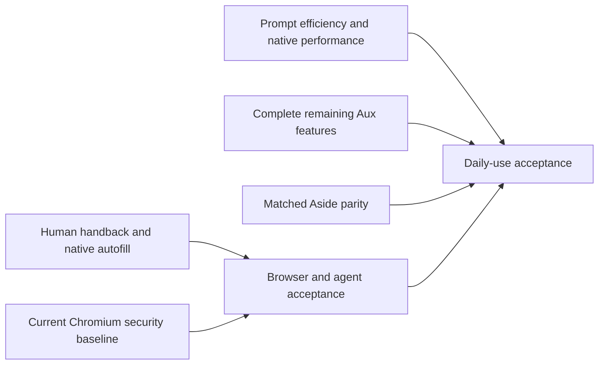
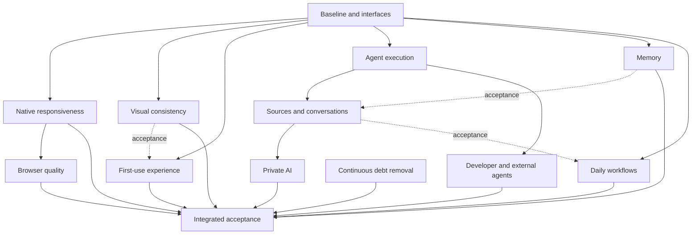

# Aux competitive execution graph

## October 17 readiness execution — active

The owner authorized completing the readiness audit's six substantial batches,
with focused verification and no repeated unchanged checks. This supersedes the
historical pause below. Baseline is clean local main `6f1016d8b`; the accepted
native/renderer/runtime source is `769ba5f86`. The 4,675-test integrated check and
native dropdown/rail observations remain valid for unchanged behavior. Full
browser readiness, the manual 20-task smoke and performance acceptance remain open.
Current source adds isolated named providers and compact Quick Ask/downloads;
all4,710tests pass. Native address save/edit/cancel/update and refill are accepted
on c366c7dc8. Redirect area0058 and compact-window area0059 await native acceptance;
the isolated155cold build remains active. STATUS is the current build-ownership
record; older preview entries below are historical.

| Batch | State | Outcome and acceptance |
| --- | --- | --- |
| R1 | active | Preserve protected document tombstones while admitting actual human navigation after agent retirement; complete native address/payment save UI. Verify navigation/back/forward/reload, Stop/Take over and synthetic form save/update/cancel without authorizing late agent traffic. Investigate the earlier unexplained native exit through changed-flow lifecycle observations. |
| R2 | building | Official155.0.8059.85 with58areas is compiling in its isolated checkout. Accept it before integrating the pin and later area0059; preserve stable product/stock checkouts. |
| R3 | waiting on R1/R2 | Complete native restore/sleep/wake/runtime-outage/import/extension/file/media/permission workflows and default-route manual smoke (at least 18/20), plus real research/site/file/coding journeys and durable controls. Reuse earlier valid observations. |
| R4 | active | Shared tool schemas halve the known SDK payload bytes; actual provider token/cache/latency and valid paired native startup/interaction/memory measurements against matching stock remain. |
| R5 | active | Named custom providers have integrated source and protocol/private/UI checks; real inference and combined picker remain. Finish channel persistence/transports/pairing/replies; supported subscription setup; Memory document authority/extraction/diffs/Dream; routine lifecycle; cloud provisioning/preview/Stop/recovery/cleanup; device/file-grant and notification acceptance. |
| R6 | active | Compact Quick Ask/download popup source is integrated. Complete native compilation, matched light/dark, normal/narrow and populated/error/focus comparisons across browser chrome, Settings, chat and libraries using the current corpus. |
| RF | waiting on integrated batches | All scoped implementation and native acceptance complete, current evidence recorded, no unresolved daily-use blocker. Distribution, signing/notarization, sync and other platforms remain separate scope. |

One executor owns source integration, the native tree, builder and launcher/plain
lock. Retire the current preview through its original launcher before replacing
it. Consolidate native changes as area patches; commit coherent slices to local
main. Runtime source changes rebuild dist before tests. Run one integrated check
per slice and changed-flow native observations; repeat only for a changed
dependency, invalid result or failure. External account registration, signed
password-manager identity and DRM licensing stay explicit prerequisites rather
than compatibility claims.

## Execution checkpoint — October 8 wrap-up

The owner requested wrapping up, landing completed work on local main and stopping
further testing. Execution is paused, with the full scope and unfinished acceptance
preserved. All returned worker slices are integrated. No further test run, build,
launch or benchmark is scheduled by this wrap-up.

The latest 272-method app built in 44 steps / 26m07.40s with 200 renderer assets,
Node 26.9, document citations, early Enter, full-size image Save and area 0037.
Native DOCX/text/PDF batch intake was observed. The owner used the preview;
automation stopped, then normal retirement exited 0 and removed its Profile/lock.
Source now has 273 methods / 30 events (`cce8203bcbd0`): areas 0038–0039 add
lossless icon compression and native image Copy. Both are registered and applied
to product source, but uncompiled. Their TypeScript/focused UI/replay evidence
is recorded in STATUS; no native clipboard or complete workflow pass is claimed.

## Outcome and baseline

Implement the approved Mac daily-driver plan completely: frictionless human and
agent browsing, intentional Aside-derived visuals with Aux branding, fast native
interaction, reliable research/writing/site/file/coding workflows, and removal of
the implementations replaced by this work. Ask first remains the initial default;
Skip confirmation is the remembered Full mode, with a temporary per-run override.
No new permission system is introduced. Stop, Take over, site policy, native
ownership, secret protection, durable effects and conflict-safe undo remain.

Execution was authorized on October 7, 2026. The source baseline is clean local
main at `62f3626c8d0b50880452e928c3e24ba0277f4d2e`. The integrated native candidate is
Chromium 154.0.8037.98 in `~/aux-chromium-product/chromium/src/out/AuxFast/Aux.app`,
with the native tree through the frozen 42-area source checkpoint consolidated into 32 equivalent areas. The preceding combined areas 0033–0036 compiled in 33 steps / 30m40.20s with 272 methods / 30 events, `97d6daa5466e`; the same owned pipeline staged checksum-pinned slim Node 26.9 and completed a disposable launch. DOCX import, Next/Previous preview and preserved attachment/draft were observed; normal Quit exited 0 and removed the Profile and plain lock. Earlier 270-method observations established History, Space creation/adoption, download Reveal/dismissal, tracker exceptions and Save as PDF with the runtime paused. The retained-page fix for full-chat connector retirement is staged in the new candidate and awaits native observation. A source-backed first answer, runtime-unavailable Find/Zoom, private answer/Stop and last-private-window retirement have earlier observations. Broader provider, takeover and workflow acceptance remain. Existing delivery observations live in STATUS.
There is no complete current performance comparison. Source presence and previous
unit checks do not establish native performance or competitor parity.

Windows/mobile, cross-device sync, enterprise administration and public release
work remain later. Do not push, run hosted Actions, enable Dependabot, sign,
notarize or release. Use only disposable development Profiles. External vendor
registration, signed password-manager integration and DRM licensing remain
explicit external prerequisites, not compatibility claims.

## Dependency graph

Solid edges are implementation prerequisites; dotted edges are integrated
acceptance prerequisites. Shared native resources are scheduled separately.

## Outcome registry and requirement coverage

Every node includes deletion of replaced code and focused verification. States
distinguish working source, integration, native build, observation and acceptance.
No node is complete merely because a worker returns a commit.

| Node | State      | Requirements and completion evidence                                                                                                                                                                                                                                                                                                                                                                                                                                                                                                                | Owner / dependencies                          |
| ---- | ---------- | --------------------------------------------------------------------------------------------------------------------------------------------------------------------------------------------------------------------------------------------------------------------------------------------------------------------------------------------------------------------------------------------------------------------------------------------------------------------------------------------------------------------------------------------------- | --------------------------------------------- |
| N0   | active     | Preserve current baseline; reconcile historical roadmap against source/evidence; establish cancellation, scheduling, sources, retrieval, providers and private-retention interfaces; maintain this graph and current docs.                                                                                                                                                                                                                                                                                                                          | Integrator; ready baseline inspected          |
| N1   | active     | Event-driven native socket bridge with bounded draining and original ownership; remove artificial startup sleep; selected-route credentials first; browser-owned memory saving; task provenance distinct from active-work discard exemption; consistent native checkout/flavor resolution. Validate changed native behavior and actual startup/interaction measurements.                                                                                                                                                                            | Native worker + integrator runtime wiring; N0 |
| N2   | active     | Readable toast/tooltip/omnibox/command/approval material; shared Quick Ask toast actions/Undo/dismiss/timing; consistent control spacing/icons/focus/loading/errors; polish sidebar reveal, narrow layouts, pins, folders and bottom Profile/Space controls; compact result-first task status; consolidated Settings metadata; keyboard/VoiceOver/reduced motion/transparency. Required selected native look comparison.                                                                                                                            | Shell worker; N0                              |
| N3   | active     | Four skippable setup stages; optional recovery/import receipts out of first-task path; normal composer and signed-in context; durable start identity; Ask/remembered Skip/temporary mode consistent; no redundant completion confirmations; truthful available providers, local discovery and OpenRouter PKCE; actionable unavailable registration paths; correct image copy. Fresh Profile completes first task within two minutes.                                                                                                                | Shell + provider owner; N0, N2 acceptance     |
| N4   | active     | Up to four independent safe reads overlap; dependent effects, suspension and terminal completion ordered; deterministic pairing/receipts; cancellation through DNS/redirects/body/extraction and absolute deadline; native search preference authority; public page-free research children; stable capability-derived manifests and cached schemas; model-aware working context separate from durable history, preserving constraints/decisions/sources/effects; compact browser observation/action batching/strategy changes.                      | Runtime worker + integrator wiring; N0        |
| N5   | active     | Cancellable idle incremental encrypted indexes/embeddings; batch identity validation; lexical results immediately, semantic refinement; active-Space recall prewarm with 150 ms initial allowance and late safe-boundary recall; no plaintext sensitive FTS; version/reuse indexes; pause/forget/revocation removes all derivatives; visible editable provenance.                                                                                                                                                                                   | Retrieval owner; N0                           |
| N6   | active     | One live/captured source model across tabs/groups/Spaces/files/mentions; native refresh at Send, pinned captures and retained drafts; paginated source collections replace unrelated count walls; relevant retrieval instead of eager entire pages; compact source pills/previews/optional diagnostics; extracted transcript/composer/context responsibilities; normalized projections; large-chat profile followed by justified bounded rendering; whole-conversation search/jump/history segment; stable drafts/selection/scroll/focus/streaming. | Conversation owner; N4, N5 acceptance         |
| N7   | active     | Native bookmark context actions/nesting/open-folder/DnD/keyboard/Undo; remove runtime gates from browser controls; predictable bulk tabs/reopen/pins/splits/Profile-Space switching; background AI never steals focus; restore/sleep-wake/external links/downloads/uploads/PDF-print/reader/PiP/media/clipboard; actual blocking/site exceptions/Store installs/popups/side panels/native messaging.                                                                                                                                                | Browser owner; N1                             |
| N8   | active     | Native off-the-record session owns ephemeral AI; in-memory chats/recall/logs, temporary artifacts outside normal Profile; last private window closure cancels/clears; explicit exports remain; no normal memory/history indexing; available local/cloud route with concise truthful cloud indicator; Ask/rail enabled only with implemented lifecycle.                                                                                                                                                                                              | Private-runtime owner; N6                     |
| N9   | active     | Five excellent journeys: cited multi-source report/table; selection explain/rewrite/translate/insert/Undo; signed-in multi-site task alongside human browsing; local files to document/sheet/deck/image; project change/run/preview/review/Undo. Useful source/copy/export/reveal/continue actions; website path and supported connectors; routine continuation and quiet notifications; reuse existing skills/packages/providers.                                                                                                                  | Workflow owner; N0, N6 acceptance             |
| N10  | active     | Aux owns execution; complete local Files/Changes/terminal/preview/coder worktree integration; CLI/MCP/SDK same supported capabilities/presence/Stop/Take over; cloud provision/execute/preview/stop/recovery without duplicates, governed file/process parity before cloud coding exposure; local coding default; connector account/reconnect/error quality; declarative pinned packages.                                                                                                                                                           | Developer-runtime owner; N4                   |
| N11  | continuous | Delete replaced onboarding/search/context/presentation paths; extract touched bootstrap/provider/retrieval/dispatch responsibilities; final native area patch consolidation in disposable replay work; preserve checkouts/caches/lock; current docs and mock capability accuracy; remove obsolete implementation tests while keeping effect/recovery guarantees; local Chromium/dependency maintenance.                                                                                                                                             | Each node + integrator final assembly         |
| F    | planned    | Entire requirements audit, integrated build, focused native workflow observations, valid performance report, required manual 20-task smoke, selected Aside look checks, current evidence/docs and explicit external prerequisites.                                                                                                                                                                                                                                                                                                                  | Integrator; all nodes integrated              |

### Shared interfaces

- Tool execution receives the original run's AbortSignal and current owner check.
  Safe read scheduling is explicit metadata, never inferred from tool names.
- Scheduling preserves assistant/tool call pairing in model order. Only proven
  independent reads overlap; mutations and potentially parked actions remain
  ordered. Stop cancels all active reads.
- The native Profile owns its browser preferences. Runtime work consumes that
  source rather than retaining a second search or memory-saver preference.
- Model working context has a selected-model input budget; full durable history
  remains the source for continuation, source retrieval and human search.
- Source selection explicitly identifies live versus captured sources and native
  Profile/Space/page/document identity. Collections are paginated and retrieved
  by relevance rather than eagerly appended to each request.
- Memory derivatives retain source and model versions, encryption and existing
  sensitivity/Space rules. Forget invalidates every derivative.
- Private execution is bound to the native off-the-record session; it cannot use
  the normal persistence/memory capture path.

## Dispatch and integration protocol

Use three workers and one integrator, all from the accepted baseline. Repository
workers use isolated worktrees and `codex/` branches. Land coherent slices on
local main. Never push. Workers return a narrow commit, exact owned paths,
focused check results, observed behavior and unresolved limitations. They propose
changes to occupied shared files to the integrator instead of editing them.

| Worker     | First assignment                                      | Reserved files/resources                                                                                                         | Next ready work                                                          |
| ---------- | ----------------------------------------------------- | -------------------------------------------------------------------------------------------------------------------------------- | ------------------------------------------------------------------------ |
| Native     | N1 event-driven transport                             | Product native runtime_host sources; its additive area patch. No native mutation until baseline run retires.                     | N7 native lifecycle/readiness, then patch consolidation                  |
| Runtime    | N4 cancellable public web tools and independent reads | agent/loop loop/tools/types, agent/web-tools, subagents and focused tests                                                        | N4 working context, N5 retrieval, N10                                    |
| Shell      | N2 readable shared material and Quick Ask notices     | ui material/toast/tooltip, glass/affected primitive styles, QuickAsk; narrow command/approval presentation                       | N3 onboarding, N6 conversations                                          |
| Integrator | N0 and shared wiring                                  | Contracts; main/host/runs/settings composition; generated outputs; launcher defaults; docs; series ordering; native builder/lock | Review/integrate; baseline, native acceptance and ready outcome dispatch |

The integrator alone builds/stages/launches/measures native candidates under one
plain lock. One native writer edits the reserved product tree only while no build
is running. Never reset that tree or the stable checkout, force-clear a live lock,
or replace cleanup ownership. Native building is the principal shared-resource
bottleneck. Readiness and interface work can proceed independently of it.

Dispatch the next ready outcome when a worker finishes; do not wait for a whole
wave. Favor critical-path unblock value and coherent handoffs. Native transport
and agent-context work have higher integration risk; visual/onboarding fixes have
smaller boundaries. Estimates follow actual first-slice evidence, not speculative
agent-count speed multipliers.

## Proportionate acceptance

Per coherent slice: rebuild runtime dist before affected runtime tests, focused
existing behavior tests, one integrated `npm run check`, incremental native build
for native changes, and one changed-flow disposable-Profile walkthrough. Reuse
unaffected evidence; repeat only for changed dependencies, failures or invalid
measurement. Do not add e2e/pixel frameworks, coverage quotas, qualification
matrices or broad provider/paid benchmark campaigns.

Focused cases cover read overlap/action ordering; Stop; uncertain-effect replay;
constraint retention/tool pairing; source refresh and boundaries; forgotten
derivatives; private-session cleanup; conflict-safe Undo; and no duplicate first
task/restart. Reversible presentation-only changes require typecheck and inspection
rather than implementation-mirroring tests.

| Quantity                    | Existing target                                                 |
| --------------------------- | --------------------------------------------------------------- |
| First frame                 | <=500 ms and <=same-flag stock +5%                              |
| Interactive / runtime ready | <=700 / <=600 ms, AI runtime off browser critical path          |
| Warm window                 | <=120 ms                                                        |
| Tab switch                  | p95 <=one frame +8 ms                                           |
| Command bar                 | p95 <=16 ms with 50,000 history entries                         |
| Idle memory                 | shell <=120 MB; runtime <=90 MB; total overhead <=stock +150 MB |
| App bytes                   | <=same-flag stock +90 MB                                        |
| First useful task           | <=two minutes on available supported setup path                 |
| Default-provider smoke      | >=18/20 completed, using existing native manual runner          |

Extend the existing performance runner only for missing promised quantities:
short repeated inputs for p95, warm windows, existing boot marks and identified
process roles. Five paired matching Aux/stock launches; retain every sample and
invalid signal. Separate provider wait from Aux overhead. Never declare fastest
or parity from source/compile/tests alone. Actual roadmap phase ends require
`pnpm perf` and the applicable manual 20-task smoke. The fixture smoke and five
real workflows prove different parts of the outcome.

Perform the existing selected native Aside comparisons manually, in both
appearances and representative normal/narrow layouts, including readable
overlays. Use few deliberate observations rather than a screenshot campaign.

## Progress and evidence

- Baseline source/STATUS/build instructions inspected; no dirty source at start.
- Three managed worker worktrees created from the exact baseline.
- Two baseline paired performance attempts produced no valid samples. The first
  exposed early native-helper attachment; the second reached setup and timed out
  on genuine interaction telemetry. Helper attachment now waits for the owned
  listener and input waits for native address focus. Measurements remain open.
- Existing native walkthrough evidence is retained in STATUS and is not relabeled
  as this execution's acceptance.

Completion requires every explicit requirement above to be implemented,
integrated and proved at its proper scope. Leave incomplete or externally blocked
items explicit; do not shrink the objective to a finished subset.

### Current implementation handoff — October 8

- Areas 0087–0093 launched in disposable Profiles. Native bookmark folder
  Rename/Undo, Settings and memory saving worked with the exact runtime paused;
  a clean tab discarded and restored. Cmd+T then Cmd+L navigation was observed.
- Areas 0094–0097 compiled/linked in 39 steps / 18m08.01s. Native bookmark
  entries/nonweb opens/export, sleeping-state publication, cloud Preview and
  private startup diagnostics await their changed-flow walkthrough. The matching
  current renderer/runtime has not yet been staged in that candidate.
- N2 shared material and four-stage optional setup are integrated. Ordinary Send
  has durable UUID reconciliation. A submitted native turn survived a deliberate
  runtime pause but then failed source reading; a subsequent fresh ordinary composer completed a source-backed answer within
  two minutes. Lost-ACK and selected Aside comparisons remain pending.
- N4 overlapping prepared reads and model-capacity working context are integrated.
  N5 encrypted cooperative index/embedding preparation is integrated; automatic
  recall is ephemeral. Indexed Forget retires derivatives, but unprovenanceable
  copies in legacy transcripts can remain. Human history is not heuristically
  erased; historical-continuation retention remains explicit.
- N6 live/captured collections, stable recapture identity, metadata pagination and
  model input-budget projection are integrated. Long-chat deferral/search/jump
  and retained artifact selection are integrated. The synthetic 300-turn workload
  improved initial detail panels from 300 to eight; native timing is unproved.
  Complete rich chat export is integrated. Rich Word, dense editable decks, typed artifact revision
  controls and original-chat routine continuation are integrated.
  The final coverage pass replaces the distinct five-document/fixed-excerpt path
  with protected immutable body/preview records and all exact metadata. Model
  evidence is ephemeral, relevant and uses the actual remaining input budget.
  Skills/search/suggestions, per-Skill occurrence history and the global inbox
  now reach older records through keyset paging; full 501-Skill file round-trip
  passed. Scheduling cooperatively visits all eligible definitions and preserves
  current pause/review/occurrence ownership.
- N7 authenticated Space/workspace publication is area 0099; native tab placement
  remains usable without Node. It is compiled; changed-flow observation remains pending.
- N8 private AI startup failed in the preceding candidate. Persistence-dependent
  feature admission was repaired in source. Area 0098/original credential broker
  now inherit selected direct/Gateway/OAuth access and abort private transports
  on original connection retirement. No private prompts/refresh tokens cross
  that broker. Area 0101 supplies opaque budget and Sandbox realms; shared accounting
  is integrated. A real private source-backed answer, Stop and last-window
  retirement have now been observed; broader provider/shared-budget/cloud acceptance remains pending.
- N10 cloud files/processes, human Changes/Logs/Stop/Undo and native Preview are
  integrated. Encrypted log chunks replace repeated whole-log decryption. Human
  controls retain original native-window/VM/Session checks after agent dispatch
  ends. Cloud code-mode uses the existing admission/receipt callbacks. Successful-task process retention now transfers monitor/Stop ownership before dispatch retirement and retains original funding expiry. Actual cloud workflow
  acceptance remains pending.
- The latest integrated check passed typecheck/lint and 4,399 tests across 711
  passing files. Its three fixture failures were corrected and their 12 affected
  tests passed. The test phase took 172.70 seconds; the under-60-second target is
  still open. Passing unchanged suites are not repeated. Runtime dist was rebuilt.
  The current 270-method/30-event source ABI is `289705b74098`. Native History,
  download dismissal, Space presentation, PDF ownership, document batches and
  tracker exception authority are integrated. The native candidate compiled in 47 steps / 10m59.84s after the
  pinned constructor and hostname ownership repairs in additive area 0033.
  Runtime-paused History/Space/download/filter/PDF flows were observed.
  The frozen 42-area checkpoint was replayed into 32 disjoint areas, matching all
  850 native paths, bytes and executable modes. This proves source equivalence; compilation and the
  changed-flow observations are recorded separately in STATUS.
- The frozen pre-consolidation areas 0033–0036 are compiled. The complete Mojo include allowed the
  combined candidate to build in 420 steps / 32m32.25s. The ordinary composer
  completed a real source-backed answer in a fresh disposable Profile within
  two minutes. With the exact runtime paused, native Find moved between both
  matches and Zoom enlarged/reset the page. Private last-window retirement left
  normal browsing alive and removed its worker directory. Private UI reconnect
  now works after omitting a regular-only settings request; private Send now
  completes a real source-backed answer with no duplicate configured-provider review. Normal shutdown
  exited 0 and retired its Profile and plain lock. Physical Take over remains
  unobserved. Runtime-only launches verify the compiled host ABI before staging.
  Enter executes the displayed Ask/Search choice immediately in source; the
  committed-input AI classifier was deleted and its focused checks pass. That
  renderer change is staged in the latest 272-method app. Explicit governed utility classification
  retains bounded provider cancellation.
- Area 0100 adds original shell/runtime role measurement; stock's additive patch
  was retired after its missing object cache requested a full rebuild, stopped
  normally. Stock keeps the same v3 timing triggers; Aux-only role telemetry is
  recorded as an instrumentation difference, with no stock role metrics. No valid paired performance report, native 20-task
  smoke, five workflow acceptance or final design comparison exists. No phase or
  competitor-parity claim is made.

## Final browser coverage follow-up

The October 8 source audit found native downloads reappearing after a runtime-only
shelf deletion, Node-dependent history and Space editing, PDF export retaining a
tab rather than its original document, and tracker exception controls depending
on Node. Their replacements are integrated and covered by the current 270-method
source ABI. Human history and download presentation belong to the browser;
dismissal keeps files and resumable transfers. Native Space presentation attaches
only authentic runtime workspace mappings. PDF export is fenced to its original
live document. Blocking source updates preserve the browser’s current controls
through source-generation checks. Replaced toggle polling is deleted.

The frozen 42-area checkpoint was consolidated to 32 equivalent areas. Additive
0033 repairs History construction and site-control hostname ownership. The
compiled app now has 270 methods / 30 events. Native History search, Space
creation/adoption, download Reveal and persistent dismissal, tracker exceptions
and Save as PDF worked with Node paused. A 31-file selection retained 30 valid
text documents and separately reported the invalid one; a late document-30 fact
was retrieved correctly in the side panel. Full chat exposed native connector
retirement; the retained-page source fix awaits native observation. Cleanup
exited 0 and removed the disposable Profile and plain lock.

Text batch selection does not supply PDF/DOCX ingestion. Frozen typed extraction
and import/read interfaces and schema-5 protected complete document snapshots
are integrated. The dedicated byte-only PDFium/DOCX utility has compiled successfully. Original
native capture adapters, shared snapshot services, bounded preview/retrieval and
streamed native receipt Save are integrated in source. Their combined native app
compiled and launched with slim Node 26.9. Actual DOCX import and paged preview
were observed; the subsequent build also retained native DOCX/text/PDF batch
attachments. Full chat, provider retrieval, exports and extension flows remain pending. The candidate retired normally with exit 0 and Profile cleanup.
The latest integrated Node-26.9 check passed 4,446 tests across 720 files,
typecheck and lint after rebuilding runtime dist. The subsequent citation
integration passed typecheck/lint and 4,473 of 4,474 tests; its sole stale mock
was corrected to the actual Run-returning contract and all four affected cases
pass. Unchanged suites are not repeated. The next combined build completed;
actual current app overhead remains 161.68 decimal MB, above the 90 MB target.

Integrated source closes early Enter handoff before React controls mount, keeps
full-size image Save available, and verifies typed document citations against
protected admitted source spans with direct saved-section opening. These slices
are staged in the latest 272-method app; their remaining native workflow
observations are open. Area 0037 adds genuine warm-window
controls readiness and paired display-frame intervals to the existing benchmark;
its source is applied under the sole dev lock, with the sole-owner combined build completed. Matching stock area 0051 is applied;
its missing compiled inputs remain to be rebuilt. Warm process relaunch is diagnostic only;
missing warm-window or frame-interval evidence remains unavailable. First static
paint is not interactive readiness. The benchmark target summary is advisory and
requires complete measurements before accepting a target. Whole-flow
acceptance, physical Take over, paired performance and the manual 20-task smoke
remain open. No phase completion or competitor-parity claim is made.
