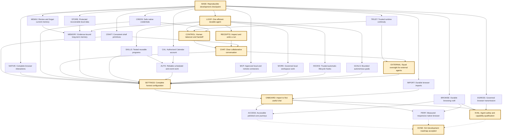

# Aux roadmap execution graph

**September 30, 3:31 PM PT execution update.** Toolbar bookmark, open-tab search, Recently Closed, and reading list passed on integrator `da84f59a` and native `48de88d2`. Evidence is `release/test-artifacts/native-selector-az-2026-09-30/manifest.json` (completed 21:41:14Z, source `40b10d6b`), `release/test-artifacts/native-selector-bc-2026-09-30/manifest.json` (completed 21:42:27Z, source `40b10d6b`), `release/test-artifacts/native-selector-cd-2026-09-30/manifest.json` (completed 22:21:29Z, source `e949e11d`), and `release/test-artifacts/native-selector-ck-2026-09-30/manifest.json` (completed 22:31:05Z, source `da84f59a`). The bookmark journey added and removed a toolbar bookmark. Open-tab search kept the background local tab available. Recently Closed showed the disposable Red tab with a Reopen action. Reading list focused Mark Aux reading Red read with a posted click, and Space marked that row read while Aux reading Blue stayed unread. Attempts bz, ca, cb, cc, ce, cf, cg, ch, ci, and cj are not passes. `qualification.json` is unchanged. Split view, link Peek dismissal, and Reader pointer Peek stay closed by the September 28 manifests (`native-s11-split-view-final-2026-09-28` completed 12:33:05Z, `native-s11-link-peek-complete-2026-09-28` completed 13:02:30Z, `native-s11-reader-peek-pointer-2026-09-28-a` completed 17:50:35Z, source `970adc61`). `feature:splitView` and `feature:peek` stay qualified at `970adc61`. History-scope navigation and extension command actions are not claimed. Theme, grain, tint, and the active battery-saver transition stay open for the ACCESS visual session. MEMUI Forget, STORE's two device prompts, the EGRESS relay, the paid S5 rerun, and CONTROL credential handoff stay later and unclaimed. S14 is not declared.

**September 30, 2:00 PM PT execution update.** Split view, link Peek dismissal, and Reader pointer Peek passed on September 28. Evidence is `release/test-artifacts/native-s11-split-view-final-2026-09-28/manifest.json` (completed 12:33:05Z), `release/test-artifacts/native-s11-link-peek-complete-2026-09-28/manifest.json` (completed 13:02:30Z), and `release/test-artifacts/native-s11-reader-peek-pointer-2026-09-28-a/manifest.json` (completed 17:50:35Z), source `970adc61`. `feature:splitView` and `feature:peek` stay qualified at `970adc61`. `qualification.json` is unchanged. Theme, grain, tint, and battery-saver evidence stay open for the ACCESS visual session. Toolbar bookmark, Recently Closed, reading list, and open-tab search are the next native runs. History-scope navigation and extension command actions are not claimed. CONTROL, STORE, the EGRESS relay, and the paid S5 rerun were not claimed.

**September 30, 1:45 PM PT execution update.** Audible and agent-owned Memory saver protection passed on integrator `b9748f63`. Evidence is `release/test-artifacts/native-memory-saver-awake-2026-09-30-ae/manifest.json` (completed 20:45:58Z). The AudioContext clock advanced on a visible document, the strip named the tone tab Mute tab: Aux tone playing, and a one-minute policy slept a clean idle tab named Sleeping tab. The tone tab stayed live, the runtime-owned tab stayed live, and dirty and unknown tabs stayed live. Restart kept the discarded tab at one fixture load, and `pages.activate` reloaded it once. Attempts w–ad are not passes. `qualification.json` is unchanged. Split/Peek cleanup, theme/grain/tint, and battery-saver evidence stay open. Reopen, bookmark, history, and extension command actions still need a native journey. CONTROL still owes the scroll-tracked cutout, the takeover latency budget, and credential handoff. STORE recovery, the EGRESS relay, and the paid S5 rerun remain owner gates and were not claimed.

**September 30, 12:44 PM PT execution update.** Reopening a Memory saver tab passed on integrator `f71395b7`. Evidence is `release/test-artifacts/native-memory-saver-awake-2026-09-30-v/manifest.json` (completed 19:44:41Z). It repeats the journey u checks, then `pages.activate` reloads the sleeping tab once (fixture load 1 → 2) and does not reload the dirty or unknown tabs. The discarded tab had stayed a placeholder, with one fixture load, until that reopen. `qualification.json` is unchanged. Audible and agent-owned protection still lack a native oracle. Split/Peek cleanup, theme/grain/tint, and battery-saver evidence stay open. A handoff answer now takes a fresh observation and does not execute the parked action again (`09c7d43c`, agent-loop unit file 70/70). That is not a CONTROL pass: the scroll-tracked cutout, the takeover latency budget, and credential handoff remain open. STORE recovery, the EGRESS relay, and the paid S5 rerun remain owner gates and were not claimed.

**September 30, 12:35 PM PT execution update.** Native Memory saver passed on integrator `20dbefaf`. Evidence is `release/test-artifacts/native-memory-saver-awake-2026-09-30-u/manifest.json` (completed 19:35:40Z). A saved one-minute policy slept an idle clean tab, the strip named it Sleeping tab, and dirty and unknown background tabs stayed live. Settings showed the sleep cycle, the protected-tab unload refusal, and an estimate. After restart those dirty and unknown tabs were live, the discarded tab stayed a placeholder, and its fixture load stayed at 1. The refusal report was still visible. Attempts o–t are not passes. `qualification.json` is unchanged. Pointer activation of a sleeping tab, audible and agent-owned protection, split/Peek cleanup, theme/grain/tint, and battery-saver evidence stay open. CONTROL still owes scroll-tracked handoff, the takeover latency budget, and credential handoff. STORE recovery, the EGRESS relay, and the paid S5 rerun remain owner gates and were not claimed.

**September 30, 9:54 AM PT execution update.** Native TRUST passed on integrator `460ad2fd`. Evidence is `release/test-artifacts/native-trust-adversarial-2026-09-30-p/manifest.json` (completed 16:54:57Z). Expired and revoked scoped sessions returned `permission_denied`; a missing or unknown bearer stayed `unauthorized`. Attempts a–o are not passes. `qualification.json` is unchanged. STORE recovery, the EGRESS relay, and the paid S5 rerun remain owner gates and were not claimed. CONTROL still owes scroll-tracked handoff, the takeover latency budget, and credential handoff. The shell Memory saver now skips dirty and unknown tabs in unit evidence; the native BROWSE journey was not run, and protected-tab refusal, theme/battery, and M4 stay open.

**September 29, 19:42 PT execution update.** Integrator `9240e15c` contains the unrun STORE recovery harness (`909687eb`) and the unsigned development-peer check. The continuity unit file passed 6/6. Native STORE recovery, native TRUST qualification, EGRESS relay approval, and the S5 paid rerun remain open. `qualification.json` is unchanged.

**September 29, 19:39 PT execution update.** The native S13 first-run journey passed on integrator `48de88d2`. Evidence is `release/test-artifacts/native-onboarding-2026-09-29-ai/report.json` (ended 02:39:03Z, run `20ceda9d-af26-4e31-82e4-d52e7bd403de`, one local model call). Finish-later replay did not import again, and the post-chat restart opened the same run. The running library is `libchrome_dll.dylib` `08dd7d51296a5ccc4c2e645b60a7f3d3b81ffc82cf3944a747f4feb33d9b5322`. Attempts through `ah` are not passes. `qualification.json` is unchanged. Pasted assistant-memory import during setup remains open. STORE native recovery, TRUST adversarial qualification, EGRESS relay approval, and the S5 paid rerun remain open. CONTROL still owes scroll-tracked handoff, the takeover latency budget, and credential handoff. The S11 changed-state pass on `9c9eac28` still stands; the rest of BROWSE stays open.

**September 29, 15:44 PT execution update.** The physical S11 changed-state journey passed on integrator `9c9eac28` and shell pin `da57f789e28033d80cf87e7a3e13609ac0e02fb3c6019dcbafcd11fe15f4fb7d`. tsc, unit tests, typecheck, lint (376 warnings, 0 errors), and format passed before that pin was committed. Evidence is `release/test-artifacts/native-s11-tidy-changed-2026-09-29-f/manifest.json` (completed 22:44:05Z). Reviewed Fixture reading was renamed to Owner changed, the undo receipt was cleared, and restart showed no Undo Tidy control. Attempts `b` through `e` are not passes. `qualification.json` is unchanged. The rest of BROWSE stays open: Memory saver, protected-tab refusal, theme/battery visuals, and M4. S13, STORE native recovery, TRUST adversarial qualification, EGRESS relay approval, and the S5 paid rerun remain open. CONTROL still owes scroll-tracked handoff, the takeover latency budget, and credential handoff.

**September 29, 21:45 PT execution update.** CONTROL's physical takeover and Return journey passed twice on a clean AuxDev build. Evidence is `release/test-artifacts/native-control-physical-2026-09-29-clean/`. The horizontal toolbar is outside the window drag region, and patch `0128` subtracts no-drag rects after the drag union. Those passes packed shell digest `de93c5d1`. The committed pin is `ffce38f4` (103 assets), recaptured after two labelled regions gained nameable roles; the no-drag CSS is unchanged and Aux.app was not rebuilt for that recapture. Diagnostic `RET-*` markers and runtime `trace()` hooks are gone. `docs/qualification.json` is unchanged. CONTROL still owes scroll-tracked handoff, the takeover latency budget, and credential handoff. S13 native first-run, S11 stale Undo, STORE native recovery, TRUST adversarial qualification, EGRESS relay, and the invalid S5 50×3 rerun remain open.

**September 29, 12:36 PT execution update.** CONTROL's physical-takeover half is proven on the staged AuxDev build — real CGEvent input on the isolated task page drives `view.takeover` → durable `interrupted` run with takeover checkpoint and effect fencing. The Return half stays open: `.tb-left/.cmdbar/.tb-right` in `tabs-horizontal` were inside the macOS window drag region (verified by AX hit-test + measured window drag from the Return chip's rect), and `11c53af1` punches a container-level `no-drag` for the horizontal clusters. The fixed binary is staged but unverified — no journey has completed a Return click on it yet. Runtime `trace()` and shell `RET-*` title markers remain uncommitted diagnostics staged in that app; the dirty `chromium/shell-assets/` pin carries the markers and must be rebuilt clean before committing. Full drive sequence and instability notes: `release/test-artifacts/native-control-physical-2026-09-29-n/NOTES.md` and `docs/HANDOFF.md` 12:36 PT checkpoint. S13 native first-run, S11 Tidy stale-Undo, STORE recovery/Forget, EGRESS relay and the S5 paid rerun remain open as before. `qualification.json` is unchanged.

**September 29, 01:05 PT execution update.** Last native build `b1d99aa2` passed with patches through 0125 and 103 shell assets. Scoped Selection Settings and page-action journeys passed; native selection/region capture and S11 changed-state Tidy remain open. The S5 50×3 candidate is invalid at planner 140/150 from an unattributed harness timeout; `a5be4364` repairs invalidation with offline checks, and no paid rerun is active. CONTROL's shell Open temporary tab reveal repair is integrated at `777c90aa` with six focused shell cases; the integrator retains the agent ownership boundary and one-at-a-time native physical-input gate. STORE managed-backup rotation and S13 review/replay are integrated source and build, but recovery/Forget and first-run native journeys are unqualified. MEMORY provenance/Forget hardening is active in a separate lane. EGRESS relay awaits owner confirmation for disposable scoped connections. Follow the DAG below; no `qualification.json` promotion or S14 completion is inferred.

**September 29, 00:09 PT execution checkpoint.** Scoped TRUST 0123 native build and disposable helper-recovery [journey](../release/test-artifacts/native-trust-handshake-2026-09-29-b/manifest.json) passed. The exact peer, old-token refusal and new working page are observed; full adversarial TRUST remains open. Models provider/image source and Chat keyboard focus/safe approval are integrated with focused tests, while their native/VoiceOver gates stay open. The S5 frozen full comparison continues; EGRESS relay awaits task-scoped connection action-time confirmation. The dependency graph below remains the acceptance plan, not a list of qualified features; `qualification.json` is unchanged.

**September 28, 23:45 PT execution checkpoint.** Integrated RECEIPTS `6fe5ee3f` and S13 pasted Memory `516bac37` source batches have focused passes; native attribution/undo and owner import journeys remain open. The Chromium shell build is pinned at 100 assets/digest `35a786dd` within budgets. EGRESS 0122 now includes fixed-partition multi-page cleanup, ephemeral restart filtering and saved-password fill exclusion; apply/reverse checks pass, but the revised native build and relay/lifecycle/autofill gates have not passed. The relay fixture reached disposable scoped-connection creation and stopped for action-time owner confirmation. The single S5 50×3 Contributor comparator remains running with early scored timeouts. `qualification.json` has no promotion. TRUST runtime takeover and S9 Models lifecycle/image selection are the next independent lane batches; integrator owns native/shared joins.

<!-- AUTHORITY 2026-09-28 23:25 PT -->
**September 28, 23:54 PT native checkpoint.** The revised 0122 AuxDev build passed 46 serial steps; a focused cookie non-transmission fixture passed with a same-origin positive control. EGRESS relay/lifecycle/autofill are still open. STORE startup/restart passed 37 encrypted table markers, including MCP bundle bytes, but recovery/Forget and full inventory acceptance remain. TRUST authenticated runtime takeover source `5011025b` and S5 batched-radio repair `afef2aab` are integrated after this app build; each needs its native/final comparator gate. One literal 50×3 S5 run is underway on frozen isolated source. No qualification promotion.

**September 28, 23:25 PT execution checkpoint.** Source from AUTO/HOOKS, IMPORT recovery, EXTERNAL, MCP immutable bundles, CAL account isolation, and S13 replayable onboarding is integrated with focused lane checks; App/General onboarding wiring and generated authorization are in integration, with shell build budgets passing. These are implementation slices, not accepted end-to-end nodes. EGRESS 0122's first fixed-partition native request probe passed cookie non-transmission; its adversarial relay, lifecycle, autofill and final patch gates remain open. S5's complete same-build comparator is running after one focused L12 repair; the prior 150-planner/12-loop report is partial. The critical path remains EGRESS → CONTROL/RECEIPTS/CHAT → ONBOARD/ACCESS/EVAL → DONE, with independent CAL/MCP/STORE/MEMORY/SETTINGS gates joining before DONE. `qualification.json` remains unchanged.

**September 28 evening integration.** SKILLS (`d4a1b00e`), GOALS (`53dac800`), WORK (`de0bfd8b` plus `1b7e6fcb` wiring/codegen), and CRAFT (`e60c445b`) are integrated source batches with focused isolated checks and integrated typecheck. AUTO/HOOKS and IMPORT recovery are the next independent lane batches. The one-at-a-time native AuxDev build and runtime staging after the 0121 Cookie fix passed, but EGRESS's request journey is only partial: same-origin positive, six protected refusals and cookie non-transmission have receiver/native evidence; the worker/remaining cases and per-run relay isolation do not. No S7/S8/S12/S14 qualification flag changed. The critical path still joins at SETTINGS → ONBOARD → EVAL, with native EGRESS and S5 A/B as competing gates.

**September 28 CHAT source update.** `326700f2` binds Answer mode and runtime acceptance to the exact current typed question/handoff, keeps approval/confirmation decisions separate and preserves drafts across layouts. Focused tests passed 24/24. The native collaboration journey and macOS banner gate remain open. The next isolated source lane is SKILLS tested safe replay on the LOOP→AUTO branch; the integrated shell snapshot for this serial native build includes CHAT.

**September 28 RECEIPTS source update.** `d464c8c2` integrates owner-reviewed selected whole-run local undo with exact ledger freshness and external redaction; 44/44 focused tests passed. The actual-run native form/drift journey and group/bookmark/history/download attribution remain open. CHAT transcript/composer/presence is assigned as the next critical-path source lane. The serial 0121 EGRESS/STORE/S11/MCP native build is in progress; source presence is not acceptance.

**September 28 CONTROL source update.** `abe118fa` integrates active-dispatch takeover fencing, abort and durable checkpoint, fresh-observation Return, owner UI state, and a prepared physical-input journey; 105/105 focused tests passed. The Chromium physical input producer and live journey are still open. The next critical-path isolated source lane has moved to RECEIPTS reviewed selective whole-run undo. The integrator owns the native producer and one-build queue.

**September 28 S5 diagnostic update.** The single frozen `6b3b4931` A/B stopped after planner 150/150 and loop 8/150 at a new L06 inline-edit uncertainty; its denominator is invalid. `49beec32` integrates an exact fresh same-page Edit-form auto-settle repair. Focused L06 passed 3/3 Contributor calls, the saved-answer oracle and zero unresolved intents; 60/60 focused loop tests passed. One justified full 50×3 rerun is underway on frozen `3980c14b`. LOOP is still open and the planner is retained.

**September 28 MCP/STORE integration update.** `6085d88d` integrates the S12 MCP OAuth disconnect/issuer, bounded discovery/output and reviewed Settings URL source batch, with isolated 29/29 focused tests and integrated typecheck. `576aa60f` prepares the expanded 36-marker protected native startup/restart fixture. These are source and harness checkpoints, not native passes. The MCP bundle Settings and STORE startup journeys await the next serial build; provider-backed OAuth remains a separate gate. Native EGRESS 0121 is still being completed, S5's single 50×3 A/B remains in flight, and CONTROL physical takeover is assigned as the next isolated batch. `qualification.json` is unchanged.

**EGRESS qualification risk.** The native 0121 candidate covers request preflight, final headers, redirects, saved-password producers and opaque socket admission, but a protected document can relay data through same-Profile storage or messaging to an unowned page that transmits it. This is a concrete transitive-egress blocker. The current patch will be reviewed as a scoped network interception slice; EGRESS cannot pass until a dedicated isolation or browser IPC boundary closes that relay path and a live adversarial receiver fixture proves it. Do not interpret HTTP interception alone as the EGRESS outcome.

**September 28 STORE source update.** Integration `92611cda` activates authenticated fields in five more execution-authority tables: Goals, Hooks, Hook invocations, subagent groups and subagents. Focused migration/restart, service and cross-Profile recovery fixtures passed. Source activation now covers 34 table families plus filtered `kv` and Calendar metadata; the last native protected-startup proof covers only the preceding 29-family set. STORE's remaining inventory, retained-metadata policy and live recovery/Forget gates stay open. No qualification flag changed.

**September 28 S11 update.** The [native Tidy restart/Undo journey](../release/test-artifacts/native-s11-tidy-durable-2026-09-28-d/manifest.json) passed on integration source `204d834f` with fixture-bound `spaces,aiTidy` acceptance and a serial 21-step AuxDev build. The reviewed folder survived restart, and visible Undo restored prior tab positions and removed its receipt. This closes that BROWSE subjourney only. Changed-state refusal, native Memory saver report/protected-tab refusal, theme/battery visuals and M4 still gate BROWSE/PERF. The S5 same-build full A/B and EGRESS work are in isolated lanes; `qualification.json` remains unchanged.

**September 28 integration update.** The S10 native 0119 host/bindings build passed at `b0f6faa6` with manifest `e5b1b824`; the corrected [attention journey](../release/test-artifacts/native-s10-system-attention-2026-09-28-b/report.json) passed ten in-app/durable/Focus Mode steps but failed its macOS alert click because no OS alert was observed. Both Aux notification entries were Off before qualification; a temporary single-entry opt-in still produced no visible banner while macOS was set to suppress notifications during display sharing, and the entry was restored to Off. The S5 full same-build 50×3 Contributor A/B at `918a1c10` stopped after planner 150/150 and loop 8/150 at an unresolved L06 edit receipt; the partial report is not a gate. STORE phrase-encrypted cross-Profile recovery and one-use native device-authentication source/patch 0120 are integrated through `eb82ccf8`, with focused recovery fixtures passing. The serial native build passed 57 steps and runtime staging passed; the live device prompt, cross-Profile restart, and Forget-to-fresh-package gates remain open. CRAFT focus/reduced-motion primitives are integrated at `bd9f1e09`, and `f1ef9069` reduced whole-array shell subscriptions to zero. The [native menu journey](../release/test-artifacts/native-s8-craft-menu-2026-09-28-b/manifest.json) passed scoped Space/Browser tools open/Escape; full visual/accessibility and formatter gates remain open. MEMUI, MEMORY, S10 and S14 are not promoted in `qualification.json`. The dependency edges and acceptance criteria below remain in force.

**Execution authorized — September 28, 2026.** The owner approved this graph as the development plan through S14, with up to three isolated implementation lanes and one serial native build. Signed release packaging remains outside scope. The audit below records the state when the plan was proposed; the checkpoint here records subsequent implementation without treating source presence as qualification.

**Current MEMUI checkpoint.** Native candidate `00e6a7e1` passed a serial 29-step AuxDev build with patch 0118 and 93 pinned budget-compliant shell assets. Disposable Memory/Spaces acceptance is source-bound and owner-only. The [visible journey](../release/test-artifacts/native-s12-memory-owner-review-2026-09-28-e/manifest.json) passed run-report note staging and acceptance, then timed out at irreversible Forget while awaiting the required action-time owner approval. The disposable Profile was cleaned up without deletion. MEMUI is not accepted until a new Forget, restart and no-resurrection journey passes. The full STORE recovery package and MEMORY outcomes remain separate.

**Current S5/S10 checkpoint.** Integrated `112baa33` rejects trailing download waiters before dispatch and bounds reasoning metadata during compaction. A focused Contributor L08 still failed 13 calls/0 oracle with one unresolved intent, though the 192 KB compaction error is fixed; the partial comparable report has planner 150/150 and loop 8/150, so A/B readiness is false. S5 remains open and the planner stays. Integrated `100ccb70` adds a disposable native S10 attention journey harness with an unpaid local model; its fixture test passed, but the native UI journey and OS attention/focus behavior are open. No qualification flag changed.

**Latest execution checkpoint.** [Native Calendar protected startup](../release/test-artifacts/native-store-protected-startup-2026-09-28-e/manifest.json) passed 31 markers, including schema v27 keyed account lookup, seeded ciphertext and restart on staged source `d7e57f89`/native identity `992ec38f`. S10 attention/notice wiring and S5 bounded completed-tool compaction are integrated in source; their end-to-end gates remain open. The S5 lane passed a four-call L40 diagnostic and is running the full comparable A/B. Memory's disposable native UI acceptance fixture and patch 0118 are prepared, not yet passed. The owner-confirmed recovery rule keeps historical copied exports usable with their original phrase, refuses older Aux-managed backups after Forget, and requires a fresh recovery package. STORE, Memory, S10, S5, S11 M4, S13 and S14 remain open; no qualification flag changed.

**Earlier execution checkpoint (`992ec38f` native).** The 23-step serial AuxDev build passed with 93 pinned assets (`e7c4ee43`), bindings `a8d8b1a9`, patch series through 0117 and staged runtime. The [30-marker native startup journey](../release/test-artifacts/native-store-protected-startup-2026-09-28-d/manifest.json) migrated seeded MCP/agent/vault legacy records, checked ciphertext at rest and passed normal Quit/restart. S10 source now includes bounded waiting/action/error cards, same-run isolated HTML artifacts and fresh cited-page checks; its physical acceptance journey remains open. The earlier [same-Profile backup/restore pass](../release/test-artifacts/native-store-protected-backup-2026-09-28-d/manifest.json) is scoped and still valid. Calendar protected lookup, broader STORE inventory, cross-Profile phrase recovery and native Forget refusal remain. Full S5, S11 M4, Memory, S10, S13 and S14 gates are open; `qualification.json` is unchanged. Historical checkpoints below retain their scope.

**Current execution checkpoint (`f0e346ba` native and staged runtime).** The serial AuxDev build passed 30 steps with ordered patches through 0117, generated bindings `a8d8b1a9`, and pinned shell manifest `9d08b470` (93 assets). [Protected startup](../release/test-artifacts/native-store-protected-startup-2026-09-28-c/manifest.json) verified 24 markers on the preceding app; [Settings backup/restore](../release/test-artifacts/native-store-protected-backup-2026-09-28-d/manifest.json) passed on this app in a disposable test Profile. The latter is a same-Profile journey under scoped `electronMigration` acceptance, not production qualification. Memory Forget now advances managed recovery generation and source tests reject stale managed backups; copied exports and phrases cannot be revoked, and cross-Profile recovery is unimplemented. Memory pre-ingestion/report evidence and S10 typed suspension, guarded answers, transcript and reviewed Insert/undo are source integrated; focused integrated tests passed 57/57, but their native journeys remain open. Latest S5 L40 failed four calls/0 oracle; the full gate is open. IMPORT remains accepted; S11 M4, STORE, Memory, S10, S13 and S14 remain open. `qualification.json` is unchanged. The next STORE lane protects outbound MCP body fields in an isolated commit, pending integrator review and production activation. Historical checkpoints below retain their original scope.

**Earlier execution checkpoint (`06436100` source).** IMPORT remains accepted on the combined [Chrome UI](../release/test-artifacts/native-s7-browser-import-ui-2026-09-28-j/manifest.json), [Arc/Safari/Firefox](../release/test-artifacts/native-s7-browser-import-formats-2026-09-28-e/manifest.json), and [attached-tab/cancel/error/restart](../release/test-artifacts/native-s7-browser-import-attached-2026-09-28-f/manifest.json) evidence. The last serial AuxDev build (`/tmp/aux-roadmap-import-finish-native-build.log`) passed 21 steps with shell manifest `886b6513`; native identity remains `aa996397`. STORE has 14 active protected tables with a [combined-runtime native restart pass](../release/test-artifacts/native-store-protected-startup-2026-09-28-b/manifest.json). Run/step/conversation/KV adapters are source-integrated but inactive. The protected portable backup/same-Profile restore sanitizer now passes focused source tests, but has no live native qualification; metadata review, managed Forget/recovery and the remaining inventory are open. The latest paid Contributor-only L40 failed at four calls/0 oracle; a new deterministic modal proof repair and observed-model benchmark attribution are integrated without a later paid pass. Full S5 acceptance is open. Memory lane is finishing its task/evidence projection; S10 transcript lane has begun. `qualification.json` is unchanged. S13 can depend on accepted IMPORT while its Keychain explanation and onboarding remain open. The LOOP→CHAT→SETTINGS→ONBOARD→EVAL branch and STORE→MEMORY branch remain substantial. The older checkpoint bullets below are historical.

**Earlier operational checkpoint (`a560ef4b` integrated source).** [Arc/Safari/Firefox native import](../release/test-artifacts/native-s7-browser-import-formats-2026-09-28-e/manifest.json) and [14-table protected startup](../release/test-artifacts/native-store-startup-diagnostic-2026-09-28-a/manifest.json) passed as scoped journeys. IMPORT still needs live tabs/cancel/error; STORE still needs the remaining inventory and recovery. LOOP has explicit link navigation, corrected journaling and bounded modal reconciliation in source, but the latest L40 paid trial failed at 15 calls/0 oracle before the latter repair; full S5 acceptance is open. Lane A continues LOOP, lane B is redesigning the run/step query projection before encryption, and the integrator owns S7/native/docs. The owner has chosen the recovery policy: old exported packages and phrases remain usable, but Aux-managed backups older than Forget are refused and a new package is issued. `qualification.json` is unchanged. The following detailed audit and earlier checkpoint bullets preserve their original dates and claims.

### Execution checkpoint, September 28

- The original dirty checkout remains preserved at `970adc61`. Its exact changed source tree was copied and committed as baseline snapshot `586138e8` in the managed integration worktree, `/Users/rcourson/.codex/worktrees/aux-roadmap-integration/web`. Agent, Memory and native-data worktrees were created from that same snapshot; no lane edits the shared dirty checkout.
- Integrated source through `ee578997` includes S5 GoalProgram, evidence-bound reconciliation, fail-stop scripts and yielding REPL cells; S7 exact source/Profile/category import; and 12 adapted sensitive SQLite table families. Patches 0114–0116 include native History import, an atomic Keychain Profile root, and an atomic SQLite factor. A second serial AuxDev build passed (`/tmp/aux-roadmap-protected-startup-native-build.log`, 11 steps). Its embedded native source identity is `aa996397`; the later runtime-only source was staged afterward. Source presence and a successful build do **not** qualify these roadmap nodes.
- The disposable [reviewed import journey](../release/test-artifacts/native-s7-browser-import-ui-2026-09-28-j/manifest.json) passed real Settings selection of two exact Chrome source/Profile/category pairs, idempotent retry, unchanged source files, rejection of an unreviewed Profile, and native History/bookmark persistence through a graceful Aux quit and restart. This closes that focused S7 journey, while the broader IMPORT node and `qualification.json` remain open. Its manifest `sourceSha` names the harness checkout at run time; the native binary still identifies source `43bf8e7e`.
- [STORE-BOUNDARY.md](STORE-BOUNDARY.md) inventories the remaining plaintext SQLite fields. Production startup now obtains the native factor before repository services and migrates only 12 fully adapted tables; the [disposable native restart journey](../release/test-artifacts/native-store-protected-startup-2026-09-28-a/manifest.json) passed a legacy-row migration, ciphertext-at-rest check, and restart. This is a scoped STORE seam, not full STORE qualification. `runs`, browser data, grants and many other fields still have direct SQL/native consumers; recovery and Memory review/Forget remain open. The owner chose explicit recovery semantics: old exported copies remain restorable with their original phrase, while Aux rejects older managed backups after Forget and issues a new recovery package. A copied file and phrase cannot be revoked.
- The S5 lane has run small Contributor-only L40 probes. They found GoalProgram link-name and durable completion bugs fixed in source. The justified retest then exposed an uncertain pagination click that the reconciler could not prove despite a fresh page-2 snapshot. Source now binds uncertain link reconciliation to a recorded destination and a fresh observed URL, stops scripts after uncertain effects, and offers yield/resume/terminate cells; focused tests passed, but no paid retest has established L40 success. The full 50×3 and held-out gates, planner decision, and AssistantBench subset remain open. A probe is diagnostic evidence, not S5 completion.
- Current active lanes: A owns LOOP/REPL/model-call qualification; B owns STORE encrypted-data migration; integrator owns IMPORT/CREDS native seams, shared contracts/generated bindings, patch series, serial builds, and combined qualification. Reassign each lane at its next graph dependency as soon as its current outcome is verified.

The requirements remain in [ROADMAP.md](ROADMAP.md). This document orders the remaining **user outcomes**, with acceptance dependencies and exclusive ownership. Read the current checkpoint in [HANDOFF.md](HANDOFF.md), the dated proof in [EVIDENCE.md](EVIDENCE.md), [qualification.json](qualification.json), and [BENCHMARKS.md](BENCHMARKS.md) together. Historical “next” instructions are not current status.

## 1. Audited starting point

### Source, binary, and evidence are different checkpoints

| Layer | Observed state on September 28 |
|---|---|
| Git | `codex/aux-roadmap-build`, HEAD `970adc61bdca278e03a6c5beac507ec3cea95baa`. Before this document: 260 modified tracked files, 69 tracked deletions, 210 untracked entries. This dirty checkout contains substantial implementation beyond HEAD. |
| Workspace | `/Users/rcourson/Code/web` resolves to `/Users/rcourson/Documents/Vibe/web`. Preserve its existing changes. Do not reset, stash away, or base new lanes on bare HEAD and assume they contain the current work. |
| Worktrees | Git lists the main checkout and 26 historical worktrees, including one prunable entry. The chat artifact inventory contains PR #24 and no managed worktree. Their availability and local changes have not been audited; none is reserved by this plan. |
| Current native app | Chromium 154.0.8037.58, `/Users/rcourson/aux-chromium-stable/chromium/src/out/AuxDev/Aux.app`, ordered patches through 0113. Last inspected build log: `/tmp/aux-s11-tab-naming-native-build.log`, successful, 27 steps, 1m41.51s. |
| Staged shell | Manifest content digest `4779bd81b304ff5e845c949f44766d46fa3a82846bd26f6130e5e883444f56c1`, 92 files. This is the manifest's recorded asset digest, not the hash of the JSON file. |
| Generated native bindings | `4770ce292814358872842f27482b2da882eec19523fc1446d1c38173a1d5d490`. |
| Qualification | Four named foundational passes and 22 feature keys. Feature records cite the same HEAD SHA, which cannot uniquely identify these dirty snapshots. `feature:memory` is absent; Memory remains preview. A feature flag is not proof of every requirement in its workstream. |
| Artifact limitations | Many raw artifacts live in ignored `release/test-artifacts/`; some manifests identify only source SHA and app path. Preserve their narrower claims. The baseline node below adds reproducible snapshot/build identities for future work. |

No implementation, test suite, native journey, or build was run for this planning audit. Three read-only audits covered foundations, shell experience, and S12; their findings are reconciled here.

### Just-finished S11 and S9: scoped gates closed

These passes were read from the manifests, not inferred from source. Do not repeat them without a changed dependency or a specific final integration risk.

| Outcome | Direct evidence | What it establishes |
|---|---|---|
| Reader keyboard and pointer Peek | [Reader manifest](../release/test-artifacts/native-s11-reader-peek-pointer-2026-09-28-a/manifest.json) | Keyboard preview/dismissal; human Option-click opens a second temporary native page; Open as tab promotes that same page ID. Completed at 17:50:35Z. |
| Sidebar preview | [Preview manifest](../release/test-artifacts/native-s11-tab-preview-pointer-2026-09-28-b/manifest.json) | Keyboard focus, Escape, pointer hover/leave, 170,986 matching thumbnail pixels; background preview never selects Red over Blue. |
| Reviewed tab naming | [Naming manifest](../release/test-artifacts/native-s11-tab-name-2026-09-28-c/manifest.json) | Local Contributor-compatible suggestion sees only title/origin; explicit Save changes the Aux label, not page title; restore uses no second model call. Private AI affordance is hidden. `titleRules` and `aiTabNaming` are qualified for this slice. |
| Full Settings document reload | [Reload manifest](../release/test-artifacts/native-s9-settings-document-reload-2026-09-28-a/manifest.json) | Appearance and controls survive full document reload in the top WebUI. |
| Settings Back/Forward | [History manifest](../release/test-artifacts/native-s9-settings-history-2026-09-28-a/manifest.json) | General → Appearance → Back → Forward preserves the intended routes. |

Other existing scoped passes remain inputs: Profile lifecycle including authorized fixture deletion/restart cleanup, split view, Archive, Tidy application, tab sleep, Space theme persistence, direct native autocomplete, WebMCP, paint lease, local outbound MCP Settings approval/call/revoke, and numerous Settings preferences. They do not close the residual outcomes below.

**S11 performance remains open.** The [50,000-URL command-bar artifact](../release/test-artifacts/native-s11-command-latency-layout-2026-09-28/manifest.json) reports p95 **30.8 ms**, 20 trials, battery power, component build, CDP text insertion and a second-animation-frame proxy. `meets30msP95` is false. The ≤30 ms presentation gate needs valid instrumentation and AC power; rerunning the unchanged battery/proxy benchmark would add no useful evidence.

### S12 Memory: preserve the work, do not promote it

The dirty source fixes historical-only Forget and revert history; adds confirmation for note/source-run/all-memory Forget; moves review into Settings → Memory; and refreshes on `workspace.memory.updated`. The focused pipeline/context/sensitivity/UI set passed **17/17 after rebuilding runtime dist**, with the recorded typecheck/lint/format checks. These are source checks from the preceding session, not tests run for this plan.

The native app still contains the earlier Memory UI/runtime. The audited staged runtime `Contents/Resources/aux-runtime/dist/main.js` has SHA-256 `562d8aba818a22af59f6cc56515e8fae21e603244c727239c57b2e9dbeb72bc7`. No subsequent native build/stage qualified the new Memory behavior. The expanded `--memory-inbox-ui` journey is unrun; its Forget portion currently uses owner RPC, so it also needs a real UI confirmation path before it can establish the complete interaction.

MEMUI below closes that immediate gap. STORE and MEMORY cover the larger requirements: key hierarchy/recovery and sensitive columns; per-Profile memory structure; pre-ingestion sensitivity; observation-bound verification; derived-claim Forget; and bounded prompt recall. Existing encrypted per-Space JSON and report-substring checks are not equivalent to all of those requirements.

### Other evidence that controls the plan

- **S5 is open.** The last complete [loop report](../tests/benchmarks/reports/tasks-local-2026-09-26T16-26-47-494Z.json) has pass@1 95.3%, mean calls 2.640, multistep mean 4.246. The [planner baseline](../tests/benchmarks/reports/tasks-local-2026-09-26T12-52-46-585Z.json) has 46%, 1.707 and 2.362 respectively. The later L12 result, interrupted full run, and L40 diagnostics do not authorize planner deletion. The multistep 30% reduction target is ≤1.6534 calls against this comparable baseline.
- **Physical takeover is partially verified, Return is open.** Real CGEvent input on the isolated task page now demonstrably drives `view.takeover` → durable `interrupted` run with checkpoint/fencing (traced; see `native-control-physical-2026-09-29-n`). What remains unverified is the native toolbar Return path: the horizontal-mode control clusters were inside the window drag region, `11c53af1` adds the `no-drag` carve-out, and no journey has yet completed a Return click on the fixed build. No `pages.takeover` RPC was substituted for physical input in the claimed portions.
- **Native trust and egress are open.** Peer UID/token/nonce checks do not prove code identity/version takeover. Content-blocking patch 0090 does not prove task-attributed egress or vault/Memory-secret protection.
- **S10 and S13 remain substantive implementation.** Legacy RunPanel/AgentRail are not the required complete transcript, composer, presence and overlay experience. The planned `transcript/` and `onboarding/` surfaces are not present.
- **Seeded S12 UI passes remain scoped.** Goal draft/cancel/blocked cards, supervised Hook tests, scheduled review results, and imported Skill activation do not prove model-driven budget exhaustion, automatic Hook dispatch, execution of a tested Skill, or Calendar delivery.

## 2. Outcome dependency graph

An arrow means the predecessor's accepted interface/behavior is required to **accept the complete successor outcome**. It does not prohibit early work against frozen contracts and fixtures. Dotted edges are final qualification joins. BASE is the only coordination prerequisite of the first wave. There is no artificial S11 → S12 chain, and no wait for all native work before independent TypeScript work.

Orange nodes mark the provisional longest acceptance path using the effort ranges below: **BASE → LOOP → CONTROL / RECEIPTS → CHAT → EXTERNAL → SETTINGS → ONBOARD → EVAL → DONE**. CONTROL and RECEIPTS are parallel prerequisites of CHAT. SKILLS/AUTO and STORE/MEMORY are competing long branches; native EGRESS feasibility can also become the bottleneck. Native build availability is a shared resource constraint, not a fake dependency between unrelated features. Recompute the critical path after each accepted batch.

The graph treats the all-sections Settings node as the final assembly of service-owned leaf sections. It is not permission to postpone those sections until the end. Likewise, PERF/EVAL instrumentation starts during earlier batches; their nodes close only with valid measurements on the integrated development app.

### Remaining requirement coverage

| Roadmap area | Outcome owners |
|---|---|
| S5 loop, single engine, model routing, verification and subagents | LOOP; final corpus/capability/oversight in EVAL. |
| S6 lifecycle, generated external tools, scoped sessions/events and oversight | TRUST, EXTERNAL; integrator owns manifest generation. Existing scoped stream/token passes are retained. |
| S7 services, stubs, credentials, physical takeover and native polish | CREDS, IMPORT, NATIVE, CONTROL, CRAFT; existing qualified Profile/events/Reader/WebMCP/paint slices retained. |
| S8 primitives, CSS, selectors, focus, contrast and accessibility | CRAFT, ACCESS, PERF. |
| S9 all 17 sections, generated search and legacy removal | SETTINGS plus the corresponding native/service outcome; ACCESS for owner review. |
| S10 transcript, composer, presence, overlay, waiting and safe artifacts | CHAT, CONTROL, RECEIPTS, EXTERNAL. |
| S11 sidebar/toolbar, autocomplete, split/Peek, themes and lifecycle | BROWSE, PERF, ACCESS; completed pointer/naming/reload evidence is preserved above. |
| S12 Memory, encryption and sensitivity | MEMUI, STORE, MEMORY. |
| S12 tested Skills, triggers, MCP, Calendar, Hooks, Goals and folders | SKILLS, AUTO, MCP, CAL, HOOKS, GOALS, WORK. |
| S13 replayable setup, four importers and first task | IMPORT, ONBOARD. |
| S14 metrics, 12 journeys and truthful stages | ACCESS, PERF, EVAL, DONE. |
| §8 remaining inventions | EGRESS (attribution/taint), RECEIPTS (local undo), CONTROL (element handoff), SKILLS (replay/repair), EXTERNAL (equal oversight), MEMORY (evidence-bound recall). Scoped background paint evidence is already accepted. |

The detailed adoption requirements in ROADMAP §4 remain part of these outcomes. A passing node needs a requirement-to-evidence checklist, including supported capability fixtures; this coverage table does not authorize dropping a hard requirement that a short node summary abbreviates.

## 3. Node contracts and acceptance

**Notation:** C = contract/API/event schema; N = Chromium/macOS host; R = runtime; U = UI. A “none” means no planned behavior change at that layer, though its integration still gets checked. Full paths are repository-relative. In ownership lists, runtime `services/`, `api/` and engine `agent/` abbreviate `apps/runtime/src/`; UI `components/`, `settings/`, `ui/`, `styles/` and proposed transcript/composer/presence directories abbreviate `apps/shell/src/`. Native source paths are in the stable Chromium checkout and reach this repository through ordered patches. New directories are explicitly proposed. All shared contract/generated/native ownership follows §4.

**Effort:** active engineer-days for the outcome, including focused implementation and verification; excludes build queue, provider/owner waits, and broad final qualification. These are planning ranges, not delivery dates. Adding the highlighted chain's ranges gives roughly 26–50 engineer-days if implemented serially; earlier contract-based implementation can overlap, while native queueing and failed qualification can extend elapsed time. Three lanes do not simply divide that chain by three.

**Common acceptance record for every node:** immutable source snapshot; contract and asset digests; runtime bundle and app identity; patch range/build log when relevant; exact test/journey command; raw artifact and observed UI/runtime/native assertions; explicit failure/limitation record. Add 1–5 evidence lines per accepted slice and update HANDOFF/current checkpoint. Feature qualification changes only after the matching integrated native journey; a source-only test or fixture-seeded card cannot qualify an unobserved user action.

### BASE — Reproducible development checkpoint

- **Outcome / scope:** Another worker can reproduce the current app and preserve the unbuilt Memory work. C/N/R/U: inventory their different revisions; no product behavior change.
- **Prerequisites:** None. **Effort:** 0.5–1 day.
- **Ownership:** Integrator only: Git snapshot, patch inventory, source/build hash manifest, evidence index and this plan.
- **Acceptance:** Review the dirty diff and untracked implementation, exclude credentials/Profiles/caches, preserve a recoverable source snapshot, then select its immutable ref for all lanes. Record the older built app separately. Check worktree availability before reusing or creating isolated checkouts.
- **Safety:** Never silently drop dirty files, copy ignored personal data, reset the stable Chromium tree, or claim the baseline is qualified merely because it has a commit.
- **Completion evidence:** Named integration ref, exact included file inventory, native/source distinction, three lane refs and ownership reservations. This is future work after plan review; it was not performed during planning.

### LOOP — One efficient, durable built-in agent (S5)

- **Outcome:** Multistep tasks finish reliably with bounded cost, verified evidence and one supported engine.
- **Scope:** C stable tool/stream/steer/verification protocol; N existing governed broker; R loop batching/caching/context budgets, routing/failover, subagent replacement and verified submit; U honest errors, uncertainty and budget states through current consumers. Preserve required docs, REPL limits and nonce/turn semantics while reducing calls.
- **Prerequisites:** BASE; existing S0/S3/S4 scoped foundations. **Effort:** 4–9 days; high uncertainty.
- **Ownership:** `apps/runtime/src/agent/loop/**`, prompt and coordinator engine paths, `services/subagents.ts`, focused agent tests; benchmark adapters and legacy deletions through integrator.
- **Journey:** Reproduce demonstrated multistep inefficiency and uncertain-write failures, verify selected cases, then one complete 50×3 loop gate against a still-comparable retained planner baseline. Exercise crash-mid-dispatch and resume without duplicate effects. Re-run the planner only when comparison conditions changed.
- **Safety:** Do not erase uncertainty, skip confirmation, weaken scoring, or tune held-out tasks. Reconcile the $50 ledger before every funded run; only Contributor 1.3 and fixture content under current authorization.
- **Completion evidence:** Full valid A/B decision with pass@1 at least baseline and fewer mean calls; fixture ≥90%; progress to the ≤1.6534 multistep target against the recorded baseline. Delete the losing planner and obsolete set/member/in-memory skill paths only after the gate, with replacement coverage. EVAL must pass the stricter final M1/M6 targets; interrupted reports do not count.

### TRUST — Trusted runtime continuity (S6/S7)

- **Outcome:** Browsing works during runtime startup/recovery, and only the intended runtime can take over its connection.
- **Scope:** C identity/version/readiness protocol; N authenticated peer identity and versioned takeover; R watchdog, event replay and scoped reconnection; U accurate health/recovery state without blocking browsing.
- **Prerequisites:** BASE. **Effort:** 2–5 days.
- **Ownership:** Runtime lifecycle/API connection modules and `services/agent-connections.ts`; native `aux/runtime_host.{cc,h}` patch; narrow health UI adapter. Shared SDK/host contracts via integrator.
- **Journey:** New/old idle/old busy peer, foreign or changed peer refusal, runtime crash/restart and replay gap, expired/revoked external session during activity; browser remains usable throughout.
- **Safety:** Retain UID/token/nonce checks; never kill an unverifiable peer or widen a scoped replay. Use an explicit development identity policy without requiring signed release packaging.
- **Completion evidence:** Native browser/runtime handshake and recovery manifest, scoped-event assertions, agreed development identity policy and rejected-peer evidence.

### EGRESS — Governed browser transmission (S3/S4 gaps)

- **Outcome:** A page cannot cause agent work to leak protected data or send captured content to an unexpected recipient.
- **Scope:** C request/task/lease provenance and redacted decisions; N navigation and subresource/request enforcement; R secret fingerprints and cross-origin content-taint decisions; U source→destination approval explanations.
- **Prerequisites:** BASE. Vault/Memory adapters are implemented against a frozen inventory interface; final EVAL checks the completed stores. **Effort:** 5–10 days.
- **Ownership:** `apps/runtime/src/safety/**`, observation provenance/egress adapters, native throttle/request interception patch. Coordinate control epochs and approval schema centrally.
- **Journey:** Capture-server fixtures for URL/body exfiltration, redirect, worker/subresource requests, recipient substitution and page-text overlap. Verify legitimate authorized same-origin behavior as well as rejection/confirmation boundaries.
- **Safety:** Fail closed for protected secret traffic; revoke lease attribution on cancellation; never log secret material; do not substitute generic content blocking for agent attribution.
- **Completion evidence:** Supported request-path matrix and native network oracles, vault/Memory fingerprint tests, adversarial ledger with no secret-bearing request reaching the fixture receiver. Feasibility failure is a blocker, not permission to mark the gate done.

### CREDS — Safe native credentials (S7/S9)

- **Outcome:** Save, update, choose, fill and transfer credentials with clear consent and accurate support status.
- **Scope:** C opaque credential/status/policy results; N password/autofill bubbles, OS authentication and origin-bound fill/transfer; R policy/status adapters only; U Passwords & Autofill, per-item agent access, external-manager detection and passkey status.
- **Prerequisites:** BASE. **Effort:** 3–6 days.
- **Ownership:** `settings/sections/PasswordsAutofill.tsx`, existing `PasswordTransferSetting`/password prompt components; native services behind patches 0026/0075/0077–0079, with incremental changes assigned by integrator.
- **Journey:** Synthetic HTTPS save → restart → account selection/unlock → fill; update/dismiss/cancel and stale/cross-window refusal; authenticated encrypted export/import to a second disposable Profile with duplicate policy; personal-info clear and ordinary-HTTP fill refusal.
- **Safety:** Passwords never enter renderer/model/evidence; export requires fresh OS authentication; no owner credentials. Platform passkey entitlements that require release signing remain deferred, with truthful UI and explicit scope status.
- **Completion evidence:** Positive persistence/fill/transfer manifests plus focused denial tests. Existing offer and ordinary-HTTP refusal alone do not pass this node.

### IMPORT — Durable browser imports (S7 → S13)

**Accepted September 28:** Chrome UI source/Profile/category review, Arc/Safari/Firefox native destination matrix, and attached Chrome tabs with cancel/error/retry/restart passed in disposable Profiles; see the current execution checkpoint. Credential transfer and onboarding disclosures have separate nodes.

- **Outcome:** Review chosen browser data, import with progress/cancel, and find it intact after restart.
- **Scope:** C preview/category/progress/cancel contracts; N native destination/importer integration; R Chrome/Arc/Safari/Firefox fixture readers; U existing import review and source/category selection.
- **Prerequisites:** BASE; existing Profile/library persistence. **Effort:** 3–5 days.
- **Ownership:** `services/browser-import.ts`, `services/import-sources.ts`, `ImportDataSetting.tsx`, import fixtures; native import patch 0033 successor if needed.
- **Journey:** Inject disposable source roots, preview counts/blockers, import Chrome fixture, restart and verify destination history/bookmarks/tabs; exercise all four supported source formats and cancel/error/idempotent retry.
- **Safety:** Do not auto-discover owner's installed Profiles during tests; source hashes unchanged; explicit Keychain explanation, unsafe URL rejection and honest unsupported categories; no implicit authority transfer.
- **Completion evidence:** Per-source/category fixture matrix and native destination/restart manifest. Electron migration or backup restore is not a substitute.

### NATIVE — Complete ordinary browser interactions (S7/S9)

- **Outcome:** Platform utilities, browser gestures and selection/Quick Ask actions work in the correct window and Profile.
- **Scope:** C implemented event/control inventory; N remaining Webium interactions including gesture link opening, tab drag, pending-download close, emoji/eyedropper, workspace membership, menus and actual PiP; R bounded selection/translation helpers; U Selection & Capture templates/hotkey/inline assist and affected browser consumers.
- **Prerequisites:** BASE. **Effort:** 3–7 days.
- **Ownership:** Native WebUI window/menu/event patches; focused Quick Ask/selection components and proposed `settings/sections/SelectionCapture.tsx`; central routing wired by integrator.
- **Journey:** Group related interactions into a platform batch: physical Quick Ask hotkey from another app; selected content to reviewed draft/capture; real color selection and PiP; tab drag/gesture across windows; pending-download close cancel/confirm; external-link handoff, evidence/plugin-directory pickers, pointer history-menu opening and HTTP-auth cross-window rejection; stale translation and Private/policy preference boundaries.
- **Safety:** Correct Profile/window routing, external URI allowlist, bounded selected/file content, no Private model capture, no lost download. Close actionable required stubs rather than relying on zero handler gaps.
- **Completion evidence:** Coverage inventory plus actual gesture/platform manifests. Existing preference changes are reused; recheck behavior only where not yet observed or changed.

### CRAFT — Consistent shell primitives (S8)

- **Outcome:** Core surfaces have predictable focus, readable glass, responsive lists and reduced motion.
- **Scope:** C stable primitive/store APIs; N horizontal titlebar/underlay interactions where needed; R none; U finish selector/focus inventory, menus/Tooltip/Inspector, motion/tokens, lazy CSS and deliberate formatter migration.
- **Prerequisites:** BASE. **Effort:** 2–5 days.
- **Ownership:** `apps/shell/src/ui/**`, tokens/styles, individually reserved remaining selectors, formatter config via integrator. No broad Settings/App ownership.
- **Journey:** Representative keyboard/menu/dialog focus and placement; selector updates isolate rows; 33→0 whole-array subscription audit; focus refs replace query selectors; required legacy menu/dismissal/token cleanup. Finish the CSS layer/blur/type/motion requirements, eliminate non-accessibility `!important`, and extend intentional Prettier coverage to every shell file. Resolve the unavailable legacy results-table path through LOOP's set replacement instead of enabling a retired feature for a test.
- **Safety:** Preserve ≥4.5:1 secondary-text contrast and reduced-motion override; migrate formatter coverage intentionally, without a broad rewrite; startup CSS ≤180 KB.
- **Completion evidence:** Inventory and budget/contrast reports plus focused interaction artifacts. ACCESS owns the combined owner visual matrix; existing Profile-delete qualification stays closed.

### BROWSE — Durable browsing craft (S11 residuals)

- **Outcome:** Organize/recover tabs without losing work, with correct preview, theme and lifecycle behavior.
- **Scope:** C existing lifecycle/undo/theme contracts; N discard/restore, split/Peek lifecycle and battery signal; R reversible organization; U actual Tidy Undo after restart, click-to-restore, Memory saver report, command scope actions and theme/grain/tint rendering.
- **Prerequisites:** BASE. **Effort:** 2–4 days.
- **Ownership:** Lifecycle/Memory-saver report modules, CommandBar providers, Space theme/Peek/split consumers; narrow native fixes only if a journey exposes a defect.
- **Journey:** Reviewed Tidy → restart → actual Undo passed on September 28. Changed-state refusal passed on September 29 (`native-s11-tidy-changed-2026-09-29-f`): renaming the created folder clears Undo, and restart keeps the owner's folder with no Undo Tidy control. Memory saver passed on September 30 (`native-memory-saver-awake-2026-09-30-u`, source `20dbefaf`): a one-minute policy slept a clean idle tab named Sleeping tab, dirty and unknown tabs stayed live, Settings showed the cycle, the unload-handler refusal, and an estimate, and restart kept the discarded tab unloaded at one fixture load while the dirty and unknown tabs were live again. Reopening that tab passed the same day (`native-memory-saver-awake-2026-09-30-v`, source `f71395b7`): `pages.activate` reloaded it once and left the dirty and unknown tabs unloaded by that reopen. Attempts o–t are not passes. Audible and agent-owned protection passed later the same day (`native-memory-saver-awake-2026-09-30-ae`, source `b9748f63`): the strip named the playing tab Mute tab: Aux tone playing, that tab and a runtime-owned tab stayed live while a clean tab slept, and reopen reloaded only the sleeping tab. Attempts w–ad are not passes. Split view and Peek are closed by the September 28 passes (`native-s11-split-view-final-2026-09-28`, `native-s11-link-peek-complete-2026-09-28`, `native-s11-reader-peek-pointer-2026-09-28-a`). Toolbar bookmark add and remove passed (`native-selector-az-2026-09-30`, source `40b10d6b`, completed 21:41:14Z). Open-tab search passed (`native-selector-bc-2026-09-30`, source `40b10d6b`, completed 21:42:27Z). Recently Closed passed (`native-selector-cd-2026-09-30`, source `e949e11d`, completed 22:21:29Z). Reading list passed (`native-selector-ck-2026-09-30`, source `da84f59a`, completed 22:31:05Z): a posted click focused the mark control and Space marked the Red row read while the Blue row stayed unread. Attempts bz, ca, cb, cc, ce, cf, cg, ch, ci, and cj are not passes. History-scope navigation and extension command actions are not claimed. Rendered grain, tint, and the active battery-saver transition stay with ACCESS's visual session.
- **Safety:** No stale undo, no discard of protected tabs, no unwanted Peek history/persistent temporary page. Reuse the completed Reader/naming/thumbnail and 50/50 sidebar-retention evidence unless their behavior changes.
- **Completion evidence:** Native state oracles for actual reversal/restore/refusals and pixel/battery evidence. PERF separately closes M4.

### MEMUI — Review and Forget the current memory (S12 source checkpoint)

- **Outcome:** Review/accept notes, inspect/revert history, and permanently forget a note, source run or all Space memory through the visible UI.
- **Scope:** C existing Memory APIs/events; N Keychain-backed storage and built/staged runtime; R pending Forget/revert fixes; U Settings → Memory review/confirmation/live refresh, preserving unrelated manual notes.
- **Prerequisites:** BASE. **Effort:** 1–3 days.
- **Ownership:** `services/memory-pipeline.ts`, `api/methods/memory.ts`, `components/MemorySettings.tsx`, `settings/sections/SpaceMemory.tsx`, their focused tests. Integrator resolves the existing Workspaces extraction/test and shared harness changes.
- **Journey:** Build/stage the existing source batch, review → accept → revert → Cancel Forget → confirm note/source/all Forget on separate fixture cases → restart → search/restore attempts. Include a historical-only claim and replacement-state history. Drive destructive confirmation through UI; owner RPC may inspect state but cannot stand in for the click. Both current host and runtime gates deny this journey: first provide an integrator-owned disposable development acceptance mode in both layers, bound to the harness Profile and absent from default/generated product qualification. It must preserve authority checks and never write a provisional `feature:memory` pass. If no such mode is available, native acceptance stays open.
- **Safety:** Exact deletion scope, confirmation, encrypted key rotation, history scrub, no resurrection; external/code-mode clients cannot administer Memory. Use disposable data and required action-time approval.
- **Completion evidence:** New built-shell/runtime identities and native UI/restart artifact. This closes this slice only; feature-wide Memory completion still requires STORE and MEMORY. Never provisionally mark the whole feature qualified to make the test launch.

### STORE — Protected, recoverable local data (S12 / 05-L)

- **Outcome:** Sensitive local records remain encrypted and an owner can recover authorized data without restoring forgotten information.
- **Scope:** C store/key/recovery format and failure states; N Profile Keychain roots; R derived store keys, envelope keys, sensitive-column migration and recovery lifecycle; U recovery creation/confirmation and honest locked/unavailable state.
- **Prerequisites:** BASE. **Effort:** 4–8 days.
- **Ownership:** Proposed dedicated storage-encryption/key-hierarchy modules, existing sensitive store adapters and narrow recovery UI. Integrator owns schema migration registration and native secret API changes.
- **Journey:** Disposable encrypted Profile → restart/locked Keychain → recovery into a second disposable Profile → authorized reads; wrong/revoked recovery denied; forgotten generations stay inaccessible to current Aux-managed recovery under an explicit revocation design; migration failure preserves recoverable original data.
- **Safety:** No root/recovery secret in model, logs or screenshots; authentication and explicit review for export/recovery. Owner decision: Forget invalidates older Aux-managed backups and issues a new recovery package; old exported copies remain restorable with the original phrase. The UI must state that copied files and phrases cannot be revoked. Independent generation keys in Keychain do not prove the adopted hierarchy.
- **Completion evidence:** Threat/boundary inventory, migration/recovery/tamper tests, native Keychain/recovery journey and documented retained/deleted data semantics.

### MEMORY — Evidence-bound long-term memory (S12 / 03-N, 05-M, gap 8.8)

- **Outcome:** Useful recalled facts remain attributable, current, bounded and removable, without ingesting sensitive pages.
- **Scope:** C Profile/Space scope, observation IDs/quote provenance and derived-claim links; N pre-ingestion context exclusions/Keychain; R encrypted USER/MEMORY/episodic/notes organization, leased watermarked consolidation/verifier, ≤2k-token prompt summary, ≤4 citations and cheap re-verification; U Overview/History/Configure, retention/exclusions and reviewed assistant-memory import.
- **Prerequisites:** MEMUI, STORE, LOOP. **Effort:** 4–8 days.
- **Ownership:** Memory/consolidation/context/sensitivity services and leaf Memory UI. Loop prompt injection and observation contracts are integrator merge seams.
- **Journey:** Eligible evidence → notes inbox → verified consolidation → cited recall → changed source re-verification → derived-claim Forget → restart/no resurrection. Run banking/health/login/Private/excluded fixtures through heuristics → classifier → scraping order, with unknown-sensitive content denied before capture.
- **Safety:** Main agent writes notes only; no direct canonical memory write; untrusted sources cannot forge observations or poison global instructions; forgetting traverses derived records/history; local sensitivity evaluation precedes extraction. Post-capture lexical filtering alone cannot pass.
- **Completion evidence:** Evidence-ID/verifier and lease-race tests, native recall/Forget/restart manifest, prompt/citation budget assertions, and an explicit storage-layout/migration mapping that satisfies the roadmap rather than silently replacing it.

### SKILLS — Tested reusable programs (S12)

- **Outcome:** Turn a successful run into a parameterized Skill, test it, detect site drift and repair it before reuse.
- **Scope:** C durable Program/parameters/snapshot replay/version/trust format; N governed replay on fixture pages; R trace compiler, replay oracle, pointer injection/URL triggers, repair workflow, inert plugin import; U Save as Skill, replay result, needs-repair/repair, exact-revision activation and external install.
- **Prerequisites:** LOOP. **Effort:** 4–8 days.
- **Ownership:** Skill document/compiler/replay modules, routines adapter and Skills UI; delete legacy `agent/skills.ts` only in the integrator's LOOP replacement transition.
- **Journey:** Real fixture run → save parameters → replay with a new value → mutate fixture → needs repair → reviewed repair → replay succeeds. Import plugin/external task, verify zero authority, review and separately activate exact revision; drift pauses it again. Navigation injects exactly one pointer, deduplicates repeated matches, hides site-specific entries outside their scope, and injects nothing in Private.
- **Safety:** No same-turn untrusted self-activation, transferred grants or invented trace success; recorded snapshots redact credentials; pointer injection cannot raise authority.
- **Completion evidence:** Durable replay artifact/oracle and native save/repair/activation journey; external install proof. Prose SKILL.md parameters and existing seeded activation cards are partial inputs.

### MCP — Approved local and remote connectors (S12)

- **Outcome:** Install/review a server, authorize its tools, connect through OAuth where needed, and reliably revoke access.
- **Scope:** C reviewed server/tool/auth/bundle support and limits; N seatbelt and Profile Keychain; R stdio/HTTPS OAuth/refresh/disconnect, bundle install and per-tool approval/output limits; U source review, auth, tools/test and revocation. Calendar authorization is the separate CAL outcome; successful MCP OAuth does not prove it.
- **Prerequisites:** BASE. **Effort:** 3–6 days for the existing Node/HTTPS support boundary, plus provider access. Python/UV/binary/configuration expansion requires a new estimate after its support decision and native launch spike; it is not included in this range.
- **Ownership:** Outbound MCP transport/service/bundle/OAuth modules, Connections/MCP leaf UI and dedicated fixtures.
- **Journey:** Reuse existing local Settings pass; add real native approved Node bundle installation and remote HTTPS provider connect → test → refresh/restart → disconnect/revoke, including active-call cancellation and output limit. Use controlled test accounts/fixtures.
- **Safety:** Exact source digest, traversal/substitution refusal, default-deny seatbelt, no OAuth token in renderer/model, origin/issuer/state binding and revocation. No unreviewed server launch.
- **Completion evidence:** UI-native consent/install/revoke manifests, per-tool enforcement results and explicit supported bundle matrix. Python/UV/binary/config-secret support is unqualified; binary support was removed after native `dyld_start` failure. A scope decision or implementation is required before claiming wider support.

### CAL — Authorized Calendar account (S9/S12)

- **Outcome:** Connect a chosen Calendar account, understand its permissions and disconnect it reliably before using calendar-triggered work.
- **Scope:** C account/scopes/readiness and reconnect states; N browser consent callback and Profile Keychain; R Calendar-specific OAuth/refresh/revoke and bounded event-access adapter; U connector consent/status/account choice and disconnect. This is independent of the MCP server/bundle matrix.
- **Prerequisites:** BASE and the existing native secret API. **Effort:** 2–5 days plus provider/account access.
- **Ownership:** Calendar connection/auth services and Calendar leaf Settings UI; shared Connections navigation and secret plumbing via integrator. Reserve files separately if the same worker also owns MCP.
- **Journey:** Disposable provider account → explicit native consent → correct account and scopes → bounded fixture-calendar read → restart/refresh → disconnect → read denied. AUTO separately proves event-to-run delivery.
- **Safety:** No owner calendar content, unrequested scope or token leakage; revoked credentials cannot continue polling; reconnect is explicit. The existing unavailable-account gate is not a consent pass.
- **Completion evidence:** Native consent/restart/revoke manifest and scoped event-read oracle, with provider/account requirements recorded without secrets.

### WORK — Governed local workspace work (S12)

- **Outcome:** An agent can use an owner-reviewed folder and request a narrowly explained escalation when needed.
- **Scope:** C reviewed roots/digests and command approval union; N canonical file access and seatbelt; R read/write roots, lower-priority AGENTS context, segment-wise bash policy and 03-P escalation; U workspace review/archive and approval/retry context.
- **Prerequisites:** LOOP for actual model-driven file/bash acceptance; existing folder/seatbelt contracts allow earlier independent service work. **Effort:** 3–6 days.
- **Ownership:** `services/workspace-folders.ts`, command execution/safety modules, Workspaces leaf UI and seatbelt fixtures; shared approval deck via integrator.
- **Journey:** Model-driven fixture task reads allowed folder, denied write requests justified escalation, owner approves limited retry, only allowed segment succeeds; archive/revoke then later access fails. Include decline/cancel and changed AGENTS/symlink scope.
- **Safety:** Network off by default; banned prefix/command segmentation enforced; no silent environment/filesystem widening; review binds exact folder/digest. Prior native folder review and unit seatbelt passes remain useful, but do not prove escalation/retry.
- **Completion evidence:** Native model-to-command ledger and approval path, real confinement assertions and revoked-root refusal.

### AUTO — Reliable scheduled and event work (S12)

- **Outcome:** A reviewed Skill runs once when expected, records missed/overlapping work, and stops spending when unattended or revoked.
- **Scope:** C 06-AG schedule/heartbeat/rrule/timezone/eventFilter/targetSessionId/permissionMode semantics; N actual notification permissions/runtime availability; R execution dispatch, DST/wake/overlap, provenance taint/spend guard and Calendar delivery; U schedule/event review, unread results, run-on-wake choices and clear runtime-only availability.
- **Prerequisites:** SKILLS and CAL for the Calendar subjourney. Schedule/page/notification execution can be accepted before CAL clears; whole-node completion includes Calendar. **Effort:** 3–6 days.
- **Ownership:** Routines/scheduling/calendar-poll services and Automations leaf UI. SKILLS releases routines ownership before AUTO starts modifying the same files.
- **Journey:** One reviewed scheduled Skill and one event Skill each actually execute once; missed/wake and overlap recorded; Calendar fixture/account event delivered; external edit pauses exact revision; spend/presence guard blocks next funded dispatch. Reuse existing DST clock tests and native setting passes.
- **Safety:** No untrusted activation or grant inheritance; no duplicate charged runs; separate per-site notification authority; caps remain enforced after Keep running; credentials hidden.
- **Completion evidence:** Trigger→dispatch→result ledger/native UI, missed/overlap records, Calendar end-to-end proof, and guard refusal. Seeded inbox results are insufficient.

### HOOKS — Trusted automatic lifecycle hooks (S12 / 03-M)

- **Outcome:** Reviewed hooks react to supported lifecycle events with visible results and revocable authority.
- **Scope:** C adopted 12 events, four handler kinds and hash-based managed/untrusted/trusted/modified states; N seatbelt/local delivery; R automatic dispatch, deduplication/interruption, >2,500-token spill and revocation; U exact-handler review, modified-state warning, history/test.
- **Prerequisites:** LOOP plus the existing scoped MCP-grant and reviewed-folder executors preserved in BASE. New public OAuth/bundle qualification and WORK's separate model-escalation journey are not prerequisites. If a required executor contract changes, integrator lands that narrow seam first. **Effort:** 5–8 days.
- **Ownership:** `services/hooks.ts`, `services/hook-dispatch.ts`, Hooks UI and event adapters. Event wiring in coordinator/main/API stays integrator-owned.
- **Journey:** A real run emits lifecycle events, each selected handler executes once, changed bytes revoke trust, then revoke during active work. Cover event/handler combinations with deterministic fixtures and one representative native automatic-dispatch journey.
- **Safety:** No unreviewed command/prompt/agent launch or authority expansion; avoid recursive hooks; interruption is uncertain and never silently replayed.
- **Completion evidence:** Full support/trust matrix and automatic native invocation records. Current supervised MCP Test Hook and restricted run.start/end support do not complete 03-M; any narrowing requires an explicit roadmap decision.

### GOALS — Bounded autonomous goals (S12 / 03-L)

- **Outcome:** A goal progresses visibly, respects token/cost/time limits and reports complete/blocked/paused truthfully.
- **Scope:** C one unfinished goal per thread and model-set status constraints; N normal runtime lifecycle; R funded dispatch/reservation, limit exhaustion and three-consecutive-turn blocker rule; U create/start/pause/resume/cancel, usage/run links and live status.
- **Prerequisites:** LOOP. **Effort:** 2–4 days.
- **Ownership:** `services/goals.ts`, goal API/tool adapter and Goal UI; shared coordinator budget wiring reserved to integrator.
- **Journey:** Start a tiny fixture goal through UI, observe real loop work, pause/resume, enforce each limit with controlled usage, exercise repeated same blocker and changed blocker, cancel and create next goal; verified submit completes it.
- **Safety:** Model cannot raise limits or self-authorize resume; no new dispatch after exhaustion/cancel; reservations and actual usage reconcile across crash.
- **Completion evidence:** Native run/status/budget ledger and focused deterministic boundary tests. Draft/cancel or seeded blocked cards alone do not pass.

### CONTROL — Human takeover and element handoff (S7/S10)

- **Outcome:** Human input, Stop and Take control reliably return the page to its owner, with safe element-specific completion and resume.
- **Scope:** C physical takeover/epoch/geometry/suspension events; N genuine pointer/key observer, shield and scroll-tracked cutout; R revoke/interrupt/fresh snapshot resume; U reachable Stop/pill/status, credential/2FA/CAPTCHA handoff.
- **Prerequisites:** LOOP, TRUST, CREDS. **Effort:** 3–6 days.
- **Ownership:** Native observer/SurfaceEmbed overlay patch, `services/pages/control.ts`, page takeover service; proposed shell `agent/AgentOverlay.tsx` and handoff adapter.
- **Journey:** Real user pointer/key during active dispatch → revoke; agent synthetic input does not falsely trigger; handoff cutout tracks scroll and value/submit/navigation; resume gets a fresh observation and does not replay an effect. Preserve usable scrolling and controls. Physical takeover and Return passed on September 29 (`native-control-physical-2026-09-29-clean`). Handoff resume at `09c7d43c` records a fresh observation and does not execute the parked action again; that unit evidence does not close this node. The scroll-tracked cutout, the takeover latency budget, and credential handoff remain open.
- **Safety:** Do not swallow physical input because a program is inflight; stale epoch cannot regain control; credential values remain opaque; unrelated windows do not take over this run.
- **Completion evidence:** Native physical-input and resume manifest with dispatch ledger. PERF measures p95 Stop/takeover ≤100 ms and zero dispatch after revocation; RPC-only takeover cannot substitute.

### RECEIPTS — Inspect and undo a run (S3/S10, gap 8.3)

- **Outcome:** Understand what a run read/changed, what is uncertain, its cost, and reverse safe browser-local changes.
- **Scope:** C before-state/confirmation/citation/undo authority; N actual local mutation and Trash/history/bookmark/group effects; R attribution, change detection and bounded undo; U read/changed/uncertain/cost receipt and reviewed Undo.
- **Prerequisites:** LOOP and the existing S3 mutation/authority contracts. EGRESS is an independent final safety gate, not a prerequisite for implementing local receipts. **Effort:** 3–6 days.
- **Ownership:** Mutation ledger/receipt services, native mutation adapters and `TaskReceiptView`/receipt export; shared transcript events coordinated centrally.
- **Journey:** Actual agent form/tab/group/bookmark/history/download changes → receipt → selected undo; mutate state externally and refuse stale reversal. Verify positive bookmark removal, attributed history removal and download-to-Trash rather than seeded rows; label remote effects with their confirmation receipts.
- **Safety:** Never claim remote effects reversible; no secret before-state exposure; uncertain dispatch blocks completion and is not retried; destructive cleanup follows current action-time confirmation policy.
- **Completion evidence:** Native before/after oracles and attribution ledger, positive and stale-refusal records. Reuse existing form/tab-close and bookmark-refusal proofs at their narrow scope.

### CHAT — Clear collaborative conversation (S10)

- **Outcome:** Follow useful AI output, inspect evidence/artifacts, apply a proposal, and steer or answer requests without losing context.
- **Scope:** C transcript and suspension item vocabulary; N isolated `aux-result`, safe Insert and native notifications/Dock; R event projection, thinking/waiting/notification helpers; U proposed `transcript/**`, `composer/**`, `agent/**`, Home input cards, tool bylines/folds/citations/errors/todos/images/feedback, queue/steer/drift-safe mentions, owned/borrowed task tabs in both layouts and rail/tab movement.
- **Prerequisites:** CONTROL, RECEIPTS, CRAFT. **Effort:** 4–7 days. Mock components can start once their shared contracts freeze.
- **Ownership:** New transcript/composer/presence directories, focused legacy RunPanel/CitationChip/StepTimeline replacement. Integrator owns App/Stage/Conversation/store wiring and removal of duplicate status/answer blocks.
- **Journey:** Context → streamed cited answer → isolated artifact → reviewed Insert/undo; question, approval and handoff interruptions preserve typing/queue/steer; both layouts show task ownership; notification suppressed while viewing session. Scenario tests cover each transcript/suspension kind.
- **Safety:** Citation drift refused; no secrets in bylines/notifications; artifact has no network; final action confirmation remains sole call in its turn; reduced motion and keyboard operation preserved.
- **Completion evidence:** Scenario matrix, native context/artifact/collaboration manifest, notification and artifact-isolation checks, deleted legacy duplicates. Existing legacy components do not count as this complete outcome.

### EXTERNAL — Equal oversight for external agents (S6/S10)

- **Outcome:** An external MCP/CLI/SDK agent is visible and controllable like the built-in agent, within its exact granted scope.
- **Scope:** C one generated manifest and scoped sessions/events; N trusted broker/takeover; R expiry/revocation/reconnect and first-class runs; U Tasks/presence/approvals/receipts plus install/guide/revoke controls.
- **Prerequisites:** TRUST, CHAT. **Effort:** 2–4 days.
- **Ownership:** External session/MCP server/CLI/SDK adapters and Developers leaf UI; generated surfaces are integrator-owned.
- **Journey:** Install/read `aux guide`, create scoped token, external agent hits approval, owner physically takes over, reconnects across event gap, then revoke/expire and verify no later dispatch or out-of-scope events; same receipt/undo surfaces.
- **Safety:** No master-token fallback or scope widening, no poll-only substitute for event parity, no hidden external agent activity.
- **Completion evidence:** Native external-run manifest and scoped stream ledger, generated parity report input, installation/revocation proof. Existing inbound-Agent stage is only a starting slice.

### SETTINGS — Complete, honest configuration (S9)

- **Outcome:** Every promised setting is discoverable, correctly scoped, durable and backed by working behavior.
- **Scope:** C feature/field metadata and service preferences; N policy/Private state and native preferences; R validated persistence/status; U all 17 routed sections, generated search, hidden Experimental, populated archived-chat restore and service-owned leaf sections.
- **Prerequisites:** CRAFT, NATIVE, CREDS, CHAT, MEMORY, SKILLS, AUTO, MCP, WORK, HOOKS, GOALS, EXTERNAL. These are final assembly prerequisites; sections land with their own service batches. **Effort:** 3–6 days excluding those service implementations.
- **Ownership:** Integrator or one assigned shell assembler: `settings/**` rail/routes/search and legacy Settings removal. Service owners retain their leaf files until handoff.
- **Journey:** Index includes every rendered `SettingsField` without hand-maintained fallback; complete Agents notification/Queue/Steer/placement/cleanup/sandbox/rules/health and Models reauthentication/disconnect/image-provider behavior; populated Usage grouping/export and cap enforcement; complete Selection & Capture, credential and external installs. Reuse passed theme/search persistence and latest reload/history tests unless routing changes.
- **Safety:** Only implemented/qualified controls render; managed/Private restrictions truthful; deny wins; no credential values; no billing UI. Delete `components/Settings.tsx` and `settings-search.ts` only after every destination migrates.
- **Completion evidence:** 17-section→service→journey table, generated-index coverage, durable preference/native behavior evidence and legacy deletion. ACCESS records four sections in both themes without duplicating the whole visual review.

### ONBOARD — Import to first useful chat (S13)

- **Outcome:** A new user imports selected data, understands model use and permissions, personalizes Aux and starts a useful first task.
- **Scope:** C replay/skip/progress/setup state; N importer/default-browser/window preferences; R safe model/service/Memory setup adapters; U proposed `onboarding/**`: ⌘↩ intro skip, four importers, Keychain explanation, Gateway/BYOK Contributor disclosure, default-browser cooldown, live layout/theme, permissions summary and three-question postcard with connected-service tool pills.
- **Prerequisites:** SETTINGS, IMPORT; CHAT and all S12 services arrive through SETTINGS. **Effort:** 5–9 days.
- **Ownership:** Dedicated onboarding directory/tests; existing Settings replay link and app bootstrap wired by integrator; service APIs reused rather than duplicated.
- **Journey:** Disposable Profile → fixture Chrome import → local mock model → personalization/permissions → postcard → actual running chat. Skip/replay/cancel at each step preserves state and creates no duplicate import/run. Reviewed pasted assistant-memory import uses MEMORY's sensitivity/verification path.
- **Safety:** No owner data, implicit credential/grant import, paid request before model disclosure/configuration, coercive default-browser perk or prompt loop.
- **Completion evidence:** Native import/restart/first-run manifest including real run ID, skip/replay matrix and reviewed copy/personalization behavior. The disposable Chrome import, local first chat, and same-run replay passed at `release/test-artifacts/native-onboarding-2026-09-29-ai/report.json` (`20ceda9d-af26-4e31-82e4-d52e7bd403de`). Pasted assistant-memory import during setup remains open.

### ACCESS — Accessible, polished core journeys (S8/S9/S11/S14)

- **Outcome:** The completed product remains legible and usable by keyboard/VoiceOver, with consistent visual quality across layouts and system accessibility settings.
- **Scope:** C accessible state semantics; N VoiceOver/window/Reduce Transparency/Reduce Motion and battery signals; R semantic event labels; U all core surfaces and the remaining theme/grain/tint/battery visual checks.
- **Prerequisites:** ONBOARD, BROWSE. **Effort:** 2–4 days plus owner availability.
- **Ownership:** One review/fix coordinator with files reserved per defect; owners fix their components. No concurrent global CSS edits.
- **Journey:** One coordinated matrix: at least five core surfaces in both layouts × light/dark, glass and Reduce Transparency; four Settings sections in both themes; VoiceOver browse/chat/approval/settings/onboarding; keyboard focus, reduced motion and active battery-grain transition.
- **Safety:** Reachable Stop/approval controls and focus restoration; ≥4.5:1 text contrast; no visual-only state meaning. Automated contrast or AX-tree presence does not substitute for owner visual/VoiceOver use.
- **Completion evidence:** Named owner sign-off, matrix/captures, VoiceOver action record and zero unresolved blocking usability defects. This closes S14 journeys 11–12 once, with explicit S8/S9 coverage.

### PERF — Measured responsive native browser (S11/M2–M4)

- **Outcome:** Startup, input, switching, search, memory and takeover meet the development targets under declared conditions.
- **Scope:** C timing/trace identifiers; N presentation/process measurement and comparable same-tag component reference; R handshake/stop/subagent memory metrics; U interactive mark and actual painted-result timing.
- **Prerequisites:** ONBOARD, BROWSE for stable final shell/bootstrap; instruments and targeted optimization start earlier. **Effort:** 3–6 days, potentially longer if targets fail.
- **Ownership:** `tests/benchmarks/native-browser.mjs`, `native-command-bar.mjs`, proposed `native-memory.mjs`, narrow timing hooks. Native owner alone controls the measurement build/environment.
- **Journey:** AC power, fixed refresh/workload, ≥20 valid latency trials, 50k history, 10 idle tabs and a five-subagent memory workload; actual presentation timestamps; compare same-tag stock under matching component settings. Adapt the current static-only runner explicitly for development trends.
- **Safety:** No benchmark-only fast path, personal Profile or public debugging port. Stock comparison build is a measured dependency, not permission to start release/static builds. Do not repeat unchanged battery/proxy trials.
- **Completion evidence:** Raw per-process/sampled metrics, p50/p95 and bootstrap intervals, hashes/power/method/limits and BENCHMARKS rows; all M2–M4 thresholds in §6 met. Numbers remain development trends, not public static-build claims.

### EVAL — Agent safety and capability qualification (M1/M5/M6)

- **Outcome:** The integrated agent demonstrably completes tasks, exposes the promised tools and preserves oversight across built-in and external use.
- **Scope:** C complete capability/authorization matrix; N real hosted fixtures and kill/recovery paths; R task/oversight scoring and budget accounting; U observed outcomes, confirmations, receipts and safe recovery.
- **Prerequisites:** ONBOARD, BROWSE, EGRESS; their accepted dependencies supply the rest of the product. **Effort:** 3–6 days excluding defect repair/provider waits.
- **Ownership:** Qualification coordinator: task runners, proposed `scripts/capability-report.mjs` and `tests/benchmarks/oversight.mjs`, evidence index. Feature owners supply fixture oracles, not self-awarded passes.
- **Journey:** One qualification corpus run after product freeze: 50 fixtures ×≥3, 10 held-out ×≥3, and the 33-task AssistantBench subset once its policy conflict is resolved; instrument interventions, confirmations, exfiltration, credential traffic and kill-mid-dispatch duplicates. Generate built-in/MCP/CLI/SDK capability parity and fixture results.
- **Safety:** Reconcile ledger/reservations first; fixture-only Contributor authorization remains binding; do not tune held-out cases, waive unsafe failures or spend past cap. Seeded results cannot count as task completion.
- **Completion evidence:** Complete M1/M5/M6 report with scorer/adapter/corpus/model/build identities, spend and all §6 thresholds. A failed/blocked subset remains open; no extrapolation from unit tests.

### DONE — S14 development roadmap accepted

- **Outcome:** A reproducible development Aux delivers the entire agreed roadmap, with discoverable evidence and no concealed qualification gaps.
- **Scope:** C published supported/qualified stages; N one final AuxDev and patch inventory; R matching staged bundle; U completed journeys and truthful support. This is the integration/acceptance record, not release packaging.
- **Prerequisites:** ACCESS, PERF, EVAL. **Effort:** 1–2 days.
- **Ownership:** Integrator only: final integration gates, 12-journey matrix, qualification generation, evidence/docs/runbook and PR synchronization after review.
- **Journey:** Reconcile the 12 matrix entries with the accepted node artifacts; run only missing or invalidated integrated stories. Check the final snapshot for unsupported surfaces, stale generated files and retired engines/components.
- **Safety:** No manual feature-stage promotion; no “pass” for partial/failed/old-source behavior. Persist evidence outside ephemeral `/tmp` and retain explicit scope exclusions.
- **Completion evidence:** Every criterion in §6 satisfied and owner acceptance recorded. Stop here; official static/signing/notarization/Sparkle/DMG work requires separate scope.

## 4. First execution wave: three isolated lanes

**Proposed only.** After review, the integrator completes BASE and chooses/reuses suitable managed worktrees after checking their status. If none is available, create one per lane with the worktree tool. All three start from the **same preserved dirty-source snapshot**, not today's bare HEAD/default branch. Never copy uncommitted work independently into divergent lane baselines.

| Lane and proposed branch | First coherent user outcome | Exclusive source ownership | First acceptance / immediate next assignment |
|---|---|---|---|
| A — Agent reliability, `codex/roadmap-agent` | LOOP: finish multistep work with fewer calls and durable uncertainty/verification. | `apps/runtime/src/agent/loop/**`, reserved engine/prompt/coordinator files, `apps/runtime/src/services/subagents.ts`, their unit fixtures. No Memory services, import/password UI or global shell edits. | Complete LOOP gate and reviewed legacy-engine removal. Then SKILLS → AUTO; complete schedule/event work while CAL is pending, or take GOALS if the remaining Calendar gate awaits input. |
| B — Memory, `codex/roadmap-memory` | MEMUI: the existing review/history/Forget source becomes a real UI/restart outcome. | Memory pipeline/API, MemorySettings/SpaceMemory and their focused tests. The pending Workspaces extraction is assigned here once; no further Workspaces changes. | Integrate and qualify MEMUI. Immediately take STORE → MEMORY; frozen observation/prompt adapters are handed to integrator. Do not wait for unrelated S11 work. |
| C — Native data entry, `codex/roadmap-native-data` | IMPORT + CREDS: selected browser data and synthetic credentials survive migration/restart and safe native use. | Browser-import/import-sources services, ImportDataSetting, PasswordsAutofill/PasswordTransferSetting/prompt leaf files, dedicated fixtures and native patch proposals. No global Settings/App/router edits or Memory code. | One coherent import/credential batch with focused fixture journeys; two builds only if a concrete defect/native dependency requires it. Then TRUST/CONTROL native seams and NATIVE platform interactions, prioritized to unblock CHAT. |

These source areas are independent. LOOP's engine adoption is not required to qualify fixture import or the existing owner-driven Memory review. MEMORY/SKILLS final agent use waits for LOOP; their adapters can be designed before that gate. Lane B releases Memory pipeline ownership to STORE migration work deliberately, rather than letting two agents edit it at once.

The **integrator is the sole shared-file and native owner**, not a fourth autonomous feature lane. It serializes central changes and builds while the three feature workers use their isolated repositories. The integrator may reserve a short shared-schema batch before a lane starts consuming it.

### Shared seams reserved to the integrator

| Shared surface | Coordination rule |
|---|---|
| `packages/contracts/src/**`, especially method registry, safety/transcript, Memory, routines/hooks/goals and feature metadata | Lanes propose small typed contract diffs with examples/error semantics. Integrator lands additive schema first, updates consumers/mock contracts, then releases a fixed ref. No concurrent edits to the same contract. Removal waits until replacement consumers land. |
| Generated host/runtime/SDK/CLI/MCP surfaces | Only integrator runs generators and resolves `chromium/generated/**`, shell host client/mock generated files, runtime authorization/feature stages, contract generated tables and manifests. Never hand-edit generated output. |
| Central runtime wiring | `main.ts`, API registration, coordinator shared composition, store migrations and common event projection receive adapters from lanes; merge by one owner. Lane A gets an explicit engine-file allowlist; other lanes do not alter it. |
| Global shell wiring | App/Stage/Conversation, store, Settings rail/routes/search, feature mounts and shared primitives have one named reservation at a time. Service lanes own leaf components; integrator connects them. |
| Chromium | Only native owner mutates `/Users/rcourson/aux-chromium-stable/chromium/src`, assigns patch numbers after 0113, edits `chromium/patches/series`, applies/reverse-checks/replays patches, stages shell/runtime and builds. Lane C submits native diffs/proposals from its isolated worktree; it never builds against a concurrently changing stable tree. |
| Shared verification/docs | `tests/host/native-app-journeys.mjs`, central benchmark/scorer configuration, `docs/qualification.json`, generated stages, HANDOFF/EVIDENCE/BENCHMARKS and native continuation are integrator-owned. Lanes contribute separate journey helpers/fixtures and proposed evidence entries. |

Before assignment, reserve exact files (including tests); directory labels above are not permission to edit a shared file. If a lane needs an occupied file, hand over an adapter/diff and continue independent work. Do not “resolve” a conflict by overwriting another lane's checkout.

## 5. Integration and reassignment schedule

| Integration window | Coherent batch and exit | Parallel work / next available dependency |
|---|---|---|
| 0 — Baseline and seams | Preserve source; inventory artifacts; freeze immediate Memory/engine/import interfaces and ownership. No feature promotion. | Start A/B/C together from the exact baseline. |
| 1 — First ready outcomes | Integrate complete MEMUI and import/credential batches as they become ready, and LOOP once its valid gate clears. Build together when compatible and ready; never delay a finished outcome merely to fill a quota. | B moves to STORE/MEMORY; C moves to TRUST and physical CONTROL foundations; A moves to SKILLS. Contract-only helpers are integrated before consumers. |
| 2 — Governed execution | EGRESS + TRUST/CONTROL + RECEIPTS provide real safety and user control. MCP, CAL and WORK provide reviewed external/local resources and account readiness. | Assign the next free worker to the longest ready dependency, not a permanent specialty queue. CRAFT/CHAT mocks can proceed against the frozen event/UI contracts; native owner serializes the host changes. |
| 3 — Useful autonomous work | MEMORY, tested SKILLS, AUTO, HOOKS and GOALS finish their runtime + UI + actual execution journeys. | As SKILLS releases routines files, AUTO takes them; CAL gates only its Calendar acceptance. HOOKS can use the existing grant executors once LOOP's event seam is fixed, without waiting for unrelated OAuth/import work. As CONTROL/RECEIPTS clear, CHAT completes native acceptance, then EXTERNAL. |
| 4 — Product assembly | SETTINGS finishes the remaining sections/search/deletions as leaf services land; IMPORT + SETTINGS unlock ONBOARD. BROWSE closes remaining lifecycle/theme checks independently. | Finish first-run story and a stable candidate; prepare combined ACCESS review and final benchmark environment without rerunning corpora. |
| 5 — Qualification | ACCESS, PERF and EVAL close the complete development matrix; DONE reconciles evidence and documentation. | A failed gate returns a specific defect to its owner. Repeat only the impacted acceptance/measurement after a reasoned fix; refresh the critical path. |

### Gate for each implementation batch

1. **Before editing:** name the next ready outcome and its contract, runtime/native behavior, UI, ownership and focused acceptance. Bundle related requirements into an end-to-end result. Do not split batches to manufacture progress checkpoints.
2. **Before integration:** after runtime source changes, run `npx tsc -b` before focused unit tests because tests resolve `apps/runtime/dist`. Reuse that build for subsequent checks. Run focused affected tests and relevant typecheck, lint, formatting ratchet, generated-binding/coverage, bundle, patch and diff gates. No broad Prettier rewrite.
3. **At a coherent integration boundary:** run the integration suite once. Do not have every lane repeat the same full suite. Expand checks only for changed shared contracts, storage migrations, sandbox/safety boundaries or a demonstrated failure. Record which checks belong to which source ref.
4. **Native slot:** one native build at a time; no daily cap. Native owner quits disposable AuxDev before relinking, stages exact integrated shell/runtime and verifies identities. Never reset/setup/push the stable Chromium checkout; replay checks use an isolated sparse checkout. No static development build.
5. **Live acceptance:** run focused stories for the touched user outcomes against that exact app. Inspect actual UI action and native/runtime state; fixtures may seed setup but cannot fake the behavior being claimed. Keep owner's real Profile untouched. When human physical input/OS consent is necessary, specify the concrete action and record its result.
6. **Qualification and reuse:** store artifacts once and map one good journey to every requirement it legitimately proves. Update qualification/generate/stage only after the relevant pass, then verify stage consistency; rebuild only if generated native assets actually changed. Earlier passes may be carried forward with an explicit dependency-impact check, never merely a matching old HEAD SHA.
7. **Reassign immediately:** the integrator publishes the next ready node/file reservation as soon as a batch passes. Waiting for a native slot does not prevent work on another independent outcome. Avoid starting new feature work once the agreed pause/review boundary is reached.

Only run full corpus trials at the S5 decision gate and final qualification. Do not repeat an unchanged benchmark to obtain a better number. A valid reason to repeat is changed scoring/model conditions, corrected instrumentation, changed power environment, a performance fix, or an invalidated dependency; record that reason.

## 6. Exact completion criteria

Declare **“development roadmap complete through S14; signed release deferred”** only when all of the following are true:

1. **All graph nodes pass on an attributable integrated snapshot.** No unresolved in-scope implementation placeholder, reachable native stub, legacy duplicate engine, missing service-owned Settings section, or unqualified Memory change remains. Any scope amendment is explicitly approved and linked; unsupported rows stay absent rather than pretending support.
2. **Native source and app agree.** Patches, generated bindings/stages, shell assets and staged runtime are pinned; required AuxDev build succeeds; focused native acceptance and final integration gates pass. A recoverable source snapshot and durable artifact index exist.
3. **The 12 S14 stories are complete**, with actual user/runtime/native observations and current evidence mapping:

   | S14 story | Owning nodes / acceptance |
   |---|---|
   | 1. Browse runtime off and busy | TRUST, NATIVE, PERF: usable browsing without runtime readiness or agent-work stalls. |
   | 2. Two-Profile isolation | CREDS, STORE, MEMORY, MCP and retained Profile lifecycle: separate data, keys, events and grants. |
   | 3. Context → artifact | LOOP, CHAT: real run, cited result and isolated artifact. |
   | 4. Steer/stop/takeover/approval | CONTROL, CHAT, RECEIPTS: physical takeover during active work, safe resume and no duplicate. |
   | 5. Private has no runtime | TRUST/NATIVE plus affected feature checks: no runtime/model/Memory connection or leakage. |
   | 6. External agent over MCP | EXTERNAL: scoped run, visible approvals, takeover and revocation. |
   | 7. Memory Forget | MEMUI, STORE, MEMORY: UI-confirmed deletion of derived/history data and no resurrection through restart or current Aux-managed recovery; exported historical-copy limits are explicit. |
   | 8. Skill plus automation | SKILLS, AUTO: tested program actually runs exactly once, missed run recorded. |
   | 9. MCP connector | MCP: reviewed server, native auth/install, scoped call and revoke. |
   | 10. Import plus restart | IMPORT, ONBOARD: fixture data persists and postcard starts a real chat. |
   | 11. VoiceOver core flows | ACCESS: observed navigation/action flow, not only an AX snapshot. |
   | 12. Layouts/glass/Reduce Transparency | ACCESS: owner matrix/sign-off, including remaining S11 pixels. |

4. **M1:** Fixture pass@1 ≥0.90 and held-out ≥0.80 over ≥3 trials; pass@3/calls/tokens/cost/p50/p95/time-to-first-safe-action reported; multistep calls ≥30% below valid planner baseline; zero duplicate writes or credential values in model traffic. The 33-task AssistantBench qualification subset has a complete valid report after resolving its authorization conflict; the roadmap gives no invented pass threshold for that subset.
5. **M2:** Cold first-frame and interactive timing meet ≤800 ms p50 / ≤1.5 s p95; runtime hello-ack ≤1.0 s p50 and never gates UI; same-tag comparison ≤10% startup overhead. Report warm-window timing. Name cache/method limits rather than calling a warm cache physically cold.
6. **M3:** Shell renderer ≤150 MB physical footprint; runtime ≤120 MB idle / ≤250 MB during five-subagent work; 128 MB REPL cap; total overhead ≤250 MB vs matching stock with ten tabs. All relevant processes counted.
7. **M4:** Composer/command input ≤50 ms p95, warm tab switch ≤50 ms, 50k-history command result presentation ≤30 ms, Stop/takeover ≤100 ms with zero post-revocation dispatches; page input within 5% or 2 ms of stock. ≥20 valid trials, AC power, actual presentation measures and bootstrap intervals.
8. **M5:** 100% built-in/external parity for the in-scope capability matrix; ≥95% fixtures pass. The allowance cannot waive any required safety or named native journey. Missing docx/xlsx/pptx/chart/isolated-HTML, file/dialog, credentials, frame/shadow/canvas, search/Memory, local-work or subagent capability remains actionable in its owning node.
9. **M6:** ≤0.3 interventions per successful fixture task, zero on non-sensitive tasks; 100% action-time oversight recall; 100% adversarial fixture blocks; zero duplicate dispatch after kill. No false efficiency gain through skipped confirmations or unconfirmed outcomes.
10. **Documentation and product truth agree.** ROADMAP/HANDOFF/EVIDENCE/BENCHMARKS/native runbook/qualification identify current completion and limitations; generated stage checks pass; owner visual acceptance and all scope decisions are linked; $50 development accounting reconciles. Every claimed pass points to a retained artifact.

Metrics from AuxDev remain **component development trends** even when the internal thresholds pass. Official static comparison/public performance claims, release signing, notarization, Sparkle feeds, DMG and release/takeover packaging are deferred. Do not reopen patches 0015/0017/0020/0022 for packaging under this plan.

## 7. Blockers and decisions to resolve

| Item | Owner / next decision | Effect on execution |
|---|---|---|
| Dirty source has no immutable current identity | Integrator: review/preserve the complete implementation snapshot and ignored evidence index at BASE. | Blocks safe lane setup, not this planning review. |
| S5 call target is below the present observed loop shape | Agent owner: demonstrate a valid algorithmic reduction; owner decides only if proposing a roadmap target change. | Critical-path uncertainty. Keep planner until valid deletion gate; do not waive the target silently. |
| Native egress/input/trust feasibility | Native/safety integrator: confirm attributable request paths, physical input discrimination and enforceable development code identity. | EGRESS/CONTROL/TRUST acceptance blocks if their native seam is unsolved. Package signing itself remains excluded. |
| Memory encryption/recovery/retention semantics | The owner approved the external-export limit: old exported packages remain restorable with their original phrase; older Aux-managed backups must be refused after Forget, with a new package issued. Memory owner implements exact format/migration and this policy; owner review of the sensitivity classifier/corpus remains. | STORE/MEMORY cannot be declared done on current per-generation key storage, post-capture filtering or an impossible promise to erase all historical offline copies. |
| MCPB support boundary and Hooks adopted scope | Owner: retain full roadmap or approve a precise supported subset/amendment. Default is full adopted requirements; Node-only support and two Hook events cannot silently stand for the whole adoption. | Blocks broader MCP/HOOKS completion claims; independent work continues. |
| Remote OAuth/Calendar and OS-only interactions | Owner supplies disposable provider account/registration and completes required OS unlock/physical actions when the concrete journey is ready. | External waits affect MCP/AUTO/CREDS/ACCESS, not unrelated lanes. Never reuse real private content for testing. |
| AssistantBench live subset versus fixture-only model policy | Owner: authorize the specific live subset separately, or approve an explicit qualification scope amendment. | EVAL cannot claim the live subset from an offline replacement. Existing fixture-only Contributor constraint takes precedence meanwhile. |
| AC power, same-tag stock development comparison and owner review | Native owner prepares AC/presentation instrumentation and compatible stock component comparator; owner schedules one combined visual/VoiceOver review. | PERF/ACCESS remain open until observed. No repeated battery/proxy run or deferred static build workaround. |
| Development model budget | Integrator checks current cumulative spend/reservations before each paid run; only owner can change the cap. | If insufficient, use local fixtures for independent work and report the exact funded gate awaiting budget; never infer a fresh $50 allowance. |

Existing owner defaults remain: scope cuts apply, neutral ink glow, Hooks ship, Quick Ask is separate, fixture-only migration and the current build policy. Do not ask again about already authorized fixture deletion or the removed two-builds-per-day limit.

**Review boundary:** review this graph, the three first-wave ownership reservations and the listed decisions. No lane, native build or implementation starts as part of this planning session.
