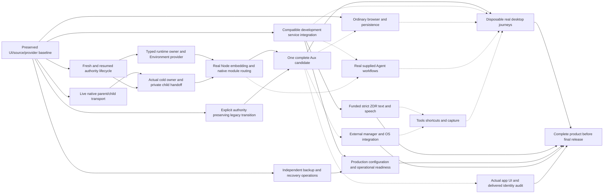

# Aux execution and completion graph

Updated 2026-10-22. This reconciles the owner's continuing implementation goal with current source, artifacts and actual evidence. It does not replace historical receipts or narrow the goal to source compilation. Execution is authorized; final desktop release/distribution remains excluded. Preserve the supplied implementation and current accepted UI, canonical Aux logo, owner data, existing provider projects and password-manager exclusion.

## Starting point and immediate queue

- Local main checkpoint `4f74e71e5` includes the recovery/runtime source chain and exact participant corrections. Later source integrations remain separately identified in Git and STATUS.
- Accepted preview remains `out/provided-candidate-local-browser-pass/Aux.app`. The unsigned recovery-enrollment package is a separately inventoried, unlaunched/state2-refused candidate; it is not its replacement.
- Applied native composition: `out/native-reuse-composition-aux-participant-addresses`, SHA256 `34f8baa6086a707488181d3a08663efd515ffaae9f01b8e2cec8776478283107`,808 source records/23 assets. Actual build93645 is live; its content module graph invalidated2765 tasks. Native source remains frozen until terminal. The preceding792-source build passed; that is not the current808-source build result.
- Renderer3TUs, worker5TUs, installed-app1TU and their focused state fixtures passed. These establish changed compilation/state boundaries, not browser shutdown/storage custody or final app behavior. The actual23-input fresh graph and53 target cases passed; new resumed/provider graphs remain pending.
- Separate development backend is deployed at `dev-cloud.getaux.co`. Its actual auth/rotation, sandbox subscription/payment/refund, encrypted transport, cookie export and synthetic recovery evidence is retained in `docs/cloud/implementation-2026-10-22.md`. One real development email was delivered; no owner code/sign-in was used.
- Separate production database now has12 matching migrations. Production profile remains null/inactive, nine live billing/webhook settings remain absent, provider pairing/operations are incomplete. No production-ready claim.
- Exact supplied Node26.5.0 executable/config and relevant headers match official archives. Preload component compiled as one object. Real Node Environment runner source now calls ModuleData/preload loading, event loop and explicit native drain; its single object check77772 is queued. No embedding executable/runtime activation exists. Queued library job26750 was canceled before execution to prioritize corrected graphs; do not treat it as running or as a compiler failure.

The original BASE, FRAME, BROWSER, AGENT, TOOLS, PACKAGE, JOURNEY and READY identifiers remain stable. The owner’s later cloud/production objective expands READY; it does not waive the older local-browser requirements. The prior detailed dated execution record is preserved in `docs/archive/execution-graph-2026-10-21-before-cloud-integration.md`; its active-worker/build statements are historical.

Provider-quarantine and peer-right ownership corrections are now integrated. The same deferred40860 is pinned to the final36-input Swift graph; actual WorkerHost compile51207, peer object/wire91715, provider lifecycle22764 and resumed filesystem42833 are queued, not results. The typed launch/C-only endpoint sources are integrated with retained COPY_SEND ownership. Parent compile remains unqueued pending exception-free compatibility with actual Chromium PCM; final cold guard and authenticated selected-home fileport transfer are under implementation. The next integrator actions are to pair those real producers into the actual parent-start/child-before-Node caller and finish the embedding executable. Do not launch a duplicate full graph. Continue actual parent/child/embedding implementation while build93645 runs; do not mutate its native checkout. The live/terminal handle ledger is `docs/integration/proposed/aux-native-parallel-checkpoint.json`.

## Dependency graph

Solid arrows are implementation prerequisites. Dashed arrows are integrated acceptance prerequisites; they do not prevent independent source work. Build-lock and dashboard contention are scheduling constraints below, not product dependencies.

Critical edges: the real native caller must own the installation and lifecycle before an Environment can receive a protected dispatcher. A signed policy or authenticated IPC peer alone cannot grant whole-profile custody. The supplied entry/native routing cannot be activated merely because an object compiled. Legacy migration cannot be silently replaced with key regeneration. Real desktop/cloud journeys require the same assembled native/resource generation; old service tests or UI screenshots cannot accept it. Production operations require independent recoverable content and key custody, not only a database branch restore.

## Outcome registry and requirement coverage

| ID / state | Scope and current evidence | Completion evidence / next action |
| --- | --- | --- |
| BASE / preserved | Accepted supplied UI, two-path logo, original static source pins, separate Aux storage/resources; no builtin Vault. | Keep all current UI/layout/glass assets byte-identical through this native/cloud batch. Count/hash every integration delta; no resets or owner-profile reads. |
| AUTH / implemented source, partly checked | Real fresh private-home creator, retained FD journal, five-row capture, immutable v2 stage, one-shot intents, four-row readback, terminal crypto, shared alias lease. Resumed-only owner/context and canonical-parent correction now exist. Actual23-input graph/53 target cases,14 parser cases,55/33 captured checks are scoped evidence. | Final combined graph plus focused real resumed filesystem cases; actual signed/protected fresh/restart/recovery behavior in the approved disposable scope. No absent/unavailable-to-fresh inference, replay or lost private authority. |
| OWNER / implementation under review | Genuine terminal → recaptured scoped context → retained-home CSK coordinator → owned dispatcher; after-flock identity recheck. Provider adds native-only routing and per-Environment creation. Late failed retirement requires retained/quarantined observation. | One final source-pinned graph (same deferred40860), changed FD/lock/provider fixtures, actual cleanup/late-close behavior; no JS supplied selectors/cores/provider or generic admission flag. Root integrates actual host recipe once. |
| PEER / implementation under review | Real Mach audit transport source uses direct waitable-child/birth observation, audit PID version, exact native code policy, nonce and monotonic closure. Root review requires wrong-process right-destruction correction. | Actual SDK compile/pure-wire check, then bounded real authenticated parent/child, negative peer and closure cases after a genuine native producer exists. Authenticated transport is not installation authority. |
| COLD / implementation missing | Existing first native/SEA/Node refusal stays first. Async-profile, helper, session, renderer/navigation and worker participants provide partial real observations only. | Implement actual earliest parent owner, cold fresh/resume/legacy choice, sealed peer-policy provenance, private right handoff and retained spawned-process/descendant lifecycle. Explicitly cover remaining renderer/storage/CLI/foreign writers; never promote raw callback counts/locks into all-writers success. |
| EMBED / component implemented, unlinked | Exact runtime source acquired; real LoadEnvironment preload component compiles and Node propagates it into child Worker environments. Explicit provider-backed WorkerHost source is separate from its unchanged selected default. | Build exact-version library/embedding executable, consume genuine cold/native provider, preload exact validated runtime/PDF/utility images, pair actual Environment cleanup/descendant closure and route supplied daemon/CLI synchronous/Worker calls. Retire original common addon against full command inventory. Preserve original runtime files; do not replace them opportunistically. |
| LEGACY / partial implementation | Versioned Aux-v2 crypto/selector ports and private-authority-preserving journal/prepared handoff sources exist; earlier software/FS checks are historical narrow evidence. | Complete explicit migration/recovery for existing formats and current account/session/cache/context ledgers, immutable catalog/trust transitions and rollback. Verify same private authority/data, no reset/delete or unauthorized old-group reads. Scope any real owner-data operation separately. |
| PACKAGE / prior package static only | Recovery-enrollment package inventoried10,764 resources/418 native leaves;1217 UI files retained with reviewed enrollment deltas. Current native/owner successors are not in an accepted running package. | Assemble one complete native/resource/SEA/Node/extension/CLI/carrier generation; preserve exact addons required by reviewed plan; verify actual paired identities/wires/resources/retired leaves. Prepare concrete exact-byte local runtime/signing review where required. No release/notarization. |
| CLOUD / implemented and deployed development, desktop inactive | Compatible auth, rotating sessions, Clerk, sandbox Stripe, encrypted sync/media/sharing/recovery/cookie API and strict provider adapters have actual development evidence. Current desktop still needs the paired new stack. | Reuse unchanged API evidence; finish actual app sign-in/token exchange/restart, subscription UI/portal/entitlements, independent-device sync/conflict/recovery, cookie restore and explicit share/revoke/large attachment journeys. No fabricated accounts/plans or owner email-code use. |
| AI / implemented, funded acceptance pending | Gateway server-held credentials, per-request ZDR and configurable model; owner selected GPT-6 Luna ≤$5. Prior credit checkout separately needs unanswered AI Product Terms consent. | After that consent, complete only approved purchase (≤$12, auto reload off) and bounded real ZDR text/browser-task/fast-model/lasso and synthetic speech checks, including debit/refund/routing/error evidence. Confirm actual desktop controls, microphone/recording separately. No provider call before approval. |
| BROWSER / historically implemented, current-generation acceptance pending | Existing supplied tabs/navigation/bookmarks/history/downloads/imports, normal/popup/installed-app session restoration and external extension paths remain. | Reuse unchanged historical evidence; prove affected ordinary browser/persistence/import/native-message boundaries on the exact final candidate without owner profiles or password import. Vendor trust is EXT, not inferred here. |
| AGENT / supplied implementation preserved, new stack pending | Original chat/model/reasoning/project/guard/task/stream/cancel/history/context/settings contracts and the20 genuine prior Muse cases remain the baseline. | Real packaged current-provider and profile-scoped task/config/context journeys using the agreed bounded model; no UI approximation or repeat of the unaffected20-case suite. Final failures/availability must remain truthful. |
| TOOLS / partial local evidence, setup-specific acceptance pending | Notifications, Mini Popup, lasso, observer/Computer Use, hosted dictation and native CLI/runtime utilities remain distinct capabilities. | Focus affected routes through real reviewed native helpers and services; actual physical shortcut/capture/microphone/OS permission evidence only where required. AI/EXT carry external prerequisites; source registration alone does not accept this outcome. |
| JOURNEY / not accepted current generation | Historical profile/window/draft/attachment/notification/sidebar tests remain valid only for their named previews; current resources/native startup are not accepted. | One focused real app batch: active work across profiles, normal+popup+installed-app restart, drafts/attachment recovery/failure, notification target, shortcuts/sidebars/chat/settings, cloud/provider work. Preserve current UI; capture exact candidate/state/evidence and cleanup. Do not repeat unrelated20-case browser-agent suite. |
| EXT / partly checked, external setup pending | Generic native-message and dummy fill checks passed. Existing owner-approved observer checks/grants are exact-helper historical evidence. | Real1Password official extension/desktop pairing with exact Apple identity and explicit trust using only a dummy login; actual reviewed observer/helper permissions and bounded capture if required; physical Mini Popup/global shortcut confirmation. No owner vault, unrelated Contacts/Messages or new OS grant inferred. |
| OPS / tooling and narrow drills verified, operations missing | Independent archive/local restore and isolated Neon/Blob synthetic recovery drills passed. Database restore alone cannot restore deleted Blob or lost wrapping keys. | Provision/authorize durable independent backup and key custody, scheduling, retention deletion and alerts; run one complete restore from those actual stores, record cleanup and measured limits. Do not claim production RPO/RTO from fixture size. |
| PROD / resources/schema prepared, configuration incomplete | Separate Aux prod DB/Blob/credentials,12 matching migrations and public origins exist; nine live billing/webhook settings plus provider/sender pairing/runtime verification remain. | Owner completes live Stripe business/KYC where required; prepare exact Aux live prices/portal/webhooks, Clerk/Resend pairing and production resource profile. Obtain concrete activation approval only after reviewable preparation. Perform authorized isolated readiness/provider/operations checks; marketing and old projects stay untouched. |
| FRAME / accepted baseline preserved, final observation missing | Current batch changes no UI views/CSS/artwork. Static package preservation and older actual side-by-side captures are scoped historical evidence. | Compare the actual final app to accepted Aux/Aside references at matching scale: window and both-sidebar corners, toolbar/bookmarks blend, glass/transparency, collapsed/hover/floating/pinned states, chat/model controls, settings and empty/loading/error states. Audit actual delivered files/native identifiers/endpoints; retain HTML semantics and required legal attribution. No screenshot/static grep substitutes for behavior. |
| READY / unproven | Whole owner objective, not a package/compiler milestone. | All above outcomes accepted at their stated scope, one reproducible ready candidate and operational handoff with clear optional owner choices. Final desktop release/distribution remains excluded. No completion percentage or “ready” from unresolved gates. |

## Ownership, scheduling and execution protocol

| Resource / surface | Exclusive owner / rule |
| --- | --- |
| Shared Chromium tree, GN, root stage/package/patch manifests and `/tmp/aux-build.lock` | Integrator. Current93645 owns native source freeze. Preserve preexisting changes and exact apply receipts. Never restart a confirmed live job because of elapsed time. |
| Provider/WorkerHost and account-runtime proposals | `/root/aux_identity_native_audit`, separate worktree/new successor paths. Return frozen source/pins, actual queue IDs/results and precise root integration edits. Same40860 may change its deferred recipe only before execution, preserving original recipes/failure receipts. |
| Resumed-only filesystem implementation/check | `/root/aux_identity_crypto`, separate worktree/new test proposal. Frozen production sources stay unchanged; captured identity is explicitly not actual signing authentication. One narrow physical-FS fixture; no duplicate25/31/36 graphs. |
| Mach peer transport and native embedding proposal | `/root/aux_identity_package_gate`, separate worktree/new paths. No shared launch/GN changes. Real transport/Environment ownership cannot fabricate parent/profile authority. Root reviews then queues the focused compile. |
| Vercel/Neon/Clerk/Stripe/Resend and production switches | Integrator, exact Aux project/environment/account checks. Do not mix metadata/accounts or local Development env into Production. Never print/read back secrets or mutate old projects. |
| Actual app/CUA/OS state | Integrator only, disposable scope; coordinate one bounded session with owner when needed. Keep current preview intact until the replacement is reviewable and authorized. |

At most three implementation workers plus the integrator. Prefer finish/integrate current outcomes over starting more proposals. When a lane waits, choose an independently useful next node only if its exact producer/contract is available. Frozen source proposals are not running integration, and a proposed lane is not an agent.

Native compile/apply work uses the existing serializer. Focused changed sources first, one combined integration link at a stable boundary, then one actual-app journey per changed behavior. Reuse unaffected evidence. Node library compilation is a necessary implementation build, not a reason to block higher-priority corrected source checks; schedule it after those checks and never replace supplied runtime bytes implicitly. Owner's two analysis jobs remain untouched.

External boundaries are explicit: no new signing/provisioning/Keychain/OS operation based on historical exceptions; prepare exact current bytes first. No funded AI/legal acceptance inferred from credit-purchase approval. No real sign-in/account creation inferred from the single delivery approval. No production activation inferred from resource bootstrap approval. Keep pending owner decisions in the existing request flow rather than repeatedly asking.

Continue this graph within the active goal: integrate reviewed current lanes, prove real native admission/embedding, assemble and exercise one unchanged-UI desktop/cloud generation, and finish production operations/configuration. Update nodes when authoritative evidence changes. Keep the full objective active until completion is proven requirement by requirement.
