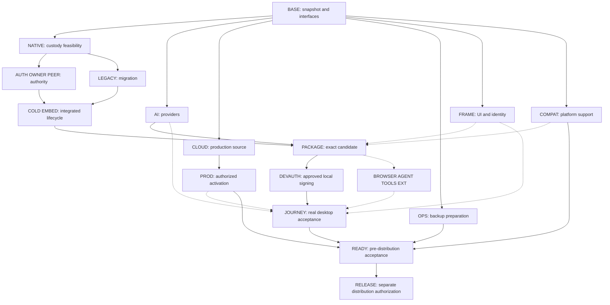

# Aux final completion execution plan

Drafted 2026-10-23 for parallel execution. This is the canonical remaining-work plan. It preserves the original outcome IDs and replaces scheduling/current-state claims in the [archived previous graph](archive/execution-graph-2026-10-23-before-final-completion-plan.md). Historical receipts remain unchanged.

This planning request does not start implementation, builds, signing, provisioning, deployment or release. Read [STATUS](STATUS.md), the [supplied contract](design/aside-contract.md), [reuse plan](plans/2026-10-19-supplied-implementation-reuse.md) and [provider-funded scope](plans/2026-10-23-provider-funded-launch.md).

## 1. Desired result and boundaries

Deliver one reproducible, runnable Aux candidate with the accepted UI, reliable startup/profile/process ownership, working BYOK and eligible official ChatGPT connections, accepted browser/agent workflows, production account/sync/sharing integration and operational recovery. Finish pre-distribution acceptance before final release signing/notarization/public distribution.

- Reuse the supplied implementation. Preserve CSS, typography, geometry, glass, corners, transitions and interactions. Fix observed regressions; do not redesign.
- Keep the full two-path `assets/brand/arch-mark.svg`. Preserve required legal attribution and HTML `aside` semantics. Identity/crypto changes must follow a reviewed versioned migration, never blind substring replacement.
- No built-in Vault/password manager. Retain secure installation/provider credentials and verify external password-manager integration.
- No Aux payments, paid-plan gates, hosted-credit sales or Aux-funded inference/speech at launch. Preserve deferred implementations; do not resume Stripe setup.
- Do not silently drop promised features to pass readiness. Unsupported ChatGPT images and deferred speech need honest availability states; any launch-scope reduction needs owner disposition.
- Preserve owner data, credentials, profiles, Chromium changes and reverse-engineering jobs. Use disposable state; do not access or stop Aside services.
- No push, hosted Actions, signing, provisioning, production activation, new OS grants or distribution under ordinary implementation authority. Prepare exact reviews; prior exceptions apply only to their actual scope.
- Provider requests require applicable model, budget and data-handling authorization. Never expose secrets in source, logs, screenshots or URLs.

## 2. Audited baseline

Planning source: clean local `main` at `e1cef9ad535070d94973be9d5e23d404151e5ad2`. Record the actual planning commit as the worker baseline before dispatch. Recheck for intervening owner/agent changes; do not reset or blindly commit a dirty tree. Inspect existing agents/worktrees/build sessions before creating duplicate work.

| Surface | Established | Still open |
| --- | --- | --- |
| Accepted preview | `out/provided-candidate-local-browser-pass/Aux.app`, historical actual UI evidence | Acceptance does not transfer to new code |
| New candidate | `out/provided-candidate-provider-funded-20261023/Aux.app`; package passed, 10,767 supplied resources, 418 native leaves | Unsigned/inactive/unrun; ordinary startup refuses, cold hook off |
| UI | All 1,217 Agent leaves match final stage; five CSS files unchanged from preceding candidate; eleven JS chunks and manifest changed | Actual new-candidate comparison |
| Native | Coherent unsigned link, retirement corrections and PTY pairing | Genuine fresh/resume/legacy admission and whole-writer/descendant custody |
| Providers | Payment-free policy and official ChatGPT registration/refresh/catalog/stream/disconnect integrated | Real connections, model metadata gaps, crash-lock recovery |
| Cloud | Development service, production resources, payment-free source/config | Current production deployment and actual desktop integration/delivery |
| Recovery | Current-schema local/hosted restore and encrypted R2 delivery/readback/expiry verified | Scheduled runner, monitoring, renewal and independent owner key retrieval |

Exact inputs/hashes: [provider integration evidence](integration/proposed/provider-funded-integration/README.md), `actual-package.json`, `stage-evidence.json`, `entry-projections.json`, `ui-preservation.json`. Reuse these authoritative records instead of duplicating immutable receipts. Do not infer running jobs from old STATUS entries.

## 3. Dependency graph

Solid arrows are implementation prerequisites. Dashed arrows are acceptance dependencies: independent source and fixture work can begin earlier. Build/device/dashboard contention is scheduled separately.

Critical path: native feasibility → actual ownership/admission → cold integration → coherent candidate → scoped development authority → real runtime acceptance. Production activation and backup operations may become a second critical path. More UI/provider workers cannot remove native platform constraints.

Every implementation edge has a concrete reason: authority consumers require a stable custody mechanism; cold startup must select valid fresh/resume/legacy state; packaging needs paired native and provider inputs; protected runtime requires exact approved bytes. Production preparation is independent of native compilation. Cloud journeys require actual deployment; ordinary local journeys do not wait for unrelated cloud work.

## 4. Outcome registry

Track each outcome as **source implemented → integrated → built/deployed → observed → accepted**. Keep failed/blocked observations open. Relative effort below is active engineering effort, not an elapsed-time promise; approval/build waits are separate.

### BASE — recoverable snapshot and dispatch contracts

**Owner:** integrator. **State:** planning evidence reviewed; execution snapshot pending. **Effort:** small, high confidence.

- Inspect current changes, agents/worktrees, native jobs and approvals. Preserve essential uncommitted work without including secrets or unrelated files.
- Record the worker baseline; create separate worktrees and one-writer reservations.
- Freeze the existing native owner/generation, admission, retirement, cancellation and journal interfaces before parallel consumers diverge. Prefer existing typed contracts.
- Pin accepted Aux/Aside references, candidate paths, display/theme/scale and disposable-state policy.

**Deliverable:** `docs/integration/proposed/final-completion/baseline.md`. **Done:** dispatchable snapshot, actual reservations and input links; no guessed versions or authority.

### NATIVE — resolve custody feasibility first

**Owner:** native worker. **Prerequisite:** BASE. **Effort:** bounded discovery, highest uncertainty.

- Enumerate all profile writers: browser/profile services, renderer/storage work, daemon Environments/Workers, CLI, PTY children/descendants, PDF/utilities, helpers and late/foreign participants.
- Map each to real admission ownership, observation and terminal conditions. Account for detached descendants, PID reuse, missed events, crashes and late joiners.
- Select a supported custody mechanism. kqueue does not provide NOTE_TRACK descendant tracking. The macOS 27 descendant API requires entitlement plus initial-population/event-completion guarantees; a compiled observer or empty map does not prove drain.
- Determine whether macOS 27 is essential or an avoidable packaging dependency; send findings to COMPAT.
- If full custody is unavailable, retain safe refusal/quarantine and report the exact blocker. Do not call restricted switching full parity.

**Deliverable:** `final-completion/native-feasibility.md`, writer coverage matrix, exact interface proposal and only necessary bounded API/compiler evidence. **Exit:** implementable design accounts for every writer, or explicit external blocker/owner decision. Do not spend another full build on an unjustified mechanism.

### AUTH / OWNER / PEER — genuine native admission and ownership

**Owner:** native worker. **Prerequisites:** BASE, NATIVE. **Effort:** substantial, medium/low confidence until discovery closes.

- Finish fresh/resumed installation admission, actual signed policy/resource verification and retained private-home authority.
- Bind Environments, Workers and helper operations to native owner/generation; reject stale and foreign-process reuse.
- Finish authenticated parent/child handoff, launch failure and closure handling. Authenticated IPC alone does not grant profile custody.
- Preserve strongest uncertainty: wrong-process/unknown/pending retirement cannot become drained after a benign callback.
- Keep required secure identity formats and migration boundaries; no synthesized account/unlock/admission flags.

**Checks:** changed replay/stale-owner/closure boundaries, focused disposable filesystem cases where relevant, affected-unit compile. **Exit:** paired producers/consumers retain uncertainty safely. Protected behavior remains a JOURNEY gate.

### LEGACY — upgrade and interrupted recovery

**Owner:** native worker, or a free worker after interfaces are frozen and exact paths reserved. **Prerequisites:** BASE, NATIVE; AUTH interfaces for integration. **Effort:** substantial, medium confidence.

- Reconcile old Aux identity/crypto formats, sessions, caches, contexts and catalog/trust state with explicit versioned migration.
- Distinguish fresh, resumed and legacy state. Inaccessible/unavailable state must not be treated as a new installation.
- Finish journal interruption/resume and rollback without regeneration/deletion of existing keys/data.
- Use synthetic historical fixtures. Real owner migration requires separately scoped access.

**Exit:** synthetic upgrade and interrupted-resume preserve original authority/data and refuse ambiguity. Record supported source versions and recovery instructions.

### COLD / EMBED — complete the actual startup lifecycle

**Owner:** native worker proposes; integrator owns shared native wiring. **Prerequisites:** AUTH, OWNER, PEER, LEGACY. **Effort:** substantial, medium confidence.

- Connect earliest browser ownership, admission, private handoff, Node preload/Environment, Worker registration and validated module/helper loading.
- Integrate PTY, PDF and utility lifetimes into the complete writer model.
- Handle normal quit, failed startup, crash, cancel, profile switching and multi-window reuse without releasing unresolved ownership.
- Replace deliberate first refusal only when genuine authority exists. Do not just flip the cold hook or weaken package gates.

**Exit:** coherent source and changed-unit compile; all exact build operands ready. Runtime success still requires DEVAUTH/JOURNEY.

### AI — finish BYOK and official ChatGPT integration

**Owner:** provider worker. **Prerequisite:** BASE; independent of native source work. **Effort:** medium/substantial, medium confidence.

**Owned paths:** `vendor/aside/patches/chatgpt.mjs`, `vendor/aside/shims/aux-chatgpt.cjs`, corresponding focused tests, `vendor/provided/provider-funded-launch.mjs`, its tests/recipe, provider evidence. Shared stage/manifests are integrator proposals.

- Complete model metadata/capability mapping using supported contracts. Unknown limits/tools/vision must remain conservative, not fabricated.
- Implement crash-left authentication lock recovery without stealing a live operation or crossing accounts.
- Reconcile BYOK key add/remove/restart, errors, cancellation, retries and isolation with supplied credential API.
- Preserve ChatGPT registration, PKCE/state/nonce, identity/scope validation, account-bound catalog, refresh, streaming completion and awaited revocation.
- Verify intended public-distribution eligibility against current official docs before live registration; record any client approval/application needed. Do not reuse another product's identity or owner auth cache.
- Resolve whether supported public-plan image functionality can be completed; retain honest unavailable state otherwise and obtain scope disposition before claiming complete parity.
- Check payment/hosted denial across actual client/daemon routes while retaining real account authentication.

**Focused checks:** changed lock collision/crash cases, metadata mapping, transformed credential/provider boundaries. **Source done:** coherent connection lifecycle and truthful supplied UI states. **Accepted:** real connect/model/completed request/tool/cancel/restart/account switch/disconnect on final candidate with authorized usage and credential cleanup. Fixtures alone do not accept refresh or consent.

### CLOUD — current production source and configuration readiness

**Owner:** cloud worker. **Prerequisite:** BASE. **Effort:** medium, relatively high confidence; provider waits separate.

**Owned paths:** `services/aux-cloud/` plus `final-completion/cloud/`; explicitly reserve recovery files if OPS is delegated separately. No worker dashboard mutations.

- Compare current source with deployed development evidence. Reconcile configuration without exposing secrets.
- Finish remaining desktop/server mismatches for sign-in, revocation, encrypted sync/media/conflicts, sharing/revoke and account deletion.
- Verify default mode cannot create allowances, process billing mutations or spend Aux Gateway balance; preserve old financial records.
- Check changed webhook authentication/idempotency, public-share authorization, attachment limits and deletion boundaries.
- Prepare exact deployment, migrations, domain/webhook, monitoring and rollback review.
- Prepare truthful onboarding/support/privacy copy describing local provider tokens, cloud data and unavailable features.

**Exit:** deployable source, reconciled required settings, focused checks and concrete activation review. Production deployment/delivery remains PROD.

### OPS — make backups operational

**Owner:** cloud worker after CLOUD or free worker with exclusive recovery ownership. **Prerequisite:** BASE. **Effort:** medium; provisioning and owner retrieval waits separate.

- Reuse successful current-schema full restore and R2 evidence; no redundant broad drill for unchanged code.
- Finalize dedicated runner installation/configuration: private persistent disk, scoped credentials, schedule, retries, retention and alert routing.
- Prepare stale/failed-backup alerts, credential rotation and restore/cutover runbooks; independently recoverable key custody must be real.
- Track existing recovery credential expiry **November 22, 2026**; prepare renewal and pre-expiry alert, without unauthorized new access.
- After concrete approval, provision and demonstrate one actual scheduled encrypted backup, alert path and bounded recovery/readback from its output. Clean only owned fixtures/plaintext scratch.
- Record measured results; a tiny synthetic restore does not establish production RPO/RTO.

**Exit:** working schedule, monitored failure, owner emergency key retrieval and recoverable scheduled output. A prepared script/manual historical R2 check is insufficient.

### FRAME — UI fidelity and complete delivered identity

**Owner:** free worker for audit/proposals; integrator applies shared native/UI wiring. **Prerequisite:** BASE. **Effort:** medium, no redesign.

- Inventory accepted references and required states; separate account-content differences from visual implementation differences.
- Audit delivered product names, endpoints, identifiers and canonical logos. Reconcile historical identity/crypto preservation instructions with the current versioned migration; resolve conflicts before changing protocol bytes.
- Cover expanded/collapsed/hover/pinned sidebar, both panels, corners, glass/color blur, toolbar/bookmark blending, chat context/composer/model controls, settings/onboarding and empty/loading/error/disconnected states in both themes.
- Make only evidence-backed fixes, preserving unaffected supplied structure/styles. Return narrow native proposals.

**Exit before runtime:** state matrix and allowed-difference inventory. **Accepted:** matched-scale actual comparison and genuine hover/transition observation on final candidate. Hashes/screenshots do not prove motion.

### COMPAT / EXT — OS, vendor and helper support

**Owner:** free worker, read-only audit first. **Prerequisite:** BASE. **Effort:** medium; vendor/OS waits uncertain.

- Establish whole-package OS/architecture support from actual artifacts. Current measured minimum maximum is macOS 27; main compiler target 13.5 does not establish older support.
- If older systems are intended, list exact incompatible components and required rebuild/adaptation work; get support-matrix disposition rather than promise unverified compatibility.
- Verify official password-manager extension install/autofill with a dummy login. Treat desktop/native messaging separately.
- Prepare exact Apple identity/vendor trust requirements for 1Password companion pairing. Do not bypass trust or use owner vault contents.
- Inventory per-helper Computer Use/observer/capture/shortcut permissions. Historical grants are not automatic authority for new helpers; no unrelated Contacts/Messages permissions.

**Exit:** truthful supported matrix, actual extension behavior, promised companion/helper acceptance and clear optional setup. Unsupported vendor pairing remains open or explicitly scoped out by the owner.

### PACKAGE — one coherent integration build

**Owner:** integrator only. **Prerequisites:** COLD/EMBED, AI and any shipped-file changes from FRAME/COMPAT. **Effort:** medium integration plus serialized build time.

- Integrate coherent local worker commits; own root stage/package/patch manifests, identity registry, GN/registration/startup and native apply steps.
- Keep immutable predecessor receipts; introduce exact successor records for changed native/entry/helper/extension combinations.
- Compile affected units, then one combined native/browser build through `scripts/native-build.py` and `/tmp/aux-build.lock`.
- Stage with exact final app path and frozen snapshot; preservation check once per coherent candidate; package to a new directory and independently check critical copied bytes.
- Record exact source/artifact identities and invalidated prior evidence. Keep accepted preview intact.

**Exit:** reproducible paired candidate, no unexplained mixed generations. This does not establish runtime acceptance.

### DEVAUTH — scoped protected-runtime authorization

**Owner:** integrator. **Prerequisite:** PACKAGE. **Effort:** small/medium preparation plus external wait.

Prepare exact app/helper hashes, developer identity, entitlements, disposable state, Keychain/OS scope, cleanup and bounded checks. Explain the actual protected-startup/resource-seal dependency. Obtain only the current required authorization; do not reuse old exceptions beyond their scope. Execute approved development signing/permissions and record exact resulting artifact identity.

**Exit:** approved candidate can undergo protected runtime checks. This is not distribution signing or release approval. Continue independent work if approval is pending; leave runtime gates open.

### BROWSER / AGENT / TOOLS / JOURNEY — bounded real-app acceptance

**Owner:** integrator on actual Mac; workers diagnose traces separately. **Prerequisites for execution:** PACKAGE + DEVAUTH; PROD only for cloud journeys. **Effort:** bounded observation plus demonstrated fixes.

Prepare fixtures early. Run each affected journey once on final candidate; repeat only invalid/failed trials or behavior affected by new changes.

| ID | Journey and acceptance |
| --- | --- |
| J1 | Fresh startup, normal restart, interrupted launch and synthetic legacy resume preserve authority/data; errors are truthful |
| J2 | Switch during streaming/tool work/approval/open terminal; work never crosses profile/account, uncertainty blocks safely, no false drained result |
| J3 | Normal/popup/installed-app windows and tabs restore separately after quit; crash recovery does not duplicate or cross profiles |
| J4 | Draft and attachment restoration; oversized/missing/unreadable/quota failures retain clear retry/remove behavior without silent loss |
| J5 | Real BYOK/ChatGPT lifecycle; model/reasoning/context/project controls, streaming/cancel/history and one tool action without Aux payment state |
| J6 | Notification targets correct profile/window/chat after target closes; physical shortcut/Mini Popup and capture/lasso/helper denial behave honestly |
| J7 | Navigation/bookmarks/downloads and changed import/session/native-message boundaries; dummy password-manager fill and companion pairing recorded separately |
| J8 | Actual FRAME comparison at matched scale/theme; real hover and both-sidebar transitions, no corner clipping, toolbar seam or missing controls |
| J9 | Production sign-in/restart/revocation; two independent sessions sync/conflict; attachment/avatar; synthetic share/revoke and disposable deletion |
| J10 | Offline/provider rejection/expired auth do not fabricate success, expose credentials or corrupt drafts; fixtures/test credentials cleaned |

Do not repeat the historical twenty-task agent suite or spend inference for visual tests. Use minimum authorized requests and synthetic data. If automation cannot send genuine hover/physical shortcuts, get one bounded owner observation and label it correctly. Deferred speech is unavailable, not silently accepted by a text check.

**Exit:** applicable journeys observed on exact candidate/backend versions; unresolved failures remain open. Static preservation does not establish functional parity.

### PROD — authorized activation and operational acceptance

**Owner:** integrator, sole dashboard writer. **Prerequisite:** CLOUD review and applicable approval. OPS required for production readiness, not independent deployment preparation.

- Verify exact Aux Vercel/Neon/Blob/Clerk/Resend resources and production-only secrets; preserve marketing, older projects and Hostinger email DNS.
- Apply approved deployment/migration/domain/webhook actions with snapshot and rollback.
- Verify health, actual authorized sign-in delivery, revocation/deletion webhooks/idempotency and synthetic encrypted sync/media/share authorization.
- Verify deployed no-payment/no-hosted-spend behavior; environment values alone do not update old deployment.
- Enable error/health/backup alerting and record operating costs/limits, support contacts and honest public claims.

**Exit:** current production backend operational and paired with final desktop, delivery and recovery evidence recorded. Dev/source checks are insufficient.

### READY — complete pre-distribution acceptance

**Owner:** integrator. **Prerequisites:** all promised outcomes accepted; optional/deferred gaps explicitly dispositioned.

Produce one acceptance ledger containing feature, source commit, candidate/backend identity, observation, limitations, cleanup and evidence. Review credential/log hygiene, artifacts, identity, Vault exclusion, provider-only policy and support matrix. Prepare install/update/rollback/support instructions and required privacy/third-party notices without claiming legal approval. Reconcile STATUS/open graph nodes. Hand owner an actually runnable accepted candidate for final review; do not replace accepted preview prematurely.

**Done:** reproducible candidate; no unresolved critical startup/data-loss/account-isolation defects; all promised launch behavior implemented and observed; recovery operational; owner review recorded. No completion percentages or readiness claims from compiler/package milestones.

### RELEASE — separate final distribution handoff

Planned only. After READY and explicit approval: confirm final signing identity/entitlements, sign, notarize/staple, verify downloaded/quarantined install on a supported clean system, verify updater/rollback packaging and publish. Repeat protected-startup/vendor checks affected by changed signatures on exact distribution bytes. Development signing is not release acceptance.

## 5. Dispatch-ready parallel lanes

Maximum **four agents total: one integrator plus three workers**. Separate worktrees; local coherent commits. All first workers start from the recorded planning baseline.

| Slot | First outcome | Exclusive ownership | Next ready work |
| --- | --- | --- | --- |
| Integrator | BASE; interfaces and acceptance fixture preparation | Shared root manifests/scripts/native tree/GN/startup, graph/STATUS, final builds and device | FRAME/COMPAT audit, integration and review preparation |
| Worker A native | NATIVE then AUTH/OWNER/PEER/COLD | New `docs/integration/proposed/final-completion/native/` source proposals/successors; no shared Chromium mutation | LEGACY, or split it after contracts freeze |
| Worker B providers | AI | ChatGPT/provider files listed under AI and own evidence | FRAME/COMPAT or disjoint LEGACY after reservation |
| Worker C cloud | CLOUD then OPS | `services/aux-cloud/`, cloud evidence; explicitly reserve recovery files | Runner/alert preparation and production review; no dashboard writes |

Dispatch instruction:

> Work from [recorded baseline] on [outcome ID]. Read this graph/current evidence. Own only [reserved files]. Preserve UI/data. Deliver a coherent implementation, focused changed-boundary checks, local commit, exact source/evidence, runtime gaps and shared-file proposals. Do not sign/deploy/access owner state/spend funds or spawn beyond the four-slot total. Fixtures do not establish acceptance. Report exact blockers and continue only independently ready assigned work.

Use a rolling queue. Prioritize native feasibility/unblock value, then complete provider/cloud outcomes. Do not wait for the slowest lane before integrating completed work. Do not create overlapping proposals for an unresolved native interface. Reassign only after a coherent slice is delivered and ownership released.

## 6. Reservations and substantial integration batches

| Shared resource | Exclusive rule |
| --- | --- |
| Chromium/native build tree | Integrator; preserve changes, serialize via native-build.py and lock; inspect live jobs first |
| Stage/package/identity/GN manifests | Integrator; workers send narrow proposals; freeze operands during builds |
| Real Aux/Aside UI/OS settings | Integrator; disposable state, one bounded uninterrupted session |
| Dashboards/secrets/production | Integrator within actual authority; no secret output/account mixing |
| Accepted preview | Immutable until accepted authorized successor |
| STATUS/graph | Integrator; workers write owned evidence directories |

**Batch A: finish implementation.** Native, providers and cloud/operations preparation in parallel. Integrate coherent slices; avoid repeated packages while startup is still unsolved.

**Batch B: build together.** After native prerequisites close, integrate provider and necessary UI changes, compile changed units and perform one combined build/package. Record all failed attempts honestly.

**Batch C: observe and repair.** Approved protected startup plus bounded J1–J10 campaign; production/backup setup can proceed independently through sole operator. Fix concrete failures; repeat affected observations only.

**Batch D: owner handoff.** Close evidence ledger, owner test, operating docs and distinct release review. Any changed dependency identifies the precise evidence to invalidate/repeat.

## 7. Owner/external dependencies

| Dependency | Prepare now | Owner/provider action | Gate |
| --- | --- | --- | --- |
| Native platform | Exact feasible mechanism/OS/entitlement review | Concrete new entitlement/provisioning decision if needed | COLD/COMPAT |
| Development signing | Built exact-byte review, scope and cleanup | Current bounded protected-runtime authorization | DEVAUTH |
| Provider connections | Working flow and minimum request plan | Direct consent/login or secure key entry where required | AI acceptance |
| ChatGPT public eligibility | Current official requirements and Aux identity | Vendor application/approval if required | Public ChatGPT launch |
| Backup runner | Concrete cost/access/install/schedule review | Provisioning approval and independent key retrieval | OPS |
| Production activation | Exact deploy/config/migration/rollback review | Activation approval where not already covered | PROD |
| Vendor/OS trust | Exact browser/helper and dummy fixture | Trust prompts/physical shortcut observation | EXT/TOOLS |
| OS/optional features | Evidence-backed support/gap inventory | Disposition for older OS/images/speech if incomplete | READY |
| Distribution | Accepted candidate and checklist | Explicit signing/notarization/release authority | RELEASE |

Do not request repeated approval for already-authorized exact actions. Resource/bootstrap approval does not automatically authorize activation, owner-data access or distribution. Continue independent work while external gates wait.

## 8. Evidence and lean verification

One outcome record identifies source commit, exact inputs/output hashes, scope/environment, command/action, result, cleanup and limitation. Never include secrets/personal content. Preserve unaffected historical evidence, but do not transfer it to changed native/provider generations. Workers run focused checks; integrator runs shared checks once per coherent candidate. No test-count targets, speculative benchmarks, repeated broad restores or twenty-task reruns. Report source/integrated/built/observed/accepted separately.

Before READY, reconcile every old graph ID: BASE, AUTH, OWNER, PEER, COLD, EMBED, LEGACY, PACKAGE, CLOUD, AI, BROWSER, AGENT, TOOLS, JOURNEY, EXT, OPS, PROD, FRAME, READY. New NATIVE/COMPAT/DEVAUTH/RELEASE nodes expose previously implicit dependencies; they do not erase old requirements.

## 9. Reusable execution instruction

> Execute `docs/ROADMAP-EXECUTION-GRAPH.md` through READY. Preserve accepted Aux UI/preview. Use one integrator and up to three workers in isolated worktrees from a recorded baseline. Start NATIVE, AI and CLOUD in parallel; use the rolling queue. Integrate coherent slices, serialize native builds and use focused changed-boundary checks plus actual final-app acceptance. Prepare concrete external/signing/production reviews without assuming authorization. Keep unimplemented and unverified items open. Do not release or distribute. Return the accepted runnable candidate, evidence ledger and remaining owner actions.
