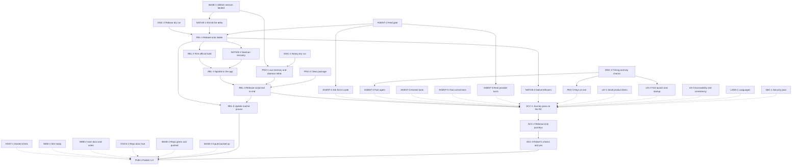

# Aux finish plan

2026-10-31. This is the single plan from build 136 to a public Aux 1.0. It replaces the older outcome inventory on this page (in Git history) and overrides older plans where they disagree. Built from four read-only audits of the code and the packaged app, with the highest-stakes claims rechecked by hand. Nothing was built, launched or changed to write it.

Robert gave permission to make any decision that gives the best outcome, so the decisions below are made, not proposed. He also said Claude can do most of the hands-on work, so this plan assigns pushes, deploys, the hosted pause and cleanup to Claude. One "ship" from Robert covers the public release: upload, site and update feed. Work is sized by what actually bounds it (native builds, launches, approvals), never by human time.

## Where it stands

**The product is close. The release path is not.** Almost everything Robert asked for in the owner ledger has been seen on screen, and most of the second audit's list has since been built. What's left falls into five groups:

1. **It can't ship yet.** No official build has ever run, Sparkle isn't in the app, one Mach-O is unsigned, and Chromium is two milestones behind with no rebase ever tried.
2. **The agent is the weakest part of the product.** A gate that looks wrong for every local user likely blocks `aux chats`, `ask`, `exec`, `repl` and the approval popover. "Ask first" relies on the model choosing to ask. Turns are slow, and models are offered tools that always fail.
3. **The package and Chromium surface still carry leftovers.** Old paths, Google features switched off by a flag instead of by default, the extension UI in English only, and a critical-rated DOMPurify advisory.
4. **The outside world is behind.** The website is 25 days old, `/download` and the appcast return 404, public docs describe an older product, and CI is red and would stay red after a push.
5. **The default path has never been walked.** Finder launch, real Keychain, a DMG with quarantine, macOS 15, and an update have all gone unobserved.

### Baseline

| Thing | State |
|---|---|
| Source | `main` at `fafda2fef`, 105 commits ahead of `origin/main`, nothing pushed |
| Dirty | `apps/pdf-addon/build.sh` untracked. `AuxFreshBootstrapPolicy.swift` edited in the durable checkout by the running session |
| In flight | The running session "Browser experience comprehensive analysis" is diagnosing the `a2` utilities add-on refusal. Build 137 is its diagnostic build, not a candidate. `out/AuxFast` was rebuilt at 06:39 and no longer matches build 136 |
| Latest candidate | Build 136: Developer ID signed, hardened, not notarized, AuxFast config. 111 Mach-Os: 107 ours, 3 At Inc., 1 unsigned. 1.2 GB. `LSMinimumSystemVersion` 15.0.0 |
| Last notarized | Build 43 only |
| Chromium | Base 155.0.8059.85 (commit dated 2026-10-14). Stable today 157.0.8103.26 |
| Tests | `pnpm test` 709 of 712 pass on this tree (recorded, not rerun). CI red on the last 6 pushes |
| Hosted | Healthy, no runtime errors in 7 days, matches `main` |
| Website | Live deployment 25 days old; prepared work sits on unpushed branch `release-prep-20261028` |
| This Mac | Mac17,6, 18 cores, 128 GB, 1.1 TB free. Tart installed, no Sequoia image pulled, Tartelet not running |

### Doc claims this audit overturned

- "Imported passwords can't be used" (audit 2) is out of date. `IsFillingEnabled` is upstream again, and only saving is off. Not yet seen on screen.
- `aux chats`, `mcp list` and `ask` failing on "a locked vault" is very likely not a mock-keychain artifact. See AGENT-1.
- Build 43 notarizing does not prove `aux-memory` passes: its copy was signed (`eb1a43f9…`), and that signature broke memory indexing. Build 136's copy is unsigned (`b4c7d12e…`) and pinned by hash in the daemon.
- The appcast's missing signature in build 43 was likely caused by the missing `SUPublicEDKey`, not a Keychain prompt.
- "Local CI is ready" is false. "Hermetic exited 0" covered only the Node half.
- Bash waiting on Apple is only part of the story: file edits are blocked by a dispatcher allowlist, and Endpoint Security is macOS 27 only, so Apple's approval alone would still leave 15 and 26 without a shell.
- Closed and still listed as open: `bundle.json`, entitlements, UTIs, version pin, CORS, LOG(ERROR) noise, stale Vercel variables, all six lanes merged, most hosted items.

## Decisions

| # | Question | Decision | Why |
|---|---|---|---|
| 1 | Should browsing ask? | Never per click or per site. Add one check in code under Ask first: submit, send or pay controls and any action on a banking-class site force the card | Today a page can talk the model out of asking. This fixes that without the noise |
| 2 | Debugger notice | Hide Chromium's bar for Aux's own extension only, with Stop and the tab-row mark as the visible signal. Third-party extensions keep the warning | The signal stays, in Aux's own design |
| 3 | "A referenced tab changed" | Rebind automatically on same-origin navigation from the agent's own click. Cross-origin still asks | Fixes the common case and keeps the safety rule |
| 4 | In-app shell without Apple | Not for 1.0. Local CLIs (Claude Code, Codex) provide shell and files. No Seatbelt shell | A new sandbox is the riskiest thing to add at the end |
| 5 | REPL, ChatGPT form, Apple | None hold up 1.0. Ship the REPL later as an update if Apple approves. The ChatGPT form stays unsubmitted | Waiting on outsiders can't be scheduled |
| 6 | Widevine | 1.0 ships without VMP, and the docs say plainly that some streaming services may not play. Test whether the CDM loads. castLabs stays open as a follow-up | Licence and audit are outside our control |
| 7 | Chromium | Rebase to current stable before release. Build the release routine before launch, not after | A two-milestone-old browser is not excellent, however good the UI |
| 8 | Rebase order | Shrink the delta first, then rebase once on a fresh checkout. That run is also the clean-apply proof | Fewer conflicts, and one piece of work settles two gates |
| 9 | Hosted scope | Pause sign-up, email sign-in, sync, shares, uploads and the 5-minute cron. Keep docs. Keep Neon, Clerk and all data | It's live attack surface with no shipped user, and it's reversible |
| 10 | Skill icons | Bundle them (decision 10 of 2026-10-28, half done), then retire `dev-cloud` | Offline, private, and a hosted dependency gone |
| 11 | Sign-in chunks | Remove with decision 9, after confirming the paused-account path can't reach a local user | Nothing left to link to them |
| 12 | Link filter | Yes. Claude tries the edit. If the safety check refuses it again, 1.0 ships without it | Unlocks the PDF add-on, Arc fixture and model tests. None of them blocks 1.0: the supplied add-on ships, and the fixture can run as a JS test |
| 13 | `apps/pdf-addon/build.sh` | Commit once the add-on links | It's a real build script |
| 14 | `aux-crypto` | Stays inactive and supplied in 1.0 | Removing a pinned part adds risk and no user value |
| 15 | expat | Bump, as part of PKG-2 | One manifest line and a rebuild |
| 16 | `aux exec --allow` | Pre-approves read-only tools only. Never send, pay, delete or submit | Keeps decision 1 meaningful |
| 17 | Google Password "Offer to save" | Hide it, since saving is off | It's a dead toggle. The password row stays, because it's where imports can be seen |
| 18 | x64 node-pty | Drop it, reversing audit 3's "left in". Re-sign the arm64 `spawn-helper` | We're repinning here anyway, and a launch checks it |
| 19 | Utilities add-on | If the running session finds the cause, ship ours. If not, 1.0 keeps the supplied image | It already works |
| 20 | Rule docs | Update AGENTS.md and the contract to match decisions Robert already made (chats, local CLIs, macOS 15, Spaces, port 21522) | They're only catching up with him |
| 21 | Batch 1.3 refresh | Recorded as dropped unless a 200-tab profile lags | Rows already survive refresh |
| 22 | CDP challenge cap | Replace with a rate limit | Every peer is loopback, so per-peer has no key |
| 23 | Local CLI list | List only drivers with a real turn behind them as supported. Everything else stays under Add a local agent | Claims match what ran |

No settled design decision is reversed here. Legal stays on Robert's own track and off this plan. One input for that track: the privacy page says crash reports stay on the Mac, while release builds have the opt-in Sentry path.

## Dependency graph

Solid arrows are implementation prerequisites. Dashed arrows mean the work can start now, but final acceptance needs the other node.

**Critical path:** BASE-1 → NATIVE-1 → REL-1 → REL-2 → REL-3 → REL-4 → ACC-1 → ACC-2 → ACC-3 → PUB-1.

**Why these edges:**
- NATIVE-1 before REL-1 is deliberate: 751 guard lines and dead code removed now don't conflict later.
- REL-2 needs REL-1, because a first official build on a base we're about to leave proves little.
- NATIVE-2 and NATIVE-3 follow REL-1 so they're tested on the base that ships. If the dry run shows a small rebase, they can move earlier.
- ACC-1 runs once, on the first full release candidate, so nothing gets tested twice.

**Bottlenecks:** native builds and official links on one Mac (first ThinLTO run unknown), the size of the rebase (unknown until DISC-2), and tightly coupled daemon pins that fail without a reason.

## Nodes

State: **ready**, **active**, **blocked** or **planned**. "Bound by" is what limits each node.

### Baseline

| ID | Outcome | Needs | Scope | Done when | Bound by | State |
|---|---|---|---|---|---|---|
| BASE-1 | Utilities work landed or stopped | none | Cause found on 2026-10-31: home journals pin the policy hash (`macos-utilities.md` section 7). Commits up to `60ad52ad7` | Build 139 runs on a1 + a6 | Done | done |
| BASE-2 | CI green, `main` pushed | none | Start Tartelet, switch `gh` to `robzilla1738`. Run `out/cleanup-2026-10-28/cleanup.sh` and remove the six merged lane worktrees after checking each target. Make `test_repair_combined.py` hermetic (`require_input('candidateApp')` at line 78). Add the 3 hex false positives to `.gitleaksignore`. Scrub the one alert-address line. Align `.node-version`, set `package.json` to 1.0.0. Rewrite `.env.example`. Run all of `test:ci` | CI passes all three jobs on the pushed commit | One CI run | ready |
| BASE-3 | Nothing is only on this Mac | Run after BASE-1 | Refresh the encrypted backup with `out/live-inputs` (20 GB), the a1 candidate, `out/runtime`, the frozen snapshot, signing profile. Confirm the Sparkle private key and put a recovery copy in the vault | Restore checked on one file. Sparkle key confirmed | A disk copy | ready |

### Discovery

| ID | Question | Scope | Exit | Bound by | State |
|---|---|---|---|---|---|
| DISC-1 | What does Apple reject today? | Submit a current Developer ID build to notarytool and read the log. Upload only, nothing published | A list of rejected paths, and a verdict on `aux-memory` and the 86 rebuilt runtime files | Apple's queue | ready |
| DISC-2 | How big is the rebase? | Fresh Chromium checkout at the current stable tag in `aux-chromium-durable/`, then `chromium-rebase.py --dry-run` | Conflict count by area, and a call on whether to do NATIVE-2 before or after REL-1 | Network and disk | ready |
| DISC-3 | Where does the time go, and how are keys stored? | One-time timers in `openTab` and turn stages. Time the first-launch signature check and daemon start. Add a fixture key and read how `credentials.json` stores it | Time per step. Keys confirmed plain or wrapped | One build and launch | planned |

### Agent

| ID | Outcome | Needs | Scope | Done when | Bound by | State |
|---|---|---|---|---|---|---|
| AGENT-1 | Local users get the feed | NATIVE lane | `allows_browsing()` requires `configured && !locked`, and a local profile has neither (`profile_state_probe.cc:48`). Add a local-account predicate and use it at the six sites in `aux_native_task_feed.cc`. Follow `aux_chats_transport.cc:113` | All `aux` commands answer on a fresh local profile. The amber popover opens | One build | ready |
| AGENT-2 | Ask first holds even if a page lies | AGENT-1 | Code check for decision 1. Expose confirm and ask over MCP for CLI turns (`provider-cli/aux-daemon.mjs:20`). Add the `--allow` limit | A fixture form raises the card on an API turn and a CLI turn. Approve and Deny work. An injected fixture page can't skip it | One build | planned |
| AGENT-3 | The agent feels fast | DISC-3 | Return from `openTab` at `interactive`, include the snapshot to save a round trip, show the step at once. Target: `openTab` under 3 s on a simple page | Timers show the target met | Timer results | planned |
| AGENT-4 | Models see only tools that work | none | `toolsets.mjs:9-19` offers only live tools. Drop removed REPL APIs (`entry:197-205`). Register write and edit under Guard paths if brokering holds. Skills that need a shell say so. API-key turns suggest a connected CLI | No turn wastes a step on an always-failing tool. Docx, xlsx and pptx skills give a clear path | JS only | ready |
| AGENT-5 | Chats behave and polish holds | none | Prompt refresh, memory stamp and rename for every open chat (`aux-agent.mjs:174-185`). Rename home-thread code. New chat and Chats commands with keys. Citations unwrap any Google host. Search: cache and dedupe the fan-out, a plain limit message, an optional key. Decisions 2 and 3 | A long chat picks up a rename. Keyboard opens chats. Citations show the real site | JS, then one native build | ready |
| AGENT-6 | Local CLIs proven | AGENT-1 | A fixture agent first, then Claude Code and Codex with Robert's logins, others if installed. Approval cards on a CLI turn. Settle Cursor, Grok and OpenCode permission modes | One real turn per supported driver | Installed CLIs | planned |

### Native

| ID | Outcome | Needs | Scope | Done when | Bound by | State |
|---|---|---|---|---|---|---|
| NATIVE-1 | Smaller delta, Google off by default | BASE-1 | Default off: Glic, Lens, Compose, `kGlicActor`, `kAim3pEntrypoint`. Hard off: sign-in opt-in, sync, iOS promos. Delete the 751 guard lines, Vault passkey broker, `RunCarrier`, `chrome://aux` remnants, unused dot button, inert `AUX_TEST_HOOKS`, mode 8 path. Remove `assert(false)` at `chrome/browser/BUILD.gn:1531`. Downgrade 19 traces. Reword reachable Chrome, Gemini and Lens strings | `gn gen` passes on release args. Launch, Settings and menus show no Google surface. Delta smaller | One large build | planned |
| NATIVE-2 | The agent recovers on its own | REL-1 | Relaunch on the native route (`daemon_supervisor.cc:296-305`). Working Retry without restarting the browser. Cache the route (20 reads) | `kill -9` the daemon: the agent returns and the UI says what happened | One build | planned |
| NATIVE-3 | Native leftovers closed | REL-1 | One profile-keyed chat and tab feed (8.14). Theme preview per window. CDP rate limit. Link the model tests and Arc fixture after the filter | `pnpm test` and native tests pass. No duplicate polling | One build | planned |

### Package

| ID | Outcome | Needs | Scope | Done when | Bound by | State |
|---|---|---|---|---|---|---|
| PKG-1 | `aux-memory` passes Apple and still works | BASE-1, DISC-1 | Sign it and change the pin in one daemon relink, shared with any BASE-1 outcome | It launches, and memory indexes and answers. A clean assembly doesn't count | One relink and launch | planned |
| PKG-2 | Package clean | none | Strip or recompile 646 `.pyc`. Regenerate venv paths and `runtime-text-root.json` (hash-pinned, a live anchor). Reword `prepare-python.py`. Remove CI paths. Remap build paths in `aux-daemon`. Drop x64 node-pty, re-sign `spawn-helper`. Remove 5 `127.0.0.1:9` strings. Bundle skill icons. Purpose strings on Computer Use. DOMPurify 3.4.17. expat bump. Delete `createSttHttpRouter` | Zero `/Users/rcourson` and `.aside` in shipped files. All Mach-Os ours. Launch and PDF check | Runtime rebuild, repin | ready |
| PKG-3 | Keys protected at rest | DISC-3 | If keys are plain, move to `readSecureStorageItem` as a versioned migration, on the supplied credential path. Never reset or decrypt old data under a new domain | A saved key survives restart and isn't readable as a file | Depends on DISC-3 | planned |

### Product

| ID | Outcome | Needs | Scope | Done when | Bound by | State |
|---|---|---|---|---|---|---|
| UX-1 | Small items closed | none | Chain filename requests (8.23). Done-step glow. Web Store banner rule (read the selector from the page). Compare hidden settings prefs with upstream. Hide Offer to save. One-time hint after a first login form with no password manager. Check Lens flags | One look at each | JS plus a native batch | ready |
| UX-2 | No dead-end first minutes | DISC-3 | Cut the first-launch signature wait, which every user pays and which repeats after updates. Shorten daemon start. Accept the first message and send on ready. Show progress in place of a retry dialog on Cmd+, | Launch to useful window measured and improved | Timer results | planned |
| UX-3 | Accessible and consistent | none | First VoiceOver pass. Convert non-preset colors of the 45 sites to theme tokens. One name each: Aux, Aux Daemon. Re-pin the visual baseline | VoiceOver completes the main flows. Baseline pinned to the RC | One pass | ready |
| LANG-1 | Nine languages | none | Add the locale runtime and apply the merged catalogs to the extension (no `_locales` today). Second pass on 120 to 130 native strings. Move the last literals, fix the timestamp | Settings, onboarding and agent read right in each language by a scripted check, plus one on-screen look in German and Japanese | JS, one native build | ready |
| SEC-1 | Reviewer-ready | none | Packet capture of default traffic. Remove `/billing/*` from the daemon, trace `GET /sessions/:id/files/metadata`, remove the dev auth path. Restrict web-accessible resources. Check embedded library versions | Capture matches what Aux says it contacts. No open finding above low | One capture | ready |

### Release

| ID | Outcome | Needs | Scope | Done when | Bound by | State |
|---|---|---|---|---|---|---|
| REL-1 | Aux on current stable | NATIVE-1, AGENT-1, DISC-2 | Rebase on the fresh checkout, resolve, update version pins (`assemble.py:35` and others). Cut over: the new checkout becomes the only native tree, and the old one is kept read-only until 1.0 ships | It builds and launches, and core UI matches, spot-checked | Conflicts, full build | blocked |
| REL-2 | Official build exists | REL-1 | `out/AuxRelease` with PGO, ThinLTO, dSYMs and the Safe Browsing key. Compare speed with AuxFast. Check Safe Browsing works and whether the Widevine CDM loads | Launches and is at least as fast as AuxFast | First official link | blocked |
| REL-3 | Updates work | REL-2, NATIVE-2 | Installed homes record the bootstrap policy hash of the build that created them, and `AuxNativeTaskLayout.reopen` refuses any other (`docs/spec/native/macos-utilities.md` section 7), so an update that changes a pinned module would lock out every user. Make `reopen` accept a policy signed by the same team as a versioned migration, tested with a pin-changing update. Add Sparkle's 5 inside-out signing targets to `assemble.py`. Stop the daemon before replacement. Check for Updates menu. Feed on the final host with no redirect. Phased rollout on | Build N updates to N+1 from a local feed, with the daemon running and a task active | Two official builds | blocked |
| REL-4 | One command makes a release | REL-3, PKG-1, PKG-2 | `package.py`: notarize app and DMG, staple, `spctl`, signed appcast. Write `latest.json` in the site's shape. Add the build number to file names. Release notes. dSYM upload to Sentry. Point the appcast at real URLs | A run ends with a verified, stopped-before-upload release | Apple's queue | blocked |
| REL-5 | Staying current is routine | REL-1, REL-4 | Parameterize version pins. Update the runbook. Run the whole loop once for real on whatever stable is current then | One real run from a new tag to a notarized build | One full loop | blocked |

### Outside the browser

| ID | Outcome | Needs | Scope | Done when | Bound by | State |
|---|---|---|---|---|---|---|
| HOST-1 | Hosted down to what's used | none | Decision 9. J5 first. Read the Neon restore window in the console. Serve docs statically. Replace the "being prepared" pages. Patch Clerk. Retire the `dev-cloud` alias after PKG-2 | Only docs and health stay public. Data intact. Monitors green | One deploy | planned |
| WEB-1 | Site tells the truth and sells it | none | Bump Next past the critical advisory. Merge `release-prep-20261028`. Launch copy: Spaces, chats, local CLIs, API keys, requirements. Download call to action. Fix links, developer snippets, "Build it locally", External agents text, macOS floor (after ACC-2). New OG image, robots, sitemap, favicon | A browser check at phone and desktop width. Audit clean | Local build | ready |
| WEB-2 | Users can get help | none | Docs for Spaces, chats, local CLIs, import, passwords, streaming limits, troubleshooting. Help links land on the right page. Community page drops Send Feedback. Release notes format | Every Help link opens a real, current page | Writing | ready |
| DOCS-1 | Repo docs true | none | Rewrite the top of STATUS. Fix a6/a7, the out-of-scope line, CI claim and test counts. Update README, docs/README, ARCHITECTURE, contract, AGENTS.md. Mark old plans superseded. Mark closed readiness items | Entry docs agree with each other and the product | Writing | ready |

### Acceptance and publish

| ID | Outcome | Needs | Scope | Done when | Bound by | State |
|---|---|---|---|---|---|---|
| ACC-1 | One pass on the RC | REL-4 and the dashed nodes | Rewrite `JOURNEYS.md`, which still names profile picker and Tidy. One pass. One fix batch. Rerun failures only | No open defect above cosmetic | One pass | blocked |
| ACC-2 | The default path works | ACC-1 | Notarized DMG on clean macOS 15, 26 and 27 VMs, with quarantine. Finder launch. Default browser, links from Mail. Camera, mic, location. Sleep and wake, second display, full screen, narrow window. Crash reaches Sentry with symbols. Update with a task running. Startup, memory and energy against Chrome | Each observed once | VM slots (two) | blocked |
| ACC-3 | Real-data checks and Robert's yes | ACC-2 | Claude runs real imports, the real Keychain, dictation and 1Password pairing. Robert uses the RC | Robert says ship | Robert | blocked |
| PUB-1 | Aux 1.0 is out | ACC-3, REL-5, dashed nodes | Order: upload files, verify checksums and download, deploy site, then publish the appcast last. Keep the prior notarized DMG for rollback. Watch Sentry and monitors | A fresh Mac installs from getaux.co and gets an update | Robert's ship | blocked |

## Coverage

| Source | Where it went |
|---|---|
| Owner ledger rows 1 to 28, 31, 34, 35 | Seen, carried forward. Reconfirmed only in ACC-1 |
| Ledger 29, 30 | PKG-2 sweep. ACC-3 real import |
| Ledger 32, 33 | This plan. Closed by PUB-1 |
| Review checklist decisions | Decisions 1 to 20 |
| Review checklist known gaps | Utilities BASE-1. Glow UX-1. node-pty PKG-2. Web Store UX-1. Preview and polls NATIVE-3. Refresh decision 21. Orion and Firefox passwords accepted. `openTab` AGENT-3. Tab rebind and citations AGENT-5. Bash AGENT-4. Home-thread code AGENT-5. Closed tabs in review profile accepted |
| Audit 2 and 3 open items | AGENT, UX-1, NATIVE-3 |
| Readiness section 2 | NATIVE-1, NATIVE-2, PKG-2, UX-3, LANG-1 |
| Readiness sections 3 to 7 | ACC, HOST-1, REL, Decisions 4 to 6, REL-1 |
| Readiness items for Robert | BASE-2, HOST-1, ACC-3, PUB-1 |
| Decision 9 languages | LANG-1 |
| New findings | AGENT-1 to AGENT-6, PKG-3, SEC-1, UX-2, WEB-1 advisories, BASE-3, REL-5 |

Explicitly out of 1.0: in-app shell, ChatGPT sign-in, Widevine VMP, Firefox and Zen passwords, native Orion bookmarks, backups as a feature, mobile, payments.

## The "only you can test" list, revisited

| Item | Now |
|---|---|
| Password import, then fill | Agent: a dummy login and a loopback page first, then one real import in ACC-3 |
| Arc import | Agent: the fixture, then the real Arc data in ACC-3 |
| Dictation | Agent, up to the macOS mic prompt |
| 1Password | Agent: diagnose `EXTERNAL_SAVE_FAILED`, then pair in ACC-3 without `--use-mock-keychain` |
| `aux chats`, `mcp list`, `ask` | Agent, after AGENT-1 |
| macOS 15 | Agent, in a Tart Sequoia VM |
| Theme picker at 13 inches | Agent, by display mode or VM |

## What Robert has to do

1. Use the release candidate and say ship. That one yes covers the upload, the site and the update feed.
2. Answer a Touch ID or password prompt if macOS or 1Password shows one.

Claude does everything else and reports each outward step. If a safety check refuses an action, Claude says so and doesn't work around it.

## Running it

### First dispatch

Four lanes plus the integrator. Each lane starts from `main` at `fafda2fef` or later, in its own worktree under `aux-worktrees/`. Stage explicit paths, never `commit -a`.

| Lane | Owns | Nodes | Consumes | Checks | Next when done |
|---|---|---|---|---|---|
| **Integrator** (this session) | `chromium/tree`, `current-source-selection.json`, assembly, build numbers, STATUS, this page, the UI lock | DISC-1, BASE-1 handoff, BASE-3 | Lane output | `pnpm test`, `verify-candidate.py` at each batch | Batches, then REL-2 onward |
| **Native** | Durable checkout (exclusive), `out/AuxFast` | AGENT-1 then NATIVE-1. Waits for BASE-1 | Agent feed contract | One launch per batch | REL-1 cutover |
| **JS** | `vendor/provided/**`, `vendor/aux-daemon/**`, `vendor/aux-extension/**`, `scripts/runtime/**` | AGENT-4, AGENT-5 JS, PKG-2, UX-1 JS | Existing transforms | `pnpm test`; on-screen in the next assembly | LANG-1, SEC-1, AGENT-2 |
| **Web and docs** | `aux-web`, `docs/**` except STATUS, `services/aux-cloud/docs`, `scripts/ci/**`, `scripts/candidate/test_repair_combined.py`, `.gitleaksignore`, `package.json` | BASE-2 prep, WEB-1, WEB-2, DOCS-1 | Product facts from STATUS | All of `test:ci`; site in a browser | HOST-1 prep |
| **Rebase** | New checkout under `aux-chromium-durable/`, `scripts/chromium-rebase.py` | DISC-2 | `chromium/tree` | Dry run report | REL-1 |

Dispatch brief:

> Deliver [node] from [commit]. Own [paths]. Send changes to anything you don't own to the integrator. Run [checks], then one on-screen check if behavior changed. Return commits, test result, what you saw, and what's open. Don't touch another lane's paths or take the UI lock without the integrator. If blocked, name the exact prerequisite and keep going on independent work.

### Shared resources

| Resource | Rule |
|---|---|
| Durable checkout, then the new checkout | One writer. Only one native build at a time, using `/tmp/aux-native-build.lock` across ninja and assembly |
| Running app | `/tmp/aux-ui.lock`. Confirm Aux is frontmost before any input, since Robert may be using the Mac |
| `vendor/provided/polish/integration.mjs` | JS lane owns it. Native asks |
| Daemon relink and pins | Integrator only, one relink per batch. A launch is the only real check |
| Build numbers | Integrator assigns. Open a new range above 137 |
| Tart VMs | Two macOS at once at most. Don't run CI during ACC-2 |
| Signing and notary | Integrator only |

### Rules

- Pick work by critical-path impact first, then what it unblocks, then risk. Don't wait for a wave to finish.
- Batch native changes into one build where they don't depend on each other.
- Per change: `pnpm test` plus one on-screen check. The full journey pass runs once, in ACC-1.
- Evidence attaches to the build it ran on. Rerun only what a change touches.
- A failed gate stays open. Don't lower a target to close it.
- Once REL-1 cuts over, no more edits to the old checkout.

### Top risks

1. **Rebase size.** Two milestones and about 2,200 changed paths, never tried on real code. DISC-2 sizes it early.
2. **First official build.** ThinLTO and PGO may surface failures AuxFast never showed. REL-2 finds them before anything depends on them.
3. **Daemon pins.** Tight coupling and silent refusals. One relink per batch, launch always.
4. **First update.** A broken Sparkle path strands every user. REL-3 tests it with a live daemon and a task running.
5. **Security lag after launch.** Chrome ships fast. REL-5 proves the loop before anyone depends on it.

## Done means

- All nodes accepted, and every owner ledger row seen or explicitly excluded here.
- A notarized, stapled DMG on current Chromium installs from getaux.co on a clean macOS 15 and later, launches from Finder with the real Keychain, and updates itself.
- The agent works on a fresh local profile: chats, CLI commands, Ask first in code, real provider turns.
- The package has no owner or Aside paths and all Mach-Os are Aux-signed.
- Crash reports arrive with symbols. Safe Browsing works. Default traffic is what Aux says it is.
- Website, Help and repo docs match the product. `main` is pushed and CI is green.
- The update loop has run once for real, and inputs are backed up.
- Robert said ship.

## Execution prompt

> Execute `docs/ROADMAP-EXECUTION-GRAPH.md` toward Aux 1.0. Coordinate with the running utilities session first. Use four worker lanes in worktrees under `aux-worktrees/` plus one integrator. Dispatch ready nodes by critical path, batch native changes, keep this page current, and reuse valid evidence. Decisions on this page stand. Do the push, deploys, hosted pause and cleanup, and report each one. Stop for a Touch ID or password prompt, and before the public release: upload, site and update feed wait for Robert's ship. Don't call anything done until it's been seen on a real build.
