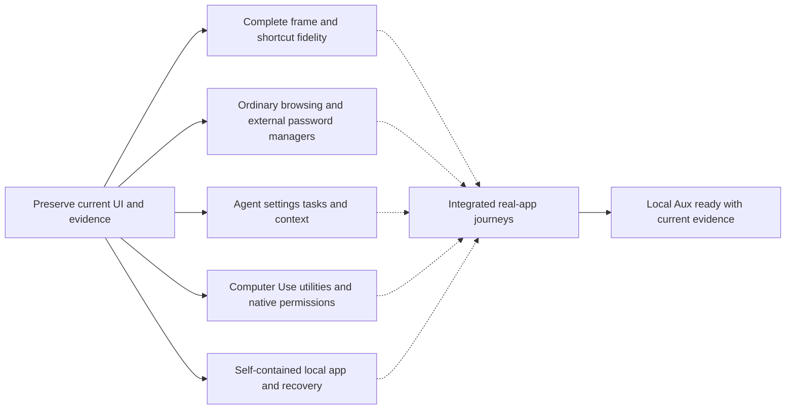

# Aux completion execution graph

Updated 2026-10-20. Owner authorized continued implementation until the local Aux browser is ready, explicitly preserving the improving UI. This graph maintains the active supplied-implementation reuse plan; it does not authorize release, new provisioning, owner-profile access or unrelated OS grants.

## Outcome and baseline

Deliver a faithful, usable local Aux app using the supplied implementation and canonical two-path Aux artwork, with matching browser and Agent behavior, isolated state/ports/identity, external password-manager integration and recoverable local installation. Built-in Vault/password management remains excluded. Preserve the current design; no redesign or replacement screens.

Current source: local main26c422f51 plus the reviewed pass1 plan update. Native560 is built and packaged at `out/provided-candidate-local-browser-pass/Aux.app`, using supplied Agent1852 and the frozen snapshot. Package report SHA256062698456102e6dd4de172426851e2741e209e3a1472d63f7c3bb4826d8eb422. Exact signed-resource reuse/native-seal receipt SHA2565237553d7230b846abdb7a042e0196a8879495c888f30ed46f91460b470620fb; no new Apple signing or Keychain operations. Previous556 candidate is preserved. Current normal disposable profile is the existing explicitly approved scope; no incognito acceptance.

Observed560: enabled model menu, genuine chat panel/current-page context, focused bookmark control, single Aux identity, immediate Settings section-title update and delayed page-title update. Shared16DIP native page/panel surfaces now render in the real app. CmdE still fails in560;561 main-menu correction is integrated into566. First real Muse task failed because secure browser-control45203 was unavailable; credential cleanup verified.566 adds authority-ready listener reconciliation. Hover was previously owner-confirmed; this desktop tool has no genuine pointer-hover API. These scoped results are not full-product acceptance.

## Dependency graph

Solid arrows are implementation prerequisites; dashed arrows are acceptance prerequisites. Shared native/build/app resources are serialized separately.

Implementation can proceed independently against existing native/wire contracts. Final Agent/tool acceptance needs the actual packaged runtime and configured test provider; final installation acceptance needs the accepted local package. No feature is blocked merely on the Settings screen or documentation.

## Node registry and requirement coverage

| ID | State / owner | Requirements and next action | Acceptance |
|---|---|---|---|
| BASE | verified / root | Preserve560 package, prior556 backup, source hashes and screenshots. Capture current UI before functional changes. | Recoverable app and source; comparisons tied to exact build. |
| FRAME | active / frame_geometry proposal, root integration | Finish CmdE through genuine Cocoa menu command; verify normal/zoom/fullscreen, sidebar expanded/hidden and panel open/closed; both themes/material preferences. Keep current icons/layout/radius. | Actual corresponding Aside/Aux captures and working controls; no remaining unexplained in-scope regressions. |
| BROWSER | active audit / frame_style | Tabs/navigation/bookmarks/history/downloads/session restore; genuine extension install and external password-manager/autofill/native-messaging compatibility. Audit source blockers first. Password import excluded; bookmarks/import behavior must be accurately represented. | Disposable ordinary browser journeys and representative external-manager integration; desktop companion capability verified separately. |
| AGENT | active audit / l4_ui | Supplied New Chat, model/reasoning/project/guard settings, task streaming/cancel/history/context and settings contracts. Fix concrete missing native/runtime owners without altering UI. | Real packaged task/context/config journeys with allowed Muse model; failure behavior and required20-task acceptance recorded, credential removed afterward. |
| TOOLS | ready for bounded discovery / root after first integration | Computer Use, notifications, mini popup/lasso, voice/dictation, runtime/CLI/helper and conditional native capabilities. Distinguish source implementation, actual availability and account-gated features. | Real authorized local tool journeys; precise external/account/OS prerequisites remain open until resolved, never fabricated. |
| PACKAGE | ready for audit / root | Self-contained launch without external Node, isolated ports/authentication/state, clean stop/reopen/recovery, canonical branding and stable local launcher/install. | Accepted local app/launcher starts normally with preserved state; no owner data touched or release implied. |
| JOURNEY | pending integrated acceptance / root | Coherent build combining compatible proposals; focused changed-boundary tests, actual app/Aside comparison and end-to-end browser+Agent checks. Reuse unaffected evidence. | Each claimed journey passes on identified candidate; gaps stay open. |
| READY | pending / root | Local installation, current STATUS/evidence, coherent local commits and testable app left open. | All in-scope nodes accepted; remaining account/service/permission limitations explicitly resolved or owner-scoped. No blanket parity claim from compilation. |

## Execution and reservations

Four total workers maximum including root. Existing separate worktrees return narrow, count-checked, hash-pinned proposals and commits. Root alone edits the shared native checkout, root manifests, staging/patch ordering, packaging and startup. Native source changes/builds use `/tmp/aux-build.lock` through project scripts. Root alone operates the live disposable app and comparison captures. Workers never read owner profiles/credentials, access owner Aside services, run native builds or mutate the shared runtime.

Current first assignments: frame_geometry repairs the observed Cocoa shortcut conflict against560; frame_style audits browser/external-manager gaps; l4_ui audits Agent/runtime journeys. Root finishes the UI state matrix and maintains the rolling queue. Integrate compatible ready fixes in one native build; do not rebuild once per unrelated audit. If a lane waits for integration, assign the next independent bounded node only after its handoff is concrete.

Preserve the visual baseline before every new functional batch. Source changes are limited to supplied implementation reuse, branding/isolation and necessary platform adaptations. Retain supplied CSS/component hierarchy and compare changed surfaces in the real app. Re-run checks only for changed dependencies, observed failures or required final acceptance. Do not stop the owner's REA jobs.

## Completion gates and external prerequisites

The old clean-room plan is superseded. Cloud deployment, release and notarization remain out of scope. Existing scoped signed helper bytes may be reused only through the exact approved workflow; this graph grants no new signing authority. Test provider credentials must enter through the supplied credential API and never be printed/committed. Owner credentials/profiles and new OS grants require their applicable explicit authorization. A genuine unavailable service/account gate is recorded and surfaced when concrete, while independent work continues.

Continue executing ready nodes until the local app is accepted. Preserve stable node IDs and update state with actual source/build/observation evidence. Do not silently redefine readiness, add fake successful services, fabricate multi-profile data or enable account-gated controls without their real contracts.
