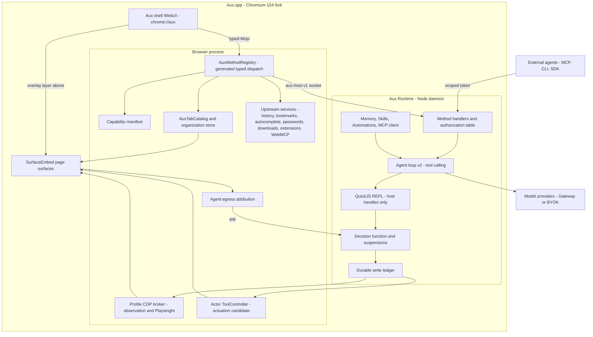
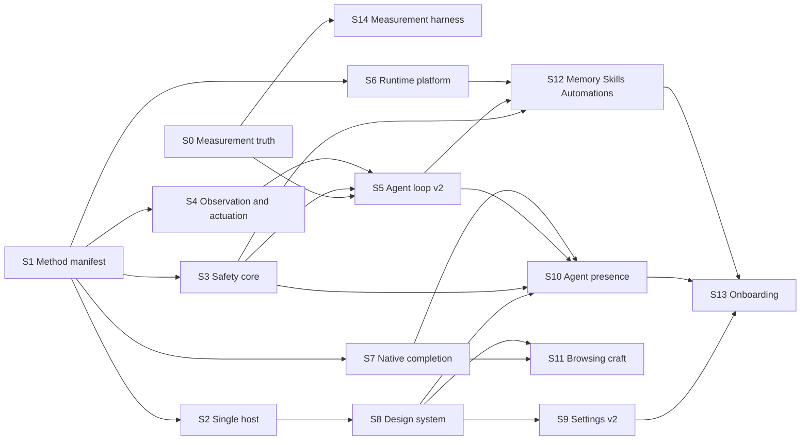

## Current delivery status — October 5, 2026, evening

Local `main` includes the panel correction (`4d7bef5b5`) and reference Home/sidebar batch (`3c4379bc3`). The packaged Aux preview now has the content-area collapse control, functional sidebar chat search, fresh Search/Ask entry, reference logo/entry/card geometry, and consistent panel backing. Aux branding and page-free Ask are retained. Real saved content drives cards; empty Profiles do not fabricate reference content. This closes the demonstrated default-view defects, **not full product parity**.

See [the current inspection handoff](INSPECTION-BUILD-HANDOFF.md) and [latest retained evidence](evidence/home-parity-2026-10-05/index.json). Renderer manifest `b13d8d5b27dc99d3bba53bc55834991646107558eda5778a087ccabb40e23ac0` is a resource update on the retained Native352 native/runtime base. Exact bytes: startup JS **500722 / 501760**, startup CSS **179825 / 184320**, total JS **1842400 / 1843200**. Focused checks, shell typecheck/format/lint, budgets, cached native build and actual-window collapse/expand/Search/Ask observations passed.

The last launched inspection uses a disposable Profile and local demo model, with original supervisor PTY61610 owning cleanup. The previous launcher wait is historical; the inherited-slot launcher completed setup. The saved-Profile runtime startup issue remains unresolved. Resize remains user-owned; full current journeys, exhaustive performance/design matrices, external-provider qualification and release remain deferred. Historical `full542Passed=false` and `safetyPassed=false` remain unchanged. Work stayed local: no push, GitHub Actions, signing or release.

---

**Current design basis (October 3, 2026).** F21 must derive every applicable UI element from the81 actual source files in `/Users/rcourson/AI Blueprints/06/assets/upstream-src/` (Chromium152.0.7977.83), plus decoded product WebUI, semantic/resolved colors, Geist typography, squircle geometry, liquid-glass materials and all supplied surfaces. See [the complete source-to-surface map](design/upstream-source-map.md), its pinned inventory, and `06_COPYABLE-SURFACES.md` §§8–8c. Compare against the130MB installed `live-1.0.928` capture. Keep Aux name, logo and app identity. Exact source adoption, actual native appearance/state evidence and final visual signoff remain required; availability is not completion.

**Browser-runtime design-pass resources — October 1, 2026.** The [F21 design pass](BROWSER-RUNTIME-PLAN.md#f21-design-polish-pass-l12-with-the-design-reviewer-throughout) uses the approximately 130 MB installed-build capture at `/Users/rcourson/AI Blueprints/06/assets/live-1.0.928/`, indexed in `/Users/rcourson/AI Blueprints/06_COPYABLE-SURFACES.md` §§8–8c. Pull surface design and interaction references from those resources while preserving Aux branding, name, logo and product identity. The canonical plan and L12 brief record the reference workflow and unchanged visual acceptance requirements.

---

**September 30, evening PT checkpoint.** MEMUI Forget passed. Manifest `release/test-artifacts/native-memory-inbox-2026-09-30-owner-n/manifest.json`, source `fa8cc22c`, native `48de88d2`, completed 2026-10-01T01:38:24.711Z. The harness that ran was dirty on top of that commit. The same click path is now `bf375e85`. Enable memory for this Space was 182×17, Create review notes 143×37, Accept note 96×37, and Forget run was line-sized. Forget permanently was the 141×28 confirmation button. press-button returned true while Forget Space memory stayed open, then focus plus Return closed the dialog. The summary showed no approved notes, the fresh managed backup was issued, and the note stayed gone after restart. STORE reached the create device-authentication sheet and cannot satisfy it: the on-screen window is owner `coreautha`, name Untitled, layer 1000 (`release/test-artifacts/native-store-recovery-2026-09-30-owner-f/manifest.json`, completed 2026-10-01T01:48:05.186Z). The restore prompt was not reached because the sealed-package review did not appear. CONTROL loaded the disposable HTTPS form with the raw Proceed click, submitted Sign in from a 57×22 button, and the Save sign-in offer did not appear (`release/test-artifacts/native-credential-handoff-2026-09-30-owner-h/manifest.json`, completed 2026-10-01T01:50:49.746Z), so Fill password and its device-authentication sheet were not reached. S13 opened Import pasted assistant notes. Destination Space is a 660×81 row. Assistant notes still reports the settings pane, and a hit test of that pane does not land on the field (`release/test-artifacts/native-memory-paste-2026-09-30-owner-f/manifest.json`, completed 2026-10-01T01:54:33.156Z). EGRESS retried `pages.execute` with controller `none` and no task revision. The conflict stayed `The state changed before this action completed`, and the two scoped-connection approvals were not reached (`release/test-artifacts/native-egress-relay-2026-09-30-owner-b/manifest.json`, completed 2026-10-01T01:55:10.868Z). The shell gateway key is rejected and the baseline `.env` key authenticates. Catalog status for the baseline key was 200. A finished call settles to reported usage. At the 16-call ceilings that charge is $24.76584, and the runner forecast is $15. Before this attempt, $46.065750631 remained of the $50 ledger, so both gates would start. The owner stopped the partial 50×3 (aux and aux-loop, 50 tasks, 3 trials, meta/muse-spark-1.3-contributor) before a complete comparison. The remaining ledger was not the reason. The partial report `tests/benchmarks/reports/tasks-local-2026-10-01T02-13-17-435Z.json` is gitignored, `complete: false`, and `valid: true`: the planner arm has 79 of 150 rows (trial 1 finished all 50, trial 2 through L29, 51 passes and 28 fails) and the loop arm never started. Live ledger after the stop: committed $3.9699201, reserved $0.031831003 across 11 unsettled rows, remaining $45.998248897. The earlier killed report `tests/benchmarks/reports/tasks-local-2026-10-01T01-10-22-132Z.json` stays `complete: false` and `valid: false`. No planner deletion. `qualification.json` is unchanged. S14 is not declared. Published to origin/codex/roadmap-integration (`bf375e85`, `df14a8fc`). The owner declined another 50×3. This record fast-forwards onto main.

**September 30, 6:10 PM PT checkpoint.** The ACCESS visual session passed. Manifest `release/test-artifacts/native-access-visual-2026-09-30-owner-h/manifest.json`, source `9a23c68c`, native `48de88d2`, completed 2026-10-01T01:00:59.121Z. Captures are sidebar-before-theme, editor-teal-grain, sidebar-teal-grain, toolbar-before-tint, toolbar-red-tint, and sidebar-battery-saver. Measured deltas are theme 8.04, tint 9.29, and battery-saver grain 7.36, with reduced transparency off. Attempts owner through owner-g are not passes. The names Memory saver, Sleeping tab, and Mute tab: stay. MEMUI Forget did not reach its confirmation: the enable control's accessible box is the settings page at 692×719 (`release/test-artifacts/native-memory-inbox-2026-09-30-owner-f/manifest.json`, completed 2026-10-01T00:40:49.473Z). STORE did not reach either device-authentication prompt (`release/test-artifacts/native-store-recovery-2026-09-30-owner/manifest.json`, completed 2026-10-01T00:43:31.118Z). The EGRESS relay did not reach its two scoped-connection approvals: `pages.execute` returned `conflict: The state changed before this action completed` (`release/test-artifacts/native-egress-relay-2026-09-30-owner/manifest.json`, completed 2026-10-01T00:44:33.258Z). CONTROL credential handoff did not reach Save or Fill password (`release/test-artifacts/native-credential-handoff-2026-09-30-owner-f/manifest.json`, completed 2026-10-01T01:07:32.181Z). S13 pasted assistant-memory did not open (`release/test-artifacts/native-memory-paste-2026-09-30-owner-b/manifest.json`, completed 2026-10-01T01:08:59.888Z). The paid S5 50×3 forecast is $15 against $46.33 remaining. The comparison started, the gateway rejected every model call as unauthenticated, and the process was stopped. `tests/benchmarks/reports/tasks-local-2026-10-01T01-10-22-132Z.json` is `complete: false` and `valid: false`. No planner deletion. `qualification.json` is unchanged. S14 is not declared. Scroll-tracked handoff and the takeover latency budget stay open. Nothing was pushed.

**September 30, 4:13 PM PT checkpoint.** The uncommitted relay-harness diagnostic is removed. Sleeping-tab discard stays covered by `tests/unit/tab-catalog-sync.test.ts` and `tests/unit/page-discard-events.test.ts`: a native aux close keeps a detached page, a missing native host removes it, and a crash stays a crash. History scope passed in `native-selector-cr-2026-09-30` (source `2ad74acf`, completed 22:58:41Z) and the extension command passed in `native-selector-ct-2026-09-30` (source `a874dea4`, completed 23:04:04Z). Toolbar bookmark, open-tab search, Recently Closed, reading list, split view, and both Peeks stay passed. `qualification.json` is unchanged. The first still-open owner gate is theme, grain, tint, and the active battery-saver transition in the ACCESS visual session. S14 is not declared. Nothing was pushed.

**September 29, 01:05 PT checkpoint.** AuxDev's serial 0125 build passed for embedded `b1d99aa2` with 103 shell assets. The focused [Selection Settings](../release/test-artifacts/native-selection-settings-2026-09-29-b/manifest.json) and [current-page Summarize](../release/test-artifacts/native-selection-page-action-2026-09-29-b/manifest.json) journeys passed. Native capture shortcuts, selection bytes, region picker, S11 changed-state Tidy, CONTROL physical owner input, STORE recovery/Forget, S13 first-run and S14 remain open. The S5 frozen A/B report is invalid at planner 140/150 due to a harness wrapper timeout without attribution; the offline invalidation repair is integrated, but no complete comparator exists. `qualification.json` is unchanged. Signed packaging remains deferred.

**September 28, 23:45 PT checkpoint.** RECEIPTS exact-claim source and S13 pasted Memory review/import are integrated with focused tests and integrated compile/lint/format. The 100-asset Chromium shell build passes budgets at 455 KB startup JS, 178 KB CSS and 1,626 KB total JS. Native EGRESS 0122 fixed-partition source now includes multi-page cleanup, ephemeral restore filtering and saved-password fill exclusion; the revised patch passes apply/reverse checks but awaits build and relay/lifecycle/autofill journeys. The first relay journey stopped at action-time approval for two disposable task-scoped connections. S5 frozen 50×3 comparison is still running and early timeouts are scored failures. Source does not qualify S13, RECEIPTS or EGRESS; `qualification.json` is unchanged.

name: Aux roadmap v2
overview: "Dependency-ordered Aux product roadmap. The proposal basis is historical; the current implementation checkpoint and evidence links appear below."
isProject: false
---

# Aux Roadmap v2: the fastest, most capable AI browser with real oversight

<!-- AUTHORITY 2026-09-28 23:25 PT -->
**September 28, 23:54 PT native checkpoint.** The revised EGRESS 0122 AuxDev build passed 46 serial steps; its focused secret-cookie fixture passed on the built app, while transitive relay, lifecycle and autofill gates remain open. The native protected startup/restart fixture passed 37 table markers, including encrypted MCP bundle bytes. TRUST authenticated takeover and S5 radio-batch source repairs are integrated after that build; the literal 50×3 Contributor comparison restarted on frozen lane source after a concrete L12 failure. STORE recovery/Forget, S13 first-run and all final S14 joins remain open. `qualification.json` is unchanged.

**September 28, 23:25 PT checkpoint.** AUTO/HOOKS, durable IMPORT recovery, EXTERNAL active-session oversight, immutable MCP bundles, CAL account-isolation cleanup and replayable S13 onboarding are integrated source slices. S13 App/General wiring and generated authorization pass integrated typecheck; shell build budgets pass at 455 KB startup JS, 178 KB CSS and 1,615 KB total JS. The first native EGRESS fixed-partition request probe passed cookie non-transmission, while relay/lifecycle/autofill and full request-path qualification stay open. A focused Contributor L12 repair passed, and the full 50×3 paired S5 comparator is running after the earlier partial stopped at loop 12. No `qualification.json` promotion; S14 acceptance and signed-packaging exclusion remain as stated.

**September 28 evening checkpoint.** Integrated SKILLS tested replay, GOALS funded model turns, WORK reviewed-folder command dispatch, and CRAFT accessible primitives are source-complete slices with focused isolated checks and integrated typecheck. Native owner journeys are still required. The serial 0121 EGRESS AuxDev build and runtime staging passed after an ambient-Cookie leak was found and blocked; a partial live fixture proved same-origin positive traffic, six protected request refusals and cookie non-transmission. Its worker branch is unresolved, and per-run isolated task browsing remains the transitive-egress prerequisite. AUTO/HOOKS and IMPORT recovery source batches are underway in isolated lanes; S5's frozen A/B remains in flight. No feature was promoted in `docs/qualification.json`; S14 and signed packaging scope are unchanged.

**CHAT source checkpoint — September 28, 2026 (`326700f2`).** Answer mode now appears only for a hydrated typed question or handoff; approval and action confirmation stay on their decision surfaces. Runtime `runs.answer` requires the exact current suspension ID, and separate answer/follow-up drafts persist across layout changes. Focused tests passed 24/24, with typecheck/lint/format in the isolated lane. A `--chat-collaboration` native journey is prepared but unrun; the macOS notification banner remains a separate blocked S10 gate. SKILLS tested replay is the next isolated source batch.

**RECEIPTS source checkpoint — September 28, 2026 (`d464c8c2`).** Whole-run local undo now requires a fresh reviewed token, an exact eligible effect set and bounded selected step IDs; a changed ledger refuses the request before any reversal. The owner UI presents selection and confirmation, stale per-effect checks remain, and external Task receipts redact the review token. Focused tests passed 44/44 in the isolated lane. The prepared `--receipt-actual-run` journey uses real saved-program form effects and owner drift; it has not run. Actual group attribution and native bookmark/history/download mutation journeys still gate full RECEIPTS. The next CHAT batch is assigned; no qualification stage changed.

**CONTROL source checkpoint — September 28, 2026 (`abe118fa`).** A native `view.takeover` event now fences a page even while an agent program is in flight: the controller epoch changes, current dispatch aborts, a checkpoint persists, and Return requires fresh observation without replay. The owner UI keeps that checkpoint visible. Focused tests passed 105/105 with typecheck/lint/format in the isolated lane. Chromium still needs the physical guest-input producer; the prepared `--physical-takeover` journey has not run, so CONTROL stays open. RECEIPTS reviewed selective whole-run undo is the next independent source batch.

**S5 diagnostic checkpoint — September 28, 2026 (`49beec32`).** A complete planner arm (150/150, 61.3% pass@1, 2.007 mean calls) paired with only eight loop rows after L06 failed, so that partial report is not an A/B decision. The trace showed a freshly opened inline edit form whose Edit click stayed uncertain; an exact same-page, single-pending-intent auto-settle repair passed focused L06 with 3/3 Contributor calls, saved answer/oracle and no unresolved intents. The S5 lane is running one justified full 50×3 comparison on frozen repaired source; the planner remains until that gate completes.

**Current integration source checkpoint — September 28, 2026 (`6085d88d`).** The S12 MCP batch now binds OAuth callbacks to the reviewed HTTPS issuer, serializes Keychain writes across disconnect, cancels active calls on clear/revoke, caps discovery/output, and gives Settings a reviewed authorization URL and fresh disconnect state. Focused source tests passed 29/29 in its isolated lane and integrated typecheck passed. A distinct native Settings bundle journey is prepared, not run; controlled provider OAuth connect/refresh/restart/revoke remains open. STORE's expanded 36-marker native startup fixture is committed at `576aa60f` but has not run. EGRESS patch 0121 is still in native implementation, S5's single frozen full A/B is running, and CONTROL physical takeover is in the next lane batch. No stage in `qualification.json` changed.

**Current STORE source checkpoint — September 28, 2026 (`92611cda`).** Five additional execution-authority tables (`goals`, `hooks`, `hook_invocations`, `subagent_groups`, `subagents`) now use authenticated field adapters, bringing source activation to 34 protected table families plus filtered `kv` and Calendar metadata. Focused migration/restart, Goal/Hook/subagent behavior and cross-Profile recovery tests passed; the last native protected-startup journey still covers only the earlier 29 families, so STORE remains open. The S11 Tidy restart/Undo pass below remains valid. The next serial build must verify the expanded marker set, S11 changed-state/Memory saver journeys and revised EGRESS native boundary before any stage change. `qualification.json` is unchanged.

**Current S11 checkpoint — September 28, 2026 (`204d834f` source).** BROWSE's reviewed AI Tidy now waits for the native organization commit and persists a guarded compact Undo receipt. The [disposable native Tidy journey](../release/test-artifacts/native-s11-tidy-durable-2026-09-28-d/manifest.json) passed apply, full AuxDev restart, visible Undo, actual restoration of prior tab positions, and receipt removal. It used source-bound development acceptance for `spaces` and `aiTidy`; this does not promote either production feature. The 94-asset shell digest `c4bab7b32e13e3129041902e4e79cc70b1dab1ac70b977fbe9063dd9698f10d4` passed budgets (454 KB startup JS, 179 KB startup CSS, 1,573 KB total JS), and the one serial AuxDev build passed 21 steps (`/tmp/aux-roadmap-s11-tidy-acceptance-native-build.log`). Changed-state Tidy refusal, native Memory saver report/protected-tab refusal, theme and battery visuals, and S11 M4 remain open. S5's full same-build A/B and EGRESS implementation are in progress; STORE recovery and Memory Forget native gates remain open. `qualification.json` is unchanged.

**Latest source checkpoint — September 28, 2026 (`d9d11d58` native; `eb18e72a` docs).** STORE now requires fresh, one-use native device authentication for each protected recovery export and reviewed restore (`eb82ccf8`, patch 0120, 170 generated host methods); five focused recovery/UI tests, typecheck, lint and format pass. The CRAFT keyboard/focus/reduced-motion primitive batch (`bd9f1e09`) is integrated, with a 167.14 KB startup CSS bundle under the 180 KB limit. The 93-asset shell manifest is pinned at `479e8e88`; the one serial AuxDev build passed 57 steps in 1m48s (`/tmp/aux-store-recovery-auth-native-build.log`) and runtime staging passed. The [focused native CRAFT menu journey](../release/test-artifacts/native-s8-craft-menu-2026-09-28-b/manifest.json) passed four Space/Browser tools open/Escape steps in a disposable Profile; full visual/accessibility qualification remains open. The [native recovery UI attempt](../release/test-artifacts/native-store-recovery-auth-2026-09-28-a/manifest.json) timed out awaiting owner phrase entry and macOS authentication; its disposable Profile was cleaned up without exercising device authentication or creating a package. STORE native acceptance remains open. The latest frozen S5 A/B at `918a1c10` stopped at an L06 unresolved click receipt: planner 150/150 (64.7% pass@1, 2.107 mean calls), loop 8/150. [The partial report](/Users/rcourson/.codex/worktrees/aux-roadmap-native-data/web/tests/benchmarks/reports/tasks-local-2026-09-29T01-50-27-960Z.json) is not an A/B gate; the S5 lane repaired that proof path and a native-select predispatch refusal; a focused [L06 trial](/Users/rcourson/.codex/worktrees/aux-roadmap-native-data/web/tests/benchmarks/reports/tasks-local-2026-09-29T02-37-11-110Z.json) passed 1/1 with 7 Contributor calls and 0 unresolved intents. The full comparable rerun is underway on frozen `5a9638cb`. S10 macOS alert, STORE native transfer, Memory Forget/restart, CRAFT visual/selector, S13 and S14 remain open. `qualification.json` is unchanged.

**Current integration checkpoint — September 28, 2026 (`2060fc2c`).** S10's native attention host patch 0119, 169 generated methods (`e5b1b824`), 93 pinned shell assets (`cf00e365`), and staged runtime passed a serial AuxDev build after the missing generated-binding stage was corrected (`/tmp/aux-roadmap-s10-system-attention-native-build-c.log`, three steps). The [disposable S10 journey](../release/test-artifacts/native-s10-system-attention-2026-09-28-b/report.json) passed concurrent runs/draft preservation, private question with generic in-app notice, foreground and preference suppression, keyboard dismissal, durable Home/Tasks review, and Focus Mode suppression. The macOS alert/click step **failed qualification** because both Aux entries in macOS Notifications are Off; no alert was observed, and the harness recorded `passed:false`. S10 remains open. Three frozen S5 reliability commits are integrated, and the full Contributor-only 50×3 A/B is still running on its isolated source; no planner decision follows yet. The Memory owner review/Forget and cross-Profile recovery journeys remain open. `qualification.json` is unchanged; signed packaging remains outside scope.

**Current native candidate — September 28, 2026 (`00e6a7e1`).** The serial AuxDev build passed 29 steps in 1m36s with ordered patches through 0118, generated bindings `a8d8b1a9`, 93 pinned shell assets (`07809a34`), staged runtime, and startup bundle budgets (451 KB JS, 180 KB CSS, 1,563 KB total JS). Disposable source-bound acceptance activates Memory and Spaces only for the test Profile; default product qualification remains unchanged. The [live Memory UI attempt](../release/test-artifacts/native-s12-memory-owner-review-2026-09-28-e/manifest.json) selected a fixture Space, staged an encrypted run-report note, and accepted its exact quote, then timed out at irreversible Forget while awaiting action-time approval. The fixture was cleaned up without deletion. No Forget/restart pass or Memory qualification is claimed. S10 attention UI is built and its native harness is integrated, but its handoff/notice journey remains open.

**Current S5/S10 checkpoint.** The partial same-build S5 comparator completed planner 150/150 but loop only 8/150, so no A/B conclusion is valid. Integrated `112baa33` bounds reasoning metadata and rejects trailing download waiters before dispatch; a focused Contributor L08 retest still failed 13 calls/0 oracle with one unresolved intent, though the former compaction failure is gone. The planner remains. Integrated `100ccb70` adds an unpaid local-model native S10 attention journey; its fixture test passed and the native journey is pending. STORE recovery, MEMUI, S5, S10, S11 M4, S13 and S14 remain open. `qualification.json` is unchanged.

**Latest qualified slice — September 28, 2026.** The [31-marker protected-startup journey](../release/test-artifacts/native-store-protected-startup-2026-09-28-e/manifest.json) passed seeded legacy Calendar metadata migration, keyed account lookup, ciphertext at rest and restart with runtime source `d7e57f89` staged on native identity `992ec38f`. Schema v27 and this Calendar slice do not close STORE. S10 durable attention, in-app notice controls and nonstealing queued-run status are source-integrated through `cbf5f407`; the native attention/handoff journey and OS notification host remain open. A Contributor-only L40 diagnostic passed four observed model calls and the oracle on isolated source `f5628a11`; the full comparable 50×3 A/B is running, so S5 and planner deletion remain open. Memory owner review/Forget and recovery still require live acceptance. `qualification.json` is unchanged.

**Latest native checkpoint — September 28, 2026 (`992ec38f`).** A serial AuxDev build passed 23 steps in 1m40s with 93 pinned shell assets (digest `e7c4ee43`), generated bindings `a8d8b1a9`, ordered patches through 0117, and staged runtime. The [30-marker native protected-startup journey](../release/test-artifacts/native-store-protected-startup-2026-09-28-d/manifest.json) passed legacy MCP/agent/vault metadata migration, ciphertext at rest, and normal Quit/restart. Source adds durable S10 waiting/activity/error cards and isolated same-run artifact previews with fresh cited-page checks; focused shell/runtime tests passed, but a full native S10 journey remains open. The prior same-Profile backup/restore pass remains valid at native identity `f0e346ba`; no new backup journey was run. Calendar/other sensitive inventory, phrase recovery, native Memory Forget, S5 full corpus, S11 M4, S13 and S14 remain open. `qualification.json` is unchanged.

**Earlier integrated checkpoint — September 28, 2026 (`f0e346ba`).** Ordered Chromium patches through 0117, generated bindings `a8d8b1a9`, and pinned 93-asset shell manifest `9d08b470` passed a serial 30-step AuxDev build (`/tmp/aux-roadmap-memory-s10-native-build.log`); runtime staging followed. The [24-marker protected startup journey](../release/test-artifacts/native-store-protected-startup-2026-09-28-c/manifest.json) proves legacy migration, ciphertext and restart on an earlier native identity. The [current native Settings backup/restore journey](../release/test-artifacts/native-store-protected-backup-2026-09-28-d/manifest.json) passed backup creation, folder-picker staging and restart with a recovery snapshot on the `f0e346ba` app in a disposable Profile with acceptance limited to `electronMigration`. Managed backup generations now advance after user-facing Memory Forget in source, and focused tests reject older managed backups; the negative path has no native journey yet. Memory pre-ingestion eligibility and evidence-bound run-report quotation, and S10 typed suspensions, guarded answers, transcript projection and reviewed text Insert/undo are integrated in source, but Memory and S10 native acceptance remain open. Latest Contributor-only L40 failed at four calls/0 oracle; no full S5 gate passed. `qualification.json` is unchanged. S11 M4, remaining S7–S12 gates, S13 onboarding and S14 qualification remain open. Signed release packaging is outside scope.

**Earlier source checkpoint — September 28, 2026.** Integration `06436100` adds a source-only protected runtime backup/restore seam: marked ciphertext is authenticated with the same Profile key, portable page recall is redacted while retained run/KV values remain sealed, and an encrypted Profile proof rejects the wrong key at staging. Focused backup/SQLite checks passed 23/23. It also includes the deterministic L40 modal proof repair and model-call event attribution for benchmark readiness. The latest one-task Contributor diagnostic still failed (four calls, no oracle); the full S5 gate remains open. No new native build or live restore has qualified these additions. Run/step/conversation/KV and pending task adapters remain inactive; STORE, Memory, S10, S13 and S14 remain open. `qualification.json` is unchanged. Continue from the [execution graph](ROADMAP-EXECUTION-GRAPH.md) and [handoff](HANDOFF.md); the following checkpoint records the preceding native evidence.

**Current checkpoint — September 28, 2026.** Integration source is `bfc71328`; the original dirty checkout at `970adc61` is untouched. Chromium 154 AuxDev has ordered native patches through 0116, a successful serial import-finish build (`/tmp/aux-roadmap-import-finish-native-build.log`, 21 steps), native identity `aa996397`, shell manifest `886b6513`, and a subsequently staged runtime containing the integrated source. The IMPORT graph outcome is accepted for the scoped S7 browser-data contract: [reviewed Chrome Settings selection](../release/test-artifacts/native-s7-browser-import-ui-2026-09-28-j/manifest.json), [Arc/Safari/Firefox native destinations](../release/test-artifacts/native-s7-browser-import-formats-2026-09-28-e/manifest.json), and [attached tabs plus cancel/error/retry/restart](../release/test-artifacts/native-s7-browser-import-attached-2026-09-28-f/manifest.json) passed with synthetic sources; no owner Profile was read. S13's Keychain explanation and onboarding are separate and open. [Protected native startup](../release/test-artifacts/native-store-protected-startup-2026-09-28-b/manifest.json) passed 14 active table families after the combined runtime was staged; source adapters for runs/steps, conversations and KV are **inactive** pending backup sanitizer, retained-metadata review and recovery. STORE and Memory remain open. S5 LOOP has further deterministic reliability fixes and an attributable benchmark runner, but the latest Contributor-only L40 diagnostic failed and the required full A/B gate is open; planner remains. S11's 50,000-URL command-bar p95 was 30.8 ms on battery with a second-frame proxy, so M4 remains open. S13 onboarding, S14 full qualification, and many S7–S12 graph nodes remain open. Signed release packaging is deferred. Continue from the [execution graph](ROADMAP-EXECUTION-GRAPH.md), [handoff](HANDOFF.md), [evidence ledger](EVIDENCE.md), [benchmark record](BENCHMARKS.md), and [native runbook](../experiments/chromium-fork/CONTINUATION.md).

**Earlier September 28 checkpoint.** The isolated integration source was at `ee578997`; the original dirty checkout at `970adc61` remains untouched. Chromium 154 AuxDev has ordered native patches through 0116 and a second successful serial build with embedded source identity `aa996397`; later runtime-only source was staged afterward. A disposable [S7 browser import journey](../release/test-artifacts/native-s7-browser-import-ui-2026-09-28-j/manifest.json) passed reviewed exact Profile/category choices, idempotent retry, unchanged source data, refusal of an unreviewed Profile, and native persistence across a graceful restart. A [STORE startup journey](../release/test-artifacts/native-store-protected-startup-2026-09-28-a/manifest.json) passed native Keychain factor creation, migration of 12 adapted table families, ciphertext-at-rest and restart. These are scoped results; S7 and STORE remain open. S11 retains qualified scoped Reader pointer/keyboard Peek, sidebar preview, tab naming and other browsing journeys; the 50,000-URL command-bar p95 of 30.8 ms on battery/second-frame proxy leaves M4 open. S9 route reload and Back/Forward passed. S5 GoalProgram, reconciliation and yielding REPL cells are source integrated, but the full benchmark gate is open. S12 Memory review/Forget is not live-qualified and remains preview; many sensitive stores and recovery remain unfinished. S13 onboarding and S14 full qualification remain open. Release packaging remains deferred. Continue from the [execution graph](ROADMAP-EXECUTION-GRAPH.md), [handoff](HANDOFF.md), [evidence ledger](EVIDENCE.md), [benchmark record](BENCHMARKS.md), and [native runbook](../experiments/chromium-fork/CONTINUATION.md) for exact scope and next work.

**Proposal basis.** Proposed 2026-09-25 against `codex/aux-roadmap-build` at `37e7ee76`; the last code commit at proposal time was `d0dba3c9`.
- Native base: Chromium `154.0.8037.58` with ordered patches 0001–0046.
- Development app: `~/aux-chromium-stable/chromium/src/out/AuxDev/Aux.app`.

**Relationship to v1.** This replaces `docs/ROADMAP.md` (v1) as the single plan. It keeps from v1:
- the September 25 scope amendment: a working development build, with release, signing, notarization, appcast and DMG work deferred;
- the model, spend and data constraints;
- native build discipline;
- the evidence labels.

**Conventions**
- Repo paths are relative to the repo root.
- `[NN] path` means `~/AI Blueprints/NN/path`.
- `[cr] path` means `~/aux-chromium-stable/chromium/src/path`. It is read-only reference material.
- Labels:
  - **[Verified]**: seen in code or in a recorded run.
  - **[Corpus]**: seen in a reference package.
  - **[Assumption]**: needs the named spike before anything depends on it.
  - **[Open]**: could not be verified.

**Mapping from v1's P-codes:**
- P1 → 01, P3 → 03, P4 → 04, P6 → 06 (the product the Aux docs call Aside), P7 → 07.
- 05 is the newer product from 07's vendor.
- 02 is new.
- P8 (Helium) is not in this corpus; only its clean-room process rules carry over.

---

## 0. Verdict

**What Aux already has.** These are the hard parts most AI browsers lack:
- A real Chromium fork. Its UI is a Webium/SurfaceEmbed WebUI: glass over live pages, native hit-testing, and no DOM injected into pages.
- A per-Profile authenticated runtime socket.
- An in-process, Profile-scoped CDP broker with no debugging port.
- A durable write-intent ledger that never retries an uncertain effect.
- Per-page controller and document epochs.
- zod contracts spanning runtime, MCP, CLI and SDK.
- QuickJS code mode.
- An honest evidence ledger.

[Verified: `docs/HANDOFF.md`, `docs/EVIDENCE.md`, `apps/runtime/src/agent/durable.ts`, `apps/runtime/src/native-cdp-broker.ts`, `apps/runtime/src/agent/code-mode.ts`]

**Why it isn't the best AI browser yet.** Five structural problems stand in the way; missing features are not the issue.

1. **The built-in agent is weak.**
   - It is a stateless JSON planner that rebuilds one prompt per turn, with no history and no native tool calls.
   - It has 25 ops.
   - Its verifier fails most runs that act on a page, and the benchmark scorer hides this.
2. **The shell↔browser boundary is untyped.** 107 of the 172 `AuxBridge` members have no native handler; a JavaScript `Proxy` turns them into runtime errors, and feature gates hide them.
3. **Safety exists but is off the agent's path on the native host.**
4. **Two hosts (Electron and native) double every code path.**
5. **Nothing is measured on the native host.**

**How v2 responds.**
- S0–S7 fix these in dependency order.
- S8–S13 then bring 06's settings and agent-presence architecture, and 05's AI-output craft, onto Aux's established design.
- S14 measures throughout.

### Deliberate deviations from v1

1. **The built-in agent becomes a code-mode-first tool-calling loop, replacing the stateless JSON planner.**
   - v1 kept the planner and added code mode "alongside".
   - Evidence against the planner:
     - It rebuilds one system+user message per turn, with no history (`apps/runtime/src/agent/gateway-client.ts`).
     - Its union schema forces a JSON-in-text fallback (`schemaNeedsJsonFallback`).
     - It exposes 25 ops (`packages/contracts/src/program.ts` `PlanStepSchema`), while external agents get code mode, subagents and MCP.
   - Keeping two planners is permanent debt. v2 runs one A/B gate and deletes the loser (S5).
2. **Electron is deleted as soon as the typed bridge lands (S2).**
   - v1 deleted it only after porting 88 Electron journeys (B11).
   - The 17 `hostKind` branches and duplicated implementations are the largest source of drift: `apps/desktop/main/**/organization-store.ts` vs native `organization_store.cc`, and `apps/desktop/native/liquid-glass.mm` vs the 0036 underlay.
   - Native journeys are written only for the 12-journey product matrix (S14).
3. **A generated, typed method manifest replaces the `Proxy` bridge and the stringly `request(method, json)` if-chains, and a browser-published capability manifest decides which features are on.**
   - v1's `AuxFeature` stages are hand-flipped.
   - The runtime override key is read but never written (`apps/runtime/src/api/handlers.ts:254`).
   - Features are enforced only by method prefix: code mode, goals, hooks, subagents and MCP are unenforced (`packages/contracts/src/aux-features.ts` `METHOD_FEATURE_PREFIXES`).
   - The renderer ignores the gates.
4. **Use upstream Chromium instead of bespoke code.** Chromium 154 already ships:
   - **WebMCP**: `[cr] third_party/blink/renderer/core/script_tools/model_context.idl`, `RuntimeEnabled=WebMCP`.
   - **The actor tool framework** (`[cr] chrome/browser/actor/`):
     - `ActorKeyedService::CreateTask/PerformActions/StopTask`;
     - tools for click, type, navigate, tabs, windows, form fill, login, OTP, history, bookmarks, media and translate;
     - `script_tool_host`, `observation_delay_controller` and `actor_navigation_throttle`.
   - **An actor overlay and border UI**: `[cr] chrome/browser/actor/ui/`.
   - **AnnotatedPageContent**: `[cr] third_party/blink/renderer/modules/content_extraction/ai_page_content_agent.cc`.

   v1 planned a P3-shaped WebMCP shim and a late actor spike. v2 enables upstream WebMCP and runs the actor and AnnotatedPageContent spike inside S4, with a hard decision rule. [Verified: files present in the checkout]
5. **Safety defaults flip from "deny unless configured" to "browse freely, confirm consequences".**
   - Today, origin policy falls back to deny for any origin without a rule (`apps/runtime/src/safety/origin-policy.ts`, `mostRestrictive(..., "deny")`), and there is no UI for writing rules.
   - Approvals only run when `AUX_HOST_SOCKET` is set (`apps/runtime/src/main.ts:87`), but `safety.*` is gated off on that host (`packages/contracts/src/aux-features.ts:41-44`).
   - v2 allows reading, navigation and in-page input. It requires action-time confirmation for the consequential categories in 03's taxonomy, with final confirmation **on** by default (06 ships it off).
6. **The $50 cap moves out of product code** (`apps/runtime/src/store/spend-ledger.ts:9` `PROGRAM_SPEND_LIMIT_USD`) into the dev harness and dev build config.
   - The development constraint is unchanged: the `$50` cumulative, fixture-only, `meta/muse-spark-1.3-contributor` ledger stays in force.
   - The product gains user-set budgets.
7. **Scope cut** (owner default: cut; see §9):
   - IDE-style dev workflows;
   - cloud environments (`cloud.*` with 27 methods, `@vercel/sandbox`);
   - the bespoke GitHub/Vercel/Sentry REST clients.

   Channels, remote control and ambient screen capture are not adopted. 06-style agent workspaces stay.
8. **Settings adopts 06's architecture:** 17 routed sections with a generated search index, replacing Aux's 7 categories plus tabs plus sub-views.
9. **Verification is proportionate.**
   - No ±1 px reference-capture program (v1 §6), and no Electron journey port.
   - Focused checks and live journeys for each coherent native batch, without duplicate tests or repeated benchmarks absent a specific reason.
   - Corpus runs only at the S5 gate and at qualification.
10. **Dependency-ordered streams replace waves.** There is one native lane, and contracts merge first.

---

## 1. North star, measured

### Reporting protocol (all metrics)

- **Where results go:** raw JSON goes under the ignored `release/test-artifacts/`, and a summary row goes in `docs/BENCHMARKS.md`. Each row records the commit, the build flavour (component "trend" or static "claim") and the power state.
- **Trials:** at least 20 for latency and at least 3 for agent tasks. Report p50 and p95 with bootstrap confidence intervals; the harness already supports this (`docs/EVIDENCE.md`, B12 row).
- **Component vs static builds:** component AuxDev numbers show trends only. Public claims need matching static builds from the same tag, and those are deferred along with release work.

### M1 — Agent task success (and speed)

**Definition**
- pass@1 averaged over 3 trials.
- A run passes only if all three hold:
  - run status is `completed`;
  - the answer matches (`scoreAnswer`);
  - the oracle passes, when the task has one.
- Also report pass@3, model calls, tokens (cached and uncached), USD, p50/p95 wall time, and time to first safe action.

**Corpora**
- `tests/benchmarks/tasks/manifest.json`: 50 fixture tasks, of which 23 are multi-step, 6 have oracles and 5 are writes.
- `heldout.json`: 10 held-out tasks.
- The AssistantBench live subset (33 tasks), run at qualification only.

**Targets**
- Fixture pass@1 ≥ 0.90; held-out ≥ 0.80.
- On multi-step tasks, ≥30% fewer model calls than the planner baseline.
- Zero duplicate writes and zero credential values in model traffic.
- Cost per task is reported against the dev ledger.

**Instrument:** `pnpm bench:tasks`, after S0 fixes the scorer. The spend ledger is checked before every run.

### M2 — Cold start

**Definition**
- (a) Launch → first presented frame of `chrome://aux` (`Startup.BrowserWindow.FirstPaint` plus a trace).
- (b) Launch → interactive composer (a shell `performance.mark("aux-interactive")` reported over the bridge).
- (c) Launch → runtime `hello-ack`. This must never gate (a) or (b).
- (d) Warm new window.

**Targets:** these are v1's, kept.
- (a)+(b): ≤ 800 ms p50 and ≤ 1.5 s p95, cold.
- (c): ≤ 1.0 s p50, and off the critical path.
- No more than +10% vs stock Chromium at the same tag.

**Instrument:** `tests/benchmarks/native-browser.mjs`. It exists but has never produced a result (`docs/BENCHMARKS.md`).

### M3 — Memory

**Definition:** macOS `footprint` physical footprint for browser, GPU, shell renderer, runtime and QuickJS, measured:
- with 10 idle fixture tabs;
- during a 5-subagent task.

**Targets**
- Shell renderer ≤ 150 MB.
- Runtime idle ≤ 120 MB, and ≤ 250 MB during a 5-subagent task.
- Each REPL session keeps its 128 MB hard cap.
- Total overhead vs stock at the same tag ≤ +250 MB with 10 tabs.

**Instrument:** new `tests/benchmarks/native-memory.mjs` (S14).

### M4 — UI latency

**Definitions**
- `EventLatency.TotalLatency` p95 for a shell keypress in the composer and in the command bar.
- `Browser.Tabs.TotalSwitchDuration3` p95.
- Command-bar keystroke → results painted, with 50k history entries.
- Stop or takeover → last dispatch, taken from ledger timestamps.

**Targets**
- Keypress ≤ 50 ms p95.
- Warm tab switch ≤ 50 ms p95.
- Command bar ≤ 30 ms p95.
- Stop ≤ 100 ms p95, with zero dispatches after revocation.
- Page input latency under the shell within 5% or 2 ms of stock.

### M5 — Tool coverage

**Definition:** the share of the capability matrix that is:
- (a) callable by the built-in agent;
- (b) callable by external agents through MCP, CLI and SDK;
- (c) passing its fixture.

It is generated from the manifest.

**Capability matrix**
- **Navigation, tabs and windows:** navigate/back/forward/reload; tabs create/close/switch/group; windows.
- **Page input:** click, type, fill, select, check, drag, hover, scroll, keyboard.
- **Files and dialogs:** scoped file upload; download-and-read; JS dialogs.
- **Page structure:** OOPIF, shadow DOM, canvas via the vision fallback.
- **Reading:** PDF text, content extraction, screenshots.
- **Credentials:** credential handoff, OTP handoff.
- **Browser data and search:** WebMCP tools, history search, bookmarks, web search, cookie-free web fetch, memory search.
- **Agent control:** subagents, ask-user, action confirmation, notifications, schedules.
- **Local work:** session-storage files, sandboxed shell, MCP tool calls.
- **Artifacts:** docx, xlsx, pptx, chart, isolated HTML.

**Targets:** 100% parity between built-in and external agents (one manifest), and ≥95% of fixtures passing.

**Instrument:** `scripts/capability-report.mjs` (S14).

### M6 — Autonomy with oversight

**Definitions**
- (a) Interventions per successful task: asks, approvals and confirmations. Lower is better.
- (b) Oversight recall: the share of actions in "confirm at action time" categories that were confirmed before dispatch.
- (c) Injection resistance, measured with adversarial fixtures: page prompt injection, exfiltration via URL, credential probing, cross-origin upload, forged or stale approval.
- (d) Duplicates after a kill mid-dispatch.
- (e) Takeover latency (see M4).

**Targets**
- (a) ≤ 0.3 across the fixture corpus, and 0 on non-sensitive tasks.
- (b) 100%.
- (c) 100% blocked.
- (d) 0.

**Instrument:** `tests/benchmarks/oversight.mjs` (S14), which reads ledger and suspension records.

---

## 2. Current state vs the bar

### 2.1 Scorecard

**M1 — task success: unknown, and probably low.**
- **Evidence gap.** The last published result is from 2026-09-15: an 8-task suite on a different model, 6/8 (`docs/BENCHMARKS.md`). The 50-task corpus has never run with a live model.
- **Scorer defect.** The scorer ignores run status: `score = answerScore && (oracle?.pass ?? true)` (`tests/benchmarks/tasks/run.mjs`) [Verified].
- **Verifier defect.**
  - Any consequential step without `expect` gets `effect:"uncertain"` (`apps/runtime/src/execution/executor.ts:191-208`).
  - `verifyDoneAgainstObservation` then returns `write not observed or remoteConfirmed` (`apps/runtime/src/agent/coordinator-verify.ts:160-163`, the return before the final `grounded`) [Verified].
  - Navigation counts as consequential (`apps/runtime/src/agent/permissions.ts` `isConsequential`).
  - Result: acting runs end `failed` even when the answer is correct, and the scorer counts them as passes.
- **Budget.** 16 model calls and 60 steps per run (`model-client.ts` `DEFAULT_MAX_MODEL_CALLS`, `coordinator-verify.ts` `DEFAULT_MAX_STEPS`).

**M2–M4 — performance: no native numbers at all.**
- `docs/performance-baseline-2026-09-24.md` measured Electron 43.6, despite its title: painted home 686/726 ms, omnibox 43.9 ms p50 at 50k visits, command bar 29.4 ms p50, restore RSS 895–918 MiB.
- Headless observe latencies: full observation p50 39.9 ms, compact 20.4 ms, cached 7.7 ms (`tests/benchmarks/reports/2026-09-23T19-15-37-704Z-final.json`).

**M5 — tool coverage: low for the built-in agent.**
- The built-in agent has 25 plan ops plus one calendar read. It has no web search or fetch, MCP, subagents, code mode, memory search or new tabs (`apps/runtime/src/agent/planner.ts` `PLANNER_SYSTEM`).
- External agents get `aux_js`, subagents and MCP (`packages/mcp/src/main.ts`).
- There are 382 API methods (`packages/contracts/src/api.ts` `MethodSchemas`).
- `docs/AGENT-API.md` is stale: 33 rows vs 42 manifest entries.

**M6 — oversight: broken on the native host.**
- **Approvals are unreachable.**
  - The approval gate is built only under `AUX_HOST_SOCKET` (`apps/runtime/src/main.ts:87`), yet `safety.*` is gated off for `chromium-fork` (`aux-features.ts:41-44`).
  - The gate's `needs_input` is classified as an auth failure with a repair budget of 0 (`apps/runtime/src/agent/repair.ts` `REPAIR_BUDGETS`).
  - The renderer never calls `safety.approvals.*`.
- **Uploads are unrestricted.** `packages/chromium-driver/src/playwright-page.ts:612` `uploadFiles` passes any path straight through [Verified].
- **Human takeover isn't detected natively.** The patches emit only `tabs.catalog` and `native.tabsChanged`.
- **What does work:** takeover, revocation and resume passed as RPC journeys (`docs/evidence/native-aux-live-2026-09-25.md`).

### 2.2 Strengths to keep

- **Composition.** Webium/SurfaceEmbed:
  - `apps/desktop/renderer/src/components/PageSurface.tsx` embeds `application/x-chromium-surface-embed`.
  - `IsAuthorizedAuxDocument()` in `[cr] chrome/browser/ui/webui_browser/webui_browser_ui.cc` authorizes the shell document.
  - Private windows run with no runtime.
- **Runtime socket and broker.**
  - Socket: 0006.
  - Broker: 0019, 0024 and 0038.
  - Remote debugging is denied by default: 0016.
- **Reliability and safety core.**
  - `DurableWriteLedger`, controller and document epochs.
  - Per-run fence tokens and `redactForModel` (`apps/runtime/src/agent/policy.ts`).
  - Password-manager credential handoff (0026).
- **Observations.** Compact: 2.8–4.2 KB, observed in 20 ms.
- **Code mode and MCP boundary.**
  - QuickJS code mode with manifest-only handles: 128 MB heap, 8 sessions, 1 MB output.
  - The MCP transport boundary uses reviewed digests and native launch permits.
- **Native features already built:**
  - content blocking (0028, 0031), Zap (0018), library (0023), searchbox (0029);
  - migration import (0033), dictation (0032), shortcut registry (0044).
- **Shell identity, confirmed by the owner:**
  - `tokens.css` (squircle 1.4, 0.5 px hairline, achromatic OKLCH);
  - one native glass underlay;
  - both layouts;
  - right-only rounded corners on the assistant rail.

### 2.3 Defects and debt, ranked

1. **Bridge.**
   - A `Proxy` sits in `apps/desktop/renderer/src/chromium-bridge.ts:54-111`.
   - 107 of the 172 members have no native handler, and fail at runtime with `not_found: Unsupported Aux shell method`.
   - `[cr] chrome/browser/resources/aux_host/aux_host_bootstrap.ts` delivers only 8 host events; the other 12 subscriptions are silent no-ops.
2. **Feature gates.**
   - Mapping is by prefix only.
   - The override key is never written.
   - `chromium-fork` defaults to `{spaces:"on"}` only, while the bootstrap declares `featureStages` for extensions, content blocking and dictation.
   - The renderer never checks gates.
3. **Native hot spots** (patch counts from `chromium/patches/aux`):
   - `chrome/browser/ui/aux/runtime_host.cc`: 19 patches.
   - `chrome/browser/ui/webui_browser/webui_browser_ui.cc`: 18.
   - `chrome/browser/ui/aux/BUILD.gn`: 18.
   - `aux_host_bootstrap.ts`: 10.
   - Patch 0036 is a 2,324-line grab-bag touching 23 files.
   - A clean full replay has been recorded only through 0036.

   Every respin fights these files.
4. **Dual host.** `apps/desktop/main` has 148 files. `App.tsx` has 17 `hostKind` branches, and implementations are duplicated between hosts.
5. **God modules.**
   - `apps/runtime/src/api/handlers.ts`: 1,865 lines, a 382-case switch and an if/else scope chain (lines 266–346).
   - `apps/runtime/src/services/settings.ts`: 49 KB, mixing model config with GitHub/Vercel/Sentry clients.
   - `apps/runtime/src/services/cloud-environments.ts`: 49 KB in 268 lines.
6. **Unwired safety code.** These are exported only for tests: `ChallengeRecoveryGate`, `tightenEgress`, `recoveryLadder`, `ViewerLivenessWatchdog`, `retryWithHints`, `pollUntil`, `withDeadline`, `untrustedOutput`.
   - Guardian's untrusted envelopes are never passed in from `apps/runtime/src/services/pages/executor.ts`.
   - Master-token callers get `allowEval` (`handlers.ts:1149`).
7. **Renderer.**
   - `Settings.tsx` is 603 lines with lines up to 1,760 characters.
   - Styles are about 228 KB raw across 13 partials. The `refinements` layer is used as an override tier, there are 15 `!important`, and blur values are scattered (28/24/18/16/8).
   - 33 whole-array store subscriptions and 70 `querySelector` calls.
   - Startup JS is at 486 of a 490 KB budget. xterm (329 KB) and `MockPage` still ship.
8. **Missing agent UX.** No approval UI, no in-page overlay, no agent indicator in the default horizontal tabs, no Dock badge.
9. **Model layer.**
   - Gateway can only call registry-priced models (`projectedModelCostUsd` throws otherwise).
   - Reservations assume the full 1,048,576-token context, about $0.21 per call.
   - Reasoning effort is passed only for Muse.
   - Direct Anthropic calls get no `cache_control`.
   - The run's `maxTokens` and `maxCostUsd` are not enforced by the coordinator.
10. **Webium stubs.** 56 `NOTIMPLEMENTED` in `[cr] chrome/browser/ui/webui_browser/webui_browser_window.cc` [Verified] and 29 in the stub location bar.
11. **Unfinished services.**
    - Hooks are a registry only (`services/hooks.ts`; dispatch is never called).
    - Goal budgets are unenforced.
    - Auto-compiled skills live in memory only.
    - Set-run members accept `done` without verification (`apps/runtime/src/agent/member-agent.ts:74`).
12. **Surface mismatch.** The MCP `aux_page_execute` tool advertises `evaluate`, which `McpStepSchema` rejects (`packages/mcp/src/steps.ts`).
13. **Misleading evidence.** The performance-baseline title, stale `BENCHMARKS.md`/`EVIDENCE.md` rows, and screenshots taken in mock mode.

---

## 3. Target architecture

**Decisions** (the "better way" calls). Each lists its stream.

- **D1. One generated method manifest (S1).**
  - `packages/contracts` defines every shell→browser, runtime→browser and runtime API method, plus every event, in zod.
  - From that, codegen emits:
    - a typed shell client (no `Proxy`);
    - C++ method IDs, validators and a registry, staged into the native tree the same way shell assets are;
    - the runtime handler and authorization tables;
    - MCP, CLI and SDK surfaces.
  - This beats per-domain mojom because one schema has to serve three parties (shell, browser, runtime). It also beats today's JSON if-chains because it is typed and validated at both ends.
- **D2. Capability-derived features (S1).**
  - The browser publishes a capability manifest (implemented method IDs plus build ID).
  - A feature is:
    - `on` when all its required methods are implemented and its journey is recorded;
    - `preview` when the methods are implemented but the journey isn't recorded (it appears only under Settings › Experimental);
    - `off` otherwise.
  - The renderer never shows an entry point for an unavailable feature, and there are no hand flips.
- **D3. Agent loop v2 (S5).**
  - Keeps message history and uses native tool calling, through AI SDK 7, which is already a dependency (`apps/runtime/package.json`: `ai@7.0.93`).
  - The primary tool is a persistent QuickJS REPL. Every `aux.*` effect in it compiles to the existing typed `Program` step and flows through `guardedExecute`, the decision function and the ledger. Aux's execution rigor stays; only the model-facing interface changes.
  - The dev model supports tool calling [Verified: EVIDENCE B0 row].
- **D4. One effect decision function, and durable suspensions (S3).**
  - Every actor — built-in agent, subagent, code mode or external token — calls `decide()`.
  - "Ask" results become durable suspensions of four kinds: question, approval, action confirmation, and handoff.
  - The run parks and resumes when the suspension is answered.
- **D5. Actuation.**
  - The CDP broker stays for observation and for external Playwright clients.
  - Upstream WebMCP is enabled.
  - Actor-framework actuation is adopted only if the S4 spike wins [Assumption].
- **D6. In-page agent presence is drawn by the shell over SurfaceEmbed.**
  - That covers the glow, status pill, ripples and input shield.
  - Webium composites pages inside the shell with DOM stacking order and native hit-testing (`docs/decisions/host-composition.md`), so Aux needs neither 01's native web-overlay API nor page DOM injection.
  - Keyboard shielding is part of the S10 check [Assumption].
- **D7. Background agent tabs keep rendering without taking focus** — a "paint lease" via `WebContents` capturer count (S4) [Assumption].
- **D8. One host (S2).** Electron is deleted. The renderer moves to `apps/shell`, and the mock host becomes a dev-only host generated from the same manifest.
- **D9. Resumable event streams (S6).** Every event carries `(streamId, seq)`. The server keeps a replay buffer, clients reconnect with `afterSeq`, and a gap triggers an explicit resync snapshot. Updates are deltas, not 06's full-state frames every 16 ms.
- **D10. Agent egress attribution in the browser (S3 spike).** Requests and navigations started by an agent-leased `WebContents` during a task are tagged and checked against `decide()` when they head to new destinations [Assumption].
- **D11. Budgets are split (S5).** The product gets user budgets per run, day and routine. The dev harness keeps the `$50` program ledger.
- **D12. Memory is cited files (S12).** Encrypted per-Profile memory files are updated by a consolidation job that must cite evidence. Memory history can be reverted, Forget is diff-driven, and ingestion passes a sensitivity gate.

---

## 4. Adoption matrix

**Entry format.** Each entry gives:
- **What:** the capability.
- **Why:** the benefit.
- **Lands:** where it goes in Aux.
- **Evidence:** where it was seen.
- **Better-way:** whether Aux's current approach is better, equal or inferior.

Entries are ordered by value within each package.

**Licensing rule.** Minified bundles and binaries are re-implemented. Token values, CSS recipes, schemas, prompt text and policy text may be adapted literally. Every literal copy gets a line in `docs/reference-specs/PROVENANCE.md`, under the owner's authorization recorded there on 2026-09-24.

### 06 — primary design source and agent reference

**Design and surfaces**

- **06-A Settings shell.**
  - **What:** a routed settings surface.
    - A 208 px grouped sidebar with four groups: Personal / Agent / Features / Archived.
    - Nav icons that switch to a filled variant when active.
    - A 672 px content column on a 22 px squircle card, with padding 32/64/160.
    - A dash "section rail" when the container is ≥720 px and has ≥2 sections.
    - Scroll resets per route; editor pages are full-bleed.
  - **Why:** it scales to 17 sections without nesting tabs inside tabs.
  - **Lands:** `apps/shell/src/settings/{SettingsShell,SettingsNav,SectionRail}.tsx` (S9).
  - **Evidence:** `[06] assets/06-agent-manager/assets/route-D7-MBAxn.js` (`n0`, `z2`, `te`, `L`); `route-DycgEzsv.js` (`D`, `w`, `B`).
  - **Better-way:** Aux is inferior. `apps/desktop/renderer/src/components/Settings.tsx` has 7 categories, 5 Connections tabs, 4 back-button sub-views, and a 1,760-character line.
- **06-B The eight settings primitives.**
  - **What:**
    - Header: h1 24 px, weight 450.
    - Section: `data-settings-section`; h2 14 px, weight 550, muted at 80%.
    - Group card with a −14 px outdent; in dark mode, 1 px gaps replace dividers.
    - Row: at least 52 px tall, 10 px padding.
    - Clickable row.
    - Row label: `data-settings-field`; title 14/500, description 12/500.
    - Row control slot: at most 160 px wide.
    - Hero card and shortcut-recorder row.
  - **Why:** every page is built from these, so pages stay consistent and searchable.
  - **Lands:** `apps/shell/src/settings/primitives.tsx` (S9).
  - **Evidence:** `[06] assets/06-agent-manager/assets/extension-main-rV0z3Wk8.js`, exports `v, b, x, g, h, _, m, y, p`.
  - **Better-way:** Aux is inferior. Its rows are hand-built from `SettingsRow`, raw `<select>` and `.seg` controls, and `SettingsDisclosure` is dead code.
- **06-C Settings search.**
  - **What:**
    - Text normalized with NFD; all query tokens must match (AND).
    - Weights: sections ×3, fields ×3, search terms ×2.
    - Match scores: exact 120, whole word 105, prefix 90, word-prefix 80, substring 65; top 12 results.
    - Deep-link poll: up to 40 checks, 50 ms apart.
    - A triple amber flash: `.settings-search-focus`, 3 × 0.75 s.
  - **Lands:** `apps/shell/src/settings/search.ts` (S9). **Improvement:** the index is generated from the primitives instead of hand-maintained.
  - **Evidence:** `route-D7-MBAxn.js` (`F2`, `le`, `N`, `ce`, `N2`, `D2`); `[06] assets/06-agent-manager/assets/globals-CEMBVzEt.css`.
  - **Better-way:** Aux is inferior. `settings-search.ts` indexes 41 destinations and misses Plugins, Calendar and Filter lists.
- **06-D Agents settings page.**
  - **What:**
    - Notification categories (needs attention, task completions, routine completions) and a completion sound.
    - Follow-up behavior: Queue or Steer.
    - Chat behavior on tab switch.
    - Agent-tab cleanup after idle.
    - Sandbox toggle.
    - "Can view" and "Can edit" file roots.
    - Tool rules in Allow / Ask / Deny groups, glob-matched, with "Deny wins before Ask, then Allow".
  - **Lands:** `apps/shell/src/settings/sections/Agents.tsx` (S9), backed by S3's rules.
  - **Evidence:** `[06] assets/06-agent-manager/assets/agents-BD4wUoBv.js`.
  - **Better-way:** Aux is inferior. It has one segmented Read/Write/Navigate/Evaluate row.
- **06-E Models page.**
  - **What:**
    - Provider rows with a kebab menu: set models, reauthenticate, disconnect.
    - Categories fast / standard / deep / visual, each with an "Automatic" default.
    - Default model with thinking level; image-generation model.
  - **Lands:** `settings/sections/Models.tsx` (S9), backed by S5 routing.
  - **Evidence:** `model-B0E7z5yb.js`, `model-categories-B6QO8F-x.js`.
  - **Better-way:** equal on providers; Aux has none of the category UI.
- **06-F Memory pages.**
  - **What:** Overview (file tree plus editor), History (each run's trigger, model, tokens and cost, with Revert), and Configure (enable, retention).
  - **Lands:** `settings/sections/memory/*` (S9, S12).
  - **Evidence:** `files-7pjo1TP9.js`, `histories-ineeVJKY.js`, `settings-BkS4XNAB.js`.
  - **Better-way:** Aux's `MemorySettings` has no history or revert.
- **06-G Passwords page.**
  - **What:**
    - An agent access policy per item and per account: Always allow / While unlocked / Never.
    - Autofill options, import and export, detection of external managers.
    - Hero copy: "Let your agent sign in … without ever seeing your passwords."
  - **Lands:** `settings/sections/Passwords.tsx`, over the Chromium password manager (0026) (S9).
  - **Evidence:** `password-z2jtlpiu.js`; `[06] assets/AsidePasswordManager/edit-mode-C9JmyIdm.js`.
  - **Better-way:** Aux's vault sits under Connections with no agent policy → adopt the policy and keep the Chromium store.
- **06-H Routines page.** Pause/resume switches, a create dialog (schedule or event), and a suggestion scan with frequency. **Lands:** `settings/sections/Automations.tsx`. **Evidence:** `routines-B2j0DOh-.js`. **Better-way:** equal in the runtime (`RoutineService`), inferior in the UI.
- **06-I Developers page.** CLI install, an "Add skill to…" action targeting `~/.claude/skills`, `~/.cursor/skills` and others, and "Enable MCP server". **Lands:** `settings/sections/Developers.tsx` (S9, S6). **Evidence:** `developers-GEeRdDj8.js`. **Better-way:** Aux has the CLI and MCP but no install surface.
- **06-J Mini popup and Lasso.**
  - **What:** Mini popup = Quick Ask with a hotkey recorder. Lasso = selection actions: a sortable list of prompt templates with `{text}` / `{code}` / `{image}` tokens, and a double-tap hotkey.
  - **Lands:** `settings/sections/{QuickAsk,SelectionActions}.tsx` (S9), backed by S7's Quick Ask window.
  - **Evidence:** `mini-popup-DgHWzf75.js`, `lasso-z5TIN3GK.js`.
  - **Better-way:** Aux has selection-to-ask and region capture but no configurable actions.
- **06-K Suspension-driven composer modes.**
  - **What:**
    - The composer body swaps between default, question, approval and action confirmation.
    - Options are numbered; ⌘↵ confirms and Esc denies.
    - "Tell Aux what to do differently" is offered, and a custom reply is sent back as a rejection.
    - The flip uses a spring (stiffness 420, damping 28, y ±4–6 px, blur 2–3 px).
  - **Lands:** `apps/shell/src/composer/SuspensionPanel.tsx` (S10).
  - **Evidence:** `permission-approval-CzDCohfk.js` (`N1`, `Zs`); `sidepanel-fMnad1IU.js`.
  - **Better-way:** Aux has only a `needs_input` text block (`RunPanel.tsx:255-279`) → adopt.
- **06-L "Needs your input" cards on the New Tab page.**
  - **What:**
    - Cards are `h-40 rounded-2xl`, with a 370 px artifact pane and Confirm / Custom reply pills.
    - Chats and Routines tabs carry count badges.
    - Grid: `minmax(240px, 1fr)`, maximum 827 px wide.
  - **Lands:** `apps/shell/src/home/NeedsInput.tsx` (S10).
  - **Evidence:** `tasks-DT6WSLJP.js` (`Qe`, `pe`).
  - **Better-way:** 06 polls every 5 s; Aux uses the event stream from S6.
- **06-M Status vocabulary and turn fold.**
  - **What:**
    - Status is `waiting` / `error` / `running`, plus an unread dot and "Awaiting approval / answer / review" badges.
    - The turn fold reads "Working for 12s" and becomes "Worked for …" (200 ms).
    - Grouped summaries: "Read N files", "Searched the web", "Used MCP tools", "Ran commands".
  - **Lands:** `apps/shell/src/agent/{StatusBadge,TurnFold,ToolSummary}.tsx` (S10).
  - **Evidence:** `chat-list-item-B365UCgd.js`, `turn-fold-CeBdYg2K.js`, `session-composer-CnTzVrop.js`.
  - **Better-way:** Aux's `StepTimeline` shows raw steps with no folding.
- **06-N Notifications.** Three categories; sounds at volume 0.35; no notification when the user is already viewing the session. **Lands:** a runtime notification service plus the shell (S10). **Evidence:** `notification-BC4Db68a.js`, `volume-DzWRRv7x.js`, SEA `hasForegroundAgentManagerSessionAttention`. **Better-way:** Aux has none.
- **06-O Tokens.**
  - **What:**
    - Surfaces: primary, secondary, tertiary as alpha steps.
    - `--border-surface` and `-strong`.
    - `bg-glass` and `border-glass` (an inset ring).
    - Blur scale 4/8/12/16/24/64.
    - Motion: 150 ms `cubic-bezier(.4,0,.2,1)`; overlays at 100 ms with zoom-95 and a 2 px slide; `click-depth` scale 97%.
  - **Lands:** `apps/shell/src/tokens.css` (S8).
  - **Evidence:** `globals-CEMBVzEt.css`; `[06] assets/extension-design-tokens.txt`.
  - **Better-way:** Aux already shares squircle 1.4, the 0.5 px hairline and Geist. It is missing the surface ladder and has an inconsistent blur scale.
- **06-P Liquid-glass layer stack.**
  - **What:** the layering for CSS-only floating surfaces inside the WebUI: backdrop, burn rim, blend-mode fills, xor-masked stroke, inner glow and shade.
  - **Lands:** `apps/shell/src/styles/glass.css` (S8).
  - **Evidence:** `liquid-glass-playground-DmW4POkb.js` (`h()`), `[06] assets/liquid-glass.css`.
  - **Better-way:** Aux's single native underlay is better for docked chrome. Keep it, and use the 06 stack only for floating CSS panels.
- **06-Q Component recipes.**
  - Button: cva sizes 24/28/32/36.
  - Badge, Dropdown (`rounded-xl p-1.5`, items ≥32 px), Select, Popover, Tooltip.
  - Dialog: overlay `bg-black/15` with `backdrop-blur-xs`.
  - Toast: top-center, 3 s, `rounded-3xl`.
  - Kbd: `h-4.5 text-[11px]`.

  **Lands:** `apps/shell/src/ui/*` (S8). **Evidence:** `button-FRhD5n00.js`, `dropdown-menu-DpjgdWI6.js`, `dialog-ndJkI_Fq.js`, `sonner-CpMC3e9f.js`, `kbd-BDAwTCNn.js`. **Better-way:** Aux has six hand-rolled `role="menu"` implementations and two dismissal hooks.
- **06-R Tab search groups.** Open Tabs / Recently Closed / Bookmarks / History / Extensions, with Switch / Reopen / Open actions. **Lands:** command-bar providers (S11). **Evidence:** `tabsearch-ki2vKQEQ.js`. **Better-way:** equal; Aux has providers but not these groups.
- **06-S First-frame static CSS for the New Tab page before React loads.** **Lands:** the `chrome://aux` index shell (S8). **Evidence:** `[06] assets/06-agent-manager/newtab.html`. **Better-way:** Aux boots React first → adopt (this serves M2).

**Agent internals**

- **06-T Daemon lifecycle.**
  - **What:**
    - Versioned takeover that replaces only a strictly older daemon.
    - A 30 s idle wait that defers instead of killing.
    - A wedged daemon is reclaimed only after its binary is verified.
    - A 180 s bootstrap watchdog.
    - A readiness gate that answers 503 until ready.
  - **Lands:** `apps/runtime/src/main.ts`, `chrome/browser/ui/aux/runtime_host.cc` via a registry patch (S6).
  - **Evidence:** `[06] agent/daemon/sea/index.mjs` (`resolvePortInUseDaemon`, `BOOTSTRAP_STALL_TIMEOUT_MS`, `TAKEOVER_IDLE_WAIT_MS`).
  - **Better-way:** Aux supervises with backoff but has no version takeover or readiness gate.
- **06-U Stream resume.** `runId` + `afterSeq` replay, with a gap triggering a resync. **Lands:** `apps/runtime/src/api/server.ts` and the shell store (S6). **Evidence:** SEA `AgentSessionServer.connect`. **Better-way:** Aux's SDK polls `events.since` every 400 ms, and scoped clients get no events → inferior.
- **06-V System-prompt rules.**
  - **What:**
    - Restate tool-derived facts; update the user roughly every 30 s.
    - Attach visual proof.
    - `snapshot()` is the primary way to read a page; each snapshot invalidates older refs.
    - Pack an action and its snapshot into one call.
    - No redundant `sleep`; switch strategy after 2–3 failures.
    - `<system_message>` is authoritative only in the user role.
  - **Lands:** `apps/runtime/src/agent/prompt/system.md` (S5).
  - **Evidence:** `[06] agent/system-prompt.txt`.
  - **Better-way:** Aux's `PLANNER_SYSTEM` is a JSON-planner prompt → replace it.
- **06-W REPL surface and limits.**
  - **What:**
    - Globals: `tabs`, `openTab` / `closeTab`, `snapshot`, `annotatedScreenshot`, `page`, `display`, `fs`, `fetch`.
    - Limits: an explicit memory limit, a 1 MB stack, a 120 s deadline interrupt, a module-access regex, `HOST_DENYLIST`, `isMarshalable`, `hardenReplSurface`, and a 16 KB context-output cap.
  - **Lands:** `apps/runtime/src/agent/code-mode.ts` (S5).
  - **Evidence:** SEA `QuickJSBridge`, `createReplScope`, `REPL_CONTEXT_OUTPUT_MAX_BYTES`; `[06] agent/repl-description.txt`.
  - **Better-way:** Aux's 128 MB heap is better than 06's 512 MB. Aux lacks the output cap and the frozen surfaces.
- **06-X Tool set.** `repl`, `write_todos`, `read_file` / `write_file` / `edit_file`, `bash` (seatbelt), `webfetch`, `websearch`, `get_time`, `history_search`, `memory_search`, `subagent` / `subagent_wait`, `ask_user_question`, `routine_update`, `notification`, `request_action_confirmation`. **Lands:** built-in loop tools (S5). **Evidence:** SEA `createToolset`. **Better-way:** Aux's built-in agent has none of these.
- **06-Y Subagents.**
  - **What:**
    - At most 8.
    - Profiles: default, context explorer, read-only code explorer, `fork_self` for prompt-cache sharing.
    - Denied-tool sets; no inherited tabs; interrupts cascade to children.
    - A 10-minute conclusion rule.
  - **Lands:** `apps/runtime/src/services/subagents.ts` (S5). It replaces `scheduler/set-runner.ts` and `agent/member-agent.ts`.
  - **Evidence:** `[06] agent/daemon/subagent-profiles.txt`, SEA `SUBAGENT_DIRECTIVE`.
  - **Better-way:** Aux's service has shared budgets and page leases, which is better. But it is external-only, and member runs go unverified.
- **06-Z Context management.**
  - **What:**
    - Compaction at context window minus reserve, keeping a recent-token tail, with incremental summaries.
    - Media pruning.
    - A 40 KB per-turn tool-output budget, with overflow spilled to files.
    - Auto-recall in `<untrusted_context>`, with a 500 ms deadline and about 2k tokens.
    - Tool changes sent as system messages, so the tools array (and the prompt cache) stays stable.
  - **Lands:** `apps/runtime/src/agent/loop/context.ts` (S5).
  - **Evidence:** SEA `shouldCompact`, `createToolResultTruncationHook`, `getToolStateChanges`.
  - **Better-way:** Aux has no history, and so nothing to manage.
- **06-AA Steering.** An `interruptSteer` rewrite (`<interrupted_request>`) and queue / steer / wakeup routing. **Lands:** the loop (S5). **Evidence:** SEA 4377–4386. **Better-way:** Aux tracks `messageRevision` only.
- **06-AB Skills autoInject.**
  - **What:**
    - Injection is a pointer message to the skill, not its body.
    - Site-specific skills are hidden from the catalog.
    - URL triggers fire after navigation, mid-run, as a steer.
    - Injections are deduplicated by signature; there is an incognito block list.
  - **Lands:** `apps/runtime/src/services/skills/` (S12).
  - **Evidence:** SEA `SkillsHook`; `[06] agent/skills/skills/builtin/*/SKILL.md`.
  - **Better-way:** Aux's imported skills are never shown to the built-in planner (`docs/skills-and-plugins.md`).
- **06-AC Final confirmation.** Must be the only tool call in its turn, carry a typed draft artifact or screenshot, ask again on any material change, and be enforced in `beforeToolCall`. **Lands:** S3 and S5. **Evidence:** SEA `FINAL_CONFIRM_PROMPT`. **Better-way:** 06 defaults it **off**; Aux defaults it on for consequential categories.
- **06-AD Permission rule DSL.** Matchers for `tool` (glob plus args), `browser` (read / modify / download plus URL) and `network` (URL). Modes: read-only / guard / full-access. **Lands:** S3 `decide()` inputs. **Evidence:** SEA `permissionConfigSchema`, `resolvePermission`. **Better-way:** 06 defaults to `allow` on everything. Aux: allow reads, ask for consequences.
- **06-AE Untrusted-output envelope** and prompt-injection syntax neutralization. **Lands:** S3. **Evidence:** SEA `guardUntrustedToolResultForLlm`, `neutralizePromptInjectionSyntax`. **Better-way:** 06 skips the envelope for "high-capability" models; Aux always applies it.
- **06-AF Agent autofill.** A URL-bound payload, `agentAccessPolicy` per item, and generated-password refs. **Lands:** S3 credential handoff over 0026. **Evidence:** SEA `AgentPasswordManagerAccess`. **Better-way:** Aux's handoff (the model sends a selector; the value never reaches it) is already strong. Add the per-item policy.
- **06-AG Routine schema.**
  - **What:** `cron` starts a new session each run while `heartbeat` wakes an existing one; trigger `schedule|event`; `rrule`; timezone; `eventFilter`; `targetSessionId`; `permissionMode`.
  - **Lands:** `services/routines.ts` (S12).
  - **Evidence:** SEA `routineWritableShape`.
  - **Better-way:** Aux's triggers are richer (page change, calendar); adopt the heartbeat mode and the event filter.
- **06-AH Cross-agent skill install.** A pointer skill that tells external agents how to use the `aux` CLI. **Lands:** `packages/cli` `aux guide`, plus Developers settings (S6). **Evidence:** SEA `AGENT_INSTALLATION_CONFIGS`, `P6_BROWSER_SKILL`.
- **06-AI Tab ownership.** Tabs are owned or borrowed; there is an "Agent Tabs" group; `skipIfActive`; tabs are created inactive in the bound window; at startup, `clearAiTabsGroup{keepTargetIds}` runs. **Lands:** `chrome/browser/ui/aux/tab_catalog.cc` and the broker (S4). **Evidence:** `[06] agent/reference/background.js` 9418 and the handler `Fv`. **Better-way:** Aux has turn tabs (`agent/turn-tabs.ts`) but no ownership model.

### 05 — AI output, onboarding, local encryption

- **05-A Typed transcript item registry.**
  - **What:** item types `markdown`, `thinking`, `toolCall`, `artifact`, `textProposal`, `formProposal`, `error`, `image`, `imageCarousel`, `todo`, `linkGroup`, `feedbackButtons`, plus tool kinds with bespoke previews.
  - **Why:** one event → component registry serves the rail, Home, Tasks and the SDK.
  - **Lands:** `packages/contracts/src/transcript.ts` and `apps/shell/src/transcript/*` (S10).
  - **Evidence:** `[05] assets/web-chat/dist/app/immutable/chunks/CF6bMsxk.js`.
  - **Better-way:** Aux streams only a 280-character `message` field (`agent/answer-delta.ts`) → inferior.
- **05-B Tool-step rail.**
  - **What:**
    - Marker 16 px, dot 6 px, line 2 px, 22 px between steps.
    - Status colors for completed / in progress / pending.
    - Labels in present/past pairs ("Searching…" → "Searched").
    - A model-written `byline` parameter on every tool schema.
  - **Lands:** tool schemas (S5) and `apps/shell/src/transcript/ToolRail.tsx` (S10).
  - **Evidence:** `[05] agent/resources/tool-schemas/P5.json` (`byline`), `[05] assets/web-chat/dist/app/immutable/assets/response-context-content.BlTLFqVz.css`.
  - **Better-way:** Aux's `StepTimeline` uses `opLabel` only.
- **05-C Thinking phase machine.** `active` → `deemphasizing` (280 ms) → `hiding` (370 ms) → `hidden`. Height is clamped to 180 px while active, and content dims to 0.3 over 0.42 s. Paired with a prompt: a calm short summary, no tool names, no numbered plan. **Lands:** `transcript/Thinking.tsx` and the prompt (S5, S10). **Evidence:** `CF6bMsxk.js` `di()` / `fi()`; `[05] agent/prompts/mixins/thinking-style.md`.
- **05-D Citations.**
  - **What:**
    - An inline pill with favicon and site name, maximum width 14em, a shimmer while loading.
    - A hovercard at most 280 px wide with an 8 px radius and a 0.15 s fade.
    - Rules: "after the period", at most 3 in a row.
    - Memory citations are separate, capped at 4.
  - **Lands:** `transcript/Citation.tsx`, replacing `CitationChip.tsx` (S10).
  - **Evidence:** `CF6bMsxk.js` `Cs()` / `ys()`; `[05] agent/prompts/mixins/citations.md`.
  - **Better-way:** Aux has chips but no pending state or hovercard.
- **05-E Error model.**
  - **What:**
    - Categories: transient, service and policy.
    - Recovery actions: Try Again / Retry Without Attachment / Edit Message / New Chat / Report.
    - Fallback: "Something went wrong" with details.
  - **Lands:** `packages/contracts/src/errors.ts` (`userRecovery`) and `transcript/ErrorItem.tsx` (S3, S10).
  - **Evidence:** `CF6bMsxk.js` `zn`, `Wn()`, `Gn()`.
  - **Better-way:** Aux's failure card routes to three settings pages → inferior.
- **05-F Text proposal with Insert.** `<aux:text-proposal>` renders with an Insert button that writes into the focused field through the broker, with undo. **Lands:** `transcript/TextProposal.tsx` (S10) and the inline-assist path. **Evidence:** `[05] agent/prompts/mixins/writing-output.md`.
- **05-G Question UI.** Lettered options A/B/C; labels and descriptions at most 10 words. **Lands:** S10's question suspension. **Evidence:** `[05] agent/prompts/mixins/ask-user-question-tool-guidance.md`.
- **05-H Contextual waiting phrases.** A fast single-turn call returns 6–8 two-to-three-word phrases to cycle during long work. **Lands:** a runtime fast-model helper (S5). **Evidence:** `[05] agent/specs/agents/desk-thinking-copy/spec.yaml`.
- **05-I Artifact contract.**
  - **What:** a self-contained `artifacts/<name>/index.html`, re-uploaded after every edit, with a fixed report design plus a customize panel.
  - **Lands:** artifacts, rendered in `aux-result` isolation (patch 0030) (S10).
  - **Evidence:** `[05] agent/prompts/skills/artifact-generation/SKILL.md`.
  - **Better-way:** 05 loads libraries from a CDN allowlist. Aux bundles them (the runtime already ships `docx`, `exceljs`, `pptxgenjs`, `vega-lite`) and allows no network.
- **05-J Onboarding funnel.**
  - **What:**
    - Every step promises value, and every step can be skipped.
    - Import theater shows per-browser progress.
    - Personalization repaints the chrome live in both layouts.
    - The default-browser ask backs off on a cooldown.
    - Memory can be imported from another assistant by pasting.
    - A postcard with 3 questions, each carrying a pre-written first prompt and tool pills, ends in the first chat.
  - **Lands:** `apps/shell/src/onboarding/*` (S13).
  - **Evidence:** `[05] onboarding/ONBOARDING.md`; `[05] onboarding/05-welcome-postcard/site/index.html` (`QUESTION_DATA`, motion constants).
  - **Better-way:** Aux has only a first-run skip (0040) → inferior.
- **05-K Sound cues.** One for "answer done" and one for "question for you". **Lands:** the S10 notification service; Aux authors its own sounds. **Evidence:** `[05] onboarding/audio/product-sfx/`.
- **05-L Key hierarchy.** A root key in the Keychain, derived per-store keys, envelope data keys, and a recovery phrase. **Lands:** S12 memory and sensitive runtime columns (application-level AES-GCM; `node:sqlite` has no SQLCipher). **Evidence:** `[05] assets/binary/ui-strings.txt` (`DatabaseEncryptionKeyDerivationFunction`, `sqlcipher_export`). **Better-way:** Aux encrypts memory with AES-256-GCM (`services/memory-pipeline.ts`); extend it to the other sensitive stores.
- **05-M Sensitivity gate before memory ingestion.** Order: heuristics, then a classifier, then scraping. **Lands:** the S12 memory pipeline, heuristics first. **Evidence:** `[05] assets/binary/ui-strings.txt` ("Websites with sensitive content are not saved to Memory"). The on-device LoRA bundle is **[Open]**: it isn't in the package.
- **05-N Per-context seatbelt profile.** The `private/` subdirectory is denied, the skills directory is write-protected, the profile protects itself, and egress is limited to the gateway port. **Lands:** `apps/runtime/src/services/command-seatbelt.ts` (S12). **Evidence:** `[05] agent/agent-claude-code.sb`. **Better-way:** do **not** copy its `security` exec allowance or its unrestricted `mach-lookup`.
- **05-O Thread layout.** A 596 px text column, `overflow-anchor:none` while auto-following, a bottom fade mask, and user bubbles that collapse beyond 16 lines. **Lands:** the conversation layout (S10). **Evidence:** `[05] assets/web-chat/dist/app/immutable/assets/13.BplThBE-.css`.

### 03 — agent API, code mode, approvals

- **03-A Code-mode semantics.** A persistent handle-holding REPL with `yield_time_ms` and `wait(cell_id, terminate)` so long scripts don't block the loop, `store` / `load`, and nested effects routed through the approval pipeline. **Lands:** `code-mode.ts` (S5). **Evidence:** `[03] agent/embedded-prompts.txt` 193–215 and 278–283; `[03] agent/cua-plugin/.mcp.template.json`. **Better-way:** Aux's single deadline has no yield or resume.
- **03-B One API manifest.**
  - **What:** `api-chrome.json` defines interfaces and types, with `unsupportedByDefaultIn` and `documented` per member. Docs are generated by walking reachability from the root, and disabled members are hidden.
  - **Lands:** `packages/contracts/src/agent-api.ts` (S1, S5).
  - **Evidence:** `[03] assets/cua/api-chrome.json`; `[03] assets/cua/browser-service.mjs` (`gB`, `bB`).
  - **Better-way:** Aux has a 42-entry `AgentApiManifest` with no per-backend support or conditional docs.
- **03-C Conditional docs.**
  - **What:** docs in three modes: `included`, `lookup` or `model`. A `when` filter decides relevance, `requiredFor` is **enforced at runtime** (`assertRequiredDocumentationRead`), and docs are re-emitted after compaction.
  - **Lands:** `apps/runtime/src/agent/docs/` (S5).
  - **Evidence:** `[03] assets/cua/chrome-docs/documents.json`; `browser-service.mjs` (`pf`); `create_tinysky_alt.js` (`rewriteDocumentation`).
  - **Better-way:** absent in Aux.
- **03-D Operating rules.**
  - **What:**
    - Accessibility-first action selection.
    - After UI actions, observe before deciding; never repeat an action that had no effect.
    - Focus must be verified within 250 ms, or no input is sent.
    - No guessed URL variants.
  - **Lands:** `prompt/system.md` (S5).
  - **Evidence:** `[03] assets/cua/chrome-docs/{accessibility,api-use-behavior}.md`, `[03] assets/cua/vendor03-packages/cua/docs/tinysky-alt-core-cua-repl.md`.
- **03-E Origin policy resolver.**
  - **What:**
    - Per-origin fields: access, uploads, downloads, `fullCdpAccess`, `autoReview`, `persistentApproval`, and a turn/thread lifetime.
    - Managed and user layers merged with deny winning; duplicates can only restrict.
    - Fail closed on an unreadable policy.
    - An 8-step decision cascade and audit records.
  - **Lands:** `apps/runtime/src/safety/origin-policy.ts` (S3).
  - **Evidence:** `browser-service.mjs` (`M1`, `O1`, `Go`, `maybeAutoAnswerBrowserUseRequest`).
  - **Better-way:** Aux's resolver exists but its default is deny and it has no UI.
- **03-F Confirmation taxonomy.**
  - **What:**
    - A numbered taxonomy [1]–[17] across four levels.
    - "Typing sensitive data counts as transmission."
    - Imminent risky actions are grouped into one confirmation.
  - **Lands:** `apps/runtime/src/safety/confirmation.ts` plus prompt docs (S3).
  - **Evidence:** `[03] assets/cua/chrome-docs/confirmations.md`.
  - **Better-way:** in 03 this is prompt-only; Aux enforces it in `decide()`.
- **03-G Guardian judge.**
  - **What:**
    - Risk × authorization scoring: critical is denied; high needs at least medium authorization.
    - Code nested inside the REPL is evaluated recursively.
    - Timeout means deny, with one retry; a post-denial override can't override critical.
  - **Lands:** `apps/runtime/src/safety/guardian*.ts` (S3).
  - **Evidence:** `[03] agent/embedded-prompts-full.txt` L6597–6734 and L6431.
  - **Better-way:** Aux's judge only runs for `evaluate` and `external_tool`.
- **03-H Approval decision union.**
  - **What:** `accept | acceptForSession | acceptWithPolicyAmendment | applyNetworkPolicyAmendment | decline | cancel`, where `cancel` is distinct from `decline`, plus `approvalId` for sub-approvals.
  - **Lands:** `packages/contracts/src/safety.ts` (S3).
  - **Evidence:** `[03] agent/app-server-schema/ts/v2/CommandExecutionApprovalDecision.ts`, `PermissionGrantScope.ts`.
- **03-I Secure credential handoff.** The model supplies selectors only and gets a status enum back; the host fills the secret. **Lands:** REPL `page.fillCredential(selector)` over 0026 (S5). **Evidence:** `[03] assets/cua/chrome-docs/capabilities/tab/browserAuth.md`. **Better-way:** equal; Aux already has this.
- **03-J Turn-scoped tabs.** `markDeliverable` / `markHandoff`, with cleanup on `turn_ended`. **Lands:** tab lifecycle (S4, S5). **Evidence:** `tab-cleanup-*.md`, `[03] agent/cua-plugin/.03-plugin/plugin.json`.
- **03-K Fail-closed tab mentions.** A mention is refused if the tab's title or URL has changed. **Lands:** composer mentions (S10). **Evidence:** `tab_reference.js`.
- **03-L Goals as a state machine.**
  - **What:**
    - The model may set only complete / blocked / paused.
    - "Blocked" requires the same blocker for 3 consecutive goal turns.
    - One unfinished goal per thread.
    - Budgets are set by the system, not the model.
  - **Lands:** `apps/runtime/src/services/goals.ts` (S12).
  - **Evidence:** `ThreadGoal*.ts`; `embedded-prompts.txt` 494–536.
  - **Better-way:** Aux's `GoalService` wraps one run and doesn't enforce budgets.
- **03-M Hooks.** 12 events, 4 handler types (`command|mcpTool|prompt|agent`), trust tracked by hash (`managed|untrusted|trusted|modified`), and extra context spilled to disk above 2,500 tokens. **Lands:** `services/hooks.ts` (S12). **Evidence:** `HookEventName.ts`, `ConfiguredHookHandler.ts`. **Better-way:** Aux's registry is never dispatched → implement it or delete it.
- **03-N Memory rules.**
  - **What:**
    - A `v1` summary always in the prompt, plus a registry and a notes inbox.
    - **The main agent never writes memory.**
    - Two-phase jobs, leased and watermarked; off by default; citations.
  - **Lands:** S12.
  - **Evidence:** `embedded-prompts-full.txt` L4310–4447; `[03] assets/binary/sqlite-schemas.sql` (`memories_1`).
- **03-O Audit trail with before-state** for model-initiated browser mutations. **Lands:** the ledger, feeding Gap §8.3 (S3). **Evidence:** `capabilities/browser/management.md`.
- **03-P Sandbox escalation.** `require_escalated` plus a justification plus a `prefix_rule` amendment, with banned prefixes; commands are split into segments and each segment is judged separately. **Lands:** `command-seatbelt.ts` (S12). **Evidence:** `embedded-prompts-full.txt` L6560–6596.
- **03-Q Steering protocol.** `turn/steer` requires `expectedTurnId` and takes a `clientUserMessageId`; only user input can steer; some turn kinds are non-steerable. **Lands:** S5. **Evidence:** `TurnSteerParams`; `embedded-prompts.txt` line 285.
- **03-R Model catalog as data.** `tool_mode`, upgrade and `retirement_at`, truncation policy, and effective context percentage. **Lands:** `packages/contracts/src/model-registry.ts`, fed from the live catalog (S5). **Evidence:** `[03] assets/binary/models_cache.json`.

### 04 — reliability and grants

- **04-A Nonce-chained send journal.**
  - **What:**
    - A resend links a fresh nonce to the original.
    - A three-way acceptance probe answers found / not-found / unknown-durability.
    - Records for the same agent dispatch in order.
    - `parked` is distinct from `failed`.
    - `draftRecovery` puts the text back in the composer.
  - **Lands:** composer → runtime `runs.messageStatus` (S5, S10).
  - **Evidence:** `[04] assets/app/asar/dist/renderer/assets/index.eager-app-B8lDj1qR.js` (`Ewe`).
  - **Better-way:** Aux has no client outbox.
- **04-B Ack tracker and turn settlement.** Outcomes `acked|failed|timeout|queued_offline`, and a 30 s `turn_lost` grace. **Lands:** run events (S6). **Evidence:** the same file (`o0e`, `Hwe`).
- **04-C Error registry with an emit-boundary sanitizer.** A payload allowlist per code, the regex `/^[0-9A-Za-z._|:-]{1,64}$/`, and unknown codes mapped to a generic code. **Lands:** `packages/contracts/src/errors.ts` (S3). **Evidence:** `[04] assets/app/asar/dist/electron-main/main-core.cjs` (`ds`, `wt`, `v6`).
- **04-D Named policy primitives.** Deadline, retry, polling, idle watchdog, expiry and debounce, plus `policyStopped`. **Lands:** `apps/runtime/src/policy/` (S3); Aux's existing test-only helpers are wired in or deleted. **Evidence:** `main-core.cjs` exports.
- **04-E Pure decision function.**
  - **What:**
    - A ceiling ranked never < ask < always.
    - Standing grants keyed `[scope, subject, action, recipient]`.
    - **Exact-match, single-use approvals**, retired in a log after use.
  - **Lands:** `apps/runtime/src/safety/decide.ts` (S3).
  - **Evidence:** `main-core.cjs` (`wK`); `[04] assets/app/asar/dist/local-exec-daemon/main.cjs` (`A8e`, `retiredIds`).
- **04-F Refusal text written for the model.** Each refusal says what didn't happen, why, the no-retry condition, what to do instead, and when retrying becomes OK. **Lands:** `packages/contracts/src/refusals.ts` (S3). **Evidence:** `main-core.cjs` (`Mh`, `vK`, `TK`).
- **04-G Provenance taint on automation writes.** Routines, skills and MCP servers created from untrusted text start paused and need a question widget, never in the same turn. **Lands:** routines, plugins and outbound MCP (S12). **Evidence:** `[04] assets/app/asar/dist/node-agent-coordinator/main.cjs` (`fC`, `gC`); the birth-ritual instructions in `index.eager-app-*.js` (`Qge`).
- **04-H Presence-driven spend guard.** Routines whose results nobody is reading are paused, with Keep / Pause / Don't-ask options. **Lands:** routines plus shell presence, evaluated locally (S12). **Evidence:** `[04] assets/app/asar/dist/electron-main/main-app.cjs` (`a2e`); `index.eager-app-*.js` (`o0`, `i0`).
- **04-I Handoff card and banner.** Instruction plus snapshot; "I'm done, continue" / "Skip"; hand-back triggers BUTTON / VIEWER_CLOSED / DISMISSED. **Lands:** the handoff suspension (S3, S10). **Evidence:** `[04] assets/app/asar/dist/renderer/assets/index-YV8szB7P.js` (`sand-box-handoff-card`), `chunk-box-desktop-modal-*.js`.
- **04-J Notification suppression.** In order: preference, focus, then a 5 s throttle per kind. **Lands:** S10. **Evidence:** `main-app.cjs` (`bYt`).
- **04-K Card approval semantics.** RAISED / ALREADY_PENDING / superseded requests, itemized totals, and "details never enter this chat". **Lands:** the payment confirmation artifact over Chromium autofill cards (S3, later). **Evidence:** `[04] assets/app/asar/dist/renderer/assets/chunk-view-qP4FW11g.js`.

### 01 — in-page agent UX and browser-control craft

- **01-A Session-scoped CDP facade and tab claims.** Only owned or claimed targets are visible; `Target.activateTarget` is a no-op; new tabs are inactive; claims are released (ungrouped) at session end and agent-created tabs are closed. **Lands:** `apps/runtime/src/native-cdp-broker.ts`, with claims recorded in the ledger (S4). **Evidence:** `[01] assets/agents/background.js` `XI` 20124–20779, `claimTab` / `revalidateClaimedTarget` 20282–20680. **Better-way:** Aux's in-process broker is better than 01's `chrome.debugger` relay. Adopt only the ownership semantics.
- **01-B Session bound to its tab group.** Closing the group cancels the session, except when the agent closed the last tab itself. **Lands:** `tab_catalog.cc` group events feeding a runtime cancel (S4). **Evidence:** `background.js` 20260–20281.
- **01-C Aria-snapshot format.**
  - **What:**
    - Refs look like `[ref=<targetId>:<backendNodeId>]`.
    - Coordinates are in screenshot space.
    - Filters: interactive / all / viewport; subtrees can be read from a ref.
    - Names are clipped at 100 characters and values at 50; default depth 15.
  - **Lands:** `packages/chromium-driver/src/{observe-script.ts,ref-registry.ts}` (S4).
  - **Evidence:** `background.js` `bN` 16511–16617, `cj` 14273.
  - **Better-way:** Aux's observer is fast, but refs are per-document → adopt cross-OOPIF keys and subtree reads.
- **01-D Network-idle heuristic.**
  - **What:**
    - 500 ms idle window, first check at 350 ms.
    - VeryLow and Low priorities ignored.
    - POSTs tracked strictly only for GraphQL and JSON-RPC.
    - Optional first-contentful-paint gate.
    - SPA navigations wait for accessibility-load debounces.
    - Wait tiers `{1250, 2500, 5000, 10000, 30000, 90000}`.
  - **Lands:** `packages/chromium-driver/src/readiness.ts` (S4).
  - **Evidence:** `background.js` `uN` 16231–16397, `gR` 21402.
  - **Better-way:** port it verbatim. It also becomes the benchmark bar for upstream `observation_delay_controller`.
- **01-E Viewport-change invalidation** of coordinate actions. **Lands:** an action precondition (S4). **Evidence:** `background.js` 17974–17981.
- **01-F Batched actions with partial-failure reporting and a click-marker screenshot.** **Lands:** REPL `page.batch` → Program steps (S4, S5). **Evidence:** `background.js` 17963–18072.
- **01-G Form setters that return the previous value**, plus native `<select>` detection. **Lands:** the driver, with before-state in the ledger (S4). **Evidence:** `background.js` `_P` 18394–18500.
- **01-H CDP retry policy.** Detached → reattach once; timeout → reload and reattach once; 45 s ceiling. **Lands:** named policies (S4). **Evidence:** `background.js` 14933–14970.
- **01-I Agent overlay.**
  - **What:**
    - **Pill:** bottom 28 px, 32 px tall, 8 px radius, `backdrop-blur` 4 px, with a status label ("Clicking", "Typing", "Reading page"…), "Take control" / "Resume", and Stop.
    - **Edge glow:** `inset:-1.25em`, `blur(24px)`, fading in over 1000 ms `cubic-bezier(.4,0,.2,1)` to 0.95, and out over 500 ms.
    - **Click ripple:** radius 135 px, loop stops when idle.
    - **Budget:** pauses when `document.hidden`.
  - **Lands:** `apps/shell/src/agent/AgentOverlay.tsx`, above `PageSurface` (S10).
  - **Evidence:** `[01] assets/agents/overlay.js` (`bP`, `pP`, `TN`), `[01] assets/agents/content.css`.
  - **Better-way:** 01 needs a native web-overlay API. Aux's Webium shell draws over live pages directly, which is better. Restyle to Aux's neutral palette.
- **01-J Input gating with an exception rectangle.** Input is blocked except in the Stop / Take-control area. **Lands:** the shell overlay's input shield (S10). **Evidence:** `chrome.p1.views.*` at `background.js` 14795–14860.
- **01-K Background agent tabs.** `historical:false`, muted, downloads suppressed, revealed on demand, garbage-collected after 7 days. **Lands:** tab catalog flags (S4). **Evidence:** `background.js` 14620–14639, 21269–21291.
- **01-L Mission-control badges** (active / blocked / for review) and tab flags `agent_is_working` / `has_badge`. **Lands:** Dock badge and tab rows (S10). **Evidence:** `background.js` 14745–14755, 14877–14882.
- **01-M Typed human-in-the-loop blocks.** Approval as Approve / Modify / Deny with a reason; questions with masked fields and conditions. **Lands:** suspension schemas (S3). **Evidence:** `[01] assets/web-resources/sidecar/assets/index-Hvc3Xkij.js` (`M7`).
- **01-N Site adapters.** A PDF text fast path, and a Google Docs cascade without the extension-ID spoof. **Lands:** `apps/runtime/src/agent/site-adapters.ts` (S4). **Evidence:** `background.js` 16771–16850.
- **01-O Screenshot budget.** JPEG q75 from the surface, capped at 1.15 MP or a 1568 px edge. **Lands:** the vision fallback (S4). **Evidence:** `background.js` `nP` 17858–17909.
- **01-P Tab discarder.** Protects audible, dirty-form and visible tabs, and measures the memory each cycle saves. **Lands:** a memory-saver policy that also protects agent-owned tabs (S11). **Evidence:** `[01] assets/01/assets/js/background.ts.DD8PL6Nb.js` (`ve`).

### 02 — evidence-bound actions and egress

- **02-A Evidence-bound actions.** Every action carries the current `observation_id`; `dispatched_unconfirmed` is a state; a `reconcile` action acknowledges without replaying; the rule is "never replay uncertain input". **Lands:** the observation contract `snapshotId` (S4) and a ledger-backed `reconcile` tool (S5). **Evidence:** `[02] agent/computer-use-contract.txt` lines 49, 79, 114, 244–257. **Better-way:** Aux's document epochs are the same idea; make them explicit and visible to the model.
- **02-B Egress approvals.**
  - **What:** a rich approval object with host, method, path, `purposeSummary`, `detailRows`, `attentionMode`, and scopes (once / domain / task / schedule / artifact).
  - **Lands:** the approval schema (S3) and the egress spike (Gap §8.1).
  - **Evidence:** `[02] assets/app02/index.html` `baseApproval` at `@13934300`; `sentinel` routes at `@1245000`.
- **02-C An allowlist-only command surface with no `evaluate`, enforced by a test.** **Lands:** the model, MCP and REPL surfaces, plus `tests/unit/command-allowlist.test.ts` (S3). **Evidence:** `[02] assets/chrome-ext/lib/commands.js` 1645–1666; `test/test-command-allowlist.mjs`. **Better-way:** Aux's master token gets `allowEval` → remove it from model-reachable paths.
- **02-D Fail-closed target validation around every step.**
  - **What:**
    - The frame tree is validated before and after each step.
    - Internal pages refuse agent control: `chrome://aux`, the settings pages and the loopback API origin.
    - Blocked navigations are redirected only in tabs the agent has touched.
  - **Lands:** broker target policy (S3, S4).
  - **Evidence:** `[02] assets/chrome-ext/lib/blocked-sites.js`, `checkedTab`; `background.js` 568–589.
- **02-E Stable refs.** Keyed `role|name|backendNodeId|headingPath`; a delta is returned only when it is smaller than half the full tree. **Lands:** the observer (S4). **Evidence:** `[02] assets/chrome-ext/lib/browser-kit.js:650`; `commands.js` 1296–1404.
- **02-F Idempotent invokes.** A 256-entry request-ID cache. **Lands:** `apps/runtime/src/host-socket.ts` and the API (S6). **Evidence:** `[02] assets/chrome-ext/lib/connection.js`.
- **02-G Errors state whether input was sent**, and name the next step. **Lands:** the refusal and error registry (S3). **Evidence:** `computer-use-contract.txt` 110–165.
- **02-H Peer integrity for the local daemon.** The runtime binary's code signature (designated requirement) is verified; its identity is pinned; the user is told when it changes. **Lands:** `runtime_host.cc` through the registry patch series (S6). **Evidence:** `checkExpectedPubkey`, `checkNonce`, `reportAttestationDowngrade` at `@11886800`. **Better-way:** Aux checks a token, nonce and peer UID; adding a code-signature check is strictly better.
- **02-I The composer stays typeable while sending is paused**, and approvals show as a deck ("Approval N of M"). **Lands:** S10. **Evidence:** `[02] assets/binary/ui-strings.txt:985`; the approval deck at `@13928800`.

### 07 — native design craft

- **07-A Alpha ladder for chrome foregrounds.** `.05` hairline, `.2` drop hint, `.3` tertiary text, `.45` disabled, `.5` active hint, `.6` secondary, `.85` scrim. **Lands:** `tokens.css` `--ink-*` steps (S8). **Evidence:** `[07] assets/binary/design-tokens.txt`. **Note:** the light/dark labels in that file look swapped **[Open]**.
- **07-B Single-color space theme.** Controls: color pad, dial, intensity, invert lightness, noise cycle, presets, reset. The OKLCH recipe is Aux's own proposal; the package contains no numbers. **Lands:** the Space theme editor (S11). **Evidence:** `[07] assets/binary/ui-strings.txt` (lines 75, 77, 489, 979, 1038, 1511) and `swift-classes.txt:1743-1749`.
- **07-C Grain as a pre-rendered 256 px tile.** `soft-light` blend; opacity .05 in light and .09 in dark; compositor-only; off under reduced motion or battery saver. This too is a proposal, since the package holds no values. **Lands:** the shell theme layer (S11). **Evidence:** `swift-classes.txt:48-49` (`AnimatedGrainView`), `ui-strings.txt:1178`.
- **07-D Per-page top-band tint** for the toolbar. **Lands:** a toolbar tint taken from the page's `theme-color` or top band (S11). **Evidence:** `swift-classes.txt:1942-1944` (`TopBarColorClient`), `:2084`.
- **07-E Blurred-content skeletons and a glow progress indicator** for AI loading. **Lands:** S10. **Evidence:** `swift-classes.txt:253-255`, `:821-825`.
- **07-F Ask progress copy and answer layouts.**
  - **What:**
    - Copy sequence: "Searching the web for you" → "Reading %d web pages" → "Read %d pages".
    - Typed one-box answers.
    - "Dive Deeper" and follow-up questions.
    - Feedback chips: "Not enough detail", "Failed or looked buggy", "Loaded too slowly".
  - **Lands:** transcript items (S10).
  - **Evidence:** `[07] assets/strings/ARC_AskArc.strings.json`; `ui-strings.txt` 710, 1116, 1299.
- **07-G Command-bar details.** A scoped-search pill, Enter/Esc key caps, "back to previous search state", a title+host dedup list, and a search-suggestion privacy disclosure. **Lands:** `CommandBar` (S11). **Evidence:** `[07] assets/app/remote-config/command_bar_behavior*.json`; `ui-strings.txt` 1838, 2147.
- **07-H Element picker scoring.**
  - **What:** weights `data-testid` 1, custom element 1, `aria-label` 0.8, `href` 0.6, gibberish −1; two expansion passes; a +20 bonus when all matches share a computed style; 15 candidates matching at most 100 elements each.
  - **Lands:** Zap (0018) and agent "point at this" targeting (S11). It is a clean-room reimplementation that restores the `aside` tag the anonymizer replaced.
  - **Evidence:** `[07] assets/app/SelectorPicker.js`.

### Upstream Chromium 154 (not a corpus package, and the strongest source)

- **U-A WebMCP.** `ModelContext.registerTool / getTools / executeTool`, with `exposedTo` origin lists, behind `RuntimeEnabled=WebMCP`. It is invoked from the browser through the actor's `script_tool_host`. **Lands:** patch `0048-enable-webmcp`, plus REPL `page.webmcp.tools()` / `.call()` under origin policy (S4). **Evidence:** `[cr] third_party/blink/renderer/core/script_tools/model_context.idl`; `[cr] chrome/browser/actor/tools/script_tool_host.cc` [Verified present]. **Better-way:** better than v1's planned bespoke shim.
- **U-B Actor framework.**
  - **What:**
    - `ActorKeyedService::CreateTask / PerformActions / StopTask`.
    - `ExecutionEngine::Act`.
    - Tools for click, type, scroll, drag, navigate, tabs, windows, form fill, login, OTP, history, bookmarks, media, translate, find and wait.
    - `observation_delay_controller` and `actor_navigation_throttle`.
  - **Lands:** the S4 spike, as a possible actuation backend reached through `native.actor.perform`.
  - **Evidence:** `[cr] chrome/browser/actor/actor_keyed_service.h:90-119`, `execution_engine.h:79,195`, and the `tools/` directory.
  - **Risk:** coupling to `optimization_guide` protos (`actor_proto_conversion.cc`) and to the `kGlicActor` feature flags **[Assumption]**.
- **U-C AnnotatedPageContent.** **Lands:** the S4 observation benchmark candidate. **Evidence:** `[cr] third_party/blink/renderer/modules/content_extraction/ai_page_content_agent.cc`.
- **U-D Actor overlay and border UI.** Used as a reference for states only; Aux draws its own in the shell. **Evidence:** `[cr] chrome/browser/actor/ui/{actor_overlay_ui.cc,actor_border_view_controller.cc,actor_ui_state_manager.cc}`.
- **U-E Vertical tab strip expand-on-hover** as the lock-state specification for the floating sidebar. **Lands:** S11. **Evidence:** `vertical_tab_strip_region_view.cc`, cited in v1 §2.

---

## 5. What not to take, and why

**Cloud brains and remote compute**
- 01's server-side agent; 02's confidential VMs, OHTTP and anonymous-credential provisioning; 04's per-bot Linux boxes with VNC.
- **Why:** Aux is local-first. These add latency, cost and 35 s lease timeouts (`[02]` `CVM_LEASE_TIMEOUT_MS`) in exchange for trust problems a local browser doesn't have.

**Remote or server-initiated control**
- 01's SSE remote-control windows (`p1_remote_control_window_hours = 6`, `[01] assets/profile/feature-flags.txt:31`).
- 06's relay remote sessions, which expose `cli.replRun` (SEA `REMOTE_CONTROL_TRPC_PROCEDURES`).
- **Why:** remote control of a logged-in browser has the worst possible blast radius.

**Anti-detection and evasion**
- 01: Amazon cookie deletion (`background.js` 14650–14744), randomized 100–200 ms delays, a Lynx user-agent for SERP scraping, and the Grammarly extension-ID spoof.
- 02: `stealth.min.js` and residential IPs.
- 04: fingerprint and GPU spoofing flags.
- 06: a spoofed Chrome/143 user agent, a silent `old.reddit` rewrite, and a built-in CAPTCHA solver.
- **Why:** Aux is the real browser; it doesn't need to evade. These carry ToS and legal risk and destroy user trust. For CAPTCHAs and bot blocks, follow 03: one recovery attempt, then hand off to the user.

**Auto-accepting dialogs**
- 01 `Page.handleJavaScriptDialog{accept:true}`, 04 `confirm()` → `true`, and 06 P6wright's auto-accept.
- **Instead:** dialogs become events decided by policy.

**Clipboard hijacking for typing** (01 18344–18362). **Instead:** `Input.insertText`.

**Cookie-carrying agent `fetch`**
- 06's REPL `fetch` attaches every cookie, and `webfetch.useCookies` is chosen by the model.
- **Instead:** Aux's agent-initiated fetch is cookie-free and policy-checked.

**Privileged extensions as architecture**
- 06: `debugger`, `cookies`, `management`, `<all_urls>`.
- 01: `externally_connectable` pages that can spawn local MCP processes.
- 02: `externally_connectable ids:["*"]`.
- **Why:** Aux is native and needs no privileged extension.

**Fixed-port daemons with unauthenticated health and permissive CORS**
- 06: port 21420 and CDP on 45103; `isAllowedCorsOrigin` accepts any `chrome-extension://` origin.
- **Instead:** keep Unix sockets. Loopback `/health` exposes no pid or version to unauthenticated callers.

**Safety that lives only in prompts or defaults**
- 06: final confirmation off, permissions `default:'allow'`, a model-conditional envelope.
- 03: confirmations as prompt text.
- 02: no per-command approval, and Pause off by default.

**Silent agent-granted permissions:** 06's "Allow for AI" notification grants.

**Reusing third-party AI subscriptions**
- 06's six `subscription_reuse_set` providers.
- **Why:** ToS risk. Use official APIs or Gateway, plus OpenAI-compatible local servers.

**Channels, messaging bots and ambient capture**
- 06 Slack/Telegram/Discord bots, iMessage/Contacts and "Context Awareness" screen and typed-text capture.
- 04 iMessage and email bots; 02 WhatsApp.
- **Why:** they're out of scope for a browser and are a privacy liability.

**Plans, credits, referrals, upsells and cashback**
- 06 Plan & Usage and referrals; 05 "unlimited chat" bundled into the default-browser ask; 01 promos and PayPal cashback.

**Telemetry defaults**
- 01 Datadog RUM at 100% and `user_email` pings; 06 a hard-coded PostHog key; 03 training-data defaults.

**Licensed assets**
- 07's 55 commercial or trial font files (including the SoehneTest and National2Test trial builds), 05's font library, vendor logos, and 01's shader package.

**Verbatim minified bundles.** They can't be maintained or rebased, so they're re-implemented (a v1 rule, kept).

**06 limits to leave behind:** the 512 MB QuickJS heap, `MAX_CONCURRENT_RUNS = 200`, a sandbox that passes straight through on Linux, a version literal inside takeover, full-state session frames every 16 ms, and polling at 400 / 900 / 5000 ms.

**05 mistakes:** the `security` exec allowance and unrestricted `mach-lookup` in its seatbelt profile, and a bundled 197 MB forked coding agent.

**03 and 04 leftovers:** 03's six-tier reasoning ladder, persistent proactivity mode and "never mention the backend" voice prompt; 03's plaintext SQLite; 04's plaintext send-journal slices and server-side decisions (spend guard, KeepTaskList — do these locally).

**07 rendering:** Metal-style animated backgrounds (too heavy for a WebUI) and the violet `#2702c2` (clashes with Aux's achromatic palette).

**Aux's own scope to cut** (owner default: cut; see §9)
- **IDE surfaces:** `ProjectFileEditor`, `CloudTerminal` and the 329 KB xterm dependency, commits, preview approval, and 22 `native.*Project*` methods.
- **Cloud environments:** `cloud.*` (27 methods), `@vercel/sandbox`, `services/cloud-environments.ts`.
- **Bespoke REST clients:** GitHub, Vercel and Sentry inside `services/settings.ts`. Official MCP servers cover these.

**Why cut them:** they don't differentiate an AI browser, external coding agents already do this over MCP, and they block Electron deletion (the 17 desktop project methods exist only in Electron). Agent workspace folders (06 "Projects") stay, in S12.

---

## 6. Workstreams (dependency-ordered; executed by AI agents)

**How the streams run**
- **Lanes:**
  - **N (native):** the single owner of the Chromium tree and all builds.
  - **T-core:** S0, S3, S5.
  - **T-platform:** the TypeScript side of S1, plus S6 and S12.
  - **T-shell:** S2, S8, S9, S10, the TypeScript side of S11, and the UI of S13.
- **Contracts first:** each stream's first merge lands its contract changes in `packages/contracts`, and consumers build against them with the dev mock host.
- **Native patch numbers** are indicative. The native lane assigns them in `chromium/patches/series` order as each patch lands.

**Critical path:** S1 → S3 and S4 → S5 → S10 → S13. S0 and S1 start immediately, in parallel. S14 runs continuously.

### S0 — Measurement truth (small; start now)

**Deliverables**
1. **Fix the task scorer** in `tests/benchmarks/tasks/run.mjs`. A pass requires `status === "completed"`, the answer and the oracle. Each row also records status, suspensions, interventions and ledger duplicates.
2. **Fix spend reservations** in `apps/runtime/src/store/spend-ledger.ts`.
   - Reserve on estimated prompt tokens plus `maxOutputTokens`, not on `contextTokens`.
   - Read the cap from `AUX_PROGRAM_SPEND_CAP_USD`, which the dev build and every harness set to 50.
   - Keep the persisted ledger file and its history intact.
   - Delete the exported constant `PROGRAM_SPEND_LIMIT_USD`.
3. **Add `scripts/check-bridge-coverage.mjs`.** It lists every renderer-called host method that has no native handler. The baseline is 107. It becomes a hard gate once S1 lands.
4. **Relabel misleading docs.** Retitle `docs/performance-baseline-2026-09-24.md` as an Electron baseline, and mark stale rows in `docs/BENCHMARKS.md` and `docs/EVIDENCE.md`.

**Verify**
- A scorer unit test: a failed run with a correct answer scores FAIL.
- A ledger test: the reservation is at most 2× the estimate.
- The coverage script prints 107 ±2 on the current head.

**Parallel:** fully independent.

### S1 — Typed method manifest and capability-driven features (keystone)

**Depends on:** nothing.

**Deliverables**
1. **`packages/contracts/src/host-methods.ts`.**
   - zod definitions for every shell→browser and runtime→browser (`native.*`) method and event.
   - Each entry carries `owner`, `feature`, `profileScoped`, and `trusted: "aux-webui"`.
   - Runtime API methods keep `MethodSchemas`, but gain a `feature` field and an `auth` class.
2. **Codegen** with `scripts/gen-host-bindings.mjs`. It emits:
   - (a) `apps/desktop/renderer/src/host/client.generated.ts`, a typed object that replaces the `Proxy` in `chromium-bridge.ts:54-111`;
   - (b) `chromium/generated/aux_host_methods.{h,cc}`: a method enum, `base::Value` → struct validators, and handler interfaces. These are staged into `chrome/browser/ui/aux/generated/` by `chromium/stage-host-bindings.mjs` with a pinned hash, the same way shell assets are staged;
   - (c) `apps/runtime/src/api/authorization.generated.ts`.

   Generated outputs are checked in, with a hash guard.
3. **Native patch `aux/shell/0047-method-registry.patch`.**
   - Adds `AuxMethodRegistry`.
   - Makes `chrome/browser/ui/webui_browser/webui_browser_ui.cc` and `chrome/browser/ui/aux/runtime_host.cc` dispatch through it.
   - Moves the existing handlers into `chrome/browser/ui/aux/methods/{tabs,library,content,credentials,page_controls,window,extensions,blocking,dictation,migration}_methods.cc`.
   - Publishes `aux.capabilities` (implemented method IDs plus build ID) at bootstrap.
   - After this patch, later patches add a file and one registration line instead of editing the hot files.
4. **Feature derivation in `packages/contracts/src/aux-features.ts`.**
   - Each feature declares `requires: MethodId[]` and `journey: JourneyId`.
   - Stage is `on` when its methods are implemented and its journey is recorded, `preview` when only the methods are implemented, and `off` otherwise.
   - The staging script reads `docs/qualification.json` (journey ID → last passing commit, written by the journey harness in S14) and bakes the stages into the bootstrap.
   - The method → feature map is generated and exhaustive, replacing `METHOD_FEATURE_PREFIXES`.
5. **Renderer gating.**
   - A `useFeature()` hook; entry points such as menus, command-bar actions, settings rows and toolbar buttons don't render when their feature is unavailable.
   - A static check fails if any generated-client call site isn't reachable only through its feature.

**Deletes**
- The bridge `Proxy`.
- The prefix table.
- The `auxFeatures:${host}:${profileId}` override reads (`handlers.ts:254`, `main.ts:149`).

**Verify**
- `pnpm typecheck` plus the generated-hash check.
- An incremental AuxDev build, then `node tests/host/native-app-journeys.mjs --app … --rpc-only`: the 6 journeys still pass.
- The coverage script reports every call site as either implemented or unreachable by construction.

**Parallel:** S0 runs alongside. The native part (3) proceeds while the TypeScript parts (1, 2, 4, 5) land. S2, S3, S4, S6 and S7 start once items 1–2 have merged.

### S2 — Single host: retire Electron and cut scope

**Depends on:** S1 items 1–2.

**Deliverables**
1. **Move the renderer.** `apps/desktop/renderer` → `apps/shell` (`@aux/shell`). Update `chromium/stage-shell.mjs`, `scripts/check-budgets.mjs`, the vite and tsconfig files, and the lint paths.
2. **Delete Electron:**
   - `apps/desktop/main`, `apps/desktop/preload`, `apps/desktop/native/liquid-glass.mm`;
   - `electron-builder*` and the Electron `package:*` and `dev:electron` scripts;
   - the Electron smokes in `tests/smoke/*desktop*.mjs` and `tests/smoke/launch.mjs`, and the Electron e2e launchers;
   - the 9 Electron-only bridge members (`setStage`, `sidebarGlass`, `sidebarPeek`, `toolbarGlass`, `toolbarTone`, `toolbarOverlay`, `trafficLights`, `windowDrag`, `forwardPagePointer`).
3. **Remove the `hostKind` branches.** The mock host becomes dev-only, generated from the manifest (`apps/shell/src/host/mock.generated.ts` plus scenario data). A budget assertion keeps `MockPage` and mock chunks out of staged assets.
4. **Apply the scope cut from §5.** IDE surfaces, `cloud.*`, `development.*`, and the bespoke REST clients go. Agent workspace roots move into S12.
5. **Keep the migration path.** `apps/runtime/src/services/electron-migration*.ts` stays; it reads the Electron data directory offline, so migration remains in scope.

**Verify**
- `pnpm typecheck && pnpm lint && pnpm test:unit`. Lint warnings may only go down from the current 390 limit.
- `node scripts/check-budgets.mjs bundle`: startup JS headroom ≥ 20 KB now that xterm and the mock chunks are gone.
- `python3 chromium/aux-chromium stage-shell`, then an AuxDev resource rebuild, then Aux Home opens.

**Parallel:** runs alongside S3, S4 and S6, which live in other directories. S8–S10 start after S2 merges, to avoid churn from the rename.

### S3 — Safety and oversight core

**Depends on:** S1. Runs in parallel with S4 and S6.

**Deliverables**
1. **`packages/contracts/src/safety.ts` v2.**
   - `EffectRequest`: actor, effect class, 03 category, origin → destination, data classes, and provenance (user / page / memory / template).
   - `Decision`: `allow{authorizedBy}` | `ask{approval}` | `deny{refusalId}`. The `ask` approval uses 02's fields and scopes.
   - Unifies the two effect taxonomies (`apps/runtime/src/agent/permissions.ts` `EffectClass` and the `safety.ts` `EffectSchema`) into one.
2. **`apps/runtime/src/safety/decide.ts`,** a pure function composing, in order:
   - the managed policy;
   - user rules in the 06 DSL (deny before ask before allow);
   - the 03 origin resolver;
   - 04 standing grants;
   - 04 single-use approvals, retired after use;
   - the 03 guardian judge for high risk.

   Every decision is audited in a `safety_decisions` table with its source.
3. **Defaults:**
   - **Allowed:** reading, navigation and in-page input that doesn't submit, on `http(s)`.
   - **Confirm at action time:** submit, send, post, purchase, delete, account or security changes, and any sensitive data typed toward a new destination. Final confirmation is the sole tool call in its turn and carries a typed artifact.
   - **Handoff only:** credentials and payment details.
   - **Uploads:** only from session storage, attachments or workspace roots. This fixes `packages/chromium-driver/src/playwright-page.ts:612`.
   - **`evaluate`:** never reachable by the model or MCP. `allowEval` stays for trusted internal programs only.
4. **Durable suspensions.**
   - Four kinds: `ask-user-question`, `approval`, `action-confirmation`, `handoff`.
   - One pending suspension per run. The run parks as `needs_input` and resumes when the decision arrives.
   - External-agent sessions route their approvals to the same UI.
   - Headless callers with no UI attached get a deny with a refusal.
   - The gate's `needs_input` stops being an auth failure (`apps/runtime/src/agent/repair.ts`).
5. **Registries.** `packages/contracts/src/refusals.ts` (04 style). Every `AuxError` maps to a code with `retryable`, `userRecovery` (05's actions) and `modelGuidance`, and an emit-boundary sanitizer (04 `wt`) applies.
6. **Untrusted content handling.** The untrusted-output envelope is always on, with prompt-injection syntax neutralization (06). Page text keeps its fence tokens. Auto-recall is framed as `<untrusted_context>`.
7. **Runtime-side egress.** Agent `fetch` and `web_fetch` never carry cookies and go through `decide()`. Separately, a native spike for agent egress attribution (Gap §8.1) [Assumption].
8. **Wire or delete** each test-only module listed in §2.3, item 6. Nothing may remain exported only for tests.

**Deletes:** the second effect taxonomy, and any module that isn't wired in.

**Verify**
- Adversarial fixtures pass in unit/integration: the existing 17 plus arbitrary-path upload, cookie fetch, injected "submit now", forged approval, a grant revoked between planning and dispatch, and a kill after dispatch (which must end uncertain, with no duplicate).
- One native journey: a fixture submit triggers a confirmation, the confirmation appears in the shell, and the action dispatches exactly once.

**Parallel:** S10 builds the suspension UI against the contract with the mock host. S5 consumes `decide()`.

### S4 — Observation and actuation v2

**Depends on:** S1 for the native parts. The TypeScript parts start immediately.

**Deliverables**
1. **Observation contract v2** (`packages/contracts/src/observation.ts`).
   - A monotonic `snapshotId` per page.
   - Refs keyed by `(targetId, backendNodeId)` with 02's stable key.
   - Accessibility-first tree text with `[ref=…]` and screenshot-space coordinates (01).
   - Interactive / all / viewport filters, and subtree reads from a ref.
   - Diffs by default when they are under half the full tree.
   - `<select>` detection, and invalidation when the viewport changes.
2. **Readiness.** `packages/chromium-driver/src/readiness.ts` ports 01's network-idle heuristic as named policies.
3. **Actions.**
   - Batches report partial failures.
   - Form setters return the previous value to the ledger as before-state.
   - Dialogs become events decided by `decide()`.
   - Scoped uploads; downloads wait into session storage.
   - Retries use 01's named policy.
   - Owned and borrowed tab claims (01-A, 06-AI) are recorded in the ledger (`apps/runtime/src/agent/durable.ts`) and released on crash recovery.
4. **Upstream WebMCP.**
   - Patch `0048-enable-webmcp` enables it for non-private Aux Profiles.
   - The REPL gets `page.webmcp.tools()` and `.call()`, routed through `script_tool_host` (or the broker, if the spike shows the isolated-world path works).
   - Tools annotated as writes need approval.
   - 03-style required-doc gating applies.
5. **Actuation and observation spike**, recorded in `docs/decisions/actuation-backend.md`.
   - **What is measured:**
     - (a) actor `PerformActions` compared with CDP input for click, type, select, navigate, login and OTP;
     - (b) AnnotatedPageContent compared with the Aux observer and the 01-style aria snapshot, on the 50-task corpus: tokens, pass@1 and latency.
   - **Decision rule:** adopt the actor path only if pass@1 is at least CDP's, p50 action latency is within CDP +10%, and it removes code.
   - **Spike hygiene:**
     - Spike patches are applied, built, measured and reverse-applied if rejected. They never enter `series`.
     - Spike TypeScript lives on a local branch and is deleted if rejected.
     - This costs two native builds.
6. **Paint lease.** A patch keeps agent-owned `WebContents` rendering in the background (capturer count) [Assumption]. It is measured by frames produced in a background agent tab.

**Verify**
- `pnpm bench:observation`: compact snapshots stay ≤ 2.8 KB at equal coverage, and diff mode is ≥ 40% smaller on multi-step fixtures.
- Fixture tests for select, dialog, upload, OOPIF and shadow DOM.
- The spike decision is recorded with its raw numbers.

**Parallel:** the TypeScript work runs alongside S3 and S5. Native patches queue behind 0047.

### S5 — Agent loop v2 (code-mode first)

**Depends on:** the S3 and S4 contracts, and S0's scorer.

**Deliverables**
1. **The loop:** `apps/runtime/src/agent/loop/`.
   - An AI SDK 7 tool-calling loop with full message history. Confirm the current `streamText` / tool-loop API through the docs before coding.
   - Prompt caching per provider:
     - Gateway `caching: "auto"`;
     - Anthropic `cache_control` breakpoints on system, tools and the history prefix;
     - OpenAI `prompt_cache_key` = the session ID.
   - Tool changes are sent as system messages so the tools array stays stable (cache-safe).
2. **Tools, from one manifest** shared by the built-in loop, MCP, CLI and SDK (06-X). Each tool has a `byline` (05-B).
   - `request_action_confirmation` must be the only call in its turn.
   - `bash` runs under seatbelt with network off by default.
   - `web_fetch` carries no cookies.
3. **REPL surface** (06-W adapted).
   - `tabs`, and `openTab` / `closeTab`, which create owned, inactive tabs in the task's group.
   - `snapshot()`, `annotatedScreenshot()`.
   - `page.*` actions, which compile to `Program` steps → `guardedExecute` → `decide()` → the ledger.
   - `page.fillCredential(selector)`, `page.webmcp`, `display()`, `sleep`.
   - `fs`, restricted to session storage and workspace roots.
   - `fetch`, cookie-free and routed through `decide()`.
   - Limits: 128 MB heap, 1 MB stack, a 120 s deadline with yield and resume through `wait(cell)`, the module regex, a host denylist, `isMarshalable` checks, frozen surfaces, and a 16 KB context-output cap with overflow spilled to a file.
4. **Prompt.** `apps/runtime/src/agent/prompt/system.md` combines 06's section order, 03's operating rules and Aux's safety rules. A conditional-docs registry (03-C) enforces `requiredFor`.
5. **Context management** (06-Z): compaction, media pruning, a 40 KB per-turn tool budget, and auto-recall.
6. **Steering.** Queue / steer / interrupt with the `<interrupted_request>` rewrite. `turn/steer` requires `expectedTurnId` and takes a `clientUserMessageId`. The composer sends through the 04-A nonce-chained send journal.
7. **Subagents** (06-Y), backed by `services/subagents.ts`. These replace `sets.*`, `scheduler/set-runner.ts` and `agent/member-agent.ts`.
8. **Verification v2**, replacing `coordinator-verify.ts`.
   - Answers cite snapshot IDs and quote spans. The verifier checks that each quote exists in the cited observation, and paraphrase around quotes is allowed.
   - `navigate`, `back`, `forward` and `reload` are not writes.
   - A consequential write counts as confirmed when a later observation the model cites shows the post-state. Otherwise it is marked `unconfirmed` on the receipt, which the user sees, but it doesn't fail the run.
   - Only an uncertain dispatch recorded in the ledger blocks completion.
9. **Routing and budgets.**
   - Categories fast / standard / deep / visual, with per-candidate reasoning effort and **runtime failover** on 429 or 5xx (06 lacks this).
   - The registry is fed from the live Gateway catalog.
   - `apps/runtime/src/services/budgets.ts` holds user budgets per run, day and routine.
   - The dev harness keeps `meta/muse-spark-1.3-contributor` on fixture content, under the $50 ledger.
10. **A/B gate, then delete.**
    - Run the fixture corpus (50 tasks × 3 trials) with the planner and with v2, checking the ledger first.
    - If v2 matches or beats the planner on pass@1 with fewer calls, delete `agent/planner.ts`, `plan-stream.ts`, `early-dispatch.ts`, `json-text.ts`, `answer-delta.ts`, the planner paths in `coordinator-turn.ts` and `coordinator-loop.ts`, the in-memory compiled skills in `agent/skills.ts`, `member-agent.ts` and `set-runner.ts`.
    - If v2 loses, iterate on v2. Never ship both.

**Verify**
- The A/B report goes in `docs/BENCHMARKS.md`, with spend.
- REPL escape and injection fixtures pass.
- Killing the runtime mid-dispatch leaves the action uncertain, and resume causes no duplicate.

**Parallel:** S10 builds against the transcript and suspension contracts with the mock host.

### S6 — Runtime platform and external surfaces

**Depends on:** S1.

**Deliverables**
1. **Event stream v2** (D9), in `apps/runtime/src/api/server.ts`, the shell store and `packages/sdk`.
2. **Scoped tokens** (`services/agent-connections.ts`).
   - Add expiry and scopes (workspace, task, session), plus scoped event reads.
   - This fixes two gaps: `events.since` is currently not scoped, and `/ws` only accepts the master token.
3. **Split handlers.** `handlers.ts` becomes `apps/runtime/src/api/methods/<domain>.ts` plus the generated authorization table, and `handlers.ts` is deleted.
4. **Generated external surfaces.**
   - MCP, CLI and SDK are generated from the manifest.
   - The `aux_page_execute` description is fixed.
   - The SDK drops its 400 ms polling.
   - `aux guide` is added for external agents (06-AH).
5. **Runtime lifecycle** (06-T).
   - Runtime side: a readiness gate and a bootstrap watchdog.
   - Browser side: versioned takeover and a code-signature peer check (02-H), in a registry-style patch.
6. **Minimal `/health`** for unauthenticated callers.
7. **External agent sessions become first-class runs** in Tasks, with the same presence UI and approvals (Gap §8.7).

**Verify**
- Stream reconnect across a forced gap.
- Token expiry and scope tests.
- The native RPC journeys pass.

**Parallel:** alongside S3, S4 and S5.

### S7 — Native host completion

**Depends on:** S1 (patch 0047).

Each item is an incremental patch built on the registry. Build AuxDev whenever a coherent batch is ready, with only one native build at a time. Verify each batch with the required build, focused live journeys, and relevant safety checks; avoid duplicate tests and repeated benchmarks without a specific reason.

**Deliverables**
1. **Events.** Deliver or delete each of the 12 undelivered events:
   - **Implement:** `onDownload`, `onLoading`, `onAudio`, `onHttpAuthChanged`, `onPageAction`, `onQuickAskState`, `onRuntimeStatus`, `onTabsPlacement`, `onTranslationChanged`.
   - **Replace:** `onVaultOffer` becomes the password bubble.
   - **Delete (Electron-only):** `onPageCursor`, `onPreviewFrame`.
2. **Services.**
   - **Downloads (5):** `DownloadManager`.
   - **Site controls (6):** content settings, site data and HTTPS-upgrade prefs.
   - **HTTP auth (2):** `LoginHandler`.
   - **Tab audio and unsaved work (3).**
   - **Previews:** `ThumbnailTabHelper`.
   - **Menus:** the context and navigation menus gain Aux items.
   - **Reader:** DOM distiller.
3. **Webium stubs hit by journeys** in `[cr] chrome/browser/ui/webui_browser/webui_browser_window.cc`:
   - download and autofill bubbles, which map to Aux UI;
   - `ShowEmojiPanel`, `OpenEyeDropper`, `GetStatusBubbles` (the link-hover URL);
   - `LinkOpeningFromGesture`;
   - `GetWorkspace`, with a real `IsOnCurrentWorkspace`;
   - tab drag between windows;
   - `ConfirmBrowserCloseWithPendingDownloads`.
4. **Quick Ask** as a small Webium window on a global hotkey. **Profiles management** through `ProfileManager`. Both get ungated once implemented.
5. **Takeover detection.** A browser-side input observer on agent-controlled `WebContents` emits `view.takeover`.
6. **Native polish.**
   - Replace 0011's edge events with enter/leave events that have leeway. The lock logic lives in the shell (S11).
   - Take the glass corner radius from the window instead of the hard-coded 16.
   - Take the initial appearance from prefs instead of the hard-coded `"dark"` (both hard-codes are in 0036).

**Verify**
- The coverage script reaches 0 for in-scope methods.
- Each batch passes the focused native journeys needed for its touched user outcomes (for example, downloads or site controls). Electron journeys are not ported.

**Parallel:** the native lane is serial. The TypeScript consumers are built in parallel.

### S8 — Design system and primitives

**Depends on:** S2.

**Deliverables**
1. **Tokens** (`apps/shell/src/tokens.css`).
   - 06 surfaces and the glass border ring.
   - 07's alpha ladder mapped onto `--ink-*`.
   - A blur scale of 4/8/12/16/24/64, **plus** a named `--blur-glass-floating: 28px`, which keeps the owner-approved floating-panel look.
   - The stray 18 and 16 px blurs fold into the scale.
2. **Primitives in `apps/shell/src/ui/`:**
   - Button, Badge, one Menu, Select, Popover, Tooltip, one Dialog (native `<dialog>`), AlertDialog with `useConfirm`;
   - Toast, Kbd, Switch (with no per-instance canvas);
   - Tabs, InputGroup, Textarea, Checkbox, RadioCard;
   - Empty, Skeleton, and ScrollArea with an edge fade.

   06-Q gives the values.
3. **CSS architecture.**
   - Component CSS is colocated and lazy-loaded with its surface.
   - Layers are `reset, tokens, base, primitives, components, overrides`.
   - The `refinements` tier is deleted, and `!important` drops from 15 to 0 (reduced-motion rules excepted).
4. **Store.** Per-row selectors bring whole-array subscriptions from 33 to 0, and refs replace `querySelector` for focus.
5. **Contrast floor.** Secondary text is ≥ 4.5:1 on glass in both themes (`--ink-2` at .72, not 06's .55).
6. **One attention color.** `--wait` is used for every "needs you" state.
7. **Motion tokens.**
   - 06's defaults and springs: suspension flip 420/28; switch 540/32/.65.
   - A reduced-motion kill switch.
8. **Type.** Geist at 450 for the display h1 and 550 for section h2, in place of 06's proprietary display face.

**Deletes**
- The six hand-rolled `role="menu"` implementations, the second dismissal hook, and the `.sheet` / `.drawer` variants.
- Unused tokens: `--r-chat-pill`, `--engine`, `--pip`.
- `SettingsDisclosure`.

**Verify**
- Budgets: startup CSS ≤ 180 KB (218 KB today).
- `pnpm lint` with Prettier covering every shell file.
- The owner reviews 5 core surfaces in both layouts, light and dark, including the glass under Reduce Transparency. This is a visual review, not ±1 px automation.

**Parallel:** S9, S10 and S11 can build on the primitives' API as soon as it is fixed.

### S9 — Settings v2 (06 architecture)

**Depends on:** S8 and S1. Each section also depends on the service behind it.

**Deliverables**
1. **Routed settings** at `chrome://aux/settings/<section>`, using the 06-A shell, the 06-B primitives and the 06-C search. The search index is generated from primitive props.
2. **Seventeen sections.** Rows render only when their methods are implemented.
   - **Personal**
     1. **General:** search engine; new-tab mode (Search / Ask); default browser; on startup; languages; downloads folder; import; picture-in-picture; spell check; keep runtime running in the background; About/version.
     2. **Appearance:** theme; window material (Tinted / Glass, native); layout as an image radio (Horizontal / Vertical); sidebar options; tab switcher order; default zoom; **rebindable** keyboard shortcuts via 0044 (06's are display-only).
     3. **Profiles:** native `ProfileManager` flows.
     4. **Privacy & Security:** clear browsing data, with counts; content-blocking lists (`FilterListManager`); cookies; HTTPS-first; site settings; crash consent (0022); "Help improve Aux", off.
     5. **Passwords & Autofill:** Chromium password manager; the agent-access policy (06-G); import and export; external-manager detection; passkey status.
   - **Agent**
     6. **Agents:** 06-D, plus agent-tab placement (same window or a background window), final-confirmation categories, and runtime health.
     7. **Models:** 06-E, plus the Contributor-tier data-use statement.
     8. **Usage & Budgets:** spend by run, model and day from the ledger; caps; CSV export. This replaces 06's Plan & Usage, without billing.
     9. **Skills & Plugins:** my, built-in and imported skills; plugin import with zero authority; install the Aux skill into external agents.
     10. **MCP & Connectors:** outbound servers (stdio or HTTP, auth modes, test, view tools); Calendar.
     11. **Memory:** Overview, History (with revert), and Configure (retention, extraction opt-in, exclusions, Forget).
     12. **Workspaces:** agent folders with `AGENTS.md`, read/write roots, and archive.
   - **Features**
     13. **Automations:** 06-H, plus spend-guard and missed-run policy.
     14. **Quick Ask.**
     15. **Selection & Capture:** 06-J selection actions, the region-capture hotkey, and the inline-assist toggle.
     16. **Developers & External Agents:** CLI install, the MCP server, scoped tokens with expiry, and connected agents with revoke.
   - **Archived**
     17. **Archived chats.**
   - **Hidden: Experimental.** Lists `preview` features (from S1).
3. **Delete the old settings.** `Settings.tsx` and `settings-search.ts` go once every section has moved.

**Verify**
- An index test: every `SettingsField` is present in the generated index.
- One native journey: a changed preference (theme and search engine) persists across a restart.
- The owner reviews 4 sections in both themes.

**Parallel:** sections are split across agents once the shell and primitives land.

### S10 — Agent presence and AI output

**Depends on:** S8, the S3 and S5 contracts (mock host first), and S7 for takeover events.

**Deliverables**
1. **Transcript renderers** (05-A). `apps/shell/src/transcript/*` covers:
   - streaming markdown;
   - thinking (05-C);
   - the tool rail with bylines (05-B);
   - the turn fold and grouped summaries (06-M);
   - citations (05-D);
   - artifact cards opened in `aux-result`;
   - text proposals with Insert (05-F);
   - error items (05-E);
   - todos, images and feedback (07-F chips).
2. **Composer.**
   - Suspension modes (06-K) and handoff (04-I).
   - Queue and steer indicators.
   - Mentions (`@tab`, `@space`, `@skill`) refused on drift (03-K).
   - Typing stays allowed while sending is paused (02-I).
3. **Presence surfaces.**
   - The rail (`AgentRail`), plus Home "Needs your input" cards (06-L).
   - Tasks with the status vocabulary (06-M).
   - Live thumbnails via `ThumbnailTabHelper`.
   - A Dock badge (01-L).
   - Notifications and Aux-authored sounds (06-N, 05-K, 04-J).
4. **Tabs.**
   - A tab group per task, colored from a hash of the task. This improves on 06's single uncolored group.
   - A running indicator on tab rows in **both** layouts; horizontal has none today.
   - Distinct styling for owned and borrowed tabs.
   - Moving a thread between a tab and the rail.
5. **In-page overlay** (01-I, 01-J), in `apps/shell/src/agent/AgentOverlay.tsx`.
   - A neutral glow, a status pill driven by the byline, click ripples, and Stop / Take control.
   - An input shield that captures pointer and keyboard while the agent acts, with passthrough for the pill and scrolling.
   - Element-scoped handoff cutouts (Gap §8.4).
6. **Waiting states.** Contextual waiting phrases (05-H) and blurred skeletons (07-E).

**Deletes:** `StepTimeline.tsx` (replaced by the rail), the duplicate answer/status blocks in `RunPanel.tsx`, and `ObservationPanel` if it becomes unused.

**Verify**
- Mock-host scenario tests for each transcript item and each suspension kind.
- One native journey: a run hits an approval, the user takes over through the overlay, then resumes.
- A reduced-motion check.

**Parallel:** three agents — transcript, presence surfaces, overlay.

### S11 — Browsing craft

**Depends on:** S7 and S8.

**Deliverables**
1. **Floating-sidebar lock state machine** (U-E).
   - Lock modes: force-collapse; keep-current during drags, menus and popovers; keep-expanded.
   - A frame-active gate; focus counts as hover; a delay or velocity heuristic; width saved on mouse-up.
   - The toolbar auto-hide (`toolbar-reveal.ts`) uses the same semantics.
2. **Command bar.** Chromium autocomplete (0029), plus Aux providers, plus 06-R groups and 07-G details, with the learned ranking store (`services/command-ranking.ts`) and subscriptions instead of polling.
3. **Split view and peek.**
   - Split view with two SurfaceEmbeds, as a sidebar item.
   - Peek: preview a link, then promote it to a tab.
   - Hover cards from thumbnails.
4. **Space themes** (07-B, 07-C) and the toolbar top-band tint (07-D). The default stays achromatic.
5. **Archive, Tidy and tab lifecycle.**
   - Archive and Tidy with undo; AI Tidy uses the fast model.
   - Title rules.
   - Memory saver protects agent-owned, dirty and audible tabs (01-P).
   - Lazy restore.

**Verify**
- Floating-sidebar retention: 50 of 50 scripted trials.
- Command-bar latency (M4) with a 50k-entry history fixture.
- One native journey per item touched.

**Parallel:** the items are independent.

### S12 — Memory, Skills, Automations, Connectors, Workspaces

**Depends on:** S3, S5 and S6.

**Deliverables**
1. **Memory** (D12).
   - Per-Profile encrypted `USER.md`, `MEMORY.md`, `episodic/` and a notes inbox.
   - A summary of at most 2k tokens always in the prompt.
   - A leased, watermarked consolidation job whose proposals must cite evidence IDs and pass a verifier (04).
   - History with revert (06-F); diff-driven Forget that also removes derived claims.
   - A sensitivity gate (05-M): banking, health and login pages, private windows and excluded sites are never ingested.
   - Memory citations capped at 4.
   - The main agent writes only to notes (03-N).
2. **Skills.**
   - The `SKILL.md` format, pointer injection and URL triggers (06-AB).
   - Save-as-Skill from a run trace, with parameters and a replay test (Gap §8.6).
   - Plugin import with zero authority (already present).
   - External install (06-AH).
3. **Automations.**
   - The 06-AG schema, and triggers: schedule, user-visible per-site notification grants, page change, calendar.
   - Provenance taint (04-G) and the spend guard (04-H).
   - Missed and overlapping runs are recorded, with a run-once-on-wake option.
   - DST handling.
   - Runs happen only while the runtime runs, and the UI says so.
4. **Outbound MCP.**
   - The runtime spawns stdio servers under seatbelt. This removes the Electron-only `prepareMcpStdioLaunch` dependency.
   - Remote HTTPS servers with OAuth tokens in the Keychain (via `native.storeSecret`).
   - `.mcpb` install with per-server approval.
   - Per-tool `approval_mode` and `output_token_limit` (03).
5. **Hooks** (03-M): implement dispatch and trust. **Goals** (03-L): state machine plus enforced budgets.
6. **Workspaces.** Folders with read/write roots and `AGENTS.md` context. Seatbelted bash follows 05-N's rules minus its mistakes, with network off by default and 03-P escalation.

**Verify**
- Forget removes derived claims, and that survives a restart.
- An imported plugin has no authority until granted.
- A scheduled routine and an event routine each run once; a missed run is recorded.
- A stdio MCP tool can be called under a grant, and revoking the grant stops it.

**Parallel:** memory, skills, automations and MCP go to four agents.

### S13 — Onboarding and import

**Depends on:** S9, S10, S12, and the S7 importers.

**Deliverables**
1. **Flow** (05-J, in Aux identity), under `apps/shell/src/onboarding/`. Every step can be skipped and replayed from Settings.
   - A short intro that ⌘↩ skips (Aux mark motion; no licensed fonts or music).
   - **Import:** Chrome, Arc, Safari and Firefox through Chromium importers and 0033, with per-browser progress and an explanation of the Keychain prompt.
   - **Model setup:** Gateway or BYOK, with the data-use disclosure.
   - **Default browser:** with a cooldown and no perks.
   - **Personalization:** layout and theme color, previewed live in both layouts.
   - **Agent permissions summary:** what Aux asks before it acts.
   - **Postcard first task:** 3 questions, each with a pre-written prompt and tool pills tailored to connected services, ending in the first chat already running.

**Verify:** one journey in a disposable Profile: import from a fixture Chrome profile, set up a mock model, and complete the postcard, after which a run starts. No real data is used.

### S14 — Measurement and qualification (continuous)

**Depends on:** S0.

**Deliverables**
1. **Native trend numbers.** `tests/benchmarks/native-browser.mjs` runs on AuxDev (labelled trend-only). `tests/benchmarks/native-memory.mjs` uses `footprint` per process. Ledger timestamps give stop latency.
2. **`tests/benchmarks/oversight.mjs`** for M6.
3. **`scripts/capability-report.mjs`** for M5.
4. **Journey matrix.** 12 native journeys, each writing `docs/qualification.json`:
   1. Browse with the runtime off, and while it is busy.
   2. Two-Profile isolation.
   3. Context → artifact.
   4. Collaborative execution: steer, stop, takeover and approval.
   5. A private window has no runtime.
   6. An external agent over MCP.
   7. Memory Forget.
   8. Skill plus automation.
   9. An MCP connector.
   10. Import plus restart.
   11. VoiceOver on core flows.
   12. Both layouts, with glass and Reduce Transparency; the owner does the visual check.
5. **Records.** `docs/EVIDENCE.md` gets 1–5 lines per slice, with commit and command.

**Verify:** each harness emits raw JSON plus a summary. Model runs check the ledger first.

**Deferred** (unchanged from v1's amendment): official static builds, signing, notarization, Sparkle feeds, DMG, full release qualification and takeover packaging. Patches 0015, 0017, 0020 and 0022 are left as they are.

---

## 7. Design direction: 06 and 05 quality inside Aux's established identity

The F21 polish pass uses the full-fidelity installed-build capture at `/Users/rcourson/AI Blueprints/06/assets/live-1.0.928/` (approximately 130 MB). Read `/Users/rcourson/AI Blueprints/06_COPYABLE-SURFACES.md` §§8–8c for the complete asset index, including live browser 1.0.928.1 and component 1.26.929. Pull relevant surface geometry, states, tokens, motion and icons from those resources; preserve Aux branding, logo, name, app identity and copy. Record exact reference provenance for design changes, keep the capture outside Git, and retain the F21 appearance, contact-sheet, reviewer and final owner sign-off requirements in [the canonical plan](BROWSER-RUNTIME-PLAN.md#f21-design-polish-pass-l12-with-the-design-reviewer-throughout).

### 7.1 Fixed identity (do not change)

This is already established in `apps/desktop/renderer/src/tokens.css` and confirmed by the owner (`docs/HANDOFF.md`):
- The Aux mark and name.
- Geist and Geist Mono; Central Icons at 14/16/20.
- An achromatic OKLCH palette whose only chroma is `--link`.
- `--agent: var(--ink-0)`.
- Squircle factor 1.4 via `corner-shape: superellipse`; 0.5 px hairlines.
- One native `NSGlassEffectView` underlay with CSS tints on top. The expanded left panel's blur is the reference.
- Both layouts:
  - horizontal: the default, 34 px tabs;
  - vertical: a 280 px sidebar with a floating inset.
- The right-side Ask Aux rail (300–620 px, right-only rounded corners).
- A continuous toolbar–page seam.

06 already shares much of this base: squircle 1.4, the 0.5 px hairline, Geist, and a 4 px grid (`[06] globals-CEMBVzEt.css`). Porting 06's structure is therefore low-friction.

### 7.2 Settings

**Geometry** (06, mapped to Aux tokens)
- Nav 208 px; rows 32 px; group headers 12 px medium at `--ink-2`.
- Content column 672 px with padding 32/64/160.
- The card uses Aux `--r-2xl`, which is 16 × 1.4 = 22.4 px — effectively 06's 22 px.
- Row min-height 52 px; label 14/500; description 12/500 at `--ink-2`, at least 4.5:1 contrast.
- Control slot at most 160 px; the group card is outdented −14 px.
- In dark mode, cards use 1 px gaps instead of dividers.

**Headings:** page h1 is 24/450 Geist; section h2 is 14/550 at 80% ink.

**Search:** a 224 px popover with results at least 40 px tall. The flash uses `--wait` at 45% alpha, 3 × 0.75 s.

**Content:** each section's rows come from 06 (see 06-D through 06-J), minus billing, credits, referral, channels and remote control, plus Aux-only rows (layouts, material, Space themes, content blocking, Zap and user CSS, dictation).

### 7.3 Agent presence

**Surfaces:** one attention color (`--wait`) across the rail header, Home cards, Tasks rows, tab rows, the Dock badge and notifications.

**Composer and Home**
- The composer swaps its body for suspensions and flips with a spring (420/28).
- Home cards: `h-40`, `rounded-2xl`, a 370 px artifact pane, and pill buttons.
- Status appears as a badge plus the preview line, shimmering while running, with an unread dot.

**Turn fold:** ticks every 1 s and animates height over 200 ms. Grouped summaries use present and past verbs.

**Overlay** (restyled from 01 to Aux's neutral palette)
- A glow of `color-mix(in oklch, var(--ink-0) 30%, transparent)`, `blur(24px)`, with a 1000 ms fade-in at `cubic-bezier(.4,0,.2,1)` to 0.95 and a 500 ms fade-out.
- A pill 32 px tall with radius `--r-control`, positioned 28 px from the bottom, on `bg-glass border-glass`.
- A label shimmer of 1.2 s.
- A ripple of radius 135 px in ink at 25%.
- Paused while hidden, and reduced under reduced motion.
- Whether the glow should carry a hue is an owner decision (§9).

### 7.4 AI output

These values come from 05, mapped to Aux tokens:
- **Thread:** a 596 px text column with a bottom fade mask.
- **Tool rail:** marker 16 px, dot 6 px, line 2 px, 22 px spacing. Colors: completed `--ok`, running `--ink-2`, pending `--ink-3`. Chips pop in over 0.15 s, staggered.
- **Thinking:** 280 ms → 370 ms, with a 180 px clamp.
- **Citation pill:** `--fs-2xs`, padding `3px 5px 3px 6px`, radius 999, maximum width 14em. The hovercard is at most 280 px wide with radius `--r-md` and a 0.15 s fade.
- **Error items:** a category plus action buttons.
- **Text proposal:** an Insert pill that scales to 0.96 when pressed.
- **Artifacts:** open in the isolated `aux-result` origin.
- **Loading:** blurred skeletons, not gray boxes (07-E).

### 7.5 Where Aux improves on 06

- A generated search index (06's hand-written `F2` drifts).
- A contrast floor.
- One attention color. 06 uses emerald for "Awaiting" but amber for "Waiting".
- Event streams instead of 400 / 900 / 5000 ms polling.
- Rebindable shortcuts.
- Per-task colored agent groups and indicators on tabs.
- No three.js in settings, and no per-instance canvas Switch.
- Tokenized values instead of magic numbers (`w-[370px]`, `max-w-[827px]`).

---

## 8. Gaps nobody solved (Aux must invent)

1. **Browser-native agent egress control with task attribution.**
   - Nobody does this today: 02 filters in a cloud proxy, and no reference does it inside the browser per request.
   - **Aux design:**
     - A `NavigationThrottle` plus a `URLLoaderThrottle` keyed to an agent lease on the `WebContents` tag requests and navigations initiated during a task.
     - New destinations ask `decide()`.
     - Outbound URLs and bodies are scanned for hashes of vault and memory secrets.
   - **Where:** S3 spike; patch number assigned on adoption [Assumption].
2. **Taint-aware effects in code mode.**
   - No reference tracks data flow from untrusted content to effects. 04 taints only automation writes; 06 only wraps output in an envelope.
   - **Aux design:**
     - Keep n-gram fingerprints of untrusted page text per session.
     - When effect arguments (typed text, URLs, recipients) overlap untrusted content beyond a threshold **and** the destination origin differs from the source origin, escalate to an approval that explains "content from X is being sent to Y".
   - **Where:** S3, with fixtures [Assumption].
3. **Reversible agent runs with receipts.**
   - **Aux design:**
     - Capture before-state for browser-local effects: form values (01-G), tab, group, bookmark and history mutations (03-O), and downloads.
     - Offer "Undo this run's browser changes".
     - Label remote effects irreversible, with their confirmation receipts.
     - Extend `TaskReceiptView` into a receipt covering: read (with citations), changed (with confirmations), uncertain, and cost.
   - **Where:** S3, S10.
4. **Element-scoped handoff.**
   - **Aux design:**
     - The agent pauses on one element (2FA, CAPTCHA, payment field).
     - The overlay cuts out exactly that element's bounds, tracked through scrolling.
     - The run resumes on the element's value change, a submit or a navigation, with a fresh snapshot.
   - This combines 01's exception rectangles with 04's handoff card, which no reference does.
   - **Where:** S10.
5. **Background agent tabs that render without taking focus, measured.**
   - 06 uses focus emulation and 01 uses hidden tabs; neither guarantees frame production.
   - **Aux design:** a paint lease plus owned-tab rules, measured by frames per second in background agent tabs.
   - **Where:** S4 [Assumption].
6. **Skills as tested programs.**
   - Every reference treats skills as prose: 03 and 06 docs, 04 template text.
   - **Aux design:**
     - Save-as-Skill compiles a successful run's REPL trace into a parameterized `Program`, reusing Aux's interpreter in `apps/runtime/src/execution/interpreter.ts`.
     - Each skill carries a replay test over its recorded snapshot sequence.
     - A skill shows "needs repair" when a site changes, and a repair run fixes it.
   - **Where:** S12.
7. **External agents under the same oversight.**
   - 06 installs a CLI pointer and 03 has plugins, but no reference gives external agents the built-in agent's overlay, approvals, ledger and undo.
   - **Aux design:** external agents over MCP get scoped sessions that appear in Tasks with identical presence and approvals.
   - **Where:** S6, S10.
8. **Evidence-bound memory.**
   - 03's drift rule is prompt-only; 04's verifier runs server-side.
   - **Aux design:** memory claims keep citations to their source observations and are re-verified (cheaply, when possible) before an answer relies on them.
   - **Where:** S12.

---

## 9. Open questions and owner decisions

**Owner decisions** (the default assumed by this plan is listed first)
- **Scope cut in §5:** default cut.
- **Agent glow hue:** default neutral ink. The alternative is `--link` blue at low alpha.
- **Hooks:** default ship them, for external-agent parity.
- **Quick Ask:** default a separate Webium window.
- **Setting the dev-cap default:** default 50 in the dev and harness config. Removing it needs owner action.
- **Electron:** confirm deletion is fine now, with migration kept to fixtures only.

**Could not be verified in the corpus [Open]**
- 06's General settings page code is truncated (`[06] assets/06-agent-manager/assets/general-4aolNoyE.js`).
- 06's daemon auth middleware, skill loader and MV3 whitelist modules are missing from SEA.
- 03's V8 and QuickJS heap limits, and its AX diff algorithm.
- 04's spend-guard thresholds and memory-synthesis prompt (both server-side).
- 02's attestation measurement policy (the verifier definition is missing).
- 05's on-device LoRA bundle, and whether its ranker trains in a federated way.
- 07's grain, blur, type-scale and motion numbers (none extracted), and its light/dark labels (they look swapped).
- 01's model prompts and tool schemas (server-side).

**Technical assumptions that need spikes**
- The actor framework is usable outside glic, given its proto coupling (S4).
- WebMCP runtime enablement is stable in 154, and `script_tool_host` works as the invoke path (S4).
- A capturer-count paint lease works without side effects (S4).
- The SurfaceEmbed overlay can block page keyboard input (S10).
- Egress throttles can be keyed per agent lease (S3).

**Cost**
- The per-task cost on `meta/muse-spark-1.3-contributor` is unknown until the S5 A/B run.
- The S0 reservation fix is required before that run, or the ledger will over-reserve about $0.21 per call.
- Reconcile the ledger before every model run.

---

## 10. Rules for implementing agents

- **Native tree**
  - One native owner. Never run two builds at once. Quit AuxDev through its app menu before relinking.
  - New native work is an incremental patch on top of 0046 (0047 onward). Check it with `git apply --reverse --check` against the checkout, and record it in `chromium/patches/series`.
  - Never reset the stable checkout, never re-run `setup` or `push`, and never start a static build for development work.
  - Apply-only replay checks run in an isolated sparse worktree, never in the stable checkout.
- **Zero tech debt**
  - No stubs, no "later".
  - A method either exists in the manifest for a host and is implemented, or it doesn't exist.
  - Every change deletes what it replaces.
  - Features switch on only through capabilities and qualification, never by hand.
- **Verification is proportionate**
  - Run focused tests for the touched modules, plus `pnpm typecheck` / `lint` / `format:check` as relevant.
  - Run focused live journeys for the touched user outcomes; avoid duplicate journeys and repeated benchmarks without a specific reason.
  - Run full suites only when integrating.
  - Run corpus trials only at the S5 gate and at qualification.
- **Models:** `meta/muse-spark-1.3-contributor` via AI Gateway, fixture content only. Check the $50 program ledger before every run, and never print credentials.
- **Data:** never touch the owner's real Profile. Migration runs on fixtures and disposable copies only.
- **Provenance:** every literal copy from the corpus gets a `docs/reference-specs/PROVENANCE.md` line. Rename the `docs/reference-specs/P*` folders to the 01–07 mapping.
- **Evidence:** 1–5 lines per slice in `docs/EVIDENCE.md`, with commit, command and outcome. Record failures as failures.
- **Git:** never commit Profiles, credentials, build caches, reference captures or personal-data logs. Keep PR #24 in sync after reviewed work, and don't enable paid Actions billing.
