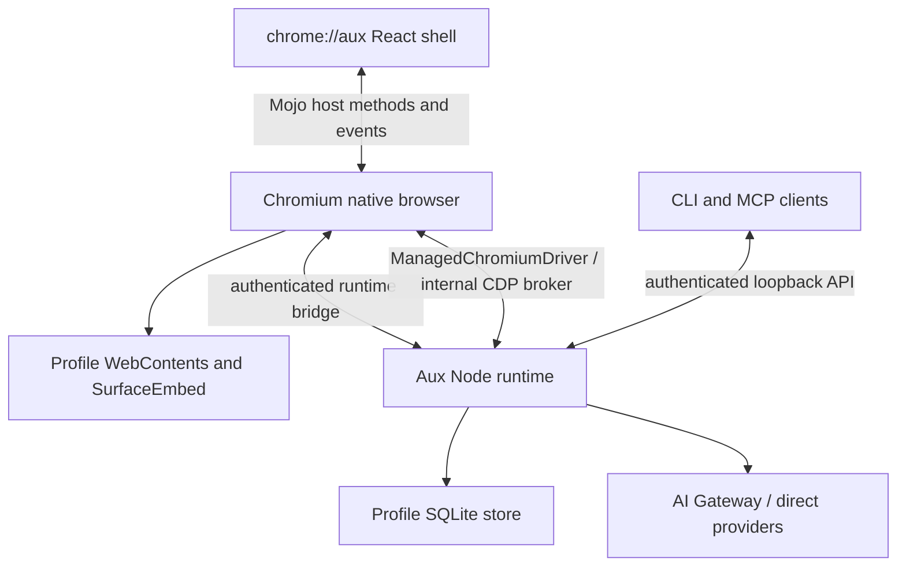

# Architecture

Aux is a Chromium browser with a trusted `chrome://aux/` React shell and a per-Profile Node runtime. Chromium owns windows, WebContents, tabs, navigation, browser sessions, extensions, history, bookmarks, permissions and the native glass underlay. The shell places page surfaces through SurfaceEmbed and invokes the native host through its packaged Mojo bootstrap.

The native method registry advertises implemented capabilities. Feature entry points depend on those capabilities and user Labs preferences. Runtime-owned chat, task and AI data stream to the shell; browser-owned interactions must remain available independently of runtime readiness.

The runtime’s services coordinate agent execution, snapshots, policy decisions, durable effect receipts, artifacts, memory, routines and external tools. Observed element references are scoped to page and document epochs. Navigation or takeover invalidates earlier authority; Stop and Take over must fence in-flight work. Model and page content remain untrusted.

The loopback API uses a bearer token stored in the Profile runtime directory. CLI and MCP are clients of the same runtime policy rather than alternate authorities. Secrets are held by native secret storage; stored sensitive values currently use protected SQLite adapters.

Implementation is transitioning under [ROADMAP.md](ROADMAP.md). Legacy planner, migration and standalone/Electron code still present in the tree are scheduled for deletion; this document does not claim those deletions or upcoming architecture changes are complete. [STATUS.md](STATUS.md) records current delivery state.
