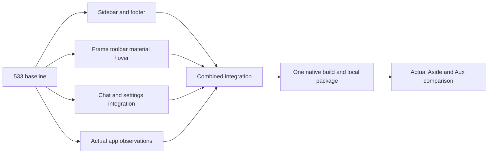

# Pass 1: integrated UI completion

Authorized by owner 2026-10-20. Baseline local main47b0e50fd, built and observed native533, supplied Agent1852 snapshot. Working tree clean. Scope: sidebar, toolbar/address bar, native material, hover lifecycle, supplied chat panel and settings. Preserve Aux artwork, Vault exclusion, owner-data isolation and existing scoped runtime. No release or provisioning. Root retains shared native/build/package/desktop ownership.

| Node | State | Owner / coverage | Acceptance |
|---|---|---|---|
| B | verified | Root: preserved533 and exact runtime cache | Recoverable prior app/source |
| S | integrated | frame_style: sidebar rows/icons/footer source owners | Matched alignment, controls, actual status integration |
| F | integrated | frame_geometry: toolbar/external frame/material/hover | Seamless correct surfaces, no rail, correct floating lifecycle |
| C | integrated | l4_ui: supplied chat/settings routes/bindings | Real settings and chat actions reachable, state retained |
| O | active | Root: desktop observations; no owner data copying | Capture corresponding states and concrete discrepancies |
| I | integrated | Root: shared native composition/stage | Compatible exact patches, no independent redesign |
| V | building | Root: serialized native build and package | Matching successful receipt, existing scoped authority reused |
| A | pending | Root: focused actual app journeys | Sidebar, toolbar, hover, chat and settings evaluated against reference; gaps explicit |

Parallel work uses separate worktrees and returns pinned proposals; workers never modify shared native checkout or run builds. Native build/packaging is the serial bottleneck. No numeric time estimate is justified before discovery. Integration waits for related corrections, not isolated icon changes. After focused compile/build, compare actual app; repeat only for concrete observed failures. Real AI tasks/provider services, import, password-manager compatibility and distribution are later passes. Do not mark entire pass accepted while in-scope behavior remains broken or unexplained.

## Concrete baseline observations and integrated corrections

Actual533/Aside desktop capture pair uses Example Domain at identical display scale. Aux had stock filled omnibox, bright page divider and an8px shadow-box inset when chat opened. Aside has a flat resting URL/title presentation, flush rounded content, toolbar following page background and transparent chat panel. Integrated native534..541 restores tab row/NewTab8px margins, supplied internal Settings routes, flat external omnibox plus actual adjacent page title, page background repaint, transparent panel and zero Agent padding, retained blur eligibility, pinned-menu expansion locks, and original CommandE34068 panel toggle. Domain/title adapter is explicitly observed155 integration rather than a claim of recovered original source; editing/site information retain their actual owner.

Actual Sidebar footer zap/dot is the original multi-profile pager, so the one-profile disposable preview must not fabricate it. Most keyboard customization controls are also disabled in the current Aside reference and pinned1852 gates them on native API availability. Those are documented capability/version differences, not falsely enabled controls. Models menu in533 already opens with real choices; no AI task submitted. CmdE was actually broken in533 while AltShiftB opened the actual supplied panel, and Aside CmdE visibly toggles it.

Settings import descriptions are now a counted two-anchor source adaptation saying bookmarks, matching the shipped native importer and owner password-manager exclusion. Existing eight signed helper targets stay byte-identical; the local reuse workflow now admits only exact reviewed UI/provenance hashes, verifies all other resource bytes/modes/links and final signatures, and reports changed UI resources honestly. Six focused source/boundary checks pass; no broad regression suite or new Apple signing/Keychain operation.

## Combined build in progress

Native542 restores the genuine bundled Agent toolbar action;543 adds the read-only resting origin without shortening or replacing the real URL editor. Native544 makes Agent panel layout and resize measurements use its actual zero border while retaining stock borders for ordinary panels. Native545 repairs the three concrete155 compile incompatibilities found in the first combined build: callback binding, protected LabelButton access and non-const WebContents title access. The corrected combined build is in progress; packaging and real-app acceptance remain pending.

Settings links now use the six counted Aux internal URLs, with compatible legacy aliases retained at the native boundary. The final supplied stage is `out/provided-reuse-pass1`. Existing authority reuse admits only explicitly reviewed UI and provenance hashes; eight signed helpers remain unchanged. This is not evidence of a completed build or current app acceptance.

The v545 full build then found a non-const top-container accessor in the frame paint adapter. Native546 replaces it with the existing const-safe view-type check. The targeted address-bar and frame-paint objects now compile; the routing object is compiling before the full incremental build resumes. No runtime acceptance is inferred from these compile results.

Native547 updates the four obsolete GURL path accessor calls without changing the Settings allowlist. All six targeted native object checks pass. The full incremental build reached framework linking; final package and actual desktop comparison remain pending.

## Actual547 comparison and final551 integration

547 built and launched; receipt and resource reuse verification succeeded. Actual menu/Settings/Advanced link/collapse/sidebar data observation succeeded. The final551 composition incorporates actual Cocoa shortcut dispatch,330DIP Agent default/minimum (preserving explicit saved widths), Agent-only Ask/native-close visibility, and directly observed resting-domain PageInfo plus trailing focused site controls. All four affected object checks pass; full551 build/package/live acceptance remains pending. Evidence of the newly observed reference interactions is saved in `out/pass1-ui-completion/aside-domain-info.png` and `aside-url-focused.png`. No AI request was sent.

## Final556 build and package

Full native556 build and generated-key probe passed (18 incremental steps;5m09s). Packaging assembled10,751 supplied resources and418 native leaves. Final composition includes552 canonical Aux/pinned ImageModels and themed fallback,553 recovered source-backed Ask Aux text pill,554 actual Agent main-page resting brand/title,555 Agent-page action visibility and556 the actual155 ImageModel API repair. The focused objects passed before the full build. No additional broad test suite was run.

The observed547 preview is preserved as `out/provided-candidate-local-browser-pass-v547-observed-baseline`. The556 package is at the stable preview path; approved-resource reuse/native sealing and final actual-app observations are pending. Package report SHA256: `6505a34faefe2595fa3ae089893bcbe9886f19271a45f42bfce8172f84bec054`. Native receipt: `out/native-integration/native-full-build-v556.json`.

## Actual556 comparison and final558 corrections

556 resource reuse/native sealing passed: receipt SHA256 `ef1084d67fa581f7ed68ad4441c2704b51a7e4e3a2db3547d552ed5f3a6e9d53`. The bundle metadata differed only in excluded-file ordering; exact semantic proof is retained, and the final resource review pins the new hash. Actual observations are in `out/pass1-ui-completion/v556-observations.json`, with captured states under `v556/`. No AI request was sent. Transparent→Tinted→Transparent visibly changes the native frame; original preference restored. Actual current Aside also shows the same pale material, so no arbitrary darkening was introduced.

Actual observation exposed four final integration bugs.557 reserves the actual Ask command before Cocoa's conflicting responder selector, refreshes the resting title on real title events and removes the exact Agent main-page duplicate neutral extension chip. Three focused objects pass.558 uses the genuine bookmark model's existing omnibox suppression exemption only for AuxMac BookmarkThisTab; all other active/enabled/visible/requested/pinned eligibility remains. Full558 build and packaging are in progress. Final runtime acceptance is pending.

## Owner corner correction and recovered C++ inputs

The owner supplied `~/Downloads/aside-rea 2/recovered-cpp/` during final comparison. Pinned audits confirm useful address-labelled sidebar/address-bar bodies, including existing8DIP inset,151DIP compact threshold and retained hover locks. The export lacks the Mac corner query and relevant layout owner; it is not original compilable C++. The observed32physical-pixel/16DIP Aside page curvature therefore remains explicitly measured evidence. Native559 shares that radius across existing native frame, toolbar, page and Agent clipping owners, including zoomed states; no opaque wrapper or global shadow mask is added. Native560 fixes the actual Chromium155 generic-view compile type at the query call. Full560 build passed (8 incremental steps,5m25.76s) with generated-key probe; packaging assembled10,751 supplied resources and418 native leaves. Actual corner acceptance is pending.

The recovered address-bar body also exposes six bounded50ms refresh retries; current actual title-event invalidation is checked before introducing any timer. See `docs/integration/proposed/recovered-cpp-sidebar-toolbar-audit/` and `native-shared-surface-corners/recovered-cpp-audit.json`.
