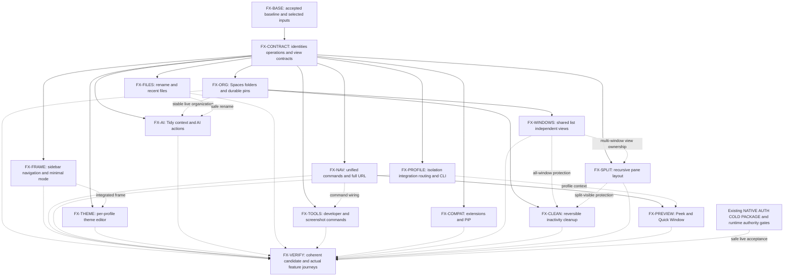

# Aux desktop feature expansion — parallel execution plan

Planning date: 2026-10-23. Source baseline: local `main` at `2301a7d66` with a clean working tree before this documentation pass. **Planning only: no feature implementation, build, application lifecycle action, signing or release was performed.** Three read-only agents audited native capabilities, productivity/AI, and synchronization; the integrator reconciled their findings against the selected product and inspected saved actual-app captures.

## 1. Outcome and owner decisions

Extend the current Aux browser with durable organization, faster navigation, flexible windows, and useful productivity features while preserving its accepted visual identity and supplied implementation. Reuse existing native owners, supplied Agent components and supported Chromium capabilities; do not revive the retired independent shell or build a competing UI/store.

Owner decisions made during this planning session:

- **No mobile app now.** Mobile tab sync and pinning from a phone are deferred and excluded from this plan's completion gate. Do not create a mobile client or mobile-specific cloud service.
- **Desktop windows share the same tab list, with independent viewing.** Within one profile, additions, organization and closures converge locally; each window retains its selected tab/pane, scroll and focus. Selecting a tab must not unexpectedly activate another window.
- Pins appear in every Space **within their profile**. Work and personal profiles never share cookies, extensions, provider credentials or live page instances implicitly.
- Preserve the current UI. Requested changes—sidebar navigation, centered Cmd+T, minimal mode, themes and new organization controls—are deliberate extensions of that UI, not permission for a redesign.
- Keep testing focused. Build coherent batches, inspect actual changed interactions, repeat only failures or checks invalidated by a change.
- Signing and distribution remain separate. The standing instruction not to shut down or restart anything still applies. Prepare lifecycle acceptance, but do not run it until that instruction is explicitly changed.

Desktop cross-window synchronization is a local browser feature and needs no Aux account, cloud deployment or subscription. Payments, Aux-funded inference, hosted speech, mobile, and unrelated production setup are outside this feature expansion. Existing pre-release obligations remain in the [completion graph](../ROADMAP-EXECUTION-GRAPH.md); this plan does not replace or close them.

## 2. Honest starting point

Status must distinguish **source present → integrated → built → observed → accepted**. A patch, disabled implementation, passing fixture or historical screenshot is not proof the current candidate works.

| Area | Evidence and starting state | Consequence |
|---|---|---|
| Accepted visual baseline | `out/provided-candidate-local-browser-pass/Aux.app`; saved actual Aux617/reference captures in `out/pass1-ui-completion/compare.html` | Preserve this app and its appearance. These are historical observations, not a new live comparison. |
| Latest candidate | `out/provided-candidate-protected-startup-integration-20261023/Aux.app`; paired assembly recorded under `docs/integration/proposed/profile-isolation-protected-startup/integration/` | Built but inactive, unsigned, `testable:false`; startup/custody/recovery are not accepted. Only daemon and bundle metadata differ from the preceding candidate across 11,191 recorded leaves. |
| Current native source | `/private/tmp/aux-chromium-recovery-snapshot-20261023/src` selected for the last successful build | Freeze a recoverable source snapshot and exact selected graph before execution. Do not edit this or the owner's shared Chromium checkout concurrently. |
| Retired shell | `chrome/browser/ui/aux/BUILD.gn` asserts `enable_aux_shell`; selected product requires it false | Organization, routing, quick-window and download code there can supply reviewed algorithms. Their presence is not delivered functionality; do not activate the old shell. |
| Native pins | `chrome/browser/ui/tabs/aux_pinned_tab_entries.{h,cc}` and `ui/views/tabs/vertical/aux_pinned_tab_entry_actions.cc` | Real persistent URL/title pins exist. Stable IDs, Space/folder ownership and complete unload semantics need work. |
| Hierarchy and sections | `ui/views/frame/aux_vertical_tab_bookmark_expansion.cc`, `aux_vertical_tab_bookmarks_view.cc`, `aux_bookmarks_section.cc`, `aux_section_view.{h,cc}` | Bookmark trees and persistent animated collapse exist. Nested **tab** folders and a collapsible pinned section are additional work. |
| Profile and frame | `ui/views/frame/aux_profile_switch_{request,transaction,workspaces}.cc`, `vertical_tab_strip_region_view.cc`, `aux_sidebar_presentation.{h,cc}` | Extend real switching/presentation owners. Existing “workspaces” are cached profile browsers, not user Spaces. |
| Commands and URL | `ui/aux_keyboard_shortcuts.{h,mm}`, `ui/views/frame/aux_tab_search_bubble.{h,cc}`, `ui/views/omnibox/omnibox_context_menu_mixin.cc` | Reuse shortcut registry/search host and Chromium full-URL preference. Centered Cmd+T commit semantics and sidebar omnibox placement need integration. |
| Splits and quick popup | `ui/tabs/split_*`, `tab_strip_model.cc`; `extensions/api/aux_mini_popup/` | Existing two-pane substrate and supplied Mini Popup do not establish arbitrary pane trees or a small browsing window. Fixed-two assumptions must be removed deliberately. |
| Supplied AI | Latest packaged extension `background.js`, `assets/appearance-Ceuw3-j6.js`, `session-composer-Dc0LRfZA.js`, `utils-Cl9zfMcr.js`, `tabsearch-3k_2hgil.js` | Tidy, mentions, Search/Ask and search UI exist. Extend them through count-checked source adaptations; never edit generated package files as the source of truth. |
| Tidy defect and dependency | `aux.verticalTabsTidy` → `Yw()`; `Ow()` calls `/tabs-tidy/plan`; current code closes duplicates before planning resolves | Reuse UI, replace hosted-only dependency with configured provider capability and make organization changes transactional, reviewable and undoable. |
| Cloud sync | `services/aux-cloud/src/session-sync.ts` and `services/aux-cloud/docs/session-sync.md` | This is conversation history, not browser tab/Space synchronization. No new cloud work is required for the approved local-window behavior. |
| Utilities | Existing supplied capture/Lasso and native extension mechanisms; historical safe rename/router patches | Reuse selected capability where available; port only needed safe primitives from retired code. Actual external password-manager pairing and final-app utility acceptance remain open. |

Native paths in this document are relative to the frozen Chromium `src` root unless explicitly repository-relative. Supplied extension paths above refer to `Aux.app/Contents/Resources/aux/apps/extension/dist/` in the latest package and serve as evidence, not editing destinations.

### Foundational work that remains separate and necessary

The current [STATUS](../STATUS.md) and completion graph still require genuine protected startup, private-state writer custody, complete drain, safe admitted-root recovery and atomic runtime publication. The latest inventory recheck does not close the post-check race; external hardlink and staging-name races remain known gaps. No new feature may bypass those boundaries to appear runnable.

New feature source, model checks and inactive builds can proceed against frozen ownership interfaces. Real profile isolation, restart persistence, and final-app acceptance require the corresponding existing `NATIVE`, `AUTH/OWNER/PEER`, `COLD/EMBED`, `PACKAGE` and runtime-authority gates. Track those existing IDs; do not create a second competing startup implementation in this roadmap.

## 3. Product and interaction contracts

These are the defaults to implement unless concrete source discovery requires an explicit, documented adjustment. They resolve cross-feature behavior before agents branch.

### 3.1 Profiles, Spaces, pins and folders

- **Profile** is the privacy boundary. Separate cookies, site storage, extension installations/data, permissions, history and provider state. Reuse the existing switch transaction and admission owner.
- **Space** is an organizational view inside a profile, not another profile or hidden-browser cache. Each has a stable ID, name, icon and ordered tab/folder list. Creation requires no account.
- **Global pins** sit above Space-specific contents. A pinned tab or pinned folder appears in every Space of that profile. An ordinary tab may also be protected in its Space; the UI must distinguish “Pin to all Spaces” from “Keep in this Space.”
- Persistent means the record survives closure/relaunch, not that every page continually consumes memory. Close/Cmd+W on a global pin unloads its live view and leaves the pin available; explicit Unpin/Remove is a separate command. Protected unsaved work must not be discarded to satisfy unload.
- Pin identity is not its URL. Two same-URL entries with different state remain distinct. Preserve the chosen launch URL separately from the current view URL; no automatic reset to the launch URL on every click.
- Nested folders support recursive rename, reorder, drag, move, collapse and keyboard navigation. Prevent cycles and cross-profile parentage. Use a documented high safety bound for hostile/imported trees, not an arbitrary one-level product restriction. Pinned-folder children inherit retention; removing a folder offers clear keep-contents versus remove-contents behavior.
- Bookmarks remain actual Chromium bookmarks. A bookmark folder is not silently converted to a tab folder. Reuse disclosure styling and support explicit open/copy/pin actions between the two.
- Collapse state persists independently for Bookmarks, Pins and each folder; collapsing never unloads or deletes its contents.
- Keep the current global Pins/Bookmarks/Chats order. Introduce a compact Space selector at the Tabs section header with its icon and `+`, rather than adding another large permanent toolbar. Existing profile avatar/pager remains distinct; do not relabel profile dots as Spaces. Chats remain profile-scoped. Recent Files is optional/collapsible within the existing sidebar scroll layout.
- `+` creates a named Space with icon selection using current menus/popovers. An end-of-list swipe exposes an explicit add affordance; incidental scrolling must not create Spaces.
- Horizontal swipe over the Space switcher changes Spaces. A conventional mouse wheel over that switcher also steps through them, with threshold/debounce and one transition per gesture. Scrolling webpages or tab lists remains normal scrolling. Provide keyboard/menu alternatives and respect reduced motion.

### 3.2 Shared tabs, independent windows

Use one profile-scoped logical organization model with per-window views. Do not share a single live renderer between visible windows and do not sync browser state through the chat-history service.

- Shared: logical tab membership, canonical committed URL/title, pin/folder/Space membership and ordering. New entries appear in other same-profile windows without stealing focus or eagerly loading every page.
- Window-local: active Space, selected tab, scroll, focus, live page/history instance, split arrangement and transient UI. Selection opens/focuses that window's view, not another window.
- A navigation publishes a versioned logical update. Update shared metadata and never-loaded placeholders automatically. An existing loaded view retains its actual document, URL and history, with a quiet pending-update marker; adopting the navigation or keeping an independent copy requires an explicit action. Background status or absence of a dirty/beforeunload signal does not make replacement safe. Suspended views with retained history also keep that history until the update is accepted. Never show the shared URL over a different loaded origin.
- Closing a logical ordinary tab removes it from the shared list. If another window holds protected live work, retain a clearly identified local recovery copy/pending-close view until the user resolves it. Do not silently lose form state or resurrect the shared item via a stale update.
- Closing a window releases its views; it does not delete the profile's logical tab list. Deliberate “Close tab everywhere,” “Close this view,” and “Keep independent copy” commands must have distinct behavior and clear labels where needed.
- Pins unload locally while remaining shared records. Explicit removal propagates with the same protected-work handling as ordinary tabs.
- Durably commit before acknowledging organization changes. Revisions, stable operation IDs and origin-window IDs prevent feedback loops and stale replay. Recovery restores logical state and suspended views; it does not automatically resume agent jobs, media capture or permissions.

### 3.3 Preserve the frame and extend navigation

- Freeze current typography, icon weight, spacing, rounded surfaces, blur/material, toolbar integration, chat width behavior and default theme. Capture matching states before changing their owners.
- One frame state owner coordinates `docked`, `hidden`, `hover-preview`, `minimal`, sidebar-navigation placement and right chat/split geometry. Avoid separate booleans in multiple widgets painting conflicting corners.
- Always-visible and auto-hide are explicit modes with a menu/shortcut toggle. Hidden mode reserves no phantom rail. Hover preview overlays content; docked mode reserves width. Menus, drags and keyboard focus retain the preview until released; leaving then dismisses it without pointer gaps.
- Reuse current motion/material tokens. Animate transforms/opacity where existing native owners support them; avoid repeated page relayout during hover. No new arbitrary duration or increased bounce. Reduced motion keeps every action usable.
- With sidebar navigation enabled, move the **actual** URL/navigation control and its controller into the docked sidebar header. Keep one authority for typed URL, selection, permission UI and back/forward state. A collapsed sidebar returns those controls to the existing seamless top location. Hover reveal must not relocate a focused editor mid-typing.
- Minimal mode removes redundant chrome and gives the page available space while preserving the left pane when docked. Keep discoverable exit/keyboard controls and trusted origin/permission affordances. “Always show full URL” takes precedence over hiding the location control, including in minimal mode.
- Full URL exposes the existing Chromium preference through Aux Settings and every resting URL presentation. Editing/copying always uses the actual URL; retain Chromium's security formatting, directionality handling and site-information UI. Long URLs scroll/reveal appropriately rather than hiding the identity behind a title.
- The theme editor extends Appearance: per-profile light/dark/system, accent, background/tint and supported material intensity, live preview, cancel/apply, save preset, reset and validated export/import. Default tokens stay unchanged. No arbitrary executable CSS or remote asset loading. Keep readable text/focus indicators; reflect OS reduced-transparency/contrast settings rather than promising blur the OS has disabled.
- Tab selection gets a subtle active shadow/pressed response, using the current shape. “Tabs that move when clicked” means tasteful selection motion and scroll-into-view—not automatic tab reordering. Drag remains the way to reorder.
- Native window/page/sidebar/split/chat clipping uses one geometry calculation. Both sidebars, bookmarks bar, hover preview, fullscreen and narrow-window transitions must not reintroduce the previously fixed notch, double corners or clipped Ask button.

### 3.4 Unified commands, Peek and quick windows

- Reuse the supplied/native search host and one command catalog. `Cmd+T` opens a centered New Tab palette; no tab is created until a destination is committed. Escape leaves tab count and selection unchanged. Explicit New Blank Tab remains available.
- `Cmd+L` selects the active pane's actual address in the same command system, with a current-location/edit mode. `Cmd+K` opens all commands/search. Modes are visible and share ranking, focus, accessibility and keyboard behavior.
- Results include matching open tabs, bookmarks, history, Spaces and commands, then normal web search and explicit Ask. Existing-tab results focus a local view without accidental duplication; “Open another view/copy” is explicit.
- Expand the existing shortcut registry and Settings editor. Support navigation, Spaces/folders, pin/unload/archive, splits/pane focus, chat, themes, screenshots, developer tools and quick windows. Detect conflicts, preserve platform-reserved shortcuts, reset/export/import mappings. Global shortcuts are separate from in-app shortcuts; do not promise to remap every OS action.
- **Peek** previews an HTTP(S) link in a lightweight rounded surface bound to the source profile, with visible destination, dismiss/back and promote-to-tab. Provide modifier-click and context-menu entry, plus an opt-in ordinary-link-click preference. Keep default webpage click behavior until that preference is enabled. No automatic preview on hover or speculative content upload.
- Peek retains Chromium navigation/permission isolation; requests needing unsupported flows promote or show an honest restriction. Closing it releases only its own view. Promotion retains current navigation/history where supported, without reopening in the wrong profile.
- **Aux Quick Window** is the Aux-named small browsing window: URL/search, selected profile indicator, basic navigation and Open in Main Window. Reuse the current Mini Popup where suitable, but do not claim an AI popup is already a complete browser. Handoff is atomic and preserves the destination/profile; cancel/failure leaves the source view usable.

### 3.5 Splits, files, media and developer tools

- Split is a recursive layout tree with horizontal/vertical nodes and tab-view leaves, not a single two-pane ratio. Deliver three- and four-pane layouts, resizing, drag-to-edge insertion, keyboard focus, swap, unsplit and restoration; retain capacity for more panes subject to an explicit practical limit/minimum sizes.
- Dragging onto a tab shows directional drop targets; center remains ordinary selection/group behavior rather than an ambiguous destructive action. Keep right chat separate from the split tree. Active pane owns URL/history, chat context, screenshot and DevTools commands.
- Narrow windows constrain resizing and offer an explicit stacked/focus presentation without silently closing panes. Removed tabs collapse only their affected branch. Persistent pins survive unsplitting.
- Smart download names are suggestions by default. Use filename and source-page metadata before requesting file contents; any AI call uses the configured provider. Preserve extension/type, file bytes, original name/provenance, collision-safe rename and Undo. No overwrite, path traversal or silent background AI spending.
- Recent Files starts with Aux downloads and files explicitly chosen/attached in Aux, scoped to the profile. Reuse sidebar row styling and a collapsible section; support actual OS drag/drop and chat attachment. Missing/moved/unavailable files show honest status. No scan of all user files or automatic content upload.
- Expose Chromium picture-in-picture through applicable video/context/command controls. Preserve playback and return-to-tab behavior; do not invent protected-media compatibility or force automatic PiP on every tab switch.
- Developer mode is an optional grouping/preset of existing DevTools, inspect, view source, cache-bypassing reload, responsive tools, extension developer page and screenshot commands. It must not disable browser security or expose remote-debugging ports automatically.
- Screenshot commands reuse current capture and Lasso: visible tab, selection and full-page when supported, then preview/copy/save/attach. Bind to the selected profile/pane, handle navigation during capture, and explain unsupported pages. Capture never sends to AI merely because it was taken.

### 3.6 AI features and automatic organization

Reuse the existing Search/Ask, composer, context chips and Tidy settings. Feature controls stay honest about provider availability; ordinary browsing, palette, organization and cleanup work without AI setup.

- **Tidy Tabs:** choose current Space/selected tabs; produce a proposal with folder names and proposed moves. Accept once, apply against the current revision, show Undo. Never close duplicates before success; same URL does not prove same page state. Stale/profile-switched/cancelled proposals cannot mutate another context. A deterministic “Group by site” can remain separately labeled; never silently claim fallback output is AI-generated.
- **Age cleanup:** disabled initially; user chooses inactivity days and scopes. Use last meaningful activation rather than creation date. Archive recoverable metadata before unload/close. Exclude pins/pinned-folder children, active/split-visible pages, audible/capturing/downloading/beforeunload-sensitive pages and tabs held by agent work. Aggregate protection across every live view of each logical tab, including other windows and split panes; unknown protection is a reason to skip. Recheck that aggregate at commit time. Run once per profile after startup restore settles; no permanent auto-deletion in this feature. Provide recent archive, restore and Undo.
- **@ tabs:** retain supplied mention nodes/chips. Search current-profile tabs with Space labels; explicitly chosen same-profile Spaces are available. At submit, validate stable tab/view/profile/generation and navigation identity. Closed/unloaded references get a clear resolution choice; never bind to a recycled target ID. Preserve draft references across restart without automatically uploading page content.
- Define “Arc Max–style AI” concretely: Tidy Tabs, rename suggestions, Ask current page, Ask selected tabs, summarize selected text/page, and explicit web research/search with linked sources where the configured provider/search capability supports it. Do not label generic chat as verified web search or promise an undefined bundle of future features.
- AI context is explicit and scoped. Send only needed titles/URLs or chosen content; never merge work/personal contexts. Treat page content as input, not permission to run actions. Use existing cancellation/provider lifecycle boundaries and invalidate late results on profile/owner changes.
- No Aux payment plan, hosted credits or new provider subscription is needed for source implementation. Real inference acceptance requires a working authorized provider connection, applicable model/data handling and a bounded test budget; fixtures establish mechanics, not model quality.

### 3.7 Profile routing and CLI

- One rule resolver handles new external link intents, CLI and explicit browser open actions. Rules support exact host/subdomain/path patterns, stable priority, enabled state, destination profile and optional Space. Provide a “Test this URL” preview and explain which rule wins.
- Explicit user/CLI profile selection overrides automatic rules. Deleted/locked/unavailable destinations produce a choice or error, never silent fallback to a different profile. Profile identity is durable, not a display-name match.
- Do not route every redirect, POST or sign-in callback across profiles. Keep ongoing navigation and authentication chains in their originating context. Normalize using Chromium URL handling; reject unsupported/dangerous schemes and avoid broad regex engines for ordinary rules.
- Reuse the supplied CLI adapter. Target behavior: `aux open <url> --profile <id-or-unambiguous-name> [--space <id-or-name>]`, plus list/resolve commands and structured output. Use the same resolver, stable commands and authenticated local bridge. Return useful errors for ambiguous/missing profile, refusal, unavailable browser and invalid URL. Never interpolate URLs into shell commands.

## 4. Shared implementation contracts

`FX-CONTRACT` must turn these proposals into checked interfaces selected into the current browser graph before consumers diverge. Reuse existing models where appropriate; the retired shell schema is reference material, not an instruction to enable it.

| Contract | Required semantics | Single owner |
|---|---|---|
| Organization vNext | Schema version; profile/Space/folder/tab/pin IDs; parent relation; stable order; archive/tombstone state; revision; legacy pin and bookmark references | Organization worker; integrator owns public registration |
| Window view | Logical-tab ID distinct from instance/WebContents ID; selected pane/Space; actual loaded URL; protected-work state; pending shared update | Window worker |
| Mutation | Profile + owner generation + expected revision + operation ID + intent; atomic result and bounded Undo token; reject stale/foreign writes | Organization worker |
| Read model | Snapshot + revisioned deltas, resubscription after gap, origin-window tagging, no renderer-owned duplicate store | Organization/window interface jointly reviewed, one author |
| Frame state | Docked/hidden/hover/minimal, navigation host, active pane, chat geometry, focus/menu/drag locks | Frame worker |
| Command catalog | Stable ID, arguments, enablement, current profile/window/pane context; menu/shortcut/palette/CLI dispatch | Navigation worker; command-ID allocation integrator |
| File capability | Opaque file reference + profile/provenance + current access/identity validation; no arbitrary renderer paths | Utility worker |
| Provider proposal | Requested capability + explicit context + cancellation/generation; typed suggestion, no automatic mutation | AI worker |
| Theme vNext | Versioned per-profile tokens/presets with validation, preview rollback and existing-default fallback | Theme/frame worker |
| Recovery | Versioned migration; journal/transaction rules; unsupported-newer schema refusal; recoverable old state; no key resets | Integrator and existing lifecycle owner |

Migration must preserve existing saved pins, bookmark hierarchy, profile preferences, tab order and drafts. Assign stable IDs without deduplicating by URL. Do not silently reinterpret encrypted state or migrate owner profiles during development. Validate with disposable legacy fixtures, interruption/rollback and a repeat run. Persist via the admitted native storage boundary; new autosave/cleanup services must register with the existing writer/drain contract rather than bypass it.

## 5. Requirement coverage

All requested items have one owning outcome. R20 is explicitly deferred by the owner's answer, not forgotten.

| ID | Requested outcome | Owner node | Starting classification |
|---|---|---|---|
| R01 | Permanent all-Space pins and pinned folders; unload instead of close | FX-ORG | Pins exist; semantics/model extension |
| R02 | Nested folders | FX-ORG | Bookmark nesting exists; tab nesting new |
| R03 | Spaces, icons, +/swipe creation, mouse-wheel switching | FX-ORG | New selected-product integration |
| R04 | Collapsible bookmarks and pins | FX-ORG | Bookmarks exist; pin section integration |
| R05 | AI Tidy Tabs | FX-AI | Supplied implementation requires adaptation/correction |
| R06 | Inactivity-based cleanup | FX-CLEAN | New policy integrated with archive/lifecycle |
| R07 | Isolated work/personal profiles, fast switch, profile themes | FX-PROFILE + FX-THEME | Existing switching; isolation gate open; theme extension |
| R08 | Always show full URL | FX-NAV | Existing Chromium preference; Aux binding/all surfaces |
| R09 | Vertical tabs, always-visible/auto-hide, smooth easy toggle | FX-FRAME | Existing presentation; consolidate/test states |
| R10 | Minimal edge-to-edge UI toggle | FX-FRAME | Intentional new mode |
| R11 | Sidebar URL and back/forward while open | FX-FRAME | Intentional placement integration |
| R12 | Real theme editor | FX-THEME | Beyond existing light/dark/system |
| R13 | Tab motion, rounded corners, soft active shadow, pressed buttons | FX-FRAME | Preserve baseline; targeted refinement |
| R14 | Unified Cmd+K/T/L with centered no-tab-until-commit Cmd+T | FX-NAV | Reuse search host; new command behavior |
| R15 | Broad customizable shortcuts | FX-NAV | Expand real registry/editor |
| R16 | Peek link preview | FX-PREVIEW | New selected-product feature |
| R17 | Small quick browsing window | FX-PREVIEW | Mini Popup exists; browsing/handoff extension |
| R18 | Chrome and custom extension support | FX-COMPAT | Integration/actual compatibility acceptance |
| R19 | Same tab list across windows, independent viewing | FX-WINDOWS | New authoritative local live projection |
| R20 | Mobile tab sync and pin-to-Space | Deferred | Owner: “no mobile app yet skip that” |
| R21 | Drag split, top/bottom, three or more panes | FX-SPLIT | Generalize two-pane substrate |
| R22 | Smart download renaming | FX-FILES + FX-AI | Safe native service + provider suggestion |
| R23 | @ tab references in chat | FX-AI | Existing supplied mechanism; identity/Space hardening |
| R24 | AI page/tab actions and grounded AI search | FX-AI | Defined capability scope; real provider acceptance |
| R25 | Recent files sidebar and drag/drop | FX-FILES | New scoped projection/capability |
| R26 | Video picture-in-picture | FX-COMPAT | Expose/reuse native capability; actual acceptance |
| R27 | Site rules route to profiles | FX-PROFILE | Port needed into current graph |
| R28 | CLI URL open with profile choice | FX-PROFILE | Reuse CLI and profile bridge; verify/extend parser |
| R29 | Developer mode | FX-TOOLS | Cohesive command preset/integration |
| R30 | Screenshot tool | FX-TOOLS | Reuse capture/Lasso; complete exposed workflow |

## 6. Dependency graph and node registry

Solid arrows are implementation prerequisites. Dashed arrows are acceptance prerequisites; work against stable contracts can begin earlier. Shared-file/build conflicts are scheduled in section 7, not disguised as feature dependencies.

Dependency reasons: consumers need one stable identity/operation contract; live cross-window projection and cleanup require real durable organization; Peek/quick-window actions consume the unified command/navigation interface. Split layout can be built against the view contract while window integration proceeds. AI can use deterministic proposals before the real organization service arrives. Theme controls can use frozen tokens before final frame integration. Existing lifecycle gates prevent unsafe acceptance, not useful independent source work.

Effort labels below mean active engineering complexity, not elapsed deadlines: **focused** = existing surface adaptation; **substantial** = cross-layer outcome; **large** = new persistent/native subsystem. Build queues and owner/external waits are separate. Confidence reflects the source audit, not a completion promise.

### FX-BASE — preserve and qualify the execution inputs

**State:** planning audit complete; execution snapshot pending. **Owner:** integrator. **Effort:** focused, high confidence.

Pin the actual execution commit, dirty work disposition, selected native graph, supplied source versions, accepted visual captures and latest candidate receipts. Record active agents/builds without stopping anything. Create isolated execution worktrees only after execution is requested. Reserve shared files. Keep historical evidence unchanged and exclude credentials/personal state from snapshots.

**Output/check:** `docs/integration/proposed/browser-feature-expansion/baseline.md` during execution, with exact inputs/owners and a recoverable baseline. No app launch or build required to finish this node.

### FX-CONTRACT — one model and shared seam

**State:** proposed in section 4; implementation pending. **Owner:** integrator with organization worker authoring domain types. **Prerequisite:** FX-BASE. **Effort:** substantial, medium confidence.

Audit exact selected owners, resolve schema and event ownership, and freeze additive interfaces before branching consumers. Decide how current native pin/session/bookmark models feed one organization service; do not merely enable the shell-only OrganizationStore. Define atomic migration, revision/Undo limits, protected-view states and storage authority. Provide small synthetic adapters so frame, AI and tools work independently.

**Check:** one focused contract fixture for duplicate URLs, foreign profile/generation, stale revision, cyclic parent and unsupported schema; serialization roundtrip and legacy pin import. Exit requires an implemented/compilable contract and ownership map, not prose alone.

### FX-ORG — organization that remains usable and durable

**State:** partial native primitives; expanded feature pending. **Prerequisite:** FX-CONTRACT. **Owner:** organization worker. **Effort:** large, medium confidence.

Implement stable records/migration, profile-global pins/pinned folders, nested tab folders, Spaces, icon/creation/switcher, collapsible sections, keyboard/drag operations and reversible archive. Retain bookmark model behavior. Add close/unload policy at the real close-command boundary so menus, Cmd+W and other close paths agree. New writers join lifecycle ownership.

**Acceptance:** one disposable profile with mail/calendar fixtures pinned globally, two Spaces, nested folders and duplicate-URL tabs; move/collapse/switch/unload/reopen/Undo retains identities and order. Persistence after authorized relaunch is required for acceptance. Model checks cover cycles, interrupted migration and stale mutation. Source success alone is not permanence proof.

### FX-FRAME — coherent sidebar and navigation geometry

**State:** existing UI baseline; extensions pending. **Prerequisite:** FX-CONTRACT. **Owner:** frame worker. **Effort:** large, medium confidence.

Consolidate states and geometry, add sidebar-navigation/minimal modes, preserve auto-hide and glass, provide tasteful press/selection feedback. Use the actual omnibox and existing clipping owners. Accept shared command actions through the contract; do not independently edit shortcut routing.

**Acceptance:** real docked → hidden → hover → docked transitions, with focus/menu/drag held and released; sidebar URL placement, minimal mode and right-chat opening coexist. Compare matched-size baseline/default screenshots and a short genuine interaction capture; check immediate transition corners, not only settled frames. One reduced-motion and narrow-window pass, not every possible combination.

### FX-NAV — command palette, full URL and shortcuts

**State:** reusable registry/search/omnibox exists; integration pending. **Prerequisite:** FX-CONTRACT. **Owner:** navigation worker. **Effort:** substantial, medium-high confidence.

Define command catalog and context; reuse supplied search host/ranking. Implement Cmd+T/K/L modes, commit/cancel behavior, Space/folder/pane commands and Settings bindings. Expose full URL consistently and expand existing shortcut editor including conflicts/reset. Shared command-ID files and platform dispatch changes are integrator-applied adapters.

**Acceptance:** Cmd+T/Escape changes no tabs; commit creates exactly one; select existing result stays in current window; Cmd+L edits the active split pane; full URL survives mode changes; remap/reset works and conflicting/reserved shortcuts refuse. Keyboard/VoiceOver focus returns correctly after dismissal.

### FX-PROFILE — fast isolated switching and deterministic routing

**State:** current switch machinery exists; lifecycle acceptance open; new routing/CLI integration pending. **Prerequisite:** FX-CONTRACT. **Owner:** profile worker. **Effort:** substantial; isolation completion confidence depends on existing native gates.

Reuse admitted switch transactions, profile-specific stores/extensions and cancellation. Add routing rule model/editor/test preview and ingress adapters, extend supplied CLI through the common resolver. Preserve current drafts and active-work behavior. Theme binding consumes FX-THEME. Reference existing foundation gate owners instead of parallel rewrites of startup/custody.

**Acceptance:** two disposable profiles with different cookie/local-storage/extension fixtures; switch with active draft/task and late callback, ensure no cross-profile update. Open a fixture URL through external ingress and CLI into correct profile/Space; explicit override, removed profile and auth callback behavior are checked. Safe restart/active-work acceptance remains open until lifecycle gates and owner authorization permit it.

### FX-WINDOWS — one list, independent live views

**State:** new selected-product work. **Prerequisite:** FX-ORG. **Owner:** window worker. **Effort:** large, medium-low confidence until actual view ownership prototype.

Implement profile-scoped live registry, revisioned deltas, lazy per-window view instances, independent selection/scroll, protection/conflict UX and durable recovery. Define duplicate-view extension/tab-API mapping explicitly so logical records do not masquerade as native tab IDs. Ensure closing a window differs from deleting a shared tab.

**Acceptance:** two windows see add/move/pin/close immediately; each retains own selected tab and scroll. Edit in one while another navigates/closes the same logical tab: protected work stays available and actual origin remains truthful. Close/reopen window and crash/recovery journey run only when permitted. Record whether unsupported page state is retained live versus recoverable; do not claim generic form-state restoration from a URL record.

### FX-SPLIT — three-plus-pane browsing

**State:** two-pane native substrate; generalization pending. **Prerequisite:** FX-CONTRACT; acceptance needs FX-WINDOWS. **Owner:** split/window worker, sequential reservation with FX-WINDOWS where shared files overlap. **Effort:** large, medium-low confidence.

Replace fixed-two assumptions with tree model, per-pane focus/context, insertion/resizing/swap/unsplit and recovery. Reuse supplied/native split affordances. Check accessibility traversal and extension actions against selected pane. Integrator owns broad TabStripModel/BrowserView adaptations.

**Acceptance:** create left/right then top/bottom to form three and four panes; resize, navigate, chat-context-select, close one leaf and restore remaining arrangement. Test both sidebars plus one narrow window; no overlap, vanished focus, broken corners or silent tab closure. Bound malformed layout/cycle/ratio restoration in one focused fixture.

### FX-THEME — useful customization without changing defaults

**State:** light/dark/system exists; editor pending. **Prerequisite:** FX-CONTRACT; final acceptance needs FX-FRAME. **Owner:** theme worker. **Effort:** substantial, medium confidence.

Extend existing Appearance UI/native theme service with typed per-profile tokens, preset persistence/import/export, live preview/cancel/reset and contrast safeguards. Preserve current defaults exactly and existing glass eligibility. Do not rewrite supplied styles wholesale.

**Acceptance:** edit one profile, cancel then apply, switch profiles and restore defaults; validate malformed preset refusal. Compare native frame, sidebar/chat, menus and new-tab in dark/light with a colored backdrop; sample reduced-transparency/high-contrast behavior. No exhaustive color-combination suite.

### FX-PREVIEW — Peek and Aux Quick Window

**State:** selected complete Peek absent; Mini Popup reusable. **Prerequisite:** FX-NAV; profile-context acceptance needs FX-PROFILE. **Owner:** navigation/window worker. **Effort:** substantial, medium-low confidence pending popup/handoff prototype.

Prototype real WebContents ownership/promotion first, then bind supplied popup styling and command/menu controls. Implement opt-in click preview, dismiss, promote, quick-window navigation/profile indicator and main-window handoff. Avoid separate URL parser or credential store.

**Acceptance:** preview fixture link, navigate, dismiss without source loss; promote once; quick-open URL and hand off into chosen profile/Space without duplication. One blocked navigation/permission case is explicit. Existing Mini Popup drafts and chat remain unaffected.

### FX-CLEAN — reversible inactivity policy

**State:** new. **Prerequisite:** FX-ORG; final acceptance also needs FX-WINDOWS and FX-SPLIT protection aggregation. **Owner:** organization worker after its core integration. **Effort:** focused/substantial, medium-high confidence once lifecycle contract is stable.

Add Settings, profile-owned scheduler, fake-clockable policy, protected-tab exclusions, archive-before-close and restore/Undo. Aggregate eligibility across every window/view of a logical tab; an inactive local view never overrides another window’s editing, media, agent or split-visible protection. Revalidate at the actual commit; use local state only, never AI. Keep cleanup paused during startup/profile retirement and unknown drain state.

**Acceptance:** fake-clock fixture for threshold, last use, clock skew, pins, active work in another window/pane and protection becoming active during planning; one actual archive/restore UI journey. No real multi-day waits or forced permanent deletion.

### FX-AI — supplied AI features made safe and useful

**State:** real supplied Tidy/mentions/Search-Ask; adaptations and acceptance pending. **Prerequisite:** FX-CONTRACT; final Tidy/rename acceptance needs FX-ORG/FX-FILES and existing provider gates. **Owner:** AI worker. **Effort:** substantial, medium confidence.

Adapt existing handlers/UI through pinned source transforms. Remove pre-plan duplicate closures, use configured provider capability, introduce typed proposals/Undo, retain mention chips and add stable identity validation. Implement bounded page/tab summaries and explicit sourced search actions. Keep no-provider behavior usable and honest.

**Acceptance:** deterministic proposal fixture for duplicate URLs, stale profile/revision, cancellation/failure and Undo; real @ tab selection from both main composer and right chat; one bounded real provider journey when authorized to establish capability/quality. Stub inference is explicitly not AI acceptance. Preserve current UI assets outside necessary named changes.

### FX-FILES — safe download renaming and recent files

**State:** selected integration largely new; historical safe primitives and current attachments reusable. **Prerequisite:** FX-CONTRACT. **Owner:** utility worker. **Effort:** substantial, medium confidence.

Implement native safe rename/provenance/Undo, profile-scoped recent-file index and drag capabilities. Reuse existing file chooser/attachment plumbing and sidebar styling. Accept AI suggestions via FX-AI contract; ordinary manual rename works independently.

**Acceptance:** rename a completed synthetic download, collide with existing filename, Undo and verify bytes unchanged; moved/missing file refuses; actual recent-file drag into chat and a permitted OS target. Profile change invalidates pending capabilities. No global filesystem indexing.

### FX-TOOLS — developer mode and capture workflow

**State:** selected capture and Chromium dev tools exist; cohesive commands pending. **Prerequisite:** FX-CONTRACT; final command wiring needs FX-NAV. **Owner:** utility worker, after file-service seam is stable. **Effort:** focused/substantial, medium-high confidence.

Register developer preset and selected-tab/region/full-page capture actions through existing controllers. Reuse Lasso/preview and attachment flow; no new screenshot product UI. Avoid automatic debugging ports or unrelated OS grants.

**Acceptance:** inspect/view source/reload action on selected pane; capture visible area and selected region, preview/save/attach; one full-page sticky-element example or explicit supported-mode limitation. Navigation mid-capture cannot attach the wrong page. Use synthetic pages and no provider call.

### FX-COMPAT — extensions and picture-in-picture

**State:** Chromium mechanisms and historical dummy fixture exist; current actual acceptance incomplete. **Prerequisite:** FX-CONTRACT. **Owner:** compatibility worker. **Effort:** substantial, medium confidence; vendor companion is an external dependency if access is unavailable.

Expose existing extension management/custom unpacked developer flow and ordinary video PiP. Verify extension UI, permissions, service worker, isolated per-profile install and native-messaging policy. Preserve the password-manager exclusion. Review current official platform/vendor requirements before committing to store installation or companion promises; source inheritance is not certification.

**Acceptance:** small unpacked extension, ordinary store-installed extension where supported/authorized, and one real external password-manager browser-extension flow in disposable state. Vendor desktop companion pairing is a separately recorded result, never implied by a dummy host. PiP open/control/return on a synthetic video works across tab selection. External access/OS grants remain explicit needs.

### FX-VERIFY — integrated, observable feature completion

**State:** pending; no current readiness claim. **Owner:** integrator. **Acceptance prerequisites:** all in-scope FX outcomes plus applicable existing safe-runtime gates. **Effort:** focused integrated acceptance after coherent builds; confidence depends on foundational work.

Produce reproducible selected-native/supplied-resource/package receipts, unchanged-default UI evidence and exact changed-file/provenance inventory. Integrate in sensible batches; do not defer all observation until the whole roadmap is finished. Record every outcome's source/integrated/built/observed/accepted state in an execution ledger with actual hashes.

**Done:** R01–R19 and R21–R30 satisfy their observable contracts in the final candidate, ordinary non-AI use needs no account, privacy/persistence checks are accepted, unsupported dependencies remain visibly open, and the owner can evaluate a safe testable build. Mobile is excluded by explicit owner direction. This closes feature expansion only; it does not imply production/release readiness or authorize signing/distribution.

## 7. Parallel execution and ownership

Use **one integrator plus at most three workers**. The three audits in this planning session were read-only; no implementation lanes have been started. During execution, each code lane uses a separate worktree from the same recorded integration snapshot and returns coherent local commits. Native changes outside the repository are pinned narrow proposals projected only by the integrator into an isolated build tree.

### First dispatches

The first preparation is FX-BASE and the additive FX-CONTRACT freeze. Do not branch consumers from guessed types. While the integrator records inputs, workers can perform bounded source/UI seam discovery; discovery does not authorize editing shared files.

| Role | First outcome after contract freeze | Exact ownership / limits | Handoff |
|---|---|---|---|
| Integrator | FX-BASE/FX-CONTRACT; existing lifecycle coordination | Root manifests; patch series/composition; `chrome/browser/aux/BUILD.gn`; shared command IDs, startup, BrowserView/TabStripModel/BrowserWindowFeatures adapters; build/package/docs ledger | Frozen input/contract version, source selection and reservations; apply narrow worker requests |
| Worker 1 | FX-ORG | Proposed new `chrome/browser/aux/organization/` domain files; `ui/tabs/aux_pinned_tab_entries.{h,cc}`; `ui/views/tabs/vertical/aux_pinned_tab_entry_actions.cc`; bookmark/pin section adapters explicitly reserved at dispatch | Stable-ID/schema/migration and Spaces/pins/folders behavior; focused model checks; exact native proposal and requested shared wiring |
| Worker 2 | FX-FRAME | `ui/views/frame/aux_sidebar_presentation.{h,cc}`, `vertical_tab_strip_region_view.cc`; proposed `aux_navigation_placement.{h,cc}` and geometry adapters; no organization/palette/shortcut store edits | Preserved default surface; state machine and sidebar-navigation/minimal modes; before/after state expectations, affected-object checks |
| Worker 3 | FX-NAV | `ui/aux_keyboard_shortcuts.{h,mm}` and parser after reservation; `ui/views/frame/aux_tab_search_bubble.{h,cc}`; proposed unified command implementation; repo adapters `vendor/provided/aux-navigation-*.mjs` (new, pinned transformations) | Cmd+T/K/L/URL/shortcuts behavior; focused command checks; no direct generated bundle edits |

Exact first-wave shared seams:

- `aux_sidebar_body.cc`, `BrowserView`, `TabStripModel`, global command resources and Settings/native API registration have **one writer: integrator**. Workers return minimal adapter requests with pins instead of independently editing them.
- Existing supplied Appearance/Keyboard/search bundles are not worker-owned generated artifacts. Workers own distinct transformation modules and named anchors; integrator composes and proves nonoverlap against the pinned source.
- Frame lane owns outer positioning/clip; organization lane owns row/section content. Palette lane owns command/search behavior, not toolbar layout. Negotiate any overlapping existing helper before dispatch, not after conflicts appear.
- Planned new paths are proposals; FX-BASE must confirm they are free before creating them. Do not overwrite a similarly named file introduced by intervening work.

Dispatch brief, reusable for each lane:

> From the frozen FX-BASE snapshot and FX-CONTRACT version, deliver the assigned outcome within the recorded file reservation. Preserve current default visuals and use the supplied/native owners. Work in your isolated worktree; return a coherent commit, native source pins/proposal if needed, focused checks, integration requests and explicit unverified behavior. Do not modify shared native trees, generated packages, startup authority or another worker's files. Do not launch/restart/sign or call providers/cloud without applicable authorization. If a shared prerequisite blocks you, report its exact interface and continue only independent work.

### Rolling substantial batches

These are useful integration groupings, not barriers that make every worker wait for the slowest one. Refill slots by dependency readiness, highest uncertainty/unblock value and file availability.

| Group | Coherent user outcome | Parallel allocation, at most three workers | What is built together |
|---|---|---|---|
| A | Organization and navigation foundation | Organization; frame; navigation | Stable model + Spaces/pins/folders + sidebar modes + Cmd+T/K/L/full URL |
| B | Independent multi-window browsing | Windows then split (same owner where needed); profile routing/CLI; theme then Peek/Quick Window | Shared-list projection + profile/routing + coherent pane/frame/popup integration |
| C | Useful productivity without hidden automation | AI; files/tools; cleanup/compatibility | Reviewed Tidy + @/AI actions + rename/recent files + cleanup + screenshot/dev/PiP/extension integration |
| D | Complete feature candidate | Workers fix only concrete observed defects; integrator owns build/live reservation | One coherent successor, focused actual journeys and final documentation |

AI adapters, file services and compatibility discovery may start earlier once contracts and a worker are free; they need not wait for all of B. Split-tree prototyping can overlap windows via synthetic view adapters, but one owner integrates their common TabStripModel seam. Theme controls can be prepared before final frame completion using frozen tokens. Avoid starting more unfinished native branches than the integrator can combine.

The likely feature critical path is **contracts → durable organization → multi-window ownership → integrated split/recovery → real candidate acceptance**. Existing native custody/startup may dominate the overall schedule. Sidebar/native build integration is another serial bottleneck. Parallelism saves discovery and independent implementation time; it does not divide Chromium compile time or remove required lifecycle gates.

### Shared-resource schedule

| Resource | Reservation rule |
|---|---|
| Shared owner Chromium tree | Read-only; no worker mutation/reset |
| Isolated native build tree | Integrator projects one coherent proposal set at a time |
| Native compilation | `scripts/native-build.py` and `/tmp/aux-build.lock`; one queue, no competing full builds |
| Supplied bundle transformations | Distinct modules/anchor manifests; one final composition owner |
| Startup/custody/security ABI | Existing completion-plan owner/integrator; feature consumers submit requests |
| Live desktop/comparison | Integrator only, disposable profiles, authorization checked; no concurrent scripted/user interaction assumed |
| Provider/extension companion/account access | Prepare locally; real operations require their applicable credentials, permissions and budget |
| Cloud/mobile/distribution | No work scheduled by this feature plan |

## 8. Lean verification and quality bar

Do not write a separate exhaustive test suite for each UI control or repeat full builds per icon. Protect persistent data/identity boundaries with small focused checks; use actual app interaction for UI claims.

1. **Model fixture:** legacy migration/replay, nested-folder cycle/orphan, duplicate URL identities, revision conflicts, pins/unload and archive/Undo. Add new cases only for demonstrated bugs or new boundary changes.
2. **Window/privacy fixture and journey:** two disposable profiles and two same-profile windows; shared list/independent selection, protected navigation/close, separate cookies/extensions, late callback refusal. Authorized recovery checks cover the changed persistence path once.
3. **Frame/navigation journey:** docked/auto-hide/hover/minimal, sidebar address bar, Cmd+T commit/cancel, full URL and shortcut remap; right chat plus splits at a standard and narrow size. Compare defaults with saved accepted Aux and supplied reference at matched scale/theme/backdrop.
4. **Organization/productivity journey:** two Spaces, nested folders, global mail/calendar pins, cleanup archive/restore; Tidy proposal/stale rejection/Undo; @ tab and rename/file drag. Synthetic pages/files; a single bounded real AI path only when authorized.
5. **Window/media/tools journey:** 3–4 panes, Peek promotion, quick-window handoff, PiP, capture and developer command focus. One real extension installation/autofill flow; companion pairing explicitly separate if blocked.
6. **Final build/package:** affected-object checks where useful, then one combined native build per meaningful integration group. Validate exact source/resource pairing and compare only the changed preservation boundary. Reuse unchanged evidence; never transfer old runtime acceptance onto new bytes.

Quality thresholds are observable: no unexpected focus/window jumps, no tab/data loss, no cross-profile leakage, no phantom collapsed rail or clipped corners, no silent provider spending, no stale write after owner change, and no persistent UI success before durable commit. Smoothness is checked with a short genuine interaction capture and observed dropped/jumping transitions; avoid speculative benchmark projects. Keyboard access, visible focus, screen-reader names, reduced motion and reduced transparency are part of the affected controls, not a separate redesign.

When runtime is blocked, report **source/inactive build complete, actual acceptance pending**. Do not turn off an existing refusal, weaken a gate or ask the owner to test an unsafe candidate merely to finish this plan. No live acceptance runs under the current no-shutdown/restart instruction if they require those actions.

## 9. What the owner needs—and what can proceed locally

**No additional setup is needed to implement:** organization/Spaces/pins/folders, sidebar/navigation/minimal/theme, unified commands/shortcuts, local multi-window list, splits, Peek/Quick Window, reversible cleanup, manual file services, recent files, capture/dev tooling, routing/CLI and native extension/PiP integration. Source and bounded fixture work can proceed while foundations are finished.

**Needed for later actual acceptance, only when concrete:**

- A safe runnable candidate and any specifically required local runtime/signing authority; signing remains its own review. Permission to perform the particular relaunch/recovery journeys must also replace the current no-restart constraint.
- A working user-funded AI provider connection for real Tidy/search/rename quality, with supported capabilities and bounded authorized testing. Do not paste keys into chat or reuse revoked credentials. No payment-plan setup is required.
- An appropriate disposable extension/vendor account and separately approved companion/native OS access if needed for real 1Password or equivalent pairing. Browsing/custom extension code can be finished before that.
- Owner review of intentional interaction changes in a testable build, especially sidebar URL placement and shared-tab navigation conflicts. The accepted current theme/layout remains the default throughout.

**No action needed now:** mobile platform/account, new sync cloud service, Stripe, paid plans, signing/release checkout. Mobile is explicitly skipped. Existing cloud production/recovery work stays in the separate pre-release roadmap.

Open implementation decisions are bounded discoveries, not reasons to stop planning: exact native multi-view mapping, generalized split compatibility, quick-window handoff ownership, current extension-store/companion requirements and supported provider search capabilities. Each must produce a short decision and prototype/fixture result before its broad implementation; do not promise support based on inheritance alone.

## 10. Completion ledger and execution handoff

During execution maintain `docs/integration/proposed/browser-feature-expansion/execution.md` as the single evolving ledger: outcome ID, actual commit/input hashes, source/integrated/build/observed/accepted states, focused evidence, open defects and next owner. Keep this plan's IDs stable and put changed scope here explicitly. Add concise STATUS entries only for real achieved boundaries.

The new roadmap is complete when every in-scope requirement is accepted in the same identified candidate and current default UI is preserved. Pre-release readiness additionally depends on the separate existing completion graph; feature completion is not permission to distribute. Never silently replace a difficult outcome with a visible disabled button, mocked success or a reduced promise.

Suggested next execution request:

> Execute the Aux desktop feature expansion plan at `docs/plans/2026-10-23-browser-feature-expansion.md` in substantial rolling batches. Start with the baseline/contracts, then organization, frame and navigation in three isolated worker lanes with one integrator. Preserve the accepted UI and supplied implementation, share one local tab list with independent window views, and skip mobile. Use focused checks and coherent builds; keep existing startup/isolation gates explicit. Keep signing, release, cloud activation and owner-data access separate. Respect the current no-shutdown/restart instruction until I explicitly change it, and tell me when a concrete acceptance step requires that change.
